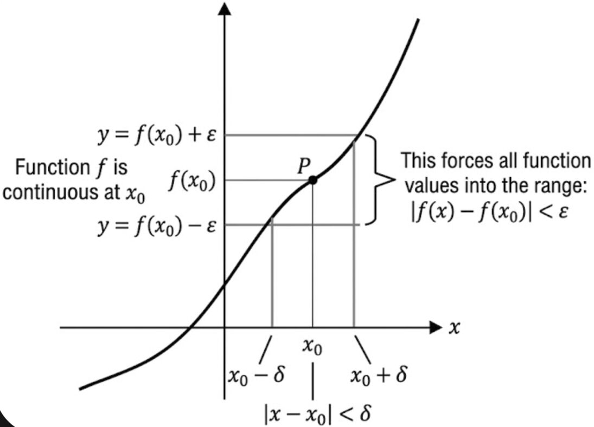
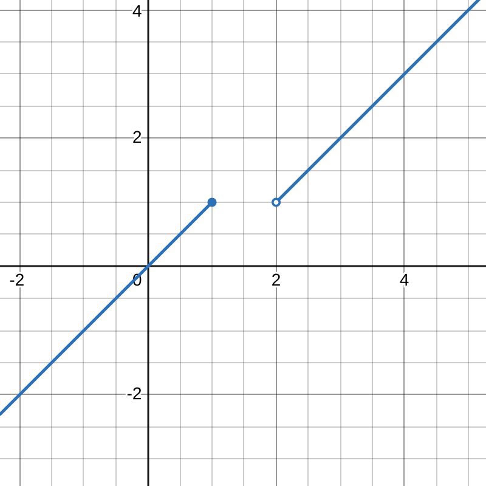

# Continuita'

**Definizione:** Dati $A \subseteq \mathbb{R}$, $x_0 \in A$ e $f: A \to \mathbb{R}$, si dice che $f$ e' **continua** in $x_0$ se:
$$\forall \varepsilon > 0, \exists \delta > 0 \text{ t.c. } \forall x \in A, |x - x_0| < \delta \implies |f(x) - f(x_0)| < \varepsilon$$

In termini di intorni:
- $|x - x_0| < \delta \iff x_0 - \delta < x < x_0 + \delta$
- $|f(x) - f(x_0)| < \varepsilon \iff f(x_0) - \varepsilon < f(x) < f(x_0) + \varepsilon$

### Esempio di funzione non continua
Sia $f: \mathbb{R} \to \mathbb{R}$ definita da:
$$f(x) = \begin{cases} 1 & \text{se } x \ge 0 \\ -1 & \text{se } x < 0 \end{cases}$$

Verifichiamo se $f$ e' continua in $x_0 = 0$:
- $f(x_0) = f(0) = 1$
- Scegliendo $\varepsilon = \frac{1}{2}$, l'intorno di $f(0)$ è $(1 - \frac{1}{2}, 1 + \frac{1}{2}) = (\frac{1}{2}, \frac{3}{2})$.
- Per valori negativi di $x$ (es. vicini a 0 da sinistra), $f(x) = -1$, il quale non cade nell'intervallo scelto. Di conseguenza, $f$ **non e' continua in $x_0 = 0$**.

---

### Continuita' in un insieme e proprieta'

**Definizione:** Data $f: A \to \mathbb{R}$ e $B \subseteq A$, si dice che $f$ e' continua in $B$ se e' continua in ogni punto $x_0 \in B$. 
*Nota:* Se diciamo semplicemente che " $f$ e' continua", si intende che e' continua in tutto il suo dominio $A$.

## Teorema della Permanenza del Segno
Siano $A \subseteq \mathbb{R}$, $f: A \to \mathbb{R}$, $x_0 \in A$. Se $f(x_0) > 0$, allora $\exists \delta > 0$ tale che per ogni $x \in A$ con $|x - x_0| < \delta$ si ha $f(x) > 0$ (vale anche se $f(x_0) < 0$).

In parole povere...  
> Se una funzione e' continua e in un punto ha un certo segno (positivo o negativo), lo mantiene anche subito intorno a quel punto. La continuita' impedisce cambi di segno repentini senza prima passare per lo zero.

#### Dimostrazione

Supponiamo $f(x_0) > 0$ e scegliamo $\varepsilon = \frac{f(x_0)}{2}$

$\implies \exists \delta > 0$ t.c. $|x - x_0| < \delta, x \in A \implies f(x_0) - \varepsilon < f(x) < f(x_0) + \varepsilon$  
perche' $f$ e' continua in $x_0$.

$$f(x) > f(x_0) - \varepsilon = f(x_0) - \frac{f(x_0)}{2} = \frac{f(x_0)}{2} > 0$$

Abbiamo supposto $f(x_0) > 0$ percio' anche $\frac{f(x_0)}{2}$ e' maggiore di zero (Se un numero e' strettamente positivo anche la sua mete'sara' necessariamente positiva). La dimostrazione chiaramente vale anche se si assume $f(x_0) < 0$.  

### Teorema sulle operazioni con funzioni continue
Se $f$ e $g$ sono continue in un punto $x_0$, allora sono continue in $x_0$ anche:
- La somma: $f + g$
- Il prodotto: $f \cdot g$
- Il valore assoluto: $|f|$
- Il quoziente: $\frac{f}{g}$ (purche' $g(x_0) \neq 0$)

## Continuita' della Funzione Inversa
Siano $I \subset \mathbb{R}$ un **intervallo** e $f: I \to B$ una funzione invertibile. Se $f$ e' continua in $I$, allora **anche la sua inversa $f^{-1}$ è continua** in $B$.

> Nota: L'importanza fondamentale dell'intervallo $I$

Il dominio deve essere necessariamente un intervallo. Se il dominio non e' un intervallo (ma un'unione di pezzi separati), la tesi potrebbe non valere.

**Esempio:**

Sia $f: (-\infty, 1] \cup (2, +\infty) \to \mathbb{R}$ definita a tratti come:
$$f(x) = \begin{cases} 
x & \text{se } x \le 1 \\ 
x - 1 & \text{se } x > 2 
\end{cases}$$

* **E' invertibile?** Sì.
* **E' continua?** Si, per la definizione di continuita' all'interno del suo dominio (nonostante la presenza dello "strappo" tra $1$ e $2$, quel buco non fa parte del dominio).

> Gli *"strappi"* orizzontali corrispondono a *"buchi"* nel dominio percio' non danno fastidio alla continuita'! 

---

## Continuita' delle funzioni elementari
- $f(x) = x$ e' continua (tutti i polinomi sono continui)
- Le funzioni razionali $f(x) = \frac{P(x)}{Q(x)}$ sono continue nel loro dominio
- $f(x) = \frac{1}{x}$ e' continua nel suo dominio $\mathbb{R} \setminus \{0\}$
- $e^x, \sin(x), \cos(x), \log(x), \arcsin(x), \arccos(x), \operatorname{tg}(x), \operatorname{arctg}(x)$ sono continue nei rispettivi domini

### Teorema di continuita' della funzione composta
Siano $f: A \to B$ e $g: B \to \mathbb{R}$, con $x_0 \in A$ e $y_0 = f(x_0) \in B$. 
Se $f$ e' continua in $x_0$ e $g$ e' continua in $y_0$, allora la funzione composta $(g \circ f)(x) = g(f(x))$ e' continua in $x_0$.

---

# Teoremi fondamentali delle funzioni continue

## Teorema degli Zeri
Se $f: [a, b] \to \mathbb{R}$ e' una funzione continua tale che $f(a) \cdot f(b) < 0$ (cioe' assume segni opposti agli estremi), allora esiste almeno un punto $c \in (a, b)$ tale che $f(c) = 0$.

## Teorema dei Valori Intermedi
Sia $I \subseteq \mathbb{R}$ un intervallo e $f: I \to \mathbb{R}$ una funzione continua, allora $f(I)$ e' un intervallo.

> **Significato:** Se $f$ assume i valori $y_1$ e $y_2$, allora assume tutti i valori compresi tra di essi. In particolare, *"se il dominio non ha buchi, anche il codominio non ha buchi!"*.

## Teorema di Weierstrass
Se $f: [a, b] \to \mathbb{R}$ e' una funzione continua su un intervallo chiuso e limitato, allora $f$ ammette **massimo e minimo assoluti** in tale intervallo.

---

## Intorni e punti di accumulazione

- **Intorno di un punto:** Dato $x_0 \in \mathbb{R}$ e $\varepsilon > 0$, l'intorno sferico e' l'insieme $(x_0 - \varepsilon, x_0 + \varepsilon)$. 
  - $[x_0, x_0 + \varepsilon)$ e' l'intorno destro.
  - $(x_0 - \varepsilon, x_0]$ e' l'intorno sinistro.
- **Intorno di $+\infty$:** E' un intervallo del tipo $(a, +\infty)$ con $a \in \mathbb{R}$.

**Definizione (Punto di Accumulazione):** Dato $A \subseteq \mathbb{R}$ e $x_0 \in \mathbb{R}$ (anche esteso), $x_0$ si dice **punto di accumulazione** per $A$ se in ogni intorno $V$ di $x_0$ cade almeno un punto di $A$ diverso da $x_0$:
$$V \cap A \setminus \{x_0\} \neq \varnothing$$
L'insieme dei punti di accumulazione si indica con $\operatorname{Acc}(A)$.

### Esempi:
1. $A = (2, 3) \implies \operatorname{Acc}(A) = [2, 3]$
2. $A = (3, +\infty) \implies \operatorname{Acc}(A) = [3, +\infty)$
3. $A = \mathbb{N}$ $\implies$ i punti isolati non sono di accumulazione. Per $\mathbb{N}$, l'unico punto di accumulazione al finito non esiste; l'unico punto di accumulazione e' $+\infty$, quindi $\operatorname{Acc}(\mathbb{N}) = \{+\infty\}$.