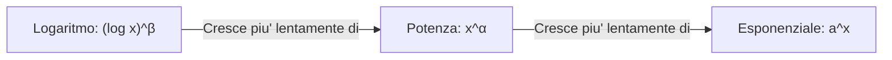

## Teorema dei Carabinieri

Siano $A \subseteq \mathbb{R}$, $x_0 \in \text{Acc}(A)$ e $f, g, h: A \to \mathbb{R}$.

Se esistono:  

$$\lim_{x \to x_0} f(x) = \lim_{x \to x_0} h(x) = l$$  

e se esiste un intorno $V$ di $x_0$ tale che:  

$$\forall x \in V \cap A \setminus \{x_0\} \implies f(x) \le g(x) \le h(x)$$  

allora esiste anche il limite di $g(x)$ ed e' pari a $l$:  

$$\lim_{x \to x_0} g(x) = l$$

### Esempio
$$\lim_{x \to +\infty} \frac{2 + \sin x}{x}$$

Sapendo che $-1 \le \sin x \le 1$, aggiungiamo $2$:
$$2 - 1 \le 2 + \sin x \le 2 + 1 \implies 1 \le 2 + \sin x \le 3$$

Dividendo per $x$ (con $x > 0$ dato che $x \to +\infty$):
$$0 \xleftarrow[x \to +\infty]{} \frac{1}{x} \le \frac{2 + \sin x}{x} \le \frac{3}{x} \xrightarrow[x \to +\infty]{} 0$$

Poiche' sia il limite inferiore che quello superiore tendono a $0$, per il Teorema dei Carabinieri:
$$\lim_{x \to +\infty} \frac{2 + \sin x}{x} = 0$$

> **Nota d'intuizione:** Anche se non conosco bene il comportamento oscillatorio della funzione al numeratore, posso metterla a confronto con due funzioni piu' semplici che conosco bene!

---

## Teorema sull'algebra dei limiti

Siano $A \subseteq \mathbb{R}$, $x_0 \in \text{Acc}(A)$ e $f, g: A \to \mathbb{R}$.  
Supponiamo che esistano:
$$\lim_{x \to x_0} f(x) = l_1 \quad \text{e} \quad \lim_{x \to x_0} g(x) = l_2 \quad (l_1, l_2 \in \overline{\mathbb{R}})$$

1. **Somma:** Se ha senso $l_1 + l_2$, allora:
   $$\exists \lim_{x \to x_0} (f + g)(x) = l_1 + l_2$$

2. **Prodotto:** Se ha senso $l_1 \cdot l_2$, allora:
   $$\exists \lim_{x \to x_0} (f \cdot g)(x) = l_1 \cdot l_2$$

> **Attenzione alle forme di indeterminatezza!**  
> Le operazioni valide valgono *a meno che non si tratti di una forma di indeterminatezza* (come $+\infty - \infty$ o $0 \cdot \infty$).
> 
> *Esempio:*  
> Se $f(x) = 2x \to +\infty$ e $g(x) = -x \to -\infty$, la somma $(f+g)(x) = 2x - x = x(2 -1)= x \to +\infty$  
> 
> Dire che $f(x) \to +\infty$ e $g(x) \to -\infty$ non basta per sapere quanto fa la loro somma. E' un'informazione incompleta. Per risolvere il limite, bisogna manipolare algebricamente la funzione per vedere quale delle due forze prevale sull'altra!

---

## Teorema sulla limitatezza locale

Sia $A \subseteq \mathbb{R}$, $x_0 \in \text{Acc}(A)$ e $f: A \to \mathbb{R}$.

Se esiste il limite finito:
$$\lim_{x \to x_0} f(x) = l \in \mathbb{R}$$

allora $f$ e' **limitata** in un intorno di $x_0$.

---

## Definizioni fondamentali di comportamento

- **Infinitesima:** Se $\lim_{x \to x_0} f(x) = 0$, si dice che $f$ e' *infinitesima* per $x \to x_0$ (cioe' converge a zero).
- **Divergente positivamente:** Se $\lim_{x \to x_0} f(x) = +\infty$, $f$ *diverge positivamente*.
- **Divergente negativamente:** Se $\lim_{x \to x_0} f(x) = -\infty$, $f$ *diverge negativamente*.
- **Convergente:** Se $\lim_{x \to x_0} f(x) = l \in \mathbb{R}$, $f$ *converge a $l$*.

---

## Proposizioni sulle funzioni limitate

### Somma con Funzione Limitata e Divergente
- Se $f$ e' **limitata inferiormente** in un intorno di $x_0$ e $\lim_{x \to x_0} g(x) = +\infty$:
  $$\lim_{x \to x_0} (f + g)(x) = +\infty$$

- Se $f$ e' **limitata superiormente** in un intorno di $x_0$ e $\lim_{x \to x_0} g(x) = -\infty$:
  $$\lim_{x \to x_0} (f + g)(x) = -\infty$$

> **Idea chiave:** Se una funzione e' limitata, non infastidisce la funzione dominante che va all'infinito!

### Prodotto di limitata per infinitesima
Se $f$ e' **limitata** in un intorno di $x_0$ e $g$ e' **infinitesima** per $x \to x_0$ ($\lim_{x \to x_0} g(x) = 0$):
$$\lim_{x \to x_0} (f \cdot g)(x) = 0$$

*Esempio:*
$$\lim_{x \to +\infty} \frac{\sin x}{x} = \lim_{x \to +\infty} \left( \sin x \cdot \frac{1}{x} \right) = 0$$
poiche' $\sin x$ e' una funzione limitata (tra $-1$ e $1$) e $\frac{1}{x} \to 0$.

### Limiti del reciproco
- Se $\lim_{x \to x_0} f(x) = 0^+ \implies \lim_{x \to x_0} \frac{1}{f(x)} = +\infty$
- Se $\lim_{x \to x_0} f(x) = 0^- \implies \lim_{x \to x_0} \frac{1}{f(x)} = -\infty$
- Se $\lim_{x \to x_0} f(x) = +\infty \implies \lim_{x \to x_0} \frac{1}{f(x)} = 0^+$
- Se $\lim_{x \to x_0} f(x) = -\infty \implies \lim_{x \to x_0} \frac{1}{f(x)} = 0^-$
- Se $\lim_{x \to x_0} f(x) = l \neq \pm\infty, 0 \implies \lim_{x \to x_0} \frac{1}{f(x)} = \frac{1}{l}$

---

## Proposizione per funzioni monotone

Siano $a, b \in \overline{\mathbb{R}}$ e $f: (a, b) \to \mathbb{R}$.

Se $f$ e' **strettamente crescente**, allora esistono sempre i due limiti agli estremi dell'intervallo:
$$\lim_{x \to b^-} f(x) = \sup(f) \quad \text{e} \quad \lim_{x \to a^+} f(x) = \inf(f)$$

> Se una funzione e' monotona, non puo' fare scherzi strani come oscillare all'infinito o saltare da una parte all'altra. Anche se l'intervallo e' infinito o la funzione non e' definita agli estremi, i limiti agli estremi esistono sempre e sono esattamente l'estremo superiore $\sup(f)$ e l'estremo inferiore $\inf(f)$.  

---

## Limiti fondamentali

### Potenze e Polinomi

$$\lim_{x \to +\infty} x = +\infty$$  

$$\lim_{x \to +\infty} x^n = \lim_{x \to +\infty} (x \cdot x \cdots x) = +\infty$$  

$$\lim_{x \to +\infty} \frac{1}{x} = \frac{1}{+\infty} = 0^+$$  

$$\lim_{x \to +\infty} \frac{1}{x^n} = 0^+ \quad (n \in \mathbb{N})$$  

Per i polinomi generici $P(x) = a_n x^n + a_{n-1} x^{n-1} + \dots + a_1 x + a_0$:  

$$\lim_{x \to \pm\infty} P(x) = \lim_{x \to \pm\infty} a_n x^n$$  

*(Comanda il termine di grado massimo!)*

*Esempio:*
$$\lim_{x \to +\infty} (3x^2 - 7x + 1) \quad \text{[Forma indeterminata } +\infty - \infty\text{]}$$
Raccogliendo il termine di grado massimo:
$$3x^2 - 7x + 1 = x^2 \left(3 - \frac{7}{x} + \frac{1}{x^2}\right) \xrightarrow[x \to +\infty]{} +\infty \cdot (3 - 0 + 0) = +\infty$$

### Funzioni Razionali Fratte
Per $x \to \pm\infty$, conta solo il rapporto tra i termini di grado massimo:
$$\lim_{x \to \pm\infty} \frac{P(x)}{Q(x)} = \lim_{x \to \pm\infty} \frac{a_n x^n + a_{n-1} x^{n-1} + \dots}{b_m x^m + b_{m-1} x^{m-1} + \dots} = \lim_{x \to \pm\infty} \frac{a_n x^n}{b_m x^m}$$

*Esempio:*
$$\lim_{x \to +\infty} \frac{7x^4 + 5x^2}{-2x^3 + x} = \lim_{x \to +\infty} \frac{7x^4}{-2x^3} = \lim_{x \to +\infty} \frac{7x}{-2} = -\infty$$

### Esponenziali e Logaritmi

$$\lim_{x \to +\infty} e^x = +\infty$$  

$$\lim_{x \to -\infty} e^x = 0^+$$  

$$\lim_{x \to +\infty} \log x = +\infty$$  

$$\lim_{x \to 0^+} \log x = -\infty$$  

---

## Limiti Notevoli

1. **Seno:** (l'intuizione e' che quando $x$ e' molto piccola $\sin x \approx x$)
   $$\lim_{x \to 0} \frac{\sin x}{x} = 1$$

2. **Coseno:**
   $$\lim_{x \to 0} \frac{1 - \cos x}{x^2} = \frac{1}{2}$$

   *Dimostrazione:*
   $$\frac{1 - \cos x}{x^2} = \frac{(1 - \cos x)(1 + \cos x)}{x^2 (1 + \cos x)} = \frac{1 - \cos^2 x}{x^2 (1 + \cos x)} = \frac{\sin^2 x}{x^2 (1 + \cos x)}$$
   $$= \underbrace{\frac{\sin x}{x}}_{\to 1} \cdot \underbrace{\frac{\sin x}{x}}_{\to 1} \cdot \underbrace{\frac{1}{1 + \cos x}}_{\to \frac{1}{2}} = 1 \cdot 1 \cdot \frac{1}{2} = \frac{1}{2}$$

3. **Espponenziale:**
   $$\lim_{x \to 0} \frac{e^x - 1}{x} = 1$$

4. **Logaritmo:**
   $$\lim_{x \to 0} \frac{\log(1 + x)}{x} = 1$$

---

## Limite della composizione di funzioni

Siano $A, B \subseteq \mathbb{R}$, $f: A \to B$, $g: B \to \mathbb{R}$, $x_0 \in \text{Acc}(A)$.

Se esiste...  

$$\lim_{x \to x_0} f(x) = y_0\qquad y_0 \in \text{Acc}(B)$$  

...e se esiste...  

$$\lim_{y \to y_0} g(y)$$  

...ed e' verificata almeno una delle seguenti **ipotesi**:
1. $y_0 \in B$ e $g$ e' **continua** in $y_0$
2. $y_0 \notin B$ (oppure $f(x) \neq y_0$ definitivamente per $x \to x_0$)

Allora:
$$\lim_{x \to x_0} (g \circ f)(x) = \lim_{y \to y_0} g(y)$$

> **Operativamente:** Posto $y = f(x)$, quando $x \to x_0 \implies y \to y_0$:
> $$\lim_{x \to x_0} (g \circ f)(x) = \lim_{x \to x_0} g(f(x)) = \lim_{y \to y_0} g(y)$$

*Esempio:*
$$\lim_{x \to 0} \log\left(\frac{\sin x}{x}\right)$$
Poniamo $y = \frac{\sin x}{x}$. Quando $x \to 0$, sappiamo che $y \to 1$.  
Di conseguenza:
$$\lim_{y \to 1} \log(y) = \log(1) = 0$$

---

## Comportamento di $a^x$ e $x^\alpha$

### Limiti per l'esponenziale $a^x$
- **Per $x \to +\infty$:**
  $$\lim_{x \to +\infty} a^x = \begin{cases} +\infty & \text{se } a > 1 \\ 1 & \text{se } a = 1 \\ 0^+ & \text{se } 0 < a < 1 \end{cases}$$

- **Per $x \to -\infty$:**
  $$\lim_{x \to -\infty} a^x = \begin{cases} 0^+ & \text{se } a > 1 \\ 1 & \text{se } a = 1 \\ +\infty & \text{se } 0 < a < 1 \end{cases}$$

### Limiti per la potenza $x^\alpha$ ($\alpha \in \mathbb{R}$)
- **Per $x \to +\infty$:**
  $$\lim_{x \to +\infty} x^\alpha = \begin{cases} +\infty & \text{se } \alpha > 0 \\ 1 & \text{se } \alpha = 0 \\ 0^+ & \text{se } \alpha < 0 \end{cases}$$
  *(Esempio: $x^{-2} = \frac{1}{x^2} \to 0^+$ per $x \to +\infty$)*

---

## Confronto tra infiniti (gerarchia degli infiniti)

Per $x \to +\infty$, le funzioni crescono a velocita' molto diverse.

### Esponenziale vs Potenza
$$\lim_{x \to +\infty} \frac{a^x}{x^\alpha} = \begin{cases} +\infty & \text{se } a > 1 \\ 0 & \text{se } 0 < a < 1 \end{cases}$$

> **Regola pratica:** L'esponenziale (con base $a > 1$) "si mangia" qualsiasi potenza, per quanto grande sia l'esponente $\alpha$!

*Esempi:*

$$\lim_{x \to +\infty} \frac{2^x}{x^{50}} = +\infty$$  

$$\lim_{x \to +\infty} \frac{(1/2)^x}{x^{-20}} = \lim_{x \to +\infty} \frac{x^{20}}{2^x} = \lim_{x \to +\infty} \frac{1}{\left(\frac{2^x}{x^{20}}\right)} = \frac{1}{+\infty} = 0^+$$  

### Logaritmo vs Potenza
Per mostrare...  

$$\lim_{x \to +\infty} \frac{\log x}{x} = 0$$  

...sostituiamo $y = \log x \implies x = e^y$.  
Se $x \to +\infty \implies y \to +\infty$:  

$$\lim_{x \to +\infty} \frac{\log x}{x} = \lim_{y \to +\infty} \frac{y}{e^y} = 0$$  

Generalizzando per parametri $\alpha, \beta > 0$:  

$$\lim_{x \to +\infty} \frac{(\log x)^\beta}{x^\alpha} = 0$$  

*Dimostrazione con cambio di variabile ($y = \log x$):*  

$$\lim_{x \to +\infty} \frac{(\log x)^\beta}{x^\alpha} = \lim_{y \to +\infty} \frac{y^\beta}{(e^y)^\alpha} = \lim_{y \to +\infty} \frac{y^\beta}{e^{\alpha y}} = 0$$  

### Gerarchia finale degli infiniti
Per $x \to +\infty$ (con $\alpha, \beta > 0$ e $a > 1$):  

$$(\log x)^\beta \ll x^\alpha \ll a^x$$  

