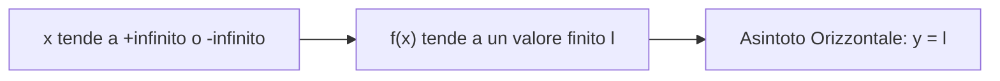
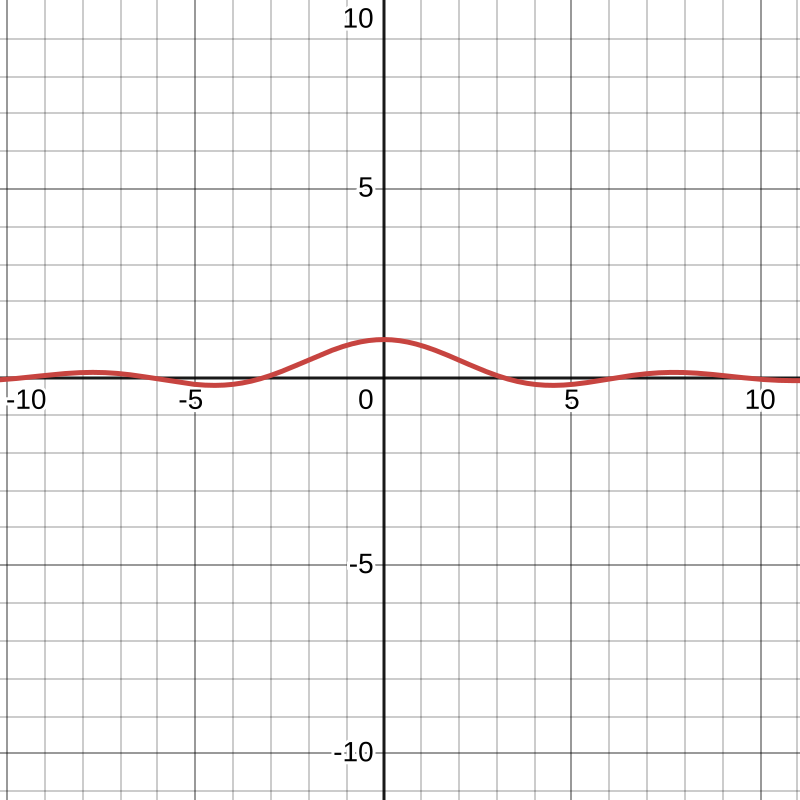
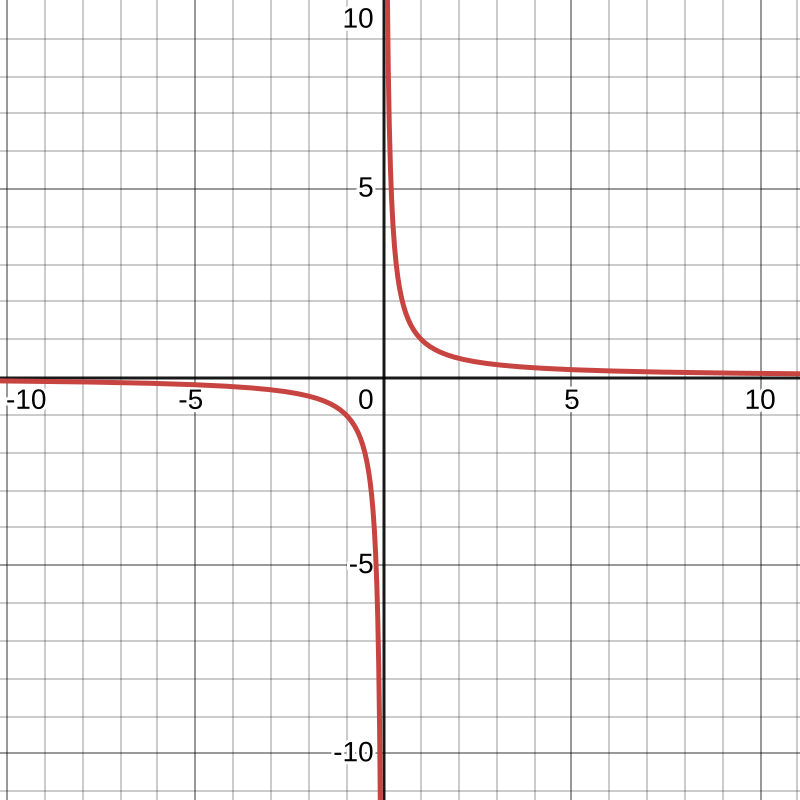
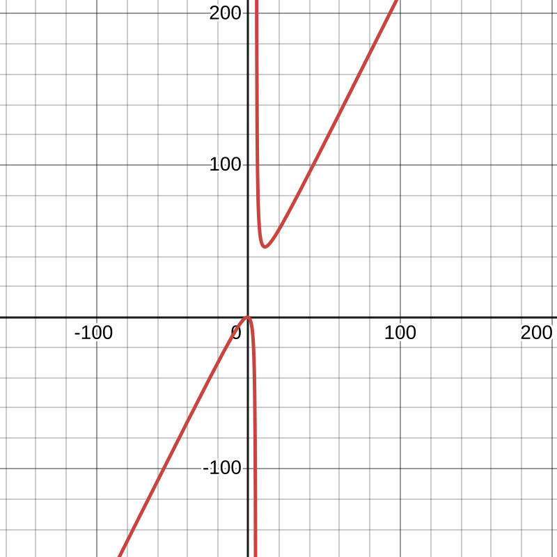
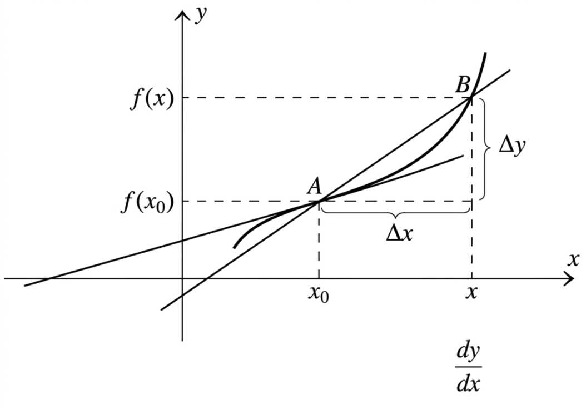
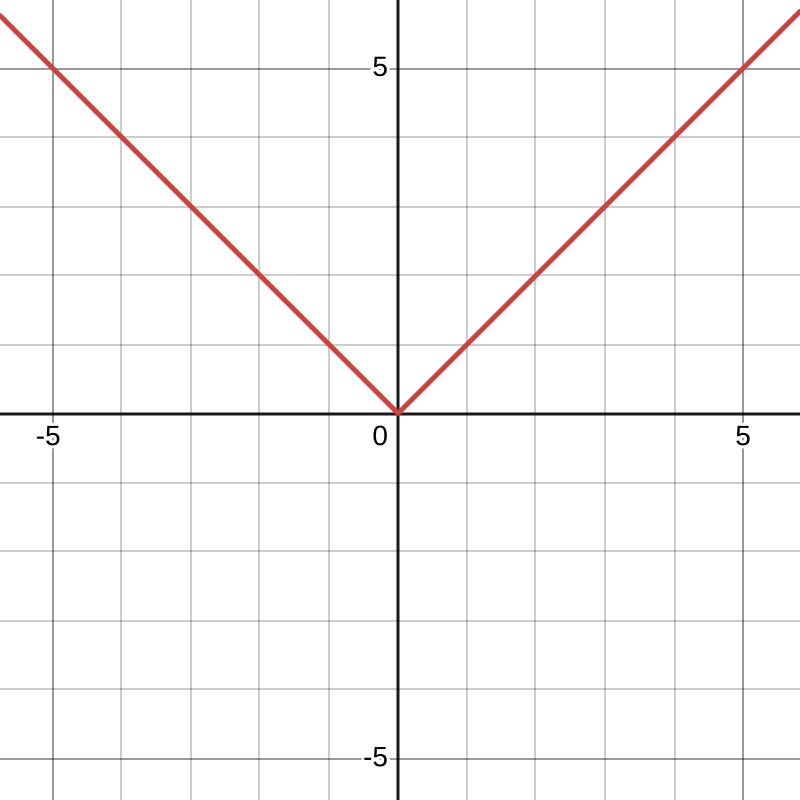
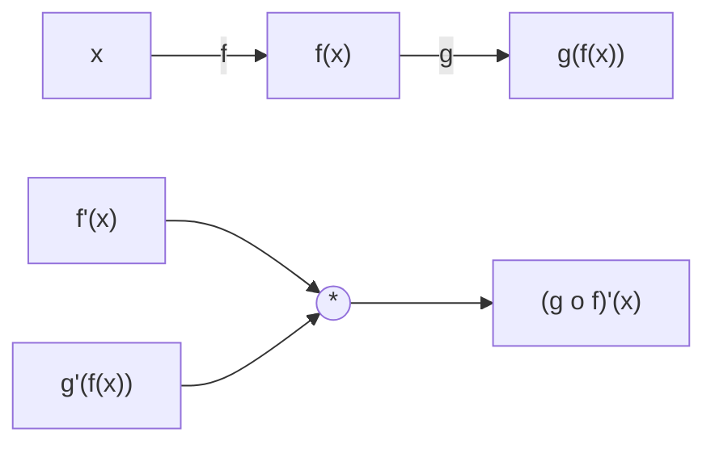

# Asintoti orizzontali

Data una funzione $f: (a, +\infty) \to \mathbb{R}$, se esiste il limite:  

$$ \lim_{x \to +\infty} f(x) = l \in \mathbb{R} $$  

si dice che $f$ ha un **asintoto orizzontale** di equazione $y = l$ per $x \to +\infty$.

Il discorso e' del tutto analogo per $x \to -\infty$.

  

### Esempi

*   $\lim_{x \to +\infty} \frac{\sin x}{x} = 0 \implies y = 0$ e' asintoto orizzontale per $x \to +\infty$.
*   $\lim_{x \to -\infty} e^x = 0 \implies y = 0$ e' asintoto orizzontale per $x \to -\infty$.
*   $\lim_{x \to +\infty} \arctan x = \frac{\pi}{2}$ e $\lim_{x \to -\infty} \arctan x = -\frac{\pi}{2} \implies y = \frac{\pi}{2}$ e $y = -\frac{\pi}{2}$ sono asintoti orizzontali.

---

# Asintoti verticali

Sia $A \subset \mathbb{R}$, $x_0 \in \text{Acc}(A)$, $x_0 \in \mathbb{R}$ e $f: A \to \mathbb{R}$.

Se $f$ diverge per $x \to x_0$ da destra o da sinistra (o da entrambe le parti), cioe':  

$$ \lim_{x \to x_0^\pm} f(x) = \pm\infty $$  

si dice che $f$ ha un **asintoto verticale** di equazione $x = x_0$.

### Esempi e osservazioni

*   $f(x) = \frac{1}{x}$:  
    $$ \lim_{x \to 0^+} \frac{1}{x} = +\infty, \quad \lim_{x \to 0^-} \frac{1}{x} = -\infty \implies x = 0 \text{ e' asintoto verticale.} $$  
*   Una funzione puo' avere **infiniti asintoti verticali**. Non c'e' problema di unicita' del limite come negli asintoti orizzontali.
*   $f(x) = \tan x$: ha infiniti asintoti verticali nelle rette $x = \frac{\pi}{2} + k\pi$ con $k \in \mathbb{Z}$.

---

# Asintoto obliquo

Sia $f: (a, +\infty) \to \mathbb{R}$. Se esistono i seguenti limiti:

1.  $\lim_{x \to +\infty}\ \frac{f(x)}{x} = m \in \mathbb{R} \quad (\text{con } m \neq 0)$
2.  $\lim_{x \to +\infty}\ f(x) - mx = q \in \mathbb{R}$

Allora si dice che $f$ ha un **asintoto obliquo** di equazione $y = mx + q$ per $x \to +\infty$ (analogo per $x \to -\infty$).

### Esempi

1.  $f(x) = \frac{2x^2 + 3x + 2}{x - 5}$:
    *   $m = \lim_{x \to +\infty} \frac{f(x)}{x} = \lim_{x \to +\infty} \frac{2x^2 + 3x + 2}{x^2 - 5x} = 2$
    *   $q = \lim_{x \to +\infty} [f(x) - 2x] = \lim_{x \to +\infty} \left( \frac{2x^2 + 3x + 2 - 2x^2 + 10x}{x - 5} \right) = \lim_{x \to +\infty} \frac{13x + 2}{x - 5} = 13$
    *   Ha asintoto obliquo $y = 2x + 13$ per $x \to +\infty$.

2.  $f(x) = 3x + \log x$:
    *   $m = \lim_{x \to +\infty} \frac{3x + \log x}{x} = 3 + \lim_{x \to +\infty} \frac{\log x}{x} = 3 + 0 = 3$
    *   $q = \lim_{x \to +\infty} [f(x) - 3x] = \lim_{x \to +\infty} \log x = +\infty$
    *   **Non c'e' asintoto obliquo** perche' $q$ non e' finito.

---

# Derivate

Sia $A \subset \mathbb{R}$, $f: A \to \mathbb{R}$, $x_0 \in \text{Acc}(A) \cap A$.

Se esiste il limite del rapporto incrementale:  

$$ \lim_{x \to x_0} \frac{f(x) - f(x_0)}{x - x_0} = l $$  

allora $l$ si dice **derivata di $f$ in $x_0$**.

*   Se $l$ e' finito ($l \in \mathbb{R}$), allora $f$ si dice **derivabile in $x_0$**.
*   Notazioni per la derivata: $f'(x_0)$, $Df(x_0)$, $\frac{df}{dx}(x_0)$.

Interpretazione geometrica del rapporto incrementale:  

$$ \frac{f(x) - f(x_0)}{x - x_0} = \frac{\Delta y}{\Delta x} $$  

### Esempio di non derivabilita'

Sia $f(x) = \sqrt{x}$ definita su $f: [0, +\infty) \to \mathbb{R}$, consideriamo $x_0 = 0$:

$$ \lim_{x \to 0^+} \frac{f(x) - f(0)}{x - 0} = \lim_{x \to 0^+} \frac{\sqrt{x} - 0}{x - 0} = \lim_{x \to 0^+} \frac{\sqrt{x}}{x} = \lim_{x \to 0^+} \frac{1}{\sqrt{x}} = +\infty $$  

In questo caso $f'(0) = +\infty$: la funzione non e' derivabile in $0$ (in senso stretto, poiche' la derivata non e' un numero finito), ma ammette derivata infinita.

---

# Teorema: derivabilita' e continuita'

**Teorema:** Se $f$ e' derivabile in $x_0$, allora $f$ e' continua in $x_0$.

### Dimostrazione

$$ \lim_{x \to x_0} f(x) = \lim_{x \to x_0} [f(x) - f(x_0) + f(x_0)] $$  

$$ = \lim_{x \to x_0} \left( \frac{f(x) - f(x_0)}{x - x_0} \cdot (x - x_0) \right) + f(x_0) $$  

$$ = \left( \lim_{x \to x_0} \frac{f(x) - f(x_0)}{x - x_0} \right) \cdot \left( \lim_{x \to x_0} (x - x_0) \right) + f(x_0) $$  

$$ = f'(x_0) \cdot 0 + f(x_0) = f(x_0) $$  

Poiche' $\lim_{x \to x_0} f(x) = f(x_0)$, la funzione $f$ e' continua in $x_0$.

> In parole povere: se una funzione ha una pendenza ben definita (e' derivabile), per fare un piccolissimo passo in avanti lungo la curva non puo' fare *"salti nel vuoto"*, quindi la funzione e' necessariamente continua.

---

# Derivata destra, sinistra e punti di non derivabilita'

Se consideriamo i limiti da destra e da sinistra del rapporto incrementale:

*   **Derivata destra:** $f'_+(x_0) = \lim_{x \to x_0^+} \frac{f(x) - f(x_0)}{x - x_0}$
*   **Derivata sinistra:** $f'_-(x_0) = \lim_{x \to x_0^-} \frac{f(x) - f(x_0)}{x - x_0}$

**Osservazione:** Esiste $f'(x_0) \iff \exists f'_+(x_0) \text{ e } f'_-(x_0) \text{ e } f'_+(x_0) = f'_-(x_0)$.

### Esempio: $f(x) = |x|$ in $x_0 = 0$  

$$ \lim_{x \to 0} \frac{|x| - 0}{x - 0} = \lim_{x \to 0} \frac{|x|}{x} $$  

*   $\lim_{x \to 0^+} \frac{x}{x} = 1 \implies f'_+(0) = 1$
*   $\lim_{x \to 0^-} \frac{-x}{x} = -1 \implies f'_-(0) = -1$

Poiche' $f'_+(0) \neq f'_-(0)$, il limite non esiste e $f$ non e' derivabile in $0$.

### Punti singolari (non derivabilita')

*   **Punto angoloso:** Se esistono $f'_+(x_0)$ e $f'_-(x_0)$ entrambe finite, ma $f'_+(x_0) \neq f'_-(x_0)$.
*   **Punto di cuspide:** Se $f$ e' continua in $x_0$ e $f'_+(x_0) = +\infty$ e $f'_-(x_0) = -\infty$ (o viceversa).
    *   *Esempio:* $f(x) = \sqrt{|x|}$ ha una cuspide in $x_0 = 0$, poiche' $f'_+(0) = +\infty$ e $f'_-(0) = -\infty$.

---

# Approssimazione lineare e retta tangente

Supponiamo $f$ derivabile in $x_0$:  

$$ \lim_{x \to x_0} \frac{f(x) - f(x_0)}{x - x_0} = f'(x_0) \iff \lim_{x \to x_0} \left( \frac{f(x) - f(x_0)}{x - x_0} - f'(x_0) \right) = 0 $$  

$$ \iff \lim_{x \to x_0} \frac{f(x) - f(x_0) - f'(x_0)(x - x_0)}{x - x_0} = 0 $$  

$$ \iff f(x) - f(x_0) - f'(x_0)(x - x_0) = o(x - x_0) $$  

Otteniamo cosi' lo sviluppo del primo ordine:  

$$ f(x) = f(x_0) + f'(x_0)(x - x_0) + o(x - x_0) $$  

L'equazione della **retta tangente** al grafico di $f$ nel punto $(x_0, f(x_0))$ e':  

$$ y = f(x_0) + f'(x_0)(x - x_0) $$  

---

# Funzione derivata e derivate successive

Sia $f: A \to \mathbb{R}$. Se $f$ e' derivabile in ogni $x \in A$, possiamo definire la **funzione derivata**:  

$$ f': A \to \mathbb{R} $$  

*   Se $f'$ e' a sua volta derivabile, possiamo costruire la sua derivata $(f')'(x) = f''(x)$, detta **derivata seconda** di $f$.
*   In generale, iterando il processo $n$ volte, indichiamo con $f^{(n)}(x)$ la **derivata $n$-esima**:  

$$ f^{(n)}(x) = \left( f^{(n-1)} \right)'(x) $$  

*   *Convenzione:* $f^{(0)} = f$. Per le prime derivate si usa la notazione con apici: $f', f'', f''', f^{(4)}, \dots$

### Classi di funzioni

*   **Classe $C^n$:** $f$ e' derivabile $n$ volte e $f^{(n)}$ e' continua.
*   **Classe $C^\infty$:** $f$ e' derivabile infinite volte.

---

# Regole di derivazione

Se $f$ e $g$ sono funzioni derivabili in $x_0$:

1.  $(f + g)'(x_0) = f'(x_0) + g'(x_0)$
2.  $(f · g)'(x_0) = f'(x_0)g(x_0) + f(x_0)g'(x_0)$
3.  Se $f(x_0) \neq 0$: **$\left(\frac{1}{f}\right)'(x_0)$** = $-\frac{f'(x_0)}{f(x_0)^2}$
4.  Dalle regole (2) e (3) deriva il **rapporto**:  
    $$ \left( \frac{f}{g} \right)' = \frac{f'g - fg'}{g^2} $$  

---

# Derivate fondamentali e proprieta'

| Funzione $f(x)$ | Derivata $f'(x)$ | Note / Proprietà |
| :--- | :--- | :--- |
| $x$ | $1$ | Derivata dell'identita' |
| $k$ (costante) | $0$ | Derivata di una costante |
| $x^2$ | $2x$ | Dimostrato via prodotto: $(x \cdot x)' = 1 \cdot x + x \cdot 1 = 2x$ |
| $x^3$ | $3x^2$ | Dimostrato via prodotto: $(x^2 \cdot x)' = 2x \cdot x + x^2 \cdot 1 = 3x^2$ |
| $x^n$ | $n x^{n-1}$ | **Regola generale delle potenze** (es. $(x^7)' = 7x^6$) |
| $(f(x)\cdot k)'$ | $k \cdot f'(x)$ | Moltiplicazione per una costante |
| $(f(x) + k)'$ | $f'(x)$ | Traslazione verticale (la costante sparisce) |
| $e^x$ | $e^x$ | Funzione esponenziale |
| $(\sin x)'$ | $\cos x$ | Derivata del seno |
| $(\cos x)'$ | $-\sin x$ | Derivata del coseno |

### Esempio di periodicita' delle derivate di $\sin x$

*   $f(x) = \sin x$
*   $f'(x) = \cos x$
*   $f''(x) = (\cos x)' = -\sin x$
*   $f'''(x) = (-\sin x)' = -\cos x$
*   $f^{(4)}(x) = (-\cos x)' = \sin x = f(x)$
*   Di conseguenza: $f^{(8)}(x) = f'(x) = \cos x$ ... e cosi via ciclicamente.

### Derivata della tangente  

$$ (\tan x)' = \left( \frac{\sin x}{\cos x} \right)' = \frac{(\sin x)' \cos x - \sin x (\cos x)'}{\cos^2 x} = \frac{\cos^2 x + \sin^2 x}{\cos^2 x} $$  

Questa espressione si puo' scrivere in due modi equivalenti:

1.  $(\tan x)' = \frac{1}{\cos^2 x}$
2.  $(\tan x)' = \frac{\cos^2 x}{\cos^2 x} + \frac{\sin^2 x}{\cos^2 x} = 1 + \tan^2 x$

---

# Derivata della funzione inversa

Sia $f: (a,b) \to \mathbb{R}$ strettamente crescente (o decrescente). Se $f$ e' derivabile in $x_0$ e $f'(x_0) \neq 0$, allora $f^{-1}$ e' derivabile in $y_0 = f(x_0)$ e vale:  

$$ (f^{-1})'(y_0) = \frac{1}{f'(x_0)} = \frac{1}{f'(f^{-1}(y_0))} $$  

### Esempio: Derivata del logaritmo

Sia $f(x) = e^x$, da cui $y = e^x \iff x = \log y$. La funzione inversa e' $f^{-1}(y) = \log y$.

> **Nota:** in questo corso $\log x = \log_e = \ln x$  

$$ (f^{-1})'(y) = (\log y)' = \frac{1}{f'(f^{-1}(y))} = \frac{1}{e^{\log y}} = \frac{1}{y} $$  

In generale: **$(\log x)' = \frac{1}{x}$**.

---

# Derivata della funzione composta (Chain Rule)

Se $f$ e' derivabile in $x_0$ e $g$ e' derivabile in $y_0 = f(x_0)$, allora la funzione composta $(g \circ f)$ e' derivabile in $x_0$ e la sua derivata e':  

$$ (g \circ f)'(x_0) = g'(f(x_0)) \cdot f'(x_0) $$  

### Esempi

*   $\left( \sin(x^2) \right)' = \cos(x^2) \cdot 2x$
*   $\left( (\sin x)^2 \right)' = 2 \sin x \cdot \cos x$
*   $(\arctan x)' = \frac{1}{1 + x^2} \iff 1 + \tan^2 x$

---

# Approssimazione notevole al primo ordine

Per $x \to 0$ e $\alpha \in \mathbb{R}$:  

$$ (1 + x)^\alpha = 1 + \alpha x + o(x) $$  

### Esempio  

$$ \sqrt[3]{1 + x} = (1 + x)^{\frac{1}{3}} = 1 + \frac{1}{3}x + o(x) \quad \text{per } x \to 0 $$  

> Questo metodo ci permette di semplificare il calcolo di funzioni complesse (come potenze e radici) quando $x$ e' un numero piccolissimo vicino a zero. Invece di calcolare valori difficili, sostituiamo la curva della funzione con la sua retta tangente ($1 + \alpha x$), commettendo un errore trascurabile indicato con il simbolo $o(x)$. In questo modo, operazioni complesse come fare la radice cubica di un numero vicino a $1$ si riducono a una semplice e rapida moltiplicazione.
