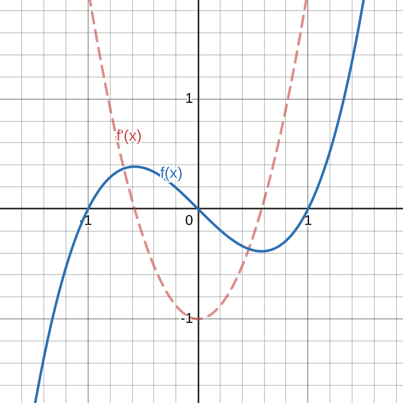

# Teorema di Fermat

Siano $A \subseteq \mathbb{R}$, $f: A \to \mathbb{R}$ e $x_0 \in \text{int}(A)$ ($x_0$ punto interno di $A$).

Se $x_0$ e' un punto di massimo o minimo locale per $f$ e se $f$ e' derivabile in $x_0$, allora:

$$f'(x_0) = 0$$

### Dimostrazione

Se $f$ e' derivabile in $x_0$, allora la derivata destra e la derivata sinistra coincidono:

$$f'_+(x_0) = f'_-(x_0)$$

Supponiamo che $x_0$ sia un punto di minimo locale. Cio' significa che $f(x) \ge f(x_0)$ in un intorno di $x_0$.

Analizziamo il limite del rapporto incrementale da destra e da sinistra:

1. **Derivata destra:** Per $x \to x_0^+$, si ha $x - x_0 > 0$ e $f(x) - f(x_0) \ge 0$. Pertanto:

$$f'_+(x_0) = \lim_{x \to x_0^+} \frac{f(x) - f(x_0)}{x - x_0} \ge 0 \implies f'_+(x_0) \ge 0$$

2. **Derivata sinistra:** Per $x \to x_0^-$, si ha $x - x_0 < 0$ e $f(x) - f(x_0) \ge 0$. Pertanto:

$$f'_-(x_0) = \lim_{x \to x_0^-} \frac{f(x) - f(x_0)}{x - x_0} \le 0 \implies f'_-(x_0) \le 0$$

Poiche' $f$ e' derivabile in $x_0$, dev'essere $f'_+(x_0) = f'_-(x_0)$. L'unica possibilita' affinche' un numero sia contemporaneamente $\ge 0$ e $\le 0$ e' che sia nullo, allora:

$$f'(x_0) = 0$$

### Controesempio e chiarimento sui punti di bordo

Il teorema vale **solo per i punti interni**! Ai bordi del dominio la derivata potrebbe essere diversa da zero. Troveremmo allora che $x_0$ e' punto di minimo e che $f$ e' derivabile ma $f'(x_0) \neq 0$: 

**Esempio:**
Sia $f(x) = x^2$ con $f: [2, 3] \to \mathbb{R}$.
- $f'(x) = 2x$
- $x_0 = 2$ e' punto di minimo locale, con $\min f = 4$, ma $f'(2) = 4 \neq 0$.
- $x_1 = 3$ e' punto di massimo locale, con $\max f = 9$, ma $f'(3) = 6 \neq 0$.

### Osservazione

>L'annullarsi della derivata prima $f'(x_0) = 0$ e' una **condizione necessaria** per un punto di massimo o minimo locale per una funzione derivabile in un punto interno, **ma non e' sufficiente**.

**Controesempi:**

1. **Punto stazionario non di estremo:**
   $f(x) = x^3$, $f'(x) = 3x^2$. 
   Per $x_0 = 0$, $f'(0) = 0$, ma $x_0 = 0$ non e' ne' punto di massimo ne' di minimo.

2. **Punti di estremo non derivabili (punti angolosi / cuspidi):**
   - $f(x) = |x|$: $x_0 = 0$ e' punto di minimo assoluto, ma $f'(0)$ non esiste.
   - $f(x) = \sqrt{|x|}$: $x_0 = 0$ e' punto di minimo assoluto, ma $f'(0)$ non esiste.

---

# Teorema di Rolle

Sia $f: [a, b] \to \mathbb{R}$ una funzione continua in $[a, b]$ e derivabile in $(a, b)$. Se $f(a) = f(b)$, allora:

$$\exists \, c \in (a, b) \quad \text{t.c.} \quad f'(c) = 0$$

### Dimostrazione

Per il **Teorema di Weierstrass**, poiche' $f$ e' continua sull'intervallo $[a, b]$, essa ammette massimo e minimo assoluti. Siano $x_1, x_2 \in [a, b]$ tali che:

$$f(x_1) = \min(f), \quad f(x_2) = \max(f)$$

Si distinguono due casi:

- **Caso 1:** Almeno uno tra $x_1$ e $x_2$ e' interno all'intervallo $(a, b)$.
  Per il Teorema di Fermat, la derivata in tale punto interno si annulla:
  $$f'(x_1) = 0 \quad \text{oppure} \quad f'(x_2) = 0$$

- **Caso 2:** Sia $x_1$ che $x_2$ sono gli estremi dell'intervallo (ossia $\{x_1, x_2\} = \{a, b\}$).
  Poiche' per ipotesi $f(a) = f(b)$, ne consegue che $\max(f) = \min(f)$.
  Quindi la funzione e' costante su tutto $[a, b]$, il che implica:
  $$f'(x) = 0 \quad \forall x \in (a, b)$$

---

## Teorema di Lagrange

Sia $f: [a, b] \to \mathbb{R}$ continua in $[a, b]$ e derivabile in $(a, b)$. Allora:

$$\exists \, c \in (a, b) \quad \text{t.c.} \quad f'(c) = \frac{f(b) - f(a)}{b - a}$$

### Dimostrazione

Consideriamo la retta secante passante per i punti $(a, f(a))$ e $(b, f(b))$ del grafico:

$$r(x) = f(a) + \frac{f(b) - f(a)}{b - a}(x - a)$$  

> Ovvero la retta che unisce gli estremi del grafico.

Definiamo la funzione ausiliaria $g(x) = f(x) - r(x)$, che rappresenta la "distanza con segno" verticale tra la curva $y = f(x)$ e la retta secante $y = r(x)$:

$$g(x) = f(x) - f(a) - \frac{f(b) - f(a)}{b - a}(x - a)$$

La funzione $g$ e' continua in $[a, b]$ e derivabile in $(a, b)$. Verifichiamo i valori agli estremi:
- $g(a) = f(a) - r(a) = f(a) - f(a) = 0$
- $g(b) = f(b) - r(b) = f(b) - f(b) = 0$

Poiche' $g(a) = g(b) = 0$, possiamo applicare il **Teorema di Rolle** a $g(x)$ nell'intervallo $[a, b]$:

$$\exists \, c \in (a, b) \quad \text{t.c.} \quad g'(c) = 0$$

Calcoliamo la derivata di $g(x)$:

$$g'(x) = f'(x) - r'(x) = f'(x) - \frac{f(b) - f(a)}{b - a}$$

Valutandola in $c$:

$$0 = g'(c) = f'(c) - \frac{f(b) - f(a)}{b - a} \implies 0 = f'(c) - \frac{f(b) - f(a)}{b - a} \implies f'(c) = \frac{f(b) - f(a)}{b - a}$$  

> Derivando $g(x)$ scopriamo che la pendenza della curva nel punto $c$ ovvero $f'(c)$, deve essere esattamente uguale alla pendenza della retta secante gli estremi.

---

## Derivata e monotonia

### Proposizione (Monotonia debole)

Sia $f: A \to \mathbb{R}$ una funzione debolmente crescente. Se esiste $f'(x_0)$ per $x_0 \in A$, allora:

$$f'(x_0) \ge 0$$

**Dimostrazione:**

$$f'(x_0) = \lim_{x \to x_0} \frac{f(x) - f(x_0)}{x - x_0}$$

Poiche' $f$ e' crescente, il numeratore $f(x) - f(x_0)$ e il denominatore $x - x_0$ hanno sempre lo stesso segno, quindi il rapporto incrementale e' sempre $\ge 0$. Per la permanenza del segno nei limiti, anche il limite e' $\ge 0$.

*(Analogamente, se $f$ e' debolmente decrescente, allora $f'(x_0) \le 0$).*

### Osservazione sulla stretta monotonia

Se $f$ e' **strettamente crescente**, non e' detto che sia $f'(x_0) > 0$. Puo' accadere che la derivata si annulli in singoli punti.

**Esempio:**
$f(x) = x^3$ e' strettamente crescente su tutto $\mathbb{R}$, ma $f'(0) = 0$.

---

### Teorema (Caratterizzazione della monotonia su intervalli)

Sia $I \subseteq \mathbb{R}$ un **intervallo**, $f: I \to \mathbb{R}$ continua in $I$ e derivabile nei punti interni $\mathring{I}$.

Allora valgono i seguenti legami:

1. $f'(x) = 0 \quad \forall x \in \mathring{I} \iff f \text{ e' costante in } I$
2. $f'(x) \ge 0 \quad \forall x \in \mathring{I} \iff f \text{ e' debolmente crescente in } I$
3. $f'(x) \le 0 \quad \forall x \in \mathring{I} \iff f \text{ e' debolmente decrescente in } I$
4. $f'(x) > 0 \quad \forall x \in \mathring{I} \implies f \text{ e' strettamente crescente in } I$
5. $f'(x) < 0 \quad \forall x \in \mathring{I} \implies f \text{ e' strettamente decrescente in } I$

### Dimostrazione (Caso 4)

Siano $x_1, x_2 \in I$ con $x_1 < x_2$.
Applichiamo il Teorema di Lagrange a $f$ nell'intervallo $[x_1, x_2] \subset I$:

$$\exists \, c \in (x_1, x_2) \quad \text{t.c.} \quad f'(c) = \frac{f(x_2) - f(x_1)}{x_2 - x_1}$$

Poiche' per ipotesi $f'(x) > 0$ in tutto l'interno dell'intervallo, si ha in particolare $f'(c) > 0$. Quindi:

$$\frac{f(x_2) - f(x_1)}{x_2 - x_1} > 0$$

Essendo $x_2 - x_1 > 0$, ne consegue necessariamente che $f(x_2) - f(x_1) > 0$, ovvero $f(x_2) > f(x_1)$. Pertanto $f$ e' strettamente crescente.

### Importanza dell'ipotesi di "Intervallo"

Il dominio $I$ **deve assolutamente essere un intervallo**, altrimenti il teorema decade!

**Esempio:**
Sia $f(x) = \frac{1}{x}$ definita sul dominio $A = (-\infty, 0) \cup (0, +\infty)$ (che e' un unione di due intervalli disgiunti, non un unico intervallo).

$$f'(x) = -\frac{1}{x^2} < 0 \quad \forall x \in A$$

Tuttavia $f$ non e' strettamente decrescente su tutto il suo dominio. Ad esempio, preso $x_1 = -1$ e $x_2 = 1$, si ha $x_1 < x_2$, ma $f(-1) = -1 < f(1) = 1$.

---

### Esempio di applicazione: Studio di una funzione costante

Sia $f(x) = \arctan(x) + \arctan\left(\frac{1}{x}\right)$ definita su $I = (0, +\infty)$.

Calcoliamo la derivata prima:

$$f'(x) = \frac{1}{1 + x^2} + \frac{1}{1 + \left(\frac{1}{x}\right)^2} \cdot \left(-\frac{1}{x^2}\right) = \frac{1}{1 + x^2} - \frac{1}{x^2 + 1} = 0$$

Poiche' $I = (0, +\infty)$ e' un intervallo e $f'(x) = 0$ su tutto l'intervallo, la funzione e' costante: $f(x) = c$.

Per determinare il valore della costante $c$, scegliamo un punto comodo $x = 1$:

$$c = f(1) = \arctan(1) + \arctan(1) = \frac{\pi}{4} + \frac{\pi}{4} = \frac{\pi}{2}$$

Se $x < 0$ (ossia sull'intervallo $(-\infty, 0)$), sostituendo $x = -1$ si ottiene analogamente:

$$c = f(-1) = \arctan(-1) + \arctan(-1) = -\frac{\pi}{4} - \frac{\pi}{4} = -\frac{\pi}{2}$$

---

## Segno della derivata prima e punti stazionari

### Proposizione

Sia $I \subseteq \mathbb{R}$ un intervallo, $f: I \to \mathbb{R}$, $x_0 \in I$. Sia $f$ continua in $I$ e derivabile in $I \setminus \{x_0\}$.

1. Se $f'(x) \le 0$ in un intorno sinistro di $x_0$ e $f'(x) \ge 0$ in un intorno destro di $x_0$, allora **$x_0$ e' punto di minimo locale**.
2. Se $f'(x) \ge 0$ in un intorno sinistro di $x_0$ e $f'(x) \le 0$ in un intorno destro di $x_0$, allora **$x_0$ e' punto di massimo locale**.

### Esempio numerico  

  

Sia $f(x) = x^3 - x$ con $f: \mathbb{R} \to \mathbb{R}$.

1. **Derivata prima:**
   $$f'(x) = 3x^2 - 1$$

2. **Punti stazionari ($f'(x) = 0$):**
   $$3x^2 - 1 = 0 \iff x = \pm \frac{1}{\sqrt{3}}$$

3. **Studio del segno della derivata:**
   - $f'(x) > 0 \iff x > \frac{1}{\sqrt{3}} \quad \lor \quad x < -\frac{1}{\sqrt{3}}$
   - $f'(x) < 0 \iff -\frac{1}{\sqrt{3}} < x < \frac{1}{\sqrt{3}}$

**Conclusione:**
- In $x = -\frac{1}{\sqrt{3}}$ la derivata passa da positiva a negativa $\implies x = -\frac{1}{\sqrt{3}}$ e' un **punto di massimo locale**.
- In $x = \frac{1}{\sqrt{3}}$ la derivata passa da negativa a positiva $\implies x = \frac{1}{\sqrt{3}}$ e' un **punto di minimo locale**.

---

## Test della derivata seconda per punti stazionari

### Teorema

Sia $A \subseteq \mathbb{R}$, $f: A \to \mathbb{R}$, $x_0 \in \text{int}(A)$. Supponiamo che $f$ sia derivabile due volte in $x_0$ e che $f'(x_0) = 0$.

Valgono le seguenti condizioni:

#### Condizioni necessarie
1. Se $x_0$ e' un punto di **minimo locale** $\implies f''(x_0) \ge 0$
2. Se $x_0$ e' un punto di **massimo locale** $\implies f''(x_0) \le 0$

#### Condizioni sufficienti
3. Se $f''(x_0) > 0 \implies x_0$ e' un punto di **minimo locale**
4. Se $f''(x_0) < 0 \implies x_0$ e' un punto di **massimo locale**

---

### Esempi applicativi

1. **Minimo locale:**
   $f(x) = x^2$
   - $f'(x) = 2x \implies f'(0) = 0$
   - $f''(x) = 2 \implies f''(0) = 2 > 0$
   - Pertanto, $x = 0$ e' un punto di **minimo locale**.

2. **Massimo locale:**
   $g(x) = -x^2$
   - $g'(x) = -2x \implies g'(0) = 0$
   - $g''(x) = -2 \implies g''(0) = -2 < 0$
   - Pertanto, $x = 0$ e' un punto di **massimo locale**.

3. **Caso indeterminato ($f''(x_0) = 0$):**
   Se la derivata seconda e' zero, **puo' succedere tutto** (il criterio della derivata seconda non fornisce informazioni):

   - $f(x) = x^3$: $f'(0) = 0$, $f''(0) = 0$. In $x = 0$ non c'e' ne' massimo ne' minimo (punto di flesso).
   - $f(x) = x^4$: $f'(0) = 0$, $f''(0) = 0$. In $x = 0$ c'e' un minimo locale assoluto.
   - $f(x) = -x^4$: $f'(0) = 0$, $f''(0) = 0$. In $x = 0$ c'e' un massimo locale assoluto.

In definitiva: **Se la derivata seconda e' zero, non si puo' concludere nulla basandosi solo su di essa.**