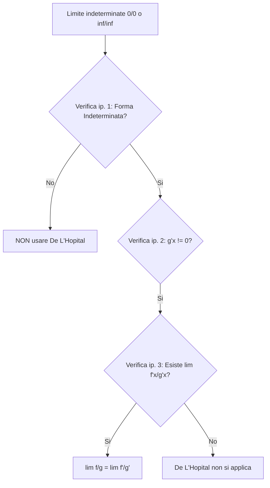

## Teorema di De L'Hopital

Siano $a, b \in \overline{\mathbb{R}}$ e $f, g: (a, b) \to \mathbb{R}$ funzioni derivabili in tutto l'intervallo $(a, b)$. 

Se valgono le seguenti ipotesi:

1. **Forma indeterminata:**  
   $$\lim_{x \to a^+} f(x) = \lim_{x \to a^+} g(x) = 0 \quad \text{oppure} \quad \lim_{x \to a^+} f(x) = \pm\infty, \, \lim_{x \to a^+} g(x) = \pm\infty$$  
2. **Derivata del denominatore non nulla:**  
   $$g'(x) \neq 0 \quad \text{in un intorno destro di } a$$  
3. **Esistenza del limite del rapporto delle derivate:**  
   $$\exists \lim_{x \to a^+} \frac{f'(x)}{g'(x)} = l \in \overline{\mathbb{R}}$$  

Allora:  

$$\exists \lim_{x \to a^+} \frac{f(x)}{g(x)} = l$$  

> **Nota:** Tutto vale anche per $x \to b^-$ e per $x \to x_0 \in (a, b)$.

---

## Esempi sull'applicazione del Teorema di De L'Hopital

### Esempio 1: Applicazione reiterata

Calcolare il seguente limite:  

$$\lim_{x \to 0} \frac{2\cos x - 2 + x^2}{x^4}$$  

- Inserendo $x = 0$ otteniamo la forma indeterminata $\left[\frac{0}{0}\right]$. Derivo:  
  $$\frac{-2\sin x + 2x}{4x^3} = \left[\frac{0}{0}\right]$$  
- Derivo ancora:  
  $$\frac{-2\cos x + 2}{12x^2} = \left[\frac{0}{0}\right]$$  
- Derivo ancora:  
  $$\frac{2\sin x}{24x} = \frac{\sin x}{12x} = \left[\frac{0}{0}\right]$$  
- Derivo di nuovo:  
  $$\frac{\cos x}{12} \to \frac{1}{12}$$  

Il risultato del limite e' $\frac{1}{12}$.

---

### Esempio 2: Confronto con la gerarchia degli infiniti  

$$\lim_{x \to +\infty} \frac{e^x}{x^2} = \left[\frac{+\infty}{+\infty}\right]$$  

Applicando De L'Hopital:  

$$\lim_{x \to +\infty} \frac{e^x}{2x} = \left[\frac{+\infty}{+\infty}\right] \implies \lim_{x \to +\infty} \frac{e^x}{2} = +\infty$$  

> **Nota:** Non servirebbe nemmeno usare De L'Hopital per via della gerarchia degli infiniti ($e^x$ cresce piu' velocemente di $x^2$).

---

### Esempio 3: Errore nell'uso senza verificare le ipotesi

Consideriamo il limite:  

$$\lim_{x \to 0} \frac{\cos x}{x^2} = \frac{1}{0^+} = +\infty$$  

Se si usa De L'Hopital senza verificare le ipotesi:
$$\frac{-\sin x}{2x} \to \frac{-\cos x}{2} \to -\frac{1}{2} \quad \text{(ERRATO!)}$$  

**Attenzione:** Bisogna sempre verificare le ipotesi! In questo caso la prima ipotesi (forma indeterminata $\left[\frac{0}{0}\right]$ o $\left[\frac{\infty}{\infty}\right]$) non e' soddisfatta poiche' $\cos(0) = 1$.

---

### Esempio 4: Quando l'ipotesi 3 fallisce  

$$\lim_{x \to 0} \frac{x^2 \sin\left(\frac{1}{x}\right)}{x} = \lim_{x \to 0} x \sin\left(\frac{1}{x}\right) = 0 \cdot (\text{limitata}) = 0$$  

Se proviamo a usare De L'Hopital:
- $f(x) = x^2 \sin\left(\frac{1}{x}\right) \to 0$
- $g(x) = x \to 0$

Derivando:
- $f'(x) = 2x \sin\left(\frac{1}{x}\right) + x^2 \cos\left(\frac{1}{x}\right)\left(-\frac{1}{x^2}\right) = 2x \sin\left(\frac{1}{x}\right) - \cos\left(\frac{1}{x}\right)$
- $g'(x) = 1$

Il limite delle derivate diventa:  

$$\lim_{x \to 0} \frac{f'(x)}{g'(x)} = \lim_{x \to 0} \left( \underbrace{2x \sin\left(\frac{1}{x}\right)}_{\to 0} - \underbrace{\cos\left(\frac{1}{x}\right)}_{\nexists} \right) \quad \nexists$$  

>**Nota:** $\sin\left(\frac{1}{x}\right)$ e' una quantita' limitata che oscilla infinitamente tra `-1` e `1` ma che viene schiacciata da $2x \to 0$. Il termine $\cos\left(\frac{1}{x}\right)$ non ha nessun coefficiente che lo porta a zero percio' il limite' non esiste!

L'ipotesi 3 **non vale**, di conseguenza De L'Hopital **non si applica**!

---

## Corollario sulla derivabilita'

Se $f$ e' una funzione continua in $x_0$ e derivabile in un intorno di $x_0$, e se esiste:  

$$\lim_{x \to x_0} f'(x) = l$$  

Allora:  

$$f'(x_0) = l$$  

---

### Esempio: Discontinuita' della funzione

Sia la funzione a tratti:  

$$f(x) = \begin{cases} x^2 + 1 & \text{se } x \geq 0 \\ x^2 & \text{se } x < 0 \end{cases}$$  

Calcolare la derivata in $x_0 = 0$:
- $f$ non e' continua in $x_0 = 0 \implies$ **non e' derivabile!**

Analizzando le derivate destre e sinistre:  

$$f'(x) = \begin{cases} 2x & \text{se } x \geq 0 \\ 2x & \text{se } x < 0 \end{cases}$$  

$$\lim_{x \to 0^+} f'(x) = \lim_{x \to 0^-} f'(x) = 0 \implies \exists \lim_{x \to 0} f'(x) = 0$$  

Esiste il limite delle derivate, ma poiche' la funzione non e' continua, il corollario **non si applica** e la funzione **non e' derivabile** in $x_0 = 0$.

>**In parole povere:** Non puoi verificare la derivabilita' limitandoti a fare la derivata delle singole parti e calcolarne il limite, se prima non hai controllato che la funzione sia continua nel punto. Senza continuita', la derivabilita' fallisce a prescindere

> **Osservazione:** Puo' succedere che $\nexists \lim_{x \to x_0} f'(x)$ ma $f$ sia comunque derivabile in $x_0$. 
> Un esempio e' la funzione:  
> 
> $$f(x) = \begin{cases} x^2 \sin\left(\frac{1}{x}\right) & \text{se } x \neq 0 \\ 0 & \text{se } x = 0 \end{cases}$$  

---

### Esempio 5: Riscrivere per applicare De L'Hopital

Calcolare il limite:  

$$\lim_{x \to 0^+} \frac{e^{-\frac{1}{x}}}{x^2} = \left[\frac{e^{-\infty}}{0^+} = \frac{0^+}{0^+}\right]$$  

Provando De L'Hopital direttamente:  

$$\lim_{x \to 0^+} \frac{e^{-\frac{1}{x}} \cdot \frac{1}{x^2}}{2x} = \lim_{x \to 0^+} \frac{e^{-\frac{1}{x}}}{2x^3} = \left[\frac{0}{0}\right]$$  

Il problema peggiora.

Riscriviamo l'espressione sfruttando la relazione $\frac{a}{b} = \frac{\frac{1}{b}}{\frac{1}{a}}$:  

$$\frac{e^{-\frac{1}{x}}}{x^2} = \frac{\frac{1}{x^2}}{e^{\frac{1}{x}}}$$  

Ponendo $f(x) = \frac{1}{x^2} = x^{-2} \implies f'(x) = -2x^{-3}$:  

$$\lim_{x \to 0^+} \frac{-2x^{-3}}{e^{\frac{1}{x}} \left(\frac{1}{x^2}\right)^2} = \lim_{x \to 0^+} \frac{-2x^{-3}}{e^{\frac{1}{x}} x^{-4}} = \lim_{x \to 0^+} \frac{-2x^{-1}}{e^{\frac{1}{x}}} \quad \text{(De L'Hopital di nuovo...)}$$  

$$\lim_{x \to 0^+} \frac{2\left(-x^{-2}\right)}{e^{\frac{1}{x}} \left(-\frac{1}{x^2}\right)} = \lim_{x \to 0^+} \frac{2}{e^{\frac{1}{x}}} = \frac{2}{e^{+\infty}} = 0$$  

---

# Formula di Taylor  

Se $f$ e' derivabile in un punto $x_0$, allora:
$$f(x) = f(x_0) + f'(x_0)(x - x_0) + o(x - x_0) \quad \text{per } x \to x_0$$  

### Formula di Taylor con resto di Peano

Sia $f: (a, b) \to \mathbb{R}$ e $x_0 \in (a, b)$. Se $f$ e' derivabile $n-1$ volte in $(a, b)$ e $n$ volte in $x_0$, allora esiste un unico polinomio $P_n(x)$ di grado minore o uguale a $n$ tale che:  

$$f(x) = P_n(x) + R_n(x) \quad \text{con } R_n(x) = o((x - x_0)^n) \text{ per } x \to x_0$$  

Dove il polinomio di Taylor e':  

$$P_n(x) = \sum_{j=0}^{n} \frac{f^{(j)}(x_0)}{j!} (x - x_0)^j = f(x_0) + \frac{f'(x_0)}{1!} (x - x_0)^1 + \frac{f''(x_0)}{2!} (x - x_0)^2 + \dots + \frac{f^{(n)}(x_0)}{n!} (x - x_0)^n$$  

> **In parole povere:** E' possibile usare un polinomio per sostituire una funzione difficile con una facile da calcolare attorno a un punto, tenendo sotto controllo l'errore commesso $R_n(x)$.

### Resto di Lagrange

Se $f$ e' derivabile $n$ volte e $n+1$ volte in tutti gli altri punti di $(a, b)$, allora esiste un valore $z$ compreso tra $x$ e $x_0$ tale che:  

$$R_n(x) = \frac{f^{(n+1)}(z)}{(n+1)!} (x - x_0)^{n+1}$$  

---

## Sviluppi di Maclaurin notevoli ($x_0 = 0$)

### 1. Funzione Esponenziale $f(x) = e^x$  

$$f(x) = e^x, \quad f'(x) = e^x, \quad f''(x) = e^x, \dots \implies f(0) = 1, \, f'(0) = 1, \, f''(0) = 1$$  

$$e^x = \sum_{j=0}^{n} \frac{x^j}{j!} + o(x^n)$$  

- Per $n = 1$: $e^x = 1 + x + o(x)$
- Per $n = 2$: $e^x = 1 + x + \frac{x^2}{2} + o(x^2)$

---

### 2. Funzione Seno $f(x) = \sin x$  

$$f(0) = 0, \quad f'(0) = 1, \quad f''(0) = 0, \quad f'''(0) = -1, \dots$$  

$$\sin x = \sum_{j=0}^{n} \frac{(-1)^j}{(2j+1)!} x^{2j+1} + o(x^{2n+2})$$  

- Per $n = 2$:  
  $$\sin x = \frac{x^1}{1!} + (-1)^1 \frac{x^3}{3!} + (-1)^2 \frac{x^5}{5!} + o(x^6) = x - \frac{x^3}{3!} + \frac{x^5}{5!} + o(x^6)$$  

---

### 3. Funzione Coseno $f(x) = \cos x$  

$$\cos x = \sum_{j=0}^{n} \frac{(-1)^j}{(2j)!} x^{2j} + o(x^{2n+1})$$  

$$\cos x = 1 - \frac{x^2}{2!} + \frac{x^4}{4!} - \frac{x^6}{6!} + o(x^7)$$  

- Approssimazione comune: $\cos x = 1 - \frac{x^2}{2} + o(x^3)$ oppure $x - \frac{x^3}{6} + o(x^4)$

---

### 4. Logaritmo $\log(1 + x)$  

$$\log(1 + x) = \sum_{j=1}^{n} (-1)^{j+1} \frac{x^j}{j} + o(x^n)$$  

$$\log(1 + x) = x - \frac{x^2}{2} + \frac{x^3}{3} - \frac{x^4}{4} + o(x^4)$$  

---

### 5. Tangente e Arcotangente
- **Tangente:**  
  $$\text{tg } x = x + \frac{x^3}{3} + \frac{2x^5}{15} + o(x^6) \quad \left[\text{Forma piu' usata: } \text{tg } x = x + o(x^2)\right]$$  

- **Arcotangente:**  
  $$\text{arctg } x = \sum_{j=0}^{n} \frac{(-1)^j x^{2j+1}}{2j+1} + o(x^{2n+2}) = x - \frac{x^3}{3} + \frac{x^5}{5} + o(x^6)$$  

---

### 6. Sviluppo Binomiale $(1 + x)^\alpha$ con $\alpha \in \mathbb{R}$  

$$(1 + x)^\alpha = 1 + \alpha x + \frac{\alpha(\alpha - 1)}{2} x^2 + \frac{\alpha(\alpha - 1)(\alpha - 2)}{3!} x^3 + \dots + \frac{\alpha(\alpha - 1)\dots(\alpha - n + 1)}{n!} x^4 + o(x^n)$$  

#### Esempio: $\sqrt{1 + x} = (1 + x)^{\frac{1}{2}}$ ($\alpha = \frac{1}{2}$)  

$$\sqrt{1 + x} = 1 + \frac{1}{2}x + \frac{\frac{1}{2}\left(\frac{1}{2} - 1\right)}{2} x^2 + \frac{\frac{1}{2}\left(\frac{1}{2} - 1\right)\left(\frac{1}{2} - 2\right)}{3!} x^3 + o(x^3)$$  

> In genere ci si ferma al primo/secondo ordine: $\sqrt{1 + x} \approx 1 + \frac{1}{2}x$.

---

## Esempio di risoluzione di limiti tramite sviluppi di Taylor

Calcolare:  

$$\lim_{x \to 0} \frac{\sin x - x}{e^x - \log(1 + x) - 1}$$  

- Verifico forma indeterminata: $\frac{0 - 0}{e^0 - \log(1) - 1} = \left[\frac{0}{0}\right]$

### Primo tentativo (arresto a un ordine troppo basso)
Sviluppiamo al primo ordine:
- $\sin x = x + o(x^2)$
- $e^x = 1 + x + o(x)$
- $\log(1 + x) = x + o(x)$

Sostituendo:  

$$\frac{x + o(x^2) - x}{1 + x + o(x) - (x + o(x)) - 1} = \frac{o(x^2)}{o(x)} \quad \implies \text{ancora indeterminato!}$$  

Se ad esempio avessimo $\frac{x^4}{x^2} = x^2 \to 0$, oppure $\frac{x^3}{x^7} = \frac{1}{x^4} \to +\infty$. Il comportamento dipende dagli ordini precisi.

---

### Secondo tentativo (aumentando il grado dello sviluppo)
Aumentiamo il grado degli sviluppi:
- $\sin x = x - \frac{x^3}{6} + o(x^4)$
- $e^x = 1 + x + \frac{x^2}{2} + o(x^2)$
- $\log(1 + x) = x - \frac{x^2}{2} + o(x^2)$

Sostituendo nel limite:  

$$\frac{x - \frac{x^3}{6} + o(x^4) - x}{1 + x + \frac{x^2}{2} + o(x^2) - \left(x - \frac{x^2}{2} + o(x^2)\right) - 1} = \frac{-\frac{x^3}{6} + o(x^4)}{\frac{x^2}{2} + \frac{x^2}{2} + o(x^2)} = \frac{-\frac{x^3}{6} + o(x^4)}{x^2 + o(x^2)}$$  

Dividiamo numeratore e denominatore per $x^2$ per rimuovere l'indeterminazione:  

$$\frac{-\frac{x}{6} + o(x^2)}{1 + o(1)} \to \frac{0 + 0}{1 + 0} = 0$$  

Il limite e' quindi **$0$**.