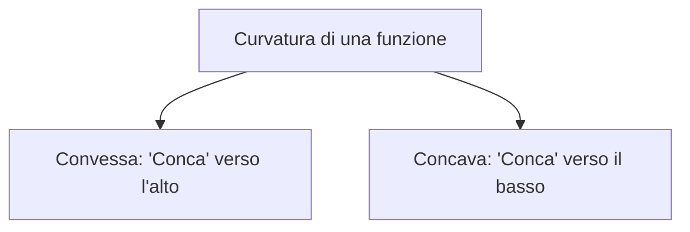
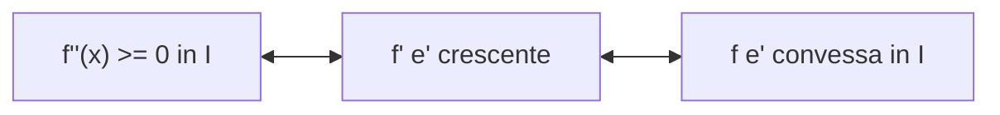
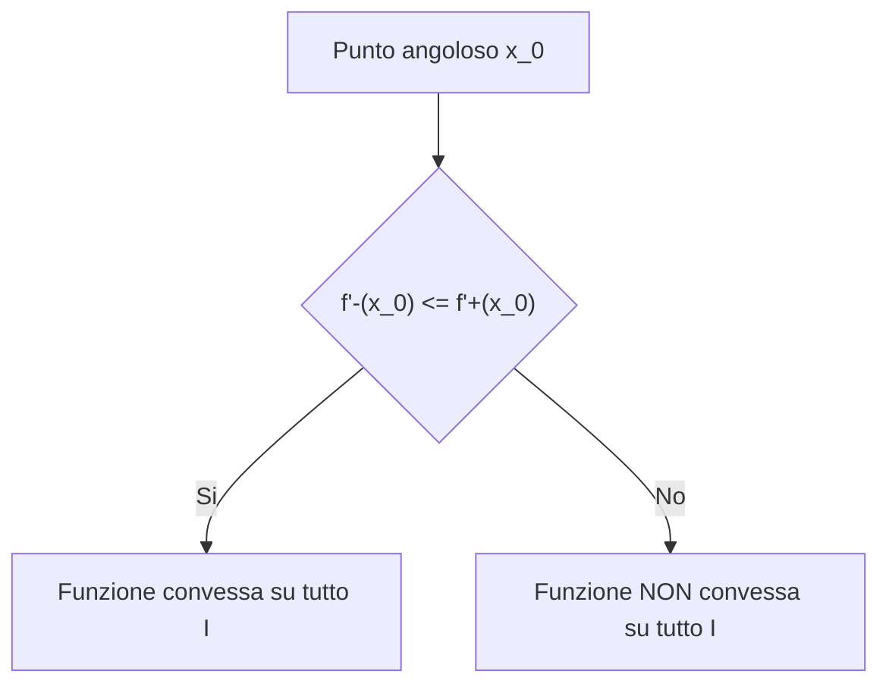
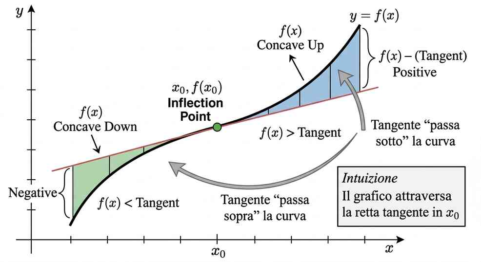

# Convessita'

La convessita' e' una proprieta' geometrica ed analitica che descrive la curvatura del grafico di una funzione. Intuitivamente, una funzione e' convessa se la curva che la rappresenta crea una sorta di "conca" rivolta verso l'alto.

## Definizione geometrica ed analitica di convessita'

Sia $I \subset \mathbb{R}$ un intervallo e $f: I \rightarrow \mathbb{R}$ una funzione.

**Definizione geometrica:**
$f$ si dice **convessa** in $I$ se, presi due punti qualsiasi sul grafico di $f$, il segmento che li unisce si trova al di sopra (o coincidente) al grafico di $f$.

**Definizione in formule:**
$f$ e' convessa in $I$ se per ogni $x_1, x_2 \in I$ con $x_1 < x_2$ e per ogni $t \in [0,1]$ risulta:

$$f(x_1 + t(x_2 - x_1)) \le f(x_1) + t(f(x_2) - f(x_1))$$

- Se nella disuguaglianza vale il segno di minore stretto $<$ per ogni $t \in (0,1)$, allora $f$ si dice **strettamente convessa**.
- La quantita' $x_1 + t(x_2 - x_1)$ rappresenta la parte di grafico compresa tra i punti $x_1$ e $x_2$ al variare di $t \in [0,1]$.

# Concavita'

**Definizione:**
Una funzione $f$ si dice **concava** in $I$ se, presi due punti qualsiasi sul grafico di $f$, il segmento che li unisce si trova al di sotto (o coincidente) al grafico di $f$.

In formule, per una funzione concava vale la disuguaglianza opposta:

$$f(x_1 + t(x_2 - x_1)) \ge f(x_1) + t(f(x_2) - f(x_1))$$

### Esempi classici

- $f(x) = x^2$ e' strettamente convessa su tutto $\mathbb{R}$.
- $f(x) = -x^2$ e' strettamente concava su tutto $\mathbb{R}$.
- $f(x) = \sin x$:
  - Concava nell'intervallo $[0, \pi]$.
  - Convessa nell'intervallo $[\pi, 2\pi]$.
  - Non e' ne' convessa ne' concava sull'intero intervallo $[0, 2\pi]$.

# Criterio della derivata seconda

Sia $I \subset \mathbb{R}$ un intervallo e $f: I \rightarrow \mathbb{R}$ derivabile due volte. Le seguenti affermazioni sono equivalenti:

1. $f$ e' convessa in $I$.
2. $f'$ e' debolmente crescente in $I$.
3. $f''(x) \ge 0$ per ogni $x \in I$.

Inoltre, se $f''(x) > 0$ per ogni $x \in I$, allora $f$ e' **strettamente convessa**.

### Interpretazione geometrica della derivata prima crescente
Che $f'$ sia crescente significa che il coefficiente angolare della retta tangente aumenta man mano che ci si sposta verso destra. Geometricamente, **"la tangente ruota in senso antiorario"**.

### Esempi di applicazione del criterio
- **Funzione $f(x) = e^x$**: 
  $f'(x) = e^x$, $f''(x) = e^x > 0$ per ogni $x \in \mathbb{R} \implies f$ e' sempre strettamente convessa in $\mathbb{R}$.
- **Funzione $f(x) = \ln x$** per $x \in (0, +\infty)$:
  $f'(x) = \frac{1}{x}$, $f''(x) = -\frac{1}{x^2} < 0$ per ogni $x > 0 \implies f$ e' strettamente concava in $(0, +\infty)$.
- **Funzione $f(x) = \sin x$** in $[0, 2\pi]$:
  $f'(x) = \cos x$, $f''(x) = -\sin x$.
  - $f''(x) \le 0 \iff x \in [0, \pi] \implies f$ concava.
  - $f''(x) \ge 0 \iff x \in [\pi, 2\pi] \implies f$ convessa.

# Caratterizzazione mediante la retta tangente

Sia $I \subset \mathbb{R}$ un intervallo e $f: I \rightarrow \mathbb{R}$ derivabile.

**Proposizione:**
$f$ e' convessa in $I$ se e solo se il grafico di $f$ si trova sempre **al di sopra** della retta tangente in qualsiasi punto $(x_0, f(x_0))$:

$$f(x) \ge f(x_0) + f'(x_0)(x - x_0) \quad \forall x, x_0 \in I$$

- Se $f$ e' concava, il grafico sta sempre al di sotto della retta tangente ($\le$).
- Se vale il segno $>$ per $x \neq x_0$, $f$ e' strettamente convessa.

> **Nota:** La disuguaglianza $f(x) \ge \text{tangente}$ significa semplicemente che, ovunque ti muovi sull'intervallo, la curva non va mai sotto la sua tangente: la retta tocca la curva in un solo punto e tutto il resto del grafico le resta sopra.

## Convessita' e punti non derivabili

La convessita' di una funzione su sottodomini distinti non garantisce la convessita' sull'intero dominio se vi sono punti di non derivabilita' (punti angolosi).

### Esempio 1: $f(x) = e^{-|x|}$
- Per $x > 0$: $f(x) = e^{-x} \implies f''(x) = e^{-x} > 0$ (convessa su $[0, +\infty)$).
- Per $x < 0$: $f(x) = e^x \implies f''(x) = e^x > 0$ (convessa su $(-\infty, 0]$).
- In $x = 0$: $f'_-(0) = 1$ e $f'_+(0) = -1$.
- Poiche' il grafico sta sotto il segmento che unisce punti tra i due semipiani, $f$ **non e' convessa** su tutto $\mathbb{R}$.

> **Nota:** Se prendi un punto a sinistra dello zero e uno a destra e li unisci con un segmento, il segmento passa sotto la punta centrale del grafico, allora la proprieta' di convessita' globale su tutto $\mathbb{R}$ fallisce.

### Esempio 2: $f(x) = e^{|x|}$
- In $x = 0$: $f'_-(0) = -1$ e $f'_+(0) = 1$.
- Poiche' la derivata sinistra e' minore della derivata destra ($f'_-(0) \le f'_+(0)$), la funzione e' **convessa su tutto $\mathbb{R}$**.

### Regola per i punti angolosi
Sia $f$ convessa separatamente sugli intervalli $I_1 = \{x \in I : x < x_0\}$ e $I_2 = \{x \in I : x > x_0\}$, e sia $x_0$ un punto angoloso. Allora $f$ e' convessa sull'intero intervallo $I$ se e solo se:

$$f'_-(x_0) \le f'_+(x_0)$$

# Punti di flesso

Sia $f: I \rightarrow \mathbb{R}$ e $x_0$ un punto interno ad $I$. Il punto $x_0$ si dice **punto di flesso** per $f$ se $f$ e' derivabile in $x_0$ ed esiste un intorno $U$ di $x_0$ tale che la quantita':  

$$\frac{f(x) - (f(x_0) + f'(x_0)(x - x_0))}{x - x_0}$$  

non cambia segno in $U \setminus \{x_0\}$.

> **Nota:** Al numeratore c'e' la differenza tra l'altezza della curva $f(x)$ e l'altezza della retta tangente.Al denominatore c'e' $(x - x_0)$, cioe' la distanza orizzontale dal punto $x_0$.Dividendo queste due quantita', stiamo guardando il "segno dello scarto": se il segno non cambia passando da sinistra a destra di $x_0$, significa che in un intorno del punto la curva attraversa la retta tangente (prima passa sotto e poi sopra, o viceversa).

### Flessi a tangente verticale
Se $f$ non e' derivabile in $x_0$ ma $f$ e' continua in $x_0$ e $\lim_{x \to x_0} |f'(x)| = +\infty$, e se $f$ cambia convessita' tra l'intorno sinistro e quello destro di $x_0$, allora $x_0$ e' un **punto di flesso a tangente verticale**.

- **Esempio:** $f(x) = \sqrt[3]{x}$ in $x_0 = 0$.
  $f'(0) = +\infty$. La funzione e' convessa per $x < 0$ e concava per $x > 0$. Pertanto $x_0 = 0$ e' un flesso a tangente verticale.

### Condizioni per la presenza di un flesso
1. **Condizione sufficiente con $f''$:** Se $f''$ cambia segno passando per $x_0$, allora $x_0$ e' un punto di flesso.
2. **Attenzione:** $f''(x_0) = 0$ e' una condizione **necessaria ma NON sufficiente**.
   - Per $f(x) = x^3$: $f''(x) = 6x \implies f''(0) = 0$, $f''$ cambia segno $\implies x=0$ e' un flesso.
   - Per $f(x) = x^4$: $f''(x) = 12x^2 \implies f''(0) = 0$, ma $f''(x) \ge 0$ sempre $\implies x=0$ NON e' un flesso (la funzione e' sempre convessa).
3. **Flessi senza derivata seconda:** Possono esistere punti di flesso dove $f''$ non esiste.
   - Per $f(x) = x|x|$:
     $$f(x) = \begin{cases} x^2 & \text{se } x \ge 0 \\ -x^2 & \text{se } x < 0 \end{cases}$$
     $f'(0) = 0$ (la tangente e' $y = 0$). La funzione e' concava per $x < 0$ e convessa per $x > 0$. $x=0$ e' un punto di flesso, ma $f''(0)$ non esiste (la derivata prima ha un punto angoloso in $x=0$).

### Estensione agli estremi degli intervalli
Se $f$ e' convessa nei punti interni di un intervallo $I$ ed e' continua su tutto $I$, allora $f$ e' convessa sull'intero intervallo $I$ (inclusi gli estremi).

---

## Schema generale per lo studio di funzione

Per tracciare il grafico qualitativo di una funzione $f(x)$, si segue la seguente scaletta:

1. Determinare l'**insieme di definizione (dominio)** di $f$.
2. Verificare eventuali **simmetrie** (funzione pari o dispari) e **periodicita'**.
3. Determinare l'insieme di **continuita'** e di **derivabilita'**.
4. Calcolare i limiti agli estremi del dominio e cercare eventuali **asintoti** (orizzontali, verticali, obliqui).
5. Studiare il segno della derivata prima $f'$ per identificare **intervalli di monotonia**, **massimi e minimi locali e assoluti**.
6. Determinare **estremo superiore e inferiore** (o verificare se esistono massimo e minimo assoluto).
7. Studiare il segno della derivata seconda $f''$ per determinare **insiemi di convessita', concavita' e punti di flesso**.
8. Tracciare il **grafico approssimativo**.

---

## Esempio di studio di funzione

> Data la funzione $f(x) = x e^{4 - x^2}$, determinarne dominio, continuita', derivabilita', intervalli di crescenza/decrescenza, massimi/minimi locali ed assoluti, estremi superiore ed inferiore, asintoti, convessita', concavita', punti di flesso e tracciarne il grafico.

**Soluzione:**

- **Dominio, continuita' e derivabilita':**
  $f$ e' definita, continua e derivabile su tutto $\mathbb{R}$ in quanto composizione e prodotto di funzioni elementari derivabili.
- **Simmetria:**
  $f(-x) = (-x)e^{4-(-x)^2} = -x e^{4-x^2} = -f(x) \implies f$ e' **dispari** (grafico simmetrico rispetto all'origine).
- **Asintoti:**
  $$f(x) = \frac{x}{e^{x^2-4}}$$
  Per il teorema di de l'Hopital:
  $$\lim_{x \to +\infty} f(x) = 0, \quad \lim_{x \to -\infty} f(x) = 0$$
  Quindi la retta $y = 0$ e' **asintoto orizzontale** a $+\infty$ e $-\infty$. Non ci sono asintoti verticali o obliqui.
- **Monotonia e punti stazionari:**
  $$f'(x) = e^{4-x^2} \cdot 1 + x e^{4-x^2}(-2x) = e^{4-x^2}(1 - 2x^2)$$
  Poiche' $e^{4-x^2} > 0$ sempre:
  $$f'(x) > 0 \iff 1 - 2x^2 > 0 \iff |x| < \frac{\sqrt{2}}{2}$$
  - $f$ e' **crescente** in $\left[-\frac{\sqrt{2}}{2}, \frac{\sqrt{2}}{2}\right]$.
  - $f$ e' **decrescente** in $\left(-\infty, -\frac{\sqrt{2}}{2}\right]$ e in $\left[\frac{\sqrt{2}}{2}, +\infty\right)$.
- **Massimi e minimi:**
  - $x = -\frac{\sqrt{2}}{2}$ e' punto di **minimo locale** con $f\left(-\frac{\sqrt{2}}{2}\right) = -\frac{\sqrt{2}}{2} e^{7/2}$.
  - $x = \frac{\sqrt{2}}{2}$ e' punto di **massimo locale** con $f\left(\frac{\sqrt{2}}{2}\right) = \frac{\sqrt{2}}{2} e^{7/2}$.
  - Poiche' la funzione tende a $0$ agli infiniti, tali punti sono anche di **minimo e massimo assoluto**. Pertanto:
    $$\inf f = \min f = -\frac{\sqrt{2}}{2} e^{7/2}, \quad \sup f = \max f = \frac{\sqrt{2}}{2} e^{7/2}$$
- **Convessita' e flessi:**
  $$f''(x) = -4x e^{4-x^2}(1 - 2x^2) + e^{4-x^2}(-4x) = 2x e^{4-x^2}(2x^2 - 3)$$
  Studiamo il segno di $f''(x) > 0 \iff x(2x^2 - 3) > 0$:
  - Concava in $\left(-\infty, -\sqrt{\frac{3}{2}}\right]$
  - Convessa in $\left[-\sqrt{\frac{3}{2}}, 0\right]$
  - Concava in $\left[0, \sqrt{\frac{3}{2}}\right]$
  - Convessa in $\left[\sqrt{\frac{3}{2}}, +\infty\right)$
  - I punti $x = -\sqrt{\frac{3}{2}}$, $x = 0$, $x = \sqrt{\frac{3}{2}}$ sono **punti di flesso**.

---

### Esercizio 2

**Testo:**
Data la funzione $f(x) = \sqrt{2x^2 - |x + 1|}$, determinarne dominio, continuita', derivabilita', crescenza/decrescenza, punti di massimo/minimo locali ed assoluti, estremo superiore/inferiore, asintoti e tracciarne il grafico.

**Soluzione:**

- **Dominio:**
  Richiediamo che l'argomento della radice sia non negativo:
  $$2x^2 \ge |x + 1| \iff -2x^2 \le x + 1 \le 2x^2 \iff \begin{cases} 2x^2 + x + 1 \ge 0 \\ 2x^2 - x - 1 \ge 0 \end{cases}$$
  - La prima disequazione ha $\Delta = 1 - 8 < 0$, quindi e' verificata per ogni $x \in \mathbb{R}$.
  - La seconda disequazione ha radici $x = 1$ e $x = -1/2$, ed e' verificata per $x \le -1/2$ oppure $x \ge 1$.
  - Quindi il dominio e' $D = \left(-\infty, -\frac{1}{2}\right] \cup [1, +\infty)$.

- **Continuita' ed esplicitazione del modulo:**
  La funzione e' continua su tutto $D$. Sciogliendo il modulo ($x + 1 \ge 0 \iff x \ge -1$):
  $$f(x) = \begin{cases} \sqrt{2x^2 + x + 1} \equiv f_1(x) & \text{se } x \le -1 \\ \sqrt{2x^2 - x - 1} \equiv f_2(x) & \text{se } -1 \le x \le -\frac{1}{2} \text{ oppure } x \ge 1 \end{cases}$$

- **Derivabilita':**
  Le derivate dei singoli rami sono:
  $$f_1'(x) = \frac{4x + 1}{2\sqrt{2x^2 + x + 1}}, \quad f_2'(x) = \frac{4x - 1}{2\sqrt{2x^2 - x - 1}}$$
  Analisi nei punti critici:
  - In $x = -1$:
    $$f'_-(-1) = \lim_{x \to -1^-} f_1'(x) = -\frac{3}{2\sqrt{2}}$$
    $$f'_+(-1) = \lim_{x \to -1^+} f_2'(x) = -\frac{5}{2\sqrt{2}}$$
    I due limiti differiscono $\implies x = -1$ e' un **punto angoloso**.
  - Agli estremi del dominio:
    $$\lim_{x \to -1/2^-} f_2'(x) = -\infty, \quad \lim_{x \to 1^+} f_2'(x) = +\infty$$
    Quindi $x = -1/2$ e $x = 1$ sono **punti a tangente verticale (semicuspidi)**.

- **Asintoti:**
  - Non vi sono asintoti orizzontali poiche' $\lim_{x \to \pm\infty} f(x) = +\infty$.
  - **Asintoto obliquo a $-\infty$:**
    $$f(x) = \sqrt{2x^2+x+1} = \sqrt{2}|x|\sqrt{1 + \frac{1}{2x} + \frac{1}{2x^2}} = -\sqrt{2}x - \frac{1}{2\sqrt{2}} + o(1)$$
    Retta: $y = -\sqrt{2}x - \frac{1}{2\sqrt{2}}$.
  - **Asintoto obliquo a $+\infty$:**
    $$f(x) = \sqrt{2x^2-x-1} = \sqrt{2}|x|\sqrt{1 - \frac{1}{2x} - \frac{1}{2x^2}} = \sqrt{2}x - \frac{1}{2\sqrt{2}} + o(1)$$
    Retta: $y = \sqrt{2}x - \frac{1}{2\sqrt{2}}$.

- **Monotonia e punti estremanti:**
  - Per $x \le -1$: $f_1'(x) \ge 0 \iff 4x + 1 \ge 0 \iff x \ge -1/4$. Quindi $f_1'(x) < 0$ su $(-\infty, -1] \implies f$ e' **decrescente**.
  - Per $x \in [-1, -1/2]$: $f_2'(x) \ge 0 \iff 4x - 1 \ge 0 \iff x \ge 1/4$. Quindi $f_2'(x) < 0$ su $[-1, -1/2] \implies f$ e' **decrescente**.
  - Per $x \ge 1$: $f_2'(x) > 0 \implies f$ e' **crescente**.

- **Sintesi della monotonia:**
  - $f$ e' **decrescente** in $(-\infty, -1/2]$.
  - $f$ e' **crescente** in $[1, +\infty)$.
  - I punti $x = -\frac{1}{2}$ e $x = 1$ sono punti di **minimo locale e assoluto**, dove $f(-1/2) = f(1) = 0$.
  - Minimo assoluto $= 0$, $\sup f = +\infty$ (nessun massimo assoluto ne' locale).