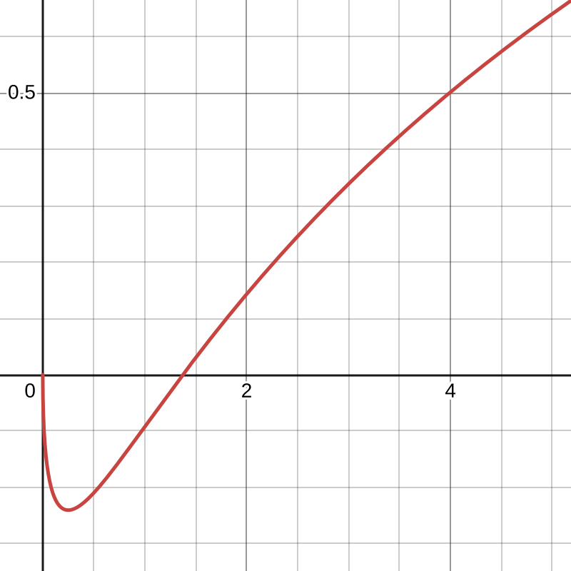

## Studio di funzione

Consideriamo la funzione:
$$f(x) = \log(x+1) - \arctan\sqrt{x}$$

### Dominio

Per determinare l'insieme di definizione della funzione, imponiamo che l'argomento del logaritmo sia strettamente positivo e che l'argomento della radice quadrata sia maggiore o uguale a zero:  

$$\begin{cases} x+1 > 0 \\ x \ge 0 \end{cases} \implies \begin{cases} x > -1 \\ x \ge 0 \end{cases} \implies x \ge 0$$  

Il dominio e' quindi $D = [0, +\infty)$.

> *Nota sulle simmetrie:* Poiche' il dominio non e' simmetrico rispetto all'origine, non ha senso domandarsi se la funzione sia pari o dispari.

### Valori agli estremi e asintoti

Calcoliamo il valore della funzione nell'estremo sinistro del dominio ($x = 0$):  

$$f(0) = \log(0+1) - \arctan\sqrt{0} = \log(1) - \arctan(0) = 0$$  

Calcoliamo il limite all'infinito:  

$$\lim_{x \to +\infty} \left( \log(x+1) - \arctan\sqrt{x} \right) = +\infty - \frac{\pi}{2} = +\infty$$  

Da queste informazioni deduciamo che:
* **Asintoti verticali:** Non esistono, perche' la funzione e' sempre definita e continua su tutto il suo dominio $[0, +\infty)$.
* **Asintoti orizzontali:** Non esistono, perche' per $x \to +\infty$ la funzione diverge a $+\infty$.
* **Asintoti obliqui:** Verifichiamo l'esistenza del coefficiente angolare $m$:  
  $$m = \lim_{x \to +\infty} \frac{f(x)}{x} = \lim_{x \to +\infty} \left( \frac{\log(x+1)}{x} - \frac{\arctan\sqrt{x}}{x} \right) = 0 - 0 = 0$$  
  Poiche' $m = 0$, non ci sono asintoti obliqui.

### Derivata prima e monotonia

La funzione e' sicuramente derivabile per $x > 0$ (composizione di funzioni derivabili). Calcoliamo $f'(x)$:  

$$f'(x) = \frac{1}{x+1} - \frac{1}{1 + (\sqrt{x})^2} \cdot \frac{1}{2\sqrt{x}} = \frac{1}{x+1} - \frac{1}{1+x} \cdot \frac{1}{2\sqrt{x}}$$  

Mettendo a denominatore comune otteniamo:  

$$f'(x) = \frac{2\sqrt{x} - 1}{2\sqrt{x}(x+1)} \quad \text{per } x > 0$$  

**Comportamento in $x = 0$:**
Dato che $f$ e' continua in $x = 0$, studiamo il limite della derivata prima per capire la pendenza della tangente nell'origine:  

$$\lim_{x \to 0^+} f'(x) = \lim_{x \to 0^+} \frac{2\sqrt{x} - 1}{2\sqrt{x}(x+1)} = \frac{-1}{0^+} = -\infty$$  

Quindi $f$ **non e' derivabile** in $x = 0$: la tangente e' verticale e l'origine e' un punto di **semicuspide** (o cuspide a destra).

**Segno della derivata prima:**
Studiamo $f'(x) \ge 0$ per $x > 0$:
* **Denominatore:** $2\sqrt{x}(x+1) > 0$ per ogni $x > 0$.
* **Numeratore:** $2\sqrt{x} - 1 \ge 0 \implies 2\sqrt{x} \ge 1 \implies \sqrt{x} \ge \frac{1}{2} \implies x \ge \frac{1}{4}$.

```text
          0                 1/4                +oo
  --------+------------------+------------------+--------> x
          |   -  -  -  -  -  0  +  +  +  +  +   |   f'(x)
          |                  |                ∧ |
          |  \               |               /  |
          |   \  decresce    |    cresce    /   |   f(x)
          |    \             |             /    |
          |     v            v            /     |
      (max loc.)         (min ass.)
```

Dallo studio del segno ricaviamo i punti di massimo/minimo (punti estremanti):
* $x = \frac{1}{4}$ e' un punto di **minimo locale e assoluto**. Il valore minimo della funzione e':  

  $$\min(f) = f\left(\frac{1}{4}\right) = \log\left(\frac{5}{4}\right) - \arctan\left(\frac{1}{2}\right)$$  
* $x = 0$ e' un punto di **massimo locale** (poiche' la funzione decresce subito a destra di $0$).
* Non esiste massimo assoluto, in quanto $\sup(f) = +\infty$.

### Derivata seconda, concavita' e flessi

Per calcolare comodamente $f''(x)$, riscriviamo la derivata prima usando gli esponenti frazionari:  

$$f'(x) = \frac{1}{2} \left( \frac{2x^{1/2} - 1}{x^{3/2} + x^{1/2}} \right)$$  

Derivando come rapporto di funzioni e semplificando i termini al numeratore (raccogliendo opportunamente le potenze di $x$), si giunge alla forma semplificata:  

$$f''(x) = \frac{-4x^{3/2} + 3x + 1}{4 \left(x^{3/2} + x^{1/2}\right)^2 x^{1/2}}$$  

> **Nota sugli appunti:** Ometto i passaggi intermedi in quanto i calcoli algebrici sarebbero da rivedere, ma il risultato finale corretto e' esattamente quello indicato sopra.

**Studio del segno di $f''(x)$:**
Il denominatore e' sempre strettamente positivo per $x > 0$. Il segno della derivata seconda dipende quindi interamente dal numeratore, che chiamiamo $g(x)$:  

$$g(x) = -4x^{3/2} + 3x + 1 \quad \text{con } x \ge 0$$  

Per capire dove $g(x)$ si annulla e cambia segno, la studiamo come una funzione ausiliaria:
1. Valore iniziale: $g(0) = 1$.
2. Limite all'infinito: $\lim_{x \to +\infty} g(x) = -\infty$.
3. Derivata di $g(x)$:  
   $$g'(x) = -4 \cdot \frac{3}{2} x^{1/2} + 3 = -6x^{1/2} + 3$$  
4. Segno di $g'(x)$:  
   $$-6x^{1/2} + 3 > 0 \implies 3 > 6x^{1/2} \implies x^{1/2} < \frac{1}{2} \implies 0 \le x < \frac{1}{4}$$  

Quindi $g(x)$ cresce da $g(0)=1$ fino a un massimo in $x = \frac{1}{4}$, e poi decresce monotona fino a $-\infty$. Per il teorema degli zeri, esiste un unico punto $c > \frac{1}{4}$ tale che $g(c) = 0$.

```text
0                       1/4                     +oo
+------------------------+------------------------> x
|                        |
|   +   +   +   +   +    0   -   -   -   -   -    |   g'(x)
|                        |                        |
|       crescente        |       decrescente      |   g(x)
|                        |                        |
|                        |                        |
```

*Nota:* Sostituendo $x = 1$ in $g(x)$ si verifica facilmente che $g(1) = -4(1) + 3(1) + 1 = 0$, quindi il punto di flesso e' esattamente $c = 1$.


```text
0                           1 (c)                 +oo
+---------------------------+-----------------------> x
|                           |
|   +   +   +   +   +   +   0   -   -   -   -   -   |   f''(x)
|                           |                       |
|        convessa (U)       |      concava (n)      |   f(x)
|                           |                       |
|                        (flesso)                   |
```

### Grafico qualitativo della funzione



Riassumendo tutte le informazioni raccolte, si ha una partenza dall'origine con tangente verticale, minimo in $x = 1/4$, flesso in $x = 1$ e crescita verso $+\infty$ senza asintoti), la funzione ha il seguente andamento:
* Decresce con concavita' verso l'alto da $(0,0)$ fino al minimo in $x = 1/4$.
* Cresce mantenendo la concavita' verso l'alto da $x = 1/4$ fino al punto di flesso $x = 1$ (attraversando l'asse $x$ prima di $1$).
* Da $x = 1$ in poi continua a crescere verso $+\infty$, ma con concavita' verso il basso.

---

## Esercizi con gli sviluppi di Taylor

### Esercizio 1: ricerca degli asintoti

Determinare quanti asintoti possiede la funzione:  

$$f(x) = \frac{x^2 - \sin^2 x}{x^4}$$  

La funzione e' definita per $x \ne 0$. Verifichiamo se $x = 0$ e' un asintoto verticale calcolando $\lim_{x \to 0} f(x)$.

**Primo tentativo (arresto al primo ordine):**
Sostituendo $\sin x = x + o(x^2)$:  

$$\lim_{x \to 0} \frac{x^2 - (x + o(x^2))^2}{x^4} = \lim_{x \to 0} \frac{x^2 - x^2(1 + o(x))^2}{x^4} = \lim_{x \to 0} \frac{x^2 - x^2 + o(x^3)}{x^4} = \lim_{x \to 0} \frac{o(x^3)}{x^4}$$  

Scrivendo $\frac{o(x^3)}{x^4} = \frac{o(x^3)}{x^3} \cdot \frac{1}{x}$, otteniamo la forma indeterminata $0 \cdot \infty$. L'ordine di sviluppo scelto non basta.

**Secondo tentativo (inseriamo il secondo termine di Taylor):**
Sviluppiamo il seno fino al terzo grado: $\sin x = x - \frac{x^3}{6} + o(x^4)$.  

$$\lim_{x \to 0} \frac{x^2 - \left(x - \frac{x^3}{6} + o(x^4)\right)^2}{x^4}$$  

Sviluppando il quadrato al numeratore (ricordando che negli o-piccoli il grado piu' basso "mangia" tutti i termini di grado superiore, quindi $o(x^5)$ assorbe $x^6$, $o(x^7)$ e $o(x^8)$):  

$$\left(x - \frac{x^3}{6} + o(x^4)\right)^2 = x^2 - \frac{2}{6}x^4 + o(x^5) = x^2 - \frac{1}{3}x^4 + o(x^5)$$  

Sostituendo nel limite:  

$$\lim_{x \to 0} \frac{x^2 - \left(x^2 - \frac{1}{3}x^4 + o(x^5)\right)}{x^4} = \lim_{x \to 0} \frac{\frac{1}{3}x^4 + o(x^5)}{x^4} = \lim_{x\to 0}\ \frac13-\frac{o(x^5)}{x^4} = \frac{1}{3} - 0 = \frac{1}{3}$$  

**Asintoti orizzontali:**  

$$\lim_{x \to \pm\infty} \frac{x^2 - \sin^2 x}{x^4} = \lim_{x \to \pm\infty} \left( \frac{1}{x^2} - \frac{\sin^2 x}{x^4} \right) = 0 - 0 = 0$$  

(dove $\frac{\sin^2 x}{x^4} \to 0$ perche' e' il rapporto tra una funzione limitata e un infinito).
La funzione ha quindi **1 asintoto orizzontale** di equazione $y = 0$.

---

### Esercizio 2: limite con cancellazione al numeratore

Calcolare il seguente limite:  

$$\lim_{x \to 0} \frac{x e^{-x^2} - \sin x}{(x + x^2) \cdot (\log(1+x))^2}$$  

Prepariamo gli sviluppi elementari per $x \to 0$:
* $e^t = 1 + t + o(t)$. Ponendo $t = -x^2$ (sostituzione lecita perche' $t \to 0$ quando $x \to 0$), otteniamo:  
  $$e^{-x^2} = 1 - x^2 + o(x^2)$$  
* $\log(1+x) = x + o(x) \implies (\log(1+x))^2 = (x + o(x))^2 = x^2 + o(x^2)$.

Al denominatore possiamo raccogliere $x$ nel primo fattore: $(x + x^2) = x(1+x)$. Poiche' $(1+x) \to 1$ per $x \to 0$, possiamo sostituirlo con $1 + o(1)$.

**Primo tentativo ($\sin x = x + o(x^2)$):**  

$$\lim_{x \to 0} \frac{x(1 - x^2 + o(x^2)) - (x + o(x^2))}{x(1+x)(x^2 + o(x^2))} = \lim_{x \to 0} \frac{x - x^3 + o(x^3) - x + o(x^2)}{x^3(1 + o(1))} = \lim_{x \to 0} \frac{o(x^2)}{x^3(1 + o(1))}$$  

L'o-piccolo al numeratore ha grado inferiore rispetto al denominatore ($x^2$ contro $x^3$): forma indeterminata!

**Secondo tentativo (alziamo il grado di $\sin x$):**
Usiamo $\sin x = x - \frac{x^3}{6} + o(x^4)$:  

$$\lim_{x \to 0} \frac{x - x^3 + o(x^3) - \left(x - \frac{x^3}{6} + o(x^4)\right)}{x^3(1 + o(1))} = \lim_{x \to 0} \frac{\left(-1 + \frac{1}{6}\right)x^3 + o(x^3)}{x^3(1 + o(1))}$$  

Semplificando $x^3$ tra numeratore e denominatore:  

$$\lim_{x \to 0} \frac{-\frac{5}{6}x^3 + o(x^3)}{x^3(1 + o(1))} = \lim_{x \to 0} \frac{-\frac{5}{6} + o(1)}{1 + o(1)} = -\frac{5}{6}$$  

---

### Esercizio 3: limite destro e composizione di funzioni

Calcolare il seguente limite:  

$$\lim_{x \to 0^+} \frac{e^x + x - 1}{e^{\sin x} - \sin x - 1}$$  

**Primo tentativo (sviluppo al primo ordine):**  

Usando $e^t = 1 + t + o(t)$ con $t = \sin x$, abbiamo:
$$e^{\sin x} = 1 + \sin x + o(\sin x) = 1 + x + o(x^2) + o(x + o(x^2)) = 1 + x + o(x)$$  

Sostituendo nel limite:  

$$\lim_{x \to 0^+} \frac{(1 + x + o(x)) + x - 1}{(1 + x + o(x)) - (x + o(x^2)) - 1} = \lim_{x \to 0^+} \frac{2x + o(x)}{o(x)} = \lim_{x \to 0^+} \frac{2}{o(1)} = \frac{2}{0}$$  

Questo risultato ci dice che il limite e' infinito, ma **non conosciamo il segno** dell'o-piccolo al denominatore ($\pm\infty$?). Dobbiamo sviluppare il denominatore al secondo ordine.

**Secondo tentativo (sviluppo al secondo ordine per $e^{\sin x}$):**
Usiamo $e^t = 1 + t + \frac{t^2}{2} + o(t^2)$ con $t = \sin x = x + o(x^2)$:  

$$e^{\sin x} = 1 + (x + o(x^2)) + \frac{1}{2}(x + o(x^2))^2 + o\left((x + o(x^2))^2\right)$$  

$$e^{\sin x} = 1 + x + o(x^2) + \frac{1}{2}(x^2 + o(x^3)) + o(x^2) = 1 + x + \frac{x^2}{2} + o(x^2)$$  

Sostituiamo ora nel limite iniziale:  

$$\lim_{x \to 0^+} \frac{1 + x + o(x) + x - 1}{1 + x + \frac{x^2}{2} + o(x^2) - (x + o(x^2)) - 1} = \lim_{x \to 0^+} \frac{2x + o(x)}{\frac{x^2}{2} + o(x^2)}$$  

Raccogliamo e semplifichiamo una $x$:  

$$\lim_{x \to 0^+} \frac{2 + o(1)}{x\left(\frac{1}{2} + o(1)\right)} = \frac{2}{0^+ \cdot \left(\frac{1}{2} + 0\right)} = \frac{2}{0^+} = +\infty$$  
