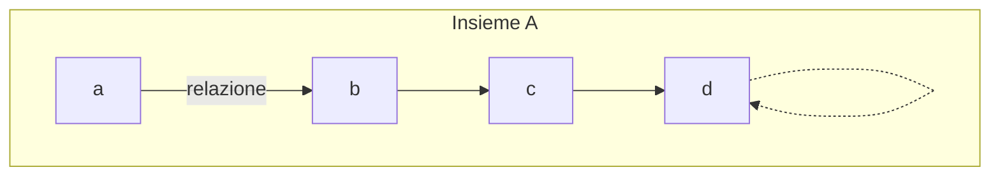

## Relazioni su un insieme

Una relazione $R$ su un insieme $A$ e' un sottoinsieme del prodotto cartesiano $A \times A$, ovvero:
$$R \in \text{Rel}(A, A) = \mathcal{P}(A \times A)$$

Ad esempio:
* $\text{Id}_A \in \text{Rel}(A, A)$ (Relazione identità)
* $\text{Succ} \in \text{Rel}(\mathbb{N}, \mathbb{N})$ (Relazione successore)
* $\text{Somma} \in \text{Rel}(\mathbb{Z} \times \mathbb{Z}, \mathbb{Z})$ **NO!** (Questa e' un'operazione, non una relazione binaria su un unico insieme di partenza).

### Notazione Grafica
Le relazioni possono essere rappresentate graficamente tramite diagrammi a grafo (o diagrammi di Venn con frecce):
* Gli elementi dell'insieme $A$ sono nodi.
* Una freccia da $a$ a $b$ indica che $(a, b) \in R$.
* I "cappi" (frecce che partono e arrivano sullo stesso elemento) indicano che l'elemento e' in relazione con se' stesso $(a, a) \in R$.

---

## Proprieta'

Data una relazione $R: A \leftrightarrow A$, analizziamo le quattro proprieta' fondamentali:

### Riflessivita'
Una relazione $R$ e' **riflessiva** se ogni elemento di A e' in relazione con se' stesso:
$$\forall a \in A\ .\ \, (a, a) \in R$$

* **Esempi:**
  * $\text{Id}_A: A \leftrightarrow A$ ($\checkmark$ riflessiva)
  * $A \times A: A \leftrightarrow A$ ($\checkmark$ riflessiva)
  * $\varnothing: A \leftrightarrow A$ (In generale **NO**, lo e' solo se $A = \varnothing$)

### Simmetria
Una relazione $R$ e' **simmetrica** se, quando un elemento e' in relazione con un secondo, vale anche il viceversa:
$$\forall a, b \in A\ .\ \, (a, b) \in R \implies (b, a) \in R$$

* **Esempi:**
  * $\text{Id}_A$ ($\checkmark$)
  * $A \times A$ ($\checkmark$)
  * $\varnothing$ ($\checkmark$ vacuamente vero, poiche'  $(a, b) \in R$ e' sempre falso).

### Transitivita'
Una relazione $R$ e' **transitiva** se la concatenazione di due relazioni implica quella diretta:
$$\forall a, b, c \in A\ .\ \, (a, b) \in R \land (b, c) \in R \implies (a, c) \in R$$

* *Nota:* $a, b, c$ possono essere anche lo stesso elemento! I cappi possono essere ignorati o inclusi senza alterare la struttura logica di base se gestiti correttamente

### Antisimmetria
Una relazione $R$ e' **antisimmetrica** se due elementi si relazionano a vicenda solo se coincidono:
$$\forall a, b \in A\ .\ \, (a, b) \in R \land (b, a) \in R \implies a = b$$

* **Esempi:**
  * $\text{Id}_A: A \leftrightarrow A$ ($\checkmark$ antisimmetrica)
  * $A \times A: A \leftrightarrow A$ (in generale **NO**, lo e' solo se A e' un singoletto oppure $A=\varnothing$)
  * $\varnothing: A \leftrightarrow A$ ($\checkmark$ vacuamente antisimmetrica)

# Teorema di caratterizzazione

Per tutti gli insiemi $A$ e le relazioni $R: A \leftrightarrow A$:

1. $R$ e' riflessiva $\iff \text{Id}_A \subseteq R$
2. $R$ e' simmetrica $\iff R \subseteq R^{\text{op}}$ (oppure $R^{\text{op}} \subseteq R$, o $R = R^{\text{op}}$)
3. $R$ e' transitiva $\iff R ; R \subseteq R$ (dove $;\;$ indica la composizione di relazioni).
4. $R$ e' antisimmetrica $\iff R \cap R^{\text{op}} \subseteq \text{Id}_A$

---

#### Dimostrazione della riflessivita'

Assumiamo che $R$ sia riflessiva. Vogliamo dimostrare che $\text{Id}_A \subseteq R$.

* Sia $(a, a) \in \text{Id}_A$.
* Per definizione di identita', $a \in A$.
* Poiche' $R$ e' riflessiva, per ogni $x \in A$ si ha $(x, x) \in R$. In particolare, per $a$, vale $(a, a) \in R$.
* Dunque, ogni elemento che appartiene a $\text{Id}_A$ appartiene anche a $R$, ovvero:
  $$\text{Id}_A \subseteq R$$

Esempio:  

$R = \{ (1,1), (2,2), (3,3), (1,2), (1,3), (2,3) \}$  

R e' riflessiva in quanto ogni elemento di A e' in relazione con se stesso.

---

#### Dimostrazione della simmetria
Assumiamo che $R$ sia simmetrica. Vogliamo dimostrare che $R \subseteq R^{\text{op}}$.

* Sia $(a, b) \in R$.
* Poiche' $R$ e' simmetrica, per definizione se $(a, b) \in R \implies (b, a) \in R$.
* Per definizione di relazione opposta ($R^{\text{op}}$), se $(b, a) \in R$, allora $(a, b) \in R^{\text{op}}$.
* Pertanto, ogni coppia di $R$ appartiene anche a $R^{\text{op}}$, il che dimostra:
  $$R \subseteq R^{\text{op}}$$

Esempio:  

$R = \{ (1, 1), (1, 2), (2, 1), (2, 3), (3, 2) \}$  

R e' simmetrica in quanto per ogni coppia $(a, b)$ presente in $R$, troviamo sempre anche la sua coppia invertita $(b, a)$, pertanto...  

$R \subseteq R^{\text{op}} \land R^{\text{op}} \subseteq R\ \implies R = R^{\text{op}}$  

---

#### Dimostrazione della transitivita'

Assumiamo che $R$ sia transitiva. Vogliamo dimostrare che $R ; R \subseteq R$.

* Sia $(x, y) \in R ; R$. Per definizione di composizione di relazioni ($;$):
  $$\exists z \in A \text{ tale che } (x, z) \in R \land (z, y) \in R$$
* Poiche' $R$ e' transitiva, da $(x, z) \in R$ e $(z, y) \in R$ segue direttamente che:
  $$(x, y) \in R$$
* Avendo mostrato che ogni elemento di $R ; R$ appartiene a $R$, concludiamo che:
  $$R ; R \subseteq R$$

Esempio:  

$R = \{ (1, 2), (2, 3), (1, 3), (3, 4), (1, 4), (2, 4) \}$  

E' transitiva in quanto la composizione di $R;R$ e' inclusa in $R$.

---

#### Dimostrazione dell'antisimmetria

Assumiamo che $R$ sia antisimmetrica. Vogliamo dimostrare che $R \cap R^{\text{op}} \subseteq \text{Id}_A$.

* Sia $(a, b) \in R \cap R^{\text{op}}$.
* Per definizione di intersezione ($\cap$), questo significa che:
  $$(a, b) \in R \quad \land \quad (a, b) \in R^{\text{op}}$$
* Per definizione di relazione opposta, $(a, b) \in R^{\text{op}} \implies (b, a) \in R$.
* Mettendo insieme le cose, abbiamo:
  $$(a, b) \in R \quad \land \quad (b, a) \in R$$
* Poiche' $R$ e' antisimmetrica, per definizione:
  $$(a, b) \in R \land (b, a) \in R \implies a = b$$
* Se $a = b$, la coppia $(a, b)$ diventa $(a, a)$, che per definizione appartiene a $\text{Id}_A$, dunque:
  $$R \cap R^{\text{op}} \subseteq \text{Id}_A$$

Esempio:  

$R = \{ (1, 1), (2, 2), (3, 3), (1, 2), (1, 3), (2, 3) \}$  

R e' antisimmetrica in quanto le uniche coppie simmetriche sono le coppie $(a, b)$ dove $a = b$. Ad esempio $R \cup \{(3, 2)\}$ **non** e' antisimmetrica!