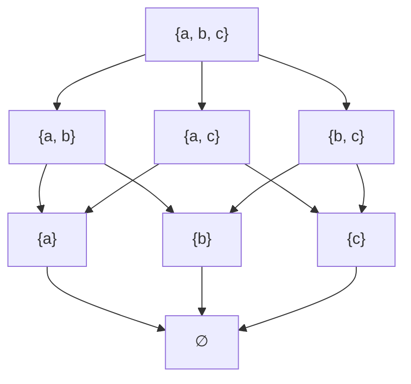
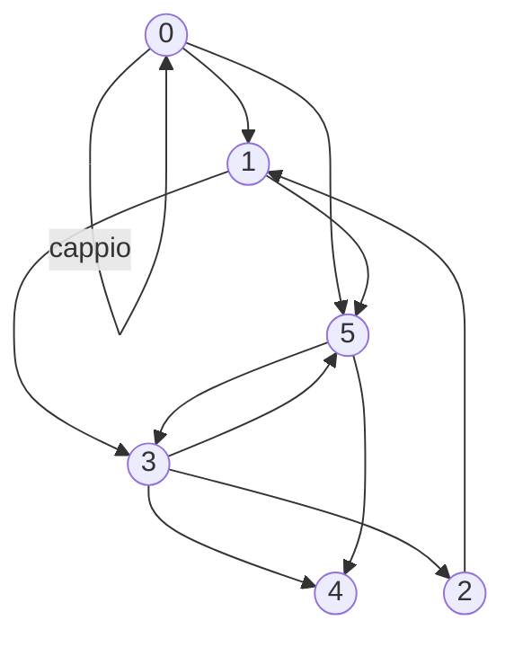
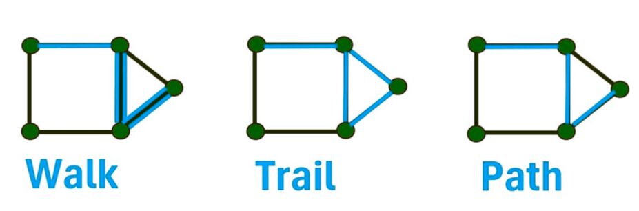

## Relazioni di ordinamento parziale

Una **relazione di ordinamento parziale** su un insieme e' una relazione $R:A \to A$ che gode delle seguenti tre proprieta' fondamentali:
1. **Riflessiva**: $\forall a \in A$, $(a, a) \in R$
2. **Transitiva**: $\forall a, b, c \in A$, se $(a, b) \in R$ e $(b, c) \in R$, allora $(a, c) \in R$
3. **Antisimmetrica**: $\forall a, b \in A$, se $(a, b) \in R$ e $(b, a) \in R$, allora $a = b$


Ad esempio sia $A = \{a, b, c\}$ allora $R = \{ (a, b), (b, c) \}$ non e' un ordinamento parziale in quanto non e' riflessiva ne' transitiva. Invece $S = \{ (a, a), (b, b), (a, b), (a, c), (b, c), (c, c) \}$ e' un ordinamento parziale!

### Esempi notevoli:
* **Identita' $Id_A$**: E' riflessiva, transitiva e antisimmetrica, quindi e' un ordinamento parziale.
* **Inclusione $\subseteq$ sull'insieme delle parti $\mathcal{P}(A)$**: Dato $A = \{a, b, c\}$, la relazione di inclusione definisce un ordinamento parziale.
* $\le: \mathbb{N}\to\mathbb{N}$

### Diagramma di Hasse
Il diagramma di Hasse permette di visualizzare graficamente un ordinamento parziale omettendo le frecce derivanti dalla proprieta' riflessiva e transitiva.

$A = \{a, b, c\}$  

$\subseteq_{P(A)} = \{ (X, Y) \in P(A) \times P(A) ∣ X \subseteq Y\}$  



*Nota bene:* In un ordinamento parziale **non** tutti gli elementi sono necessariamente confrontabili tra loro (es. $\{a\}$ e $\{b, c\}$ non sono legati da inclusione).

### Relazioni di ordinamento

Una relazione $R$ si dice di **ordinamento totale** se e' un ordinamento parziale che soddisfa anche la **proprietà di totalita**:  

$$\forall a, b \in A, \quad (a, b) \in R \lor (b, a) \in R$$  

Ovvero, ogni coppia di elementi e' sempre confrontabile. Ad esempio, $\le$ su $\mathbb{N}$ e' un ordinamento totale, mentre l'inclusione $\subseteq$ su $\mathcal{P}(A)$ **non** lo e'.

---

## Interpretazione relazionale di un ciclo while

Consideriamo l'istruzione di ciclo:
```c
while (x >= 2) do { x := x - 2 }
```
Possiamo modellare le componenti del ciclo come relazioni insiemistiche:
* **Guardia ($G$)**: Condizione di permanenza nel ciclo.  

  $$G = \{(n, n) \in \mathbb{Z} \times \mathbb{Z} \mid n \ge 2\}$$  

  > Si usa la coppia $(n, n)$ perche' nel contesto della semantica relazionale, qualsiasi componente di un programma viene visto come una relazione ingresso-uscita.
* **Negazione della Guardia ($\tilde{G}$)**: Condizione di uscita dal ciclo.  

  $$\tilde{G} = Id_\mathbb{Z} \setminus G = \{(n, n) \in \mathbb{Z} \times \mathbb{Z} \mid n < 2\}$$  

* **Corpo del ciclo ($C$)**: Trasformazione dello stato.  

  $$C = \{(x, x - 2) \mid x \in \mathbb{Z}\}$$  

* **Rappresentazione globale del ciclo ($W$)**:  

  $$W = (G; C)^* ; \tilde{G} : \mathbb{Z} \to \mathbb{Z}$$  

  > Dove $(G; C)^*$ rappresenta la chiusura riflessiva-transitiva del corpo.


### Intuizione

La chiusura $(G; C)^\star$ ha generato la "storia" di tutti gli stati intermedi attraversati dal programma, producendo coppie come $\{(5, 5), (5, 3), (5, 1), \dots \}$. Infine si ha $(G; C)^\star;\overline{G}$ che mette quindi in relazione gli stati intermedi con la condizione di chiusura ovvero $x \le 2$ e scartando tutto il resto.  

$W = \{\dots, (5, 1), (4, 0), (3, 1), (2, 0), \dots\}$  


> $W$ contiene quindi tutti i possibili stati di uscita validi (tutti gli altri stati sono stati scartati da $\overline{G}$).  

---

# Grafi

## Grafo orientato

Un **grafo orientato** e' una relazione $E: V\to V$ su un insieme finito $V$. Chiamiamo un grafo $G$ e si scrive $G = (V, E)$, dove:
* $V$ e' l'insieme dei **nodi** (o vertici), con carinalita' dei nodi $|V| = n$.****
* $E \subseteq V \times V$ e' l'insieme degli **archi** (o lati), con cardinalita' degli archi $|E| = m$.

Se un arco collega un nodo a se' stesso, ovvero $(x, x) \in E$, viene chiamato **cappio** (loop).

In questo esempio si ha che:  

$V = \{0, 1, 2, 3, 4, 5\}$  
$E = \{(0,0), (0, 1), (0, 5), \dots\}$



---

## Vicinato e grado dei nodi

Dati due nodi $x, y \in V$:
* Sono **adiacenti** se $(x, y) \in E$ oppure $(y, x) \in E$.
* **Vicinato in uscita** $N^+(x)$: l'insieme dei nodi raggiungibili da $x$.  
  $$N^+(x) = \{y \in V \mid (x, y) \in E\}$$  
* **Vicinato in ingresso** ($N^-(x)$): l'insieme dei nodi da cui e' raggiungibile $x$.  
  $$N^-(x) = \{y \in V \mid (y, x) \in E\}$$  
* **Grado di uscita ($d^+_x$) e in ingresso ($d^-_x$)**: ovvero la cardinalita' dei vicinati.  
  $$d^+_x = |N^+(x)|, \quad d^-_x = |N^-(x)|$$  


Dall'esempio nel diagramma di Hasse si ha allora che:  

$N^+(0) = {0, 1, 5}$  
$N^+(4) = \varnothing$  
$N^-(5) = {0, 1, 3}$  

$d_0^+ =3$  
$d_5^- = 3$  

### Proprieta' relazionali sui gradi (TUSI):
Le proprieta' TUSI diventano condizioni sui gradi.

* **Totale**: $E$ e' totale $\iff \forall x \in V, \, d^+_x \ge 1$
* **Univalente**: $E$ e' univalente $\iff \forall x \in V, \, d^+_x \le 1$
* **Iniettiva**: $E$ e' iniettiva $\iff \forall x \in V, \, d^-_x \le 1$
* **Suriettiva**: $E$ e' suriettiva $\iff \forall x \in V, \, d^-_x \ge 1$

---

## Handshaking Lemma

Per ogni grafo orientato vale la relazione fondamentale tra i gradi dei nodi e il numero di archi:  

$$\sum_{x \in V} d^-_x = \sum_{x \in V} d^+_x = |E| = m$$  

*Significato:* La somma di tutti i gradi in ingresso (o in uscita) di un grafo  esattamente uguale al numero totale degli archi.

### Dimostrazione per Induzione

* **Caso Base (C.B.):** Se $E = \emptyset$ (o $n = \emptyset$), allora $d^+_x = 0$ per ogni $x \in V$, da cui:  
  $$\sum_{x \in V} d^+_x = 0$$  

* **Passo Induttivo:** Supponiamo che per $|E| = m$ valga la proprietà $\sum_{x \in V} d^+_x = |E| = m$ per ogni grafo $G = (V, E)$. Vogliamo dimostrare che per un grafo $G' = (V', E')$ con $|E'| = m + 1$ vale:  

  $$\sum_{x \in V'} d'^+_x = |E'| = m + 1$$  

* **Svolgimento:** 
  Sia $G' = (V', E')$ con $|E'| = m + 1$. Togliamo da $G'$ un arco $v$ (o $e = (z \to k)$), ottenendo il grafo $G'' = (V', E' \setminus \{v\})$. Il grafo $G''$ ha esattamente $m$ archi ($|E''| = m$). 
  
  Quindi, per ipotesi induttiva, sappiamo che:  

  $$\sum_{x \in V} d''^+_x = |E''| = m$$  
  
  Rimettendo l'arco rimosso per passare da $G''$ a $G'$:  

  $$\sum_{x \in V'} d'^+_x = \sum_{x \in V' \setminus \{z\}} d''^+_x + d''^+_z + 1 = m + 1$$  


---

## Rappresentazione con matrici di adiacenza

||0|1|2|3|4|5|
|-|-|-|-|-|-|-|
|0|1|1||||1|
|1||||1||1|
|2||1|
|3|||1||1|1|
|4|||||||
|5||||1|1||

* **Vantaggi:** Permette di sfruttare le tecniche di algebra lineare (es. il prodotto matriciale rappresenta la composizione di relazioni).
* **Svantaggi:** Occupa molta memoria risultando inefficiente se il grafo e' sparso (pochi archi).
* La somma degli elementi di una riga corrisponde al grado in uscita, mentre la somma di una colonna corrisponde al grado in ingresso.
* La somma di ogni 1 e' uguale a $|E| = m$

## Liste di adiacenza
||||||
|-|-|-|-|-|
|0|$\to$|0|1|5|
|1|$\to$|3|5||
|2|$\to$|1|||
|3|$\to$|2|4|5|
|4||||
|5|$\to$|3|4||

* Per ogni nodo $x$, viene mantenuta una lista collegata dei suoi vicini in uscita, e.g. $N^+(x) = \{2, 4, 5\}$
* Per ottenere i vicini in ingresso basta trovare i nodi che puntano al nodo $x$, e.g. $N^-(3) = \{1, 5\}$
* **Vantaggi:** Molto efficiente in termini di memoria quando $|E|$ e' molto minore di $|V|^2$

$N^+(3) = \{2, 4, 5\}$  
$N^-(3) = \{1, 5\}$  


---

## Grafi Etichettati e **Pesati**
Spesso e' utile associare a nodi o archi informazioni aggiuntive (es. distanze stradali, costi o tipologie di utenti). Formalmente si definisce una funzione di etichettatura:  

$$L : (V \cup E) \to D$$  

dove $D$ e' l'insieme dei pesi o delle etichette.

## Walk, trail e path


* **Walk (Cammino generico):** Una sequenza finita di nodi $P = (v_0, v_1, \dots, v_k)$ tale che $(v_i, v_{i+1}) \in E$ per ogni $0 \le i < k$. La lunghezza del walk e' $k$. Un *walk di lunghezza 0* e' un singolo nodo.
* **Trail (Cammino senza archi ripetuti):** Un walk che non attraversa mai lo stesso *arco* due volte.
* **Path (Cammino semplice):** Un walk (o trail) che non passa mai due volte per lo stesso *nodo*.
* **Ciclo:** Un walk non vuoto i cui estremi coincidono ($v_0 = v_k$).
