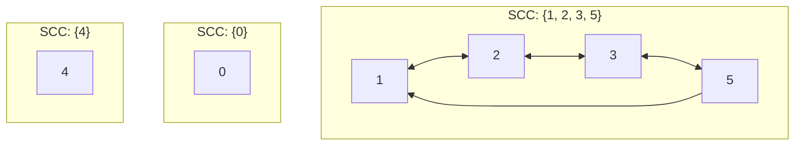
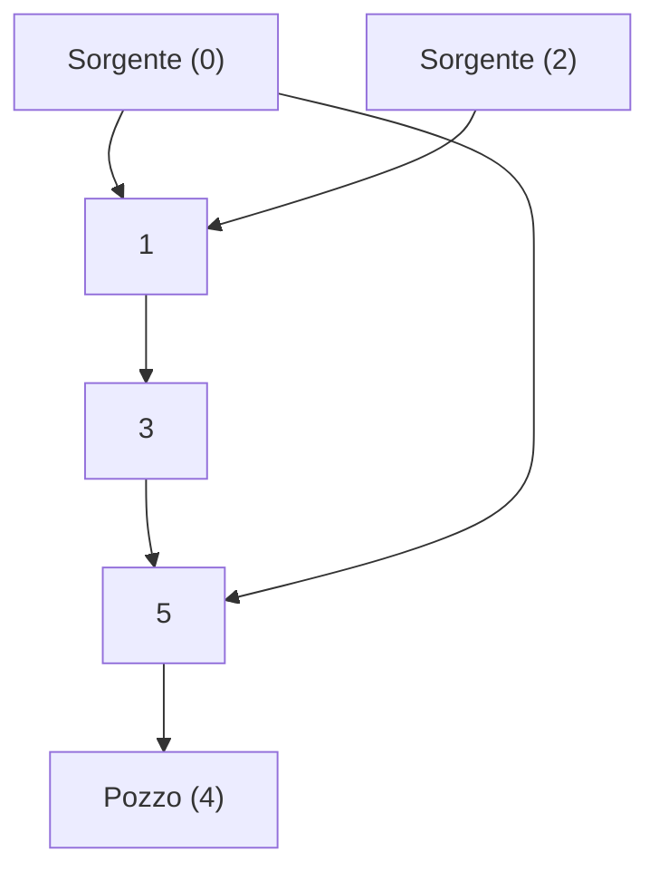

### Walk e potenze di relazioni

Sia dato un grafo orientato $G = (V, E)$ dove $E$ rappresenta la relazione di adiacenza (insieme degli archi). 
Definiamo le potenze della relazione $E$ nel seguente modo:
* $E^0 = \text{Id}_V$ (relazione identita')
* $E^{n+1} = E ; E^n$ (composizione di relazioni)

## Teorema fondamentale sui Walk
> **Esiste un walk di lunghezza $n \in \mathbb{N}$ da $x$ a $y$ se e solo se $(x, y) \in E^n$.**

Un walk di lunghezza $n$ e' una sequenza di nodi $x = x_0, x_1, \dots, x_n = y$ tale che ogni coppia consecutiva $(x_i, x_{i+1}) \in E$. 
* *Nota:* Un walk di lunghezza 0 da $x$ a $y$ esiste se e solo se $x = y$.

#### Dimostrazione per Induzione su $n$

1. **Caso Base ($n = 0$):**
   $$(x, y) \in E^0 \iff x = y \iff \exists \text{ walk di lunghezza 0 da } x \text{ a } y$$

2. **Passo Induttivo ($n \implies n+1$):**
   Supponiamo che la proprieta' valga per $n$ e dimostriamola per $n+1$:  
   $$(x, y) \in E^{n+1} \iff \{\text{definizione di potenza}\}$$  
   $$(x, y) \in E ; E^n \iff \{\text{definizione di composizione}\}$$  
   $$\exists z, \, (x, z) \in E \land (z, y) \in E^n \iff \{\text{Ipotesi Induttiva}\}$$  
   $$\exists z, \, (x, z) \in E \land \exists \text{ walk di lunghezza } n \text{ da } z \text{ a } y$$  
   Sia $z = z_0, z_1, \dots, z_n = y$ il walk da $z$ a $y$. Poiche' $(x, z) \in E$, concatenando $x$ otteniamo:  
   $$x = x, z_0, z_1, \dots, z_n = y$$  
   Questo e' un walk di lunghezza $n+1$ da $x$ a $y$.

---

## Da walk a trail, da trail a path

1. Se esiste un **walk** da $x$ a $y$, allora esiste anche un **trail** (un walk che non ripete gli archi) da $x$ a $y$.
2. Se esiste un **trail** da $x$ a $y$, allora esiste un **path** (un trail che non ripete i nodi) da $x$ a $y$.

In generale le seguenti sono equivalenti:

1. esiste un walk da $x$ a $y$
2. esiste un trail da $x$ a $y$
3. esiste un path da $x$ a $y$
4. $(x, y) \in E^\star$

---

## Walk chiusi, circuiti e cicli

* **Walk Chiuso:** Un walk in cui il nodo iniziale coincide con il nodo finale ($x = y$) e la lunghezza e' maggiore di $0$.
* **Circuito:** Un walk chiuso in cui gli archi non sono ripetuti (e' un **trail chiuso**).
* **Ciclo:** Un circuito in cui tutti i nodi interni sono distinti (e' un path chiuso a meno degli estremi).

In generale le seguenti sono equivalenti:

1. esiste un walk chiuso da $x$ a $x$
2. esiste un circuito $x$ a $x$
3. esiste un ciclo da $x$ a $x$
4. $(x, x) \in E^\star$

### Esempio pratico:
* **Walk chiuso da $x$ a $x$:** $5 \to 3 \to 2 \to 1 \to 3 \to 2 \to 1 \to 3 \to 5$
* **Circuito da $x$ a $x$:** $5 \to 3 \to 2 \to 1 \to 3 \to 5$ (eliminando gli archi ripetuti).

---

# Connettivita'

## Componenti Fortemente Connesse (SCC)

* Un grafo orientato $G = (V, E)$ e' **fortemente connesso** se per ogni coppia di nodi $x, y \in V$ esiste un walk da $x$ a $y$ (e viceversa).
* Una **Componente Fortemente Connessa (SCC)** e' un sottoinsieme non vuoto di nodi $U \subseteq V$ tale che:
  1. E' fortemente connesso.
  2. E' **massimale** (se $U \subset U' \subseteq V$, allora $U'$ non e' fortemente connesso), ovvero il massimo gruppo possibile senza che nessun nodo resti "isolato".

Dall'esempio sui grafi iniziale si ha che...  

Dove `0` e' un walk chiuso di lunghezza 1, mentre `4` e' un walk di lunghezza 0. 

## SCC e partizioni
L'insieme delle componenti fortemente connesse forma una **partizione** dell'insieme dei nodi $V$:  

  $$\text{SCC}(G) = \{ X \mid X \subseteq V \text{ e } X \text{ e' una SCC} \}$$

1. $\forall X \in \text{SCC}(G), X \neq \emptyset$
2. $\bigcup_{X \in \text{SCC}(G)} X = V$
3. $\forall X, Y \in \text{SCC}(G), X \neq Y \implies X \cap Y = \emptyset$

### Altre proprieta'

* $G(V, E)$ e' fortemente connesso $\iff V \times V \subseteq E^*$ (dove $E^*$ e' la chiusura riflessiva e transitiva).
* $(x, y) \in E^* \cap (E^*)^{op} \iff x$ e $y$ appartengono alla stessa SCC.
* Due nodi $x, y$ con $x \ne y$ appartengono alla stessa SCC se e solo se esiste un walk chiuso che li attraversa entrambe.

---

# Grafi Orientati Aciclici (DAGs)

Un **DAG** (*Directed Acyclic Graph*) e' un grafo orientato privo di cicli.
* **Sorgenti:** Nodi con grado d'ingresso pari a $0$.
* **Pozzi:** Nodi con grado d'uscita pari a $0$.

### Proprieta' fondamentale
> Se $G = (V, E)$ e' un DAG, allora la chiusura riflessiva e transitiva $E^*$ definisce un **ordinamento parziale** sui nodi.

## Ordinamento Topologico
Dato un DAG $G = (V, E)$, un ordinamento topologico e' una **biiezione** $\eta: V \to \{0, 1, 2, \dots, n-1\}$ tale che per ogni arco $(x, y) \in E$ vale:
$$\eta(x) < \eta(y)$$

*In altre parole abbiamo usato una biiezione per mettere in ordine i nodi secondo la definizione degli archi in modo che le frecce puntino tutte nella stessa direzione senza violare nessuna precedenza!*

Esempio:  

Se $E = \{ (A, B), (B, C) \}$ allora:  

$\eta(A) = 0$  
$\eta(B) = 1$  
$\eta(C) = 2$  

> **Teorema:** Ogni DAG ha almeno un ordinamento topologico.

#### Dimostrazione (per induzione su $|V|$):
1. **Caso Base ($|V| = \emptyset$):** Banale ($\checkmark$).
2. **Passo Induttivo ($|V| = n+1$):**
   * In un DAG esiste sempre almeno un pozzo $x \in V$.
   * Consideriamo il grafo ridotto $D' = (V \setminus \{x\}, E \setminus ((V \setminus \{x\}) \times (V \setminus \{x\})))$.
   * Per ipotesi induttiva, $D'$ ammette un ordinamento topologico $\eta': V \setminus \{x\} \to n$.
   * Estendiamo la funzione a tutto $V$ ponendo $\eta(x) = n$ e $\eta(y) = \eta'(y)$ per $y \neq x$. Tale funzione rispetta la condizione $\eta(u) < \eta(v)$ per ogni arco $(\checkmark)$.