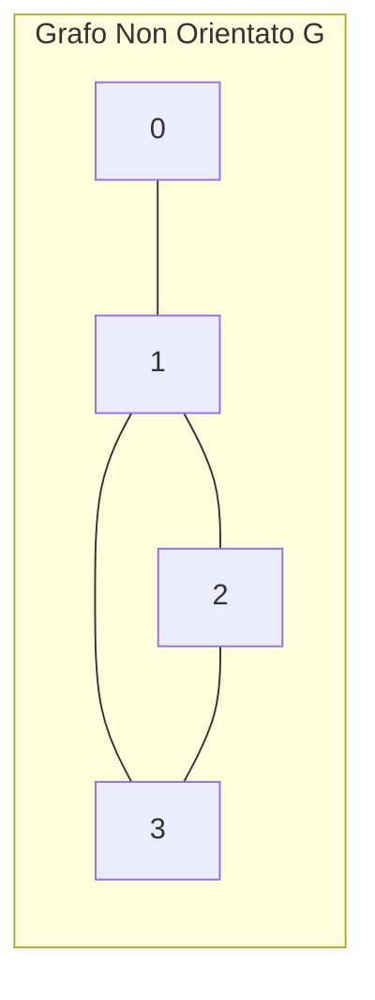
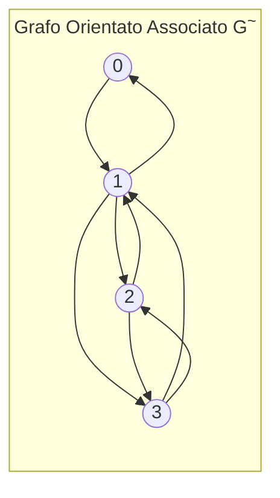
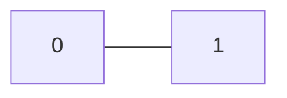
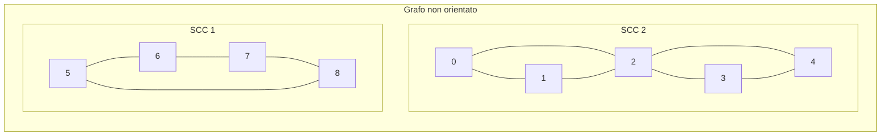
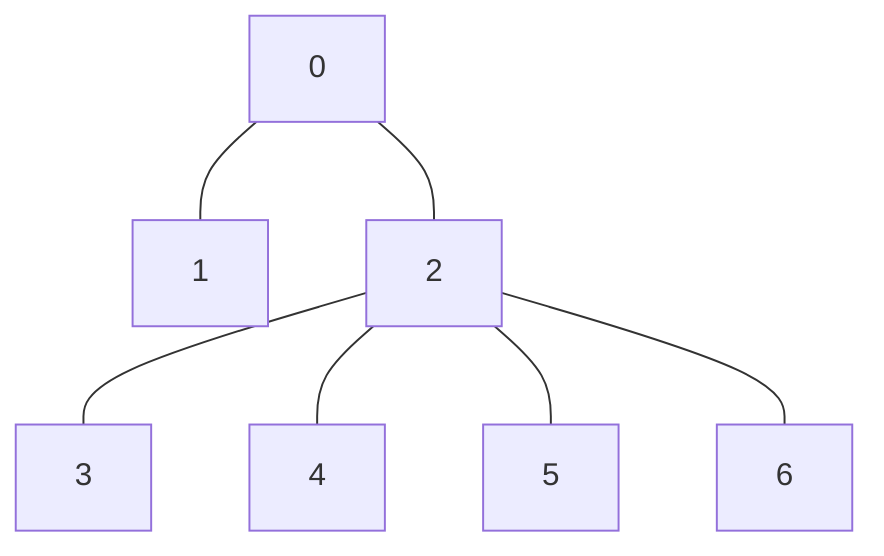

# Grafi non orientati

* Applicazioni pratiche tipiche includono le reti metropolitane o i sistemi di strade
* Mancando di un verso specifico, i collegamenti si presentano semplicemente come sottoinsiemi di nodi di cardinalita' 2:  
    $P_2(V) = \{X \subseteq V \mid |X| = 2\}$
* Formalmente, un **grafo non orientato** si definisce come una coppia $G = (V, E)$, dove $V$ rappresenta un insieme finito di nodi ed $E$ costituisce un insieme di archi tale che $E \subseteq P_2(V)$.
* Per praticita', e' possibile indicare un collegamento con $xy \in E$ anziche' $\{x, y\} \in E$ (sono comunque scritture equivalenti).
* Per definizione, questa tipologia di grafi esclude la presenza di cappi (cioe' archi che collegano un nodo a se stesso)!

Dato un grafo non orientato $G = (V, E)$, e' possibile definire il grafo orientato associato $\tilde{G} = (V, \tilde{E})$.

### Grafo orientato associato

L'insieme degli archi orientati $\tilde{E}$ e' definito come:

$$\tilde{E} = \{ (x, y) \in V \times V \mid \{x, y\} \in E \}$$

>**Nota**: $\{x, y\}$ indica un insieme di due elementi, quindi un arco non orientato, mentre $(x, y)$ e' una coppia ordinata.

#### Cardinalita'
Per ogni arco del grafo non orientato ne otteniamo $2$ nel grafo orientato associato:

$$|\tilde{E}| = 2 \cdot |E|$$

---

## Rappresentazione di grafi non orientati

I grafi non orientati possono essere rappresentati tramite una matrice di adiacenza.

|   | 0 | 1 | 2 | 3 |
|---|---|---|---|---|
| **0** | **0** | 1 | 0 | 0 |
| **1** | 1 | **0** | 1 | 1 |
| **2** | 0 | 1 | **0** | 1 |
| **3** | 0 | 1 | 1 | **0** |

- Si ottiene una **matrice simmetrica** rispetto alla diagonale.
- Non essendoci cappi (autocappi), la **diagonale e' composta interamente da zeri**.

---

## Walk, trail e path in grafi non orientati

In un grafo non orientato $G = (V, E)$:
- Un **Walk** (cammino) e' una sequenza di nodi $P = v_0, v_1, \dots, v_k$ tale che $\{v_i, v_{i+1}\} \in E$ per ogni $i \in \{0, \dots, k-1\}$.

Le definizioni tradizionali di **Trail** (cammino senza archi ripetuti) e **Path** (cammino senza nodi ripetuti) non cambiano, cosi' come le loro relazioni fondamentali:
> Se esiste un walk da $x$ a $y$, allora esiste un trail da $x$ a $y$ e un path da $x$ a $y$.

---

## Cicli e connettivita'

- Un **walk chiuso** (da $x$ a $x$) **non implica** la presenza di un circuito (da $x$ a $x$ senza archi ripetuti).
- Tuttavia, la presenza di un **circuito implica** l'esistenza di un **ciclo**.

### Esempio di walk chiuso che non e' un circuito

Consideriamo il walk $0 \to 1 \to 0$:

La sequenza $0 - 1 - 0$ e' un **walk chiuso** (parte da 0 e torna a 0), ma **non e' un circuito e neppure un ciclo**, in quanto riattraversa lo stesso arco $\{0, 1\}$.

---

## Connettivita' e componenti connesse

Un grafo non orientato e' **connesso** se esiste un walk tra ogni coppia di nodi.

- **Componente Connessa:** Insieme massimale di nodi connessi tra loro.

### Esempio

Le due sotto-strutture nell'esempio sono componenti connesse distinte e **scollegate** tra loro.

---

## Cammini e cicli Euleriani e Hahmiltoniani

### Circuiti e trail Euleriani
* **Circuito Euleriano:** Un circuito che passa **esattamente una volta per tutti gli archi** del grafo.
* **Trail Euleriano (o Percorso Euleriano):** Un trail che passa esattamente una volta per tutti gli archi (famoso nel *Problema dei 7 ponti di Königsberg*).

### Teorema di Eulero
Dato un grafo non orientato e connesso:
1. Esiste un **circuito euleriano** $\iff$ tutti i nodi hanno **grado pari**.
2. Esiste un **trail euleriano** da $x$ ad $y$ $\iff$ $x$ ed $y$ sono gli **unici nodi di grado dispari**.

---

## Cicli e path Hamiltoniani

- **Ciclo Hamiltoniano:** Dato un grafo connesso (orientato o meno), e' un ciclo che passa **esattamente una volta per tutti i nodi** del grafo.
- **Path Hamiltoniano:** E' un path che passa **esattamente una volta per tutti i nodi** (senza necessariamente tornare al punto di partenza come nel ciclo).
- **Differenza Chiave:** **Non esiste una formula o una caratterizzazione semplice** per i grafi hamiltoniani, a differenza di quanto visto per i circuiti euleriani.

### Applicazione Pratica
- **Il Problema del Commesso Viaggiatore** *(Travelling Salesman Problem)*: Ricerca del ciclo hamiltoniano di costo minimo in un grafo pesato.

---

## Alberi

Un **albero** e' un grafo non orientato, **connesso**, **aciclico** e **non vuoto**.

### Esempi notevoli di alberi
- Albero Binario di Ricerca *(BST - Binary Search Tree)*
- Red-Black Tree
- Albero Decisionale
- Albero Genealogico

---

## Foreste e proprieta' degli alberi

- **Foresta:** Un grafo non orientato, **aciclico** e **non vuoto** (puo' non essere connesso). 
  > Ogni componente connessa di una foresta e' un albero!

### Terminologia dei nodi
- **Foglia:** Nodo con grado pari a 1 (o grado 0 se il grafo e' composto da un singolo nodo).
- **Nodo Interno:** Nodo con grado $> 1$.

### Relazione Fondamentale tra vertici ed archi
In qualsiasi albero vale sempre la seguente relazione:

$$|E| = |V| - 1$$

Cioe' il numero di archi e' sempre pari al numero di nodi meno uno.