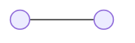
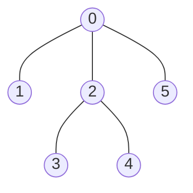
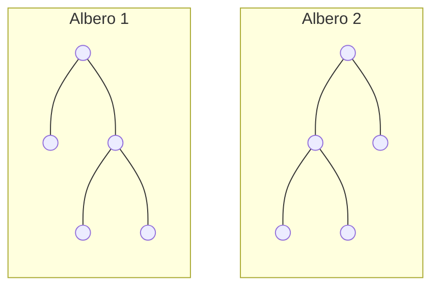
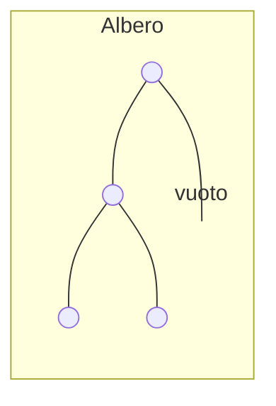
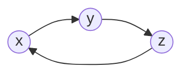
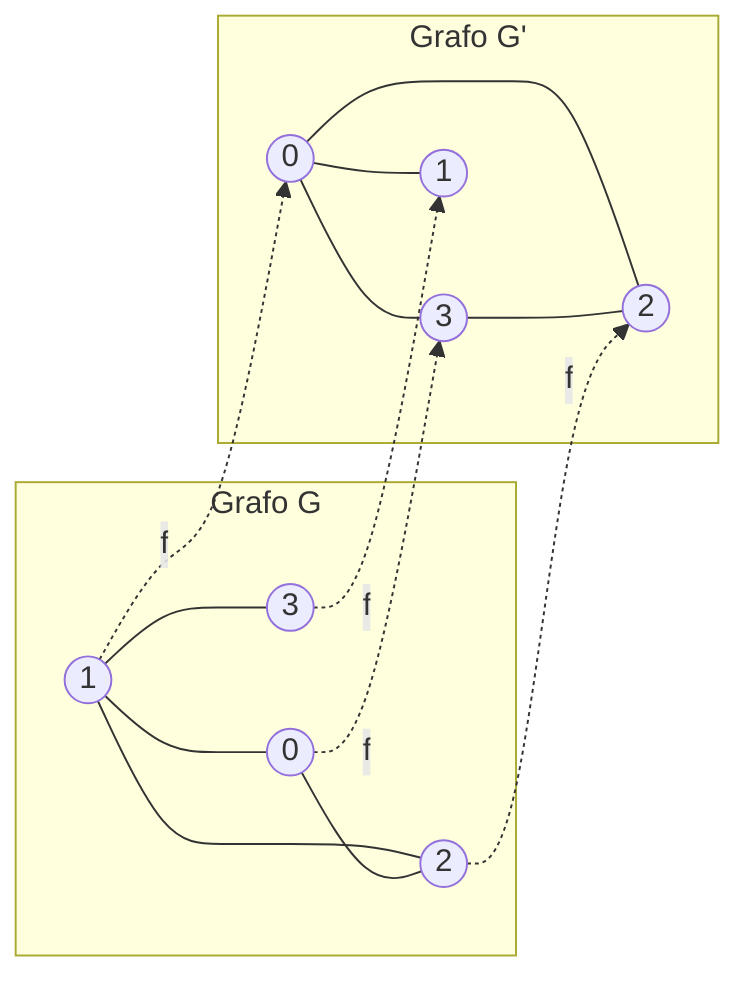

# Proprieta' degli alberi

## Proprieta' a)
>Ogni albero con almeno due nodi ha almeno una foglia

#### Dimostrazione induttiva
*   **Caso Base (CB):** $G = (V, E)$ con $|V| = 2$.

Un grafo connesso con 2 nodi ha 1 arco. Entrambi i nodi hanno grado 1, quindi l'albero ha due foglie. (Verificato $\checkmark$)

*   **Passo Induttivo (PI):** Assumiamo che ogni albero con $n$ nodi abbia almeno una foglia (Ipotesi Induttiva). Consideriamo un grafo $G = (V, E)$ con $|V| = n + 1$.
    Prendiamo un nodo $x$ con grado $d_x > 1$. Siano $N(x) = \{x_0, x_1, \dots, x_{k-1}\}$ i suoi vicini, con $d_x = k$.
    
    Si ricorda che $E \subseteq \mathcal{P}_2(V)$ (gli archi sono sottoinsiemi di 2 elementi del set di vertici), quindi possiamo costruire un nuovo grafo $G'$ rimuovendo il nodo $x$ e riconnettendo i suoi vicini in catena:
    $$G' = \left(V \setminus \{x\}, \left(E \cap \mathcal{P}_2(V \setminus \{x\})\right) \cup \{\{x_i, x_{i+1}\} \mid i \in \{0, \dots, k-2\}\}\right)$$

    **Osservazione:** $G'$ ha $n$ nodi ed e' un **ALBERO**!
    *   E' non vuoto.
    *   E' connesso (avendo tolto $x$, abbiamo riconnesso i suoi vicini tra loro).
    *   E' aciclico (non abbiamo creato nuovi cicli rimuovendo $x$ e riconnettendo gli altri).
    
    Per ipotesi induttiva, $G'$ ha almeno una foglia: $\exists z \text{ tale che } d_{G'}(z) = 1$ (foglia $z$).

    **Proprieta' del grado:**
    $$\forall x \in V_{G'}, \quad d_{G'}(x) \ge d_G(x)$$
    Se ho una foglia in $G'$, allora e' una foglia anche in $G$, in quanto rimuovendo un nodo interno e riconnettendo la catena non puo' essere aumentato il suo grado oltre il valore originale in modo da eliminare la sua natura di foglia.

---
## Proprieta' b)
> Ogni albero ha esattamente $n - 1$ archi  

Sia $G = (V, E)$ un albero con $n = |V|$ nodi. Vogliamo dimostrare che $|E| = |V| - 1$.

*   **Caso Base (CB):** $|V| = 1$.
    *   Un grafo con un solo nodo non ha archi: $|E| = 0$.
    *   Formula: $n - 1 = 1 - 1 = 0$ archi. ($\checkmark$)

*   **Passo Induttivo (PI):** $G = (V, E)$ con $|V| = n + 1 \implies |E| = n$.
    Sappiamo dalla *Proprieta' a)* che $G$ ha almeno una foglia (nodo con grado 1). Rimuoviamo la foglia $x$:
    $$G' = (V \setminus \{x\}, E \setminus \{e_x\}) = (V', E')$$
    
    *   $|V'| = |V| - 1 = n$
    *   $|E'| = |E| - 1$

    Per ipotesi induttiva, l'albero $G'$ con $n$ nodi ha $|E'| = n - 1$ archi.
    Quindi $|E| - 1 = n - 1 \implies |E| = n$. ($\checkmark$)

---

### Proprieta' c) 
> Per ogni coppia di nodi distinti $x, y \in V$ esiste un unico cammino (path) da $x$ a $y$

1.  **Esistenza ($c_1$):** Se non ci fosse un cammino tra $x$ e $y$, il grafo non sarebbe connesso e quindi non sarebbe un albero!
2.  **Unicita' ($c_2$):** Supponiamo per assurdo che esistano due cammini distinti tra $x$ e $y$:
    $$\text{Cammino 1: } x = x_0, x_1, \dots, x_k = y$$
    $$\text{Cammino 2: } x = z_0, z_1, \dots, z_k = y$$
    
    Sia $i$ il minimo indice per cui i due cammini divergano ($x_i \neq z_i$). Sia poi $k_1, k_2$ i primi indici successivi a $i$ per cui i cammini si rincontrano, ovvero $x_{k_1} = z_{k_2}$.
    Allora la sequenza di nodi $x_i, x_{i+1}, \dots, x_{k_1} = z_{k_2}, z_{k_2-1}, \dots, z_i$ forma un **ciclo**, il che e' assurdo poiche' l'albero e' per definizione aciclico.

---

### Proprieta' d)

> Per ogni arco $xy \in E$, la rimozione di $xy$ rende il grafo non connesso

In un albero, ogni arco e' un ponticello (bridge). Poiche' l'arco $xy$ costituisce l'unico cammino tra $x$ e $y$ (proprieta' c), rimuovendolo non esiste piu' alcun cammino tra $x$ e $y$, rendendo il grafo disconnesso.

---

### Proprieta' e)
>Per ogni coppia di nodi distinti $x, y \in V$ tale che $xy \notin E$, l'aggiunta dell'arco $xy$ crea un ciclo
Il grafo $G' = (V, E \cup \{xy\})$ e' ciclico. Poiche' esisteva gia' un unico cammino tra $x$ e $y$ in $G$, l'aggiunta dell'arco diretto $xy$ chiude quel cammino formando un ciclo.

---

# Alberi radicati
Un **albero radicato** e' un albero in cui e' stato designato un nodo speciale detto **radice**.

*   **Relazioni di parentela:**
    *   $1$ e $2$ sono **figli** di $0$.
    *   $1$ e $2$ sono **fratelli**.
    *   $4$ e' **discendente** di $0$.
    *   *Scegliere la radice determina la gerarchia ("parentela") nell'albero.*

---

## Albero ordinale
Un albero radicato e' **ordinale** se per ciascun nodo interno e' definito un **ordinamento totale** tra i suoi figli (es. primo figlio, secondo figlio, ecc.).

*(I due alberi sopra non sono uguali in un contesto ordinale)*.

---

## Albero cardinale
Un albero radicato e' **cardinale di ordine $k$** (o $k$-ario) se ogni nodo ha esattamente $k$ posizioni per i figli, alcuni dei quali possono essere vuoti.

*   **Alberi Binari ($k = 2$):** Ogni nodo ha al piu' due figli, distinti esplicitamente in **figlio sinistro** e **figlio destro**.

---

## Distanza metrica
Una distanza metrica su un insieme $A$ e' una funzione $d: A \times A \to \mathbb{R}$ che soddisfa le seguenti proprieta' per ogni $x, y, z \in A$:

1.  **Non negativita':** $d(x, y) \ge 0$
2.  **Identita' degli indiscernibili:** $d(x, y) = 0 \iff x = y$
3.  **Simmetria:** $d(x, y) = d(y, x)$
4.  **Disuguaglianza triangolare:** $d(x, y) \le d(x, z) + d(z, y)$

Analogamente alla distanza Euclidea tra due punti $P_1(x_1, y_1)$ e $P_2(x_2, y_2)$ nel piano cartesiano:  

$$d = \sqrt{(x_1 - x_2)^2 + (y_1 - y_2)^2}$$  

---

### Distanza su un grafo non orientato
Sia $G = (V, E)$ un grafo non orientato e connesso.
La distanza tra due nodi $x, y \in V$, indicata con $d(x, y)$, e' la **lunghezza del walk (cammino) piu' breve** tra $x$ e $y$ (il cammino minimo).

---

### Distanza su grafi orientati
La definizione di distanza si puo' applicare anche a grafi orientati fortemente connessi?

*   $d(x, y) = 1$
*   $d(y, x) = 2$

**Si perde la simmetria!** In generale, $d(x, y) \neq d(y, x)$.
Quindi si introduce il concetto di **distanza ultrametrica** (senza il vincolo di simmetria).

---

## Proprieta' metriche negli alberi e grafi

*   **Diametro:** Il diametro di un grafo e' la **massima distanza** tra qualsiasi coppia di nodi.
*   **Profondita':** In un albero radicato, la profondita' di un nodo e' la sua distanza dalla radice.
*   **Altezza:** L'altezza dell'albero e' la **massima profondita'** raggiunta da un nodo nell'albero.

---

## Isomorfismo di grafi

Un **isomorfismo** tra due grafi $G = (V, E)$ e $G' = (V', E')$ e' una **biezione** $f: V \to V'$ tale che:
$$xy \in E \iff f(x)f(y) \in E'$$

Due grafi si dicono **isomorfi** ($G \cong G'$) se esiste un isomorfismo tra di essi (ovvero hanno la stessa struttura a meno di un rinominamento dei vertici).

