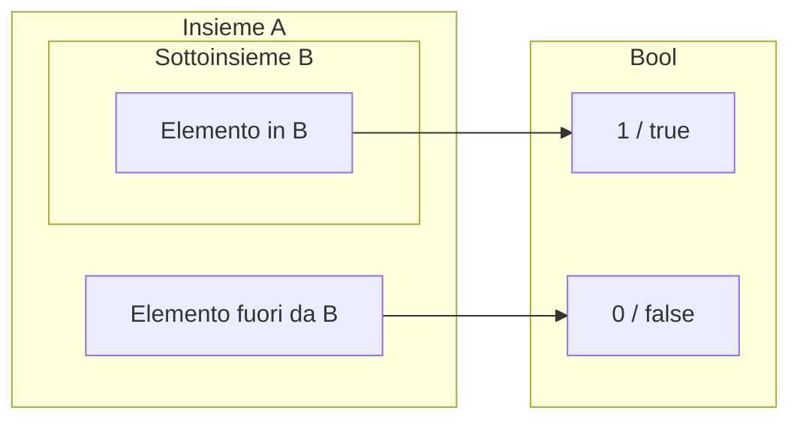

# Calcolo combinatorio

La **cardinalita'** di un insieme finito $A$ e' il numero dei suoi elementi, indicato con $|A|$.

Esempi:
* $|\{a, e, i, o, u\}| = 5$
* $|\{i, i, a, e, i, o, u\}| = 5$ (gli elementi ripetuti contano una sola volta)
* In generale, l'insieme $n = \{0, 1, 2, \dots, n-1\}$ ha cardinalita' $|n| = n$
* Per l'insieme vuoto: $|\emptyset| = 0$

---

## Lemma X

> La cardinalita' di $A$ e' uguale alla sommatoria della cardinalita' delle parti.

Se $P = \{A_i\}_{i \in I}$ e' una **partizione** dell'insieme $A$, allora:  

$$|A| = \sum_{i \in I} |A_i|$$  

### Dimostrazione per assurdo

Sia $n = |A|$ e $m = \sum_{i \in I} |A_i|$ la sommatoria delle cardinalita' delle parti.

1. **Caso $m < n$:**
   $m < n \iff \exists x \in A\ .\ (\forall i \in I, x \notin A_i)$  
   *Impossibile*, perche' $\{A_i\}_{i \in I}$ e' una copertura di $A$ (ogni elemento di $A$ appartiene ad almeno un insieme della partizione).

2. **Caso $n < m$:**
   $n < m \iff \exists x \in A,\ \exists i, j \in I\ :\ (i \neq j \land x \in |A_i| \cap |A_j|)$  
   *Impossibile*, perche' le parti di $A$ sono a due a due disgiunte per definizione di partizione.

Di conseguenza, dev'essere $n = m$.

---

## Cardinalita' di operazioni su insiemi

1. **Cardinalita' di un insieme $A$:**  
   $$|A| = |A \setminus B| + |A \cap B|$$  

2. **Unione di due insiemi (Principio di inclusione-esclusione):**  
   $$|A \cup B| = |A \setminus B| + |A \cap B| + |B \setminus A|$$  
   Aggiungendo e sottraendo $|A \cap B|$, si ottiene la formula standard:  
   $$|A \cup B| = |A| + |B| - |A \cap B|$$  

3. **Unione di tre insiemi:**  
   $$|A \cup B \cup C| = |A| + |B| + |C| - |A \cap B| - |A \cap C| - |B \cap C| + |A \cap B \cap C|$$  

Il principio e' generalizzabile a un numero qualsiasi di insiemi (Principio di Inclusione-Esclusione). Si noti che il *Lemma X* e' un caso particolare / corollario del principio di inclusione-esclusione dove gli insiemi sono disgiunti.

**Corollari:**  
* $$|A \setminus B| = |A| - |A \cap B|$$  
* $$|A \cup B| \le |A|+|B|$$  
  * *Sono uguali se e solo se $A$ e $B$ sono disgiunti.*
* $$B \subseteq A \implies |B| \le |A|$$  

---

## Cardinalita' del prodotto cartesiano

Per il prodotto cartesiano di due insiemi $A$ e $B$:  

$$|A \times B| = |A| \cdot |B|$$  

**Spiegazione:**
Si puo' suddividere $A \times B$ in insiemi disgiunti $S_k = \{(a_k, b) \mid b \in B\}$ per ogni $a_k \in A$.  
Ognuno di questi insiemi ha cardinalita' $|S_k| = |B|$.  
Quindi:  

$$|A \times B| = \sum_{i \in |A|} |S_i| = |A| \cdot |B|$$  
### Dimostrazione

Usiamo il lemma X. Sia $a \in A$. Definiamo l'insieme $S_a$ come l'insieme delle coppie in cui la prima componente e' fissata su $a$:
$$S_a = \{(a, b) \mid b \in B\}$$

* $S_a \subseteq A \times B$
* La cardinalita' di ciascuna fetta e' pari a quella di $B$: $|S_a| = |B|$

L'insieme prodotto cartesiano $A \times B$ puo' essere visto come l'unione disgiunta di tutte queste fette $S_a$ al variare di $a$ in $A$:
$$A \times B = \bigcup_{a \in A} S_a$$

Se $a_1 \neq a_2$, le fette corrispondenti sono disgiunte: $S_{a_1} \cap S_{a_2} = \emptyset$. Dunque la famiglia $\{S_a\}_{a \in A}$ forma una **partizione** di $A \times B$.

### Rappresentazione visiva di $A \times B$

La tabella seguente illustra come il prodotto cartesiano si scompone nelle fette $S_a$ lungo l'asse $A$ e gli elementi $b$ lungo l'asse $B$:

| Insieme $A \setminus B$ | $b_1$ | $b_2$ | $\dots$ | $b_m$ |
| :---: | :---: | :---: | :---: | :---: |
| **$a_1$** | $(a_1, b_1)$ | $(a_1, b_2)$ | $\dots$ | $(a_1, b_m)$ |
| **$a_2$** | $(a_2, b_1)$ | **$(a_2, b_2)$** *(elemento generico di $S_{a_2}$)* | $\dots$ | $(a_2, b_m)$ |
| **$\vdots$** | $\vdots$ | $\vdots$ | $\ddots$ | $\vdots$ |
| **$a_n$** | $(a_n, b_1)$ | $(a_n, b_2)$ | $\dots$ | $(a_n, b_m)$ |

*Nota: Ogni riga orizzontale rappresenta un insieme $S_a$, e la sua cardinalita' corrisponde esattamente a $|B|$.*

### Conclusione della dimostrazione

Applicando il Lemma X alla partizione $\{S_a\}_{a \in A}$:  

$$|A \times B| = \sum_{a \in A} |S_a| = \sum_{a \in A} |B| = |A| \cdot |B|$$  

### Esempio pratico: targhe auto
Formato standard `XX CCC XX` (2 lettere, 5 cifre, 2 lettere), si calcola usando la regola del prodotto cartesiano sulle possibili combinazioni dei singoli caratteri. In particolare:

*  $X \in A\ (\text{alfabeto escluse alcune lettere})$
*  $C \in 10$

Le targhe sono allora elementi dell'insieme:  

$$A\times A\times10 \times10 \times10 \times A\times A$$  

Dato che $|A| = 22$ si ha che il numero di targhe diverse e':  

$$22\cdot22\cdot10\cdot10\cdot10\cdot22\cdot22 = 234\ 256\ 000$$  

---

## Cardinalita' di potenze  

$$|A^n| = |A|^n$$

Sia $A = \{0, 1\}$, allora il numero di sequenze binarie di lunghezza $n$ e' $|A^n| = 2^n$. Ad esempio $A^3$ contiene tutte le possibili sequenze binarie di lunghezza $3$ (come $(0,0,0)$, $(1,0,1)$, ecc.), e la quantita' totale di queste sequenze e' data da $|A^3| = 2^3 = 8$  

**Dimostrazione per induzione su $n$:**

Sia $B(n)$ il numero di
sequenze binaria di lunghezza $n$:  

* **Caso base (CB):** $B(0) = 1$ (esiste solo la sequenza vuota).
* **Passo induttivo (CI):** $B(n+1) = 2 \cdot B(n)$.
  Se $B(n)$ e' il numero di sequenze di lunghezza $n$, aggiungendo un bit (0 o 1) si raddoppia il numero di sequenze, confermando $2^n$.

---

## Relazioni e cardinalita'

Sia $R: A \leftrightarrow B$ una relazione, ovvero $R \subseteq A \times B$.

* In generale, la cardinalita' di $R$ soddisfa:
  $$0 \le |R| \le |A| \cdot |B|$$

Proprieta' delle relazioni e dei vincoli sulla cardinalita':
* **Relazione totale:** $|R| \ge |A|$
* **Relazione univalente:** $|R| \le |A|$
* **Relazione iniettiva:** $|R| \le |B|$
* **Relazione suriettiva:** $|R| \ge |B|$
* **Relazione funzione:** $|R| = |A|$
* **Relazione biettiva:** $|R| = |A| \land |R| = |B|$ (quindi $|A| = |B|$)

---

## Pigeonhole principle

Se abbiamo $n$ piccioni e li vogliamo collocare in $m$ caselle di una piccionaia, con $n > m$, allora **almeno una casella conterra' piu' di un piccione** ($\ge 2$ piccioni).

In termini di relazioni:
* Piccioni: $|P| = n$
* Caselle: $|B| = m$
* Relazione $R: P \leftrightarrow B$, con $n > m$.
* $R$ deve essere una funzione totale ed univalente in quanto ogni piccione va associato ad una ed una sola casella.
* Se $R$ fosse una funzione iniettiva, avremmo $|R| = |P| = n$ e per l'iniettivita' $|R| \le m$, da cui $n \le m$, giungendo a un **assurdo** poiche' eravamo partiti dall'ipotesi $n > m$.
* Di conseguenza, la funzione **non puo' essere iniettiva**.

| Piccioni $P$ | Casella di destinazione $B$ |
| :---: | :---: |
| **Piccione 1** ($P_1$) | Casella 1 ($B_1$) |
| **Piccione 2** ($P_2$) | Casella 2 ($B_2$) |
| **Piccione 3** ($P_3$) | **Casella 2 ($B_2$)** *(conflitto: condivisa con $P_2$)* |

---

## Regola di biezione

Se $R: A \leftrightarrow B$ e' una biezione, allora:
$$|R| = |A| \land |R| = |B| \implies |A| = |B|$$

Questa regola e' molto utile per determinare la cardinalita' di un insieme ignoto mettendolo in biezione con uno di cardinalita' nota.

### Esempio: cardinalita' dell'insieme delle funzioni $\mathrm{Fun}(A,B)$

Mostriamo che $\mathrm{Fun}(A, B) \cong B^{|A|}$.

Sia $A = \{a_0, a_1, a_2, \dots, a_{n-1}\}$ con $|A| = n$.  
Una funzione $f \in \mathrm{Fun}(A,B)$ e' univocamente determinata dalle sue immagini:
$$(f(a_0), f(a_1), \dots, f(a_{n-1}))$$
Ogni coordinata appartiene a $B$, quindi la tupla appartiene a $B^n = B^{|A|}$.  
Esiste quindi una biezione $\hat{g} = (b_0, b_1, \dots, b_{n-1}) \mapsto g(a_i) = b_i$.

Da cui:
* $|\mathrm{Fun}(A, B)| = |B|^{|A|}$
* $|\mathrm{Rel}(A, B)| = |\mathcal{P}(A \times B)| = 2^{|A \times B|} = 2^{|A| \cdot |B|}$

---

## Cardinalita' dell'insieme delle parti

Per qualsiasi insieme $A$, la cardinalita' del suo insieme delle parti $\mathcal{P}(A)$ e':

$$|\mathcal{P}(A)| = 2^{|A|}$$

**Dimostrazione tramite isomorfismo/biezione:**
$\mathcal{P}(A) \cong \mathrm{Fun}(A, \mathrm{Bool})$

* A ogni sottoinsieme $B \subseteq A$ corrisponde la funzione caratteristica $\chi_B: A \to \mathrm{Bool}$.
* Viceversa, ad ogni funzione $f: A \to \mathrm{Bool}$ corrisponde il sottoinsieme $\{a \in A \mid f(a) = \mathrm{true}\}$.

Di conseguenza:
$$|\{f: A \to \mathrm{Bool}\}| = |\mathrm{Bool}|^{|A|} = 2^{|A|}$$

>**Nota:** Immagina di avere una scatola di oggetti e di voler creare tutte le combinazioni possibili di sottoinsiemi. Per ogni singolo oggetto hai solo 2 strade possibili:O decidi di metterlo nel sottoinsieme (1/true), o decidi di lasciarlo fuori (0/false). Visto che fai questa scelta "dentro o fuori" per ogni singolo oggetto in modo indipendente, il numero totale di combinazioni che puoi creare si ottiene semplicemente moltiplicando le 2 scelte $n$ volte dove $n$ e' la cardinalita' degli oggetti ($2 \times 2 \times 2 \dots$).
---

## Biezioni e cardinalita'

$$|A| = |B| \iff A \cong B$$

* ($\Leftarrow$) Per la **regola di biezione**.
  * Se trovi un modo per accoppiare perfettamente ogni elemento di $A$ con uno di $B$ senza scarti, allora per forza di cose $A$ e $B$ hanno lo stesso numero di elementi.
* ($\Rightarrow$) Mostriamo che $A \cong |A|$ per ogni insieme finito $A$.
  * Se sai gia' che $A$ e $B$ hanno lo stesso numero di elementi (ad esempio, entrambi hanno $n$ elementi), allora puoi "etichettarli" mettendoli in fila con i numeri da $0$ a $n-1$. Se $A$ ha cardinalita' $n$, allora $A \cong \{0, 1, 2, \dots, n-1\}$.  
  Possiamo ordinare gli elementi di $A$ come $(a_0, a_1, a_2, \dots, a_{n-1})$ e in modo analogo gli elementi di $B$.  
  Quindi:
  $$A \cong |A| = n \cong |B| \implies A \cong B$$