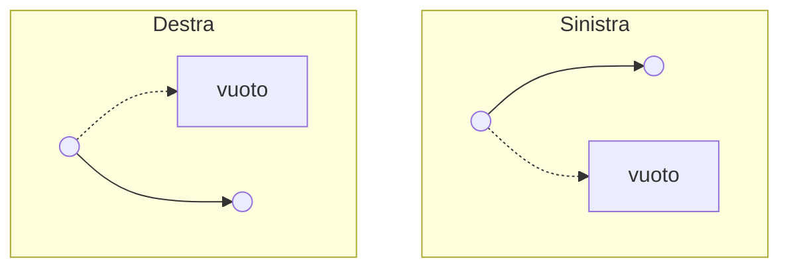
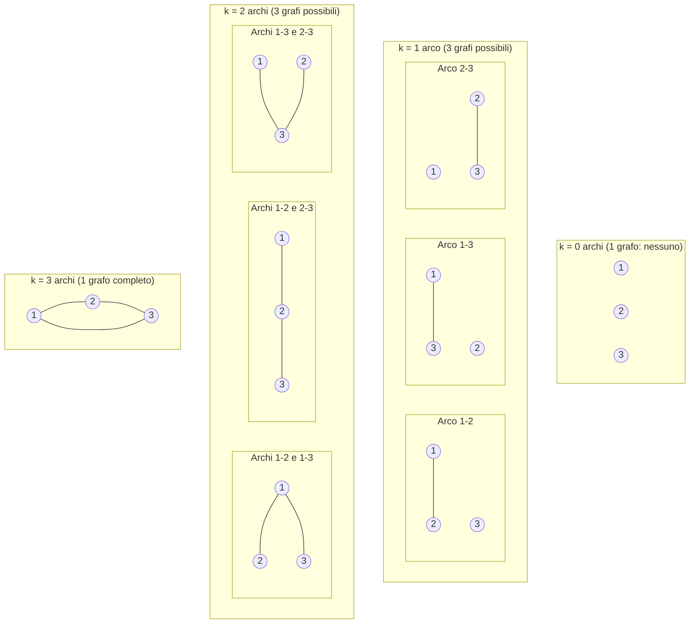
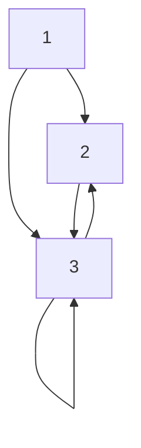
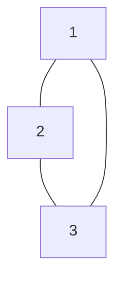

# Contare sui grafi

Sappiamo che: 

* Un albero con $n$ nodi ha esattamente $n - 1$ archi.
* L'altezza di un albero radicato e' la massima distanza di una foglia dalla radice.

Allora, se l'altezza dell'albero e' $h$, la massima distanza tra due nodi qualsiasi e' al piu' $2h$. Se $r$ e' la radice dell'albero, per ogni coppia di nodi $x$ e $y$ vale la disuguaglianza triangolare:

$$d(x, y) \le d(x, r) + d(r, y) \le 2h$$

# Alberi binari

Un albero binario e' un albero radicato posizionato (o ordinale) di ordine 2, in cui ogni nodo ha al massimo 2 figli. Distinguiamo chiaramente il figlio sinistro dal figlio destro.

> **Nota:** Due alberi con struttura opposta sono considerati distinti.

*   **Pieno**: un albero binario e' pieno se ogni nodo interno ha esattamente 2 figli.
*   **Completo**: un albero binario e' completo se e' pieno e tutte le foglie hanno la stessa profondita' (o altezza).

---

## Alberi binari completi di altezza $h$

Per un albero binario completo di altezza $h$:

*   **Numero totale di nodi ($N_h$):**
    $$N_h = 2^{h+1} - 1 = 2^0 + 2^1 + \dots + 2^h$$

    *Nota:* In informatica con $n$ bit (es. 8 bit) il numero massimo rappresentabile e' $2^8 - 1 = 255$, mentre il numero totale di configurazioni e' $2^8 = 256$.

*   **Numero di foglie ($F_h$):**
    $$F_h = 2^h$$

*   **Numero di nodi interni ($I_h$):**
    $$I_h = 2^h - 1$$

---

## Altezza minima di un albero binario

Dato un albero binario con $k$ foglie, qual e' la minima altezza $h_k$ che puo' avere?

Un albero binario completo di altezza $h$ ha $k = 2^h$ foglie, quindi:

$$h_k = \log_2 k$$

In generale, per un qualsiasi albero binario con $k$ foglie:

$$h_k \ge \log_2 k$$

---

## Dimostrazione del limite inferiore per gli algoritmi di ordinamento

Ogni algoritmo di ordinamento basato su confronti per una sequenza di $n$ elementi puo' essere modellato come un **albero binario di decisione**.

Se dobbiamo ordinare una sequenza di $n$ elementi, il risultato sara' una delle permutazioni possibili dei dati.

*   L'albero avra' al minimo $P(n) = n!$ foglie (una per ogni possibile ordinamento).
*   Di conseguenza, l'altezza dell'albero $h$ (che rappresenta il numero di confronti nel caso peggiore) deve soddisfare:

$$h \ge \log_2(n!) \approx n \log_2 n$$

Questo rappresenta il **limite inferiore alla complessita'** di un qualsiasi algoritmo di sorting basato su confronti.

---

## Quanti grafi non orientati esistono su $n$ nodi?

Consideriamo un insieme di nodi $\{1, 2, \dots, n\}$.

### Esempio con $n = 3$

Il numero massimo di archi possibili e':

$$m = \frac{n(n - 1)}{2} = \frac{3 \cdot 2}{2} = 3$$

Le combinazioni possibili di grafi su 3 nodi etichettati sono $2^3 = 8$ grafi:

*   $1$ grafo con $0$ archi: $\binom{3}{0} = 1$
*   $3$ grafi con $1$ arco: $\binom{3}{1} = 3$
*   $3$ grafi con $2$ archi: $\binom{3}{2} = 3$
*   $1$ grafo con $3$ archi: $\binom{3}{3} = 1$

---

### In generale per $n$ nodi

Il numero massimo di archi in un grafo non orientato semplice con $n$ nodi e' il numero di coppie non ordinate (ovvero il numero triangolare $T_{n-1}$):  

$$m = \frac{n(n - 1)}{2} = T_{n-1}$$  

Per ogni arco possibile abbiamo 2 scelte: includerlo o non includerlo nel grafo, quindi il numero totale di grafi non orientati distinti e' uguale alla cardinalita' dell'insieme delle parti di $m$:  

$$|P(m)| = 2^m$$  

Dove $m = \frac{n(n - 1)}{2}$, questo equivale anche alla sommatoria di tutte le combinazioni possibili di archi:  

$$|P(m)| = \sum_{i=0}^{m} \binom{m}{i} = 2^m = 2^{\frac{n(n-1)}{2}}$$  

---

## Coefficiente binomiale e insieme delle parti

Il **triangolo di Tartaglia** mostra i coefficienti binomiali $\binom{n}{k}$:

| $n \setminus k$ | 0 | 1 | 2 | 3 | 4 |
|---|---|---|---|---|---|
| **0** | 1 | | | | |
| **1** | 1 | 1 | | | |
| **2** | 1 | 2 | 1 | | |
| **3** | 1 | 3 | 3 | 1 | |
| **4** | 1 | 4 | 6 | 4 | 1 |

La somma di ogni riga rappresenta proprio la sommatoria dei coefficienti binomiali al variare di $k$ da $0$ ad $n$, questo coincide proprio con la cardinalita dell'insieme delle parti di un insieme $A$ di $n$ elementi:  

$$\sum_{k=0}^{n} \binom{n}{k} = |P(A)| = 2^n = \sum_{k=0}^{n} |P_k(A)|$$  

Esempio di calcolo del coefficiente binomiale:

$$\binom{4}{2} = \frac{4!}{(4-2)! \, 2!} = \frac{24}{4} = 6$$

Proprieta' di ricorsione (clausola ricorsiva del coefficiente binomiale):

$$\binom{n}{k} = \binom{n - 1}{k - 1} + \binom{n - 1}{k}$$

> **Nota:** Tracciando le opportune diagonali nel triangolo di Tartaglia si ottiene la sequenza dei numeri di Fibonacci.

---

## Quanti grafi orientati con $n$ nodi esistono?

In un grafo orientato, ogni coppia ordinata di nodi puo' avere un arco. Inoltre, se consideriamo anche i cappi (archi da un nodo a se stesso), ci sono $n^2$ archi massimi totali. Se non consideriamo i cappi, il numero massimo di archi e' $n(n - 1)$.

Considerando i grafi orientati semplici senza cappi, il numero massimo di archi e' $n(n - 1)$, e quindi esistono:  

$$2^{n(n-1)}$$  

possibili grafi non orientati su $n$ nodi **senza cappi**, mentre in generale esistono:  

$$2^{n^2}$$  

possibili grafi non orientati su $n$ nodi.  

---

## Matrici di adiacenza

Una matrice di adiacenza rappresenta le connessioni tra i nodi di un grafo:

*   **Grafo orientato**: la matrice ha dimensioni $n \times n$, portando a $n^2$ celle indipendenti.
*   **Grafo non orientato**: la matrice e' simmetrica rispetto alla diagonale principale. E' sufficiente memorizzare solo la parte triangolare inferiore (o superiore), che corrisponde a $\frac{n(n-1)}{2}$ elementi.  
   
---

| $+$ / $-$ | 1 | 2 | 3 |
| :---: | :---: | :---: | :---: |
| **1** | 0 | 1 | 1 |
| **2** | 0 | 0 | 1 |
| **3** | 0 | 1 | 1 |

> Nota: Si hanno esattamene $n^2 = 3^2 = 9$ celle utili.

---

| | 1 | 2 | 3 |
| :---: | :---: | :---: | :---: |
| **1** | 0 | 1 | 1 |
| **2** | 1 | 0 | 1 |
| **3** | 1 | 1 | 0 |

> **Nota:** Si hanno solo 3 celle utili $\frac{3(3-1)}{2} = 3$ in quanto i grafi non orientati hanno matrici di adiacenza simmetriche sulla diagonale. 
---

## Quanti grafi "diversi" (non isomorfi) esistono?

>Un isomorfismo tra due grafi $G=(V,E)$ e $G^\prime =(V^\prime,E^\prime)$ e' una biiezione $f:V\to V^\prime$ tale che per ogni coppia di nodi vale che $xy \in E \iff f(x)f(y) \in E^\prime$

Due grafi sono **isomorfi** se hanno la stessa struttura a meno di una hanno la stessa struttura a meno di un rinominamento dei vertici.

*   Per $n = 3$: esistono 8 grafi, ma solo **4 grafi non isomorfi**.
*   Per $n = 4$: esistono $2^{\frac{4 \cdot 3}{2}} = 2^6 = 64$ grafi possibili, ma solo **11 classi di isomorfismo**.

Non si conosce una formula generale per calcolare il numero di grafi non isomorfi per un arbitrario $n$; il valore va calcolato a mano.