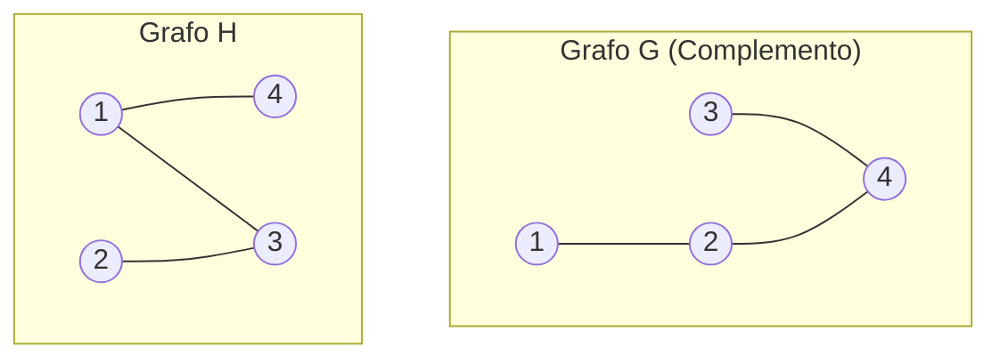
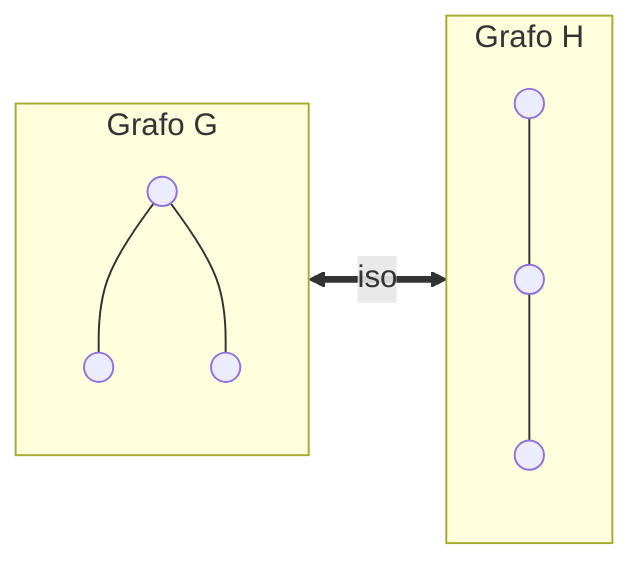
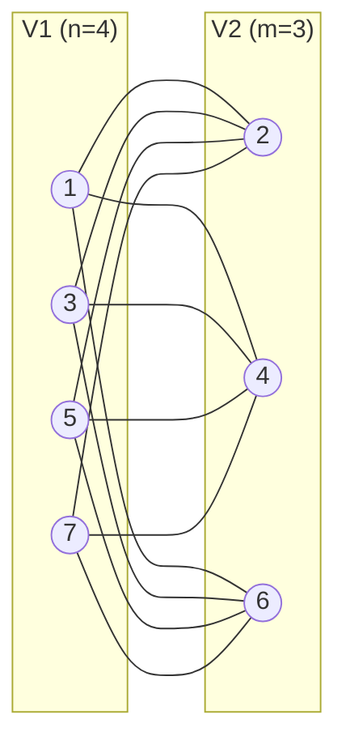

## Complemento di un grafo

Il grafo $G = (V, E)$ e' il complemento del grafo $H = (V, E')$ se:  

$$E = P_2(V) \setminus E' = \{xy \in P_2(V) \mid xy \notin E'\}$$  

### Esempio visivo

Grafi $H$ e il suo complemento $G$:

## Relazione complemento

Sia $G_n$ l'insieme dei grafi non orientati su $n$ nodi. La relazione complemento $C \in \mathrm{Rel}(G_n, G_n)$ e' **totale, univoca, iniettiva e suriettiva**, quindi e' **biettiva** e ha inversa.

Sia $G_n^k = \{G \in G_n \mid G \text{ ha } k \text{ archi}\}$.

Sappiamo che:  

$$\binom{m}{k} = |G_n^k| \quad \text{dove } m = \frac{n(n-1)}{2}$$  

Poiche' $G_n^k \cong G_n^{m-k}$, per la regola di biiezione si ha:  

$$\binom{m}{k} = \binom{m}{m-k}$$  

## Complemento e classi di isomorfismo

Sia $E \in \mathrm{Rel}(A, A)$ una relazione di equivalenza:  

$$[a]_E = \{b \in A \mid (a, b) \in E\}$$  

Infatti, se $G \cong H$ allora $C(G) \cong C(H)$ (se due grafi sono isomorfi, anche i loro complementi sono isomorfi).

## Shortest path e distanze

I **shortest path** (cammini minimi tra due nodi) non sono univoci.

## Path in una cricca / grafo completo $K_n$

Data una cricca o grafo completo $K_n$ di $n$ nodi:

- **Quanti shortest path tra due nodi $x$ e $y$?** Esattamente **1** shortest path (l'arco diretto che li connette).
- **Quanti path hamiltoniani?** Sono $n!$
- **Quanti cicli hamiltoniani?** Sempre $n!$ considerando tutte le sequenze. Tuttavia, poiche' piu' cicli usano lo stesso insieme di archi e si possono percorrere nei due sensi, quanti cicli "non equivalenti" esistono?  

  $$\frac{n!}{2 \cdot n}$$  

  (occorre togliere le rotazioni $n$ e i cicli al contrario $\times 2$).

## Grafo bipartito

Un grafo e' bipartito se soddisfa una delle seguenti condizioni equivalenti:
- Esiste una partizione $V_1, V_2$ di $V$ tale che nessun arco ha entrambi gli estremi nello stesso $V_i$.
- Ha una 2-colorazione.
- Non ha cicli di lunghezza dispari.

Un **grafo bipartito completo** $K_{n, m}$ ha $|V_1| = n$, $|V_2| = m$ e ogni nodo in $V_1$ e' adiacente a tutti i nodi in $V_2$.

### Esempio $K_{4,3}$

### Paths in un grafo bipartito completo $K_{n, m}$ (con $n=m$)

Se $n = m$:
- **Quanti shortest paths tra due nodi appartenenti a partizioni diverse?** $1$ oppure $2n$ (a seconda che si considerino nodi opposti o stesso lato).
- **Quanti path hamiltoniani?** $2 \cdot n! \cdot n!$
- **Quanti cicli hamiltoniani distinti?**  

  $$\frac{2 \cdot n! \cdot n!}{2 \cdot 2 \cdot n}$$  

Se $n \neq m$:
- **Quanti path hamiltoniani?** A volte $0$, a volte esistono valenze / cammini parziali.
- **Quanti cicli hamiltoniani?** $\emptyset$ (non esistono cicli hamiltoniani se le due partizioni hanno dimensioni diverse).

---

# Induzione strutturale

Le stesse tecniche usate sui numeri naturali funzionano su liste, alberi binari, ecc.

## Le liste

Le liste sono sequenze omogenee di dati di lunghezza variabile.
- La lista $a_1, a_2, \dots, a_k$ si rappresenta con $[a_1, a_2, \dots, a_k]$.
- La lista vuota e' $[]$.

### Implementazioni di liste
- **Array list:** array contiguo in memoria $[a_1 | a_2 | \dots]$
- **Linked list:** nodi con puntatori $a_1 \to a_2 \to \dots$
- **Doubly linked list:** nodi con doppio puntatore avanti/indietro.

## Liste e insiemi

Sia le liste che gli insiemi possono contenere elementi. Negli insiemi ordine e ripetizioni non contano, mentre nelle liste si!

## Definizione induttiva di una lista

Possiamo costruire una qualunque lista partendo dalla lista vuota con l'operazione $a : \text{lst}$ (cons) che aggiunge un elemento in testa.

L'insieme $L_A$ delle liste su $A$ e' il piu' piccolo insieme che soddisfa:
- **Caso Base (CB):** $[\:] \in L_A$ (la lista vuota appartiene a $L_A$).
- **Caso Induttivo (CI):** Se $a \in A$ e $\text{lst} \in L_A$, allora $a : \text{lst} \in L_A$.

### Notazione
$$b : (e : (a : [\:])) = b : e : a : [\:] = [b, e, a]$$

## Lunghezza di una lista

Funzione $\text{len} : L_A \to \mathbb{N}$

1. $\text{len}([\:]) = 0$
2. $\text{len}(a : \text{lst}) = \text{len}(\text{lst}) + 1$

### Esempio
$$\begin{aligned}
\text{len}([a, e, a]) &= \text{len}(a : e : a : [\:]) \\
&= \text{len}(e : a : [\:]) + 1 \\
&= \text{len}(a : [\:]) + 2 \\
&= \text{len}([\:]) + 3 \\
&= 0 + 3 = 3
\end{aligned}$$

## Somma degli elementi di una lista

Funzione $\text{sumlist} : L_{\mathbb{N}} \to \mathbb{N}$

1. $\text{sumlist}([\:]) = 0$
2. $\text{sumlist}(n : \text{lst}) = \text{sumlist}(\text{lst}) + n$

## Appartenenza di un elemento a una lista `belList` (*belong to list*)

Funzione $\text{belList} : L_A \times A \to \text{Bool}$

1. $\text{belList}([\:], b) = \text{false}, \quad \forall b \in A$
2. $\text{belList}(a : \text{lst}, b) = \text{true}, \quad \forall a, b \in A \text{ tali che } a = b$
3. $\text{belList}(a : \text{lst}, b) = \text{belList}(\text{lst}, b), \quad \forall a, b \in A \text{ tali che } a \neq b$

## Principio di induzione sulle liste

Per dimostrare che una proprieta' $P(\text{lst})$ e' vera per ogni $\text{lst} \in L_A$:

- **(CB)** Si dimostra che $P([\:])$ e' vera.
- **(CI)** Si dimostra che se $P(\text{lst})$ e' vera, allora anche $P(a : \text{lst})$ e' vera per ogni $a \in A$ e per ogni $\text{lst} \in L_A$.