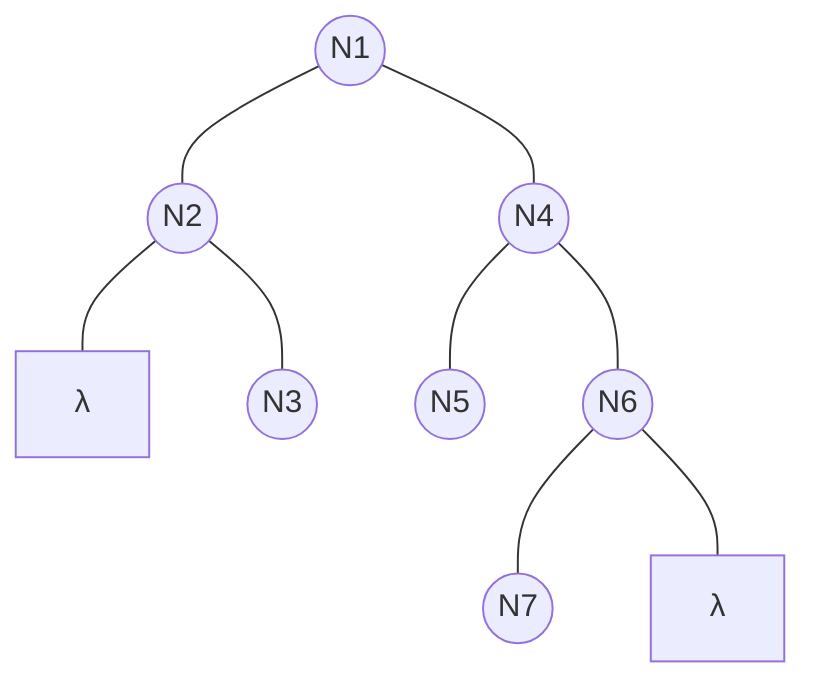
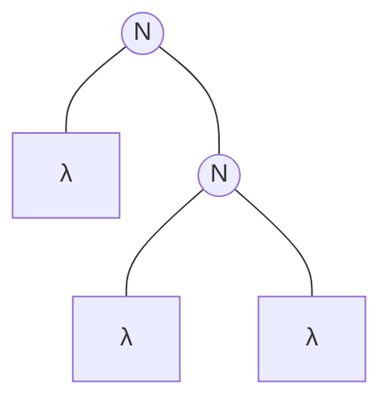

## Struttura delle liste

La testa (head) della lista e' il primo elemento, mentre la coda (tail) e' il resto della lista.
Ad esempio, data la notazione `a : lst`:
- `a` e' la **testa**
- `lst` e' la **coda**

# Operazioni strutturali su liste

### Valutazione di appartenenza di un elemento alla lista

Data la lista `[a, b, a]` e l'elemento da cercare `b`:

1. `belList([a, b, a], b) = belList(a : b : a : [], b)`
   - Non posso applicare ne' la prima ne' la seconda clausola (poiche' $a \neq b$).
2. Passiamo al successivo elemento della lista:
   `= belList(b : a : [], b)`
   - Applicando la clausola 2 ($b = b$), il risultato e' **TRUE**!

---

## Concatenazione (`append`)

Definizione della funzione di concatenazione:  

$$\text{app}: L_A \times L_A \to L_A$$  

### Definizione induttiva

1. **CB:** $\text{app}([], lst_2) = lst_2$
2. **CI:** $\text{app}(a : lst_1, lst_2) = a : \text{app}(lst_1, lst_2)$

> **Nota:** L'operatore `:` corrisponde al `cons` (dal linguaggio Lisp).

### Esempio di calcolo di `append`

Vogliamo calcolare $\text{app}([d, f], [a, c, d])$:

$$\begin{aligned}
\text{app}([d, f], [a, c, d]) &= \text{app}(d : f : [], [a, c, d]) && \text{\{cl 2 app\}} \\
&= d : \text{app}(f : [], [a, c, d]) && \text{\{cl 2 app\}} \\
&= d : f : \text{app}([], [a, c, d]) && \text{\{cl 1 app\}} \\
&= d : f : [a, c, d] \\
&= [d, f, a, c, d]
\end{aligned}$$

---

## Proprieta' sulle liste

Dimostriamo per induzione la proprieta':  

$$P(lst) \equiv \text{app}(lst, []) = lst$$  

### Caso base (C.B.)
Dobbiamo far vedere che $P([]) = []$, ovvero che applicando il caso base di `app`:  

$$\text{app}([], []) = [] \quad \checkmark$$  

### Passo induttivo (P.I.)
Assumiamo che la proprieta' valga per $lst$ ($\text{app}(lst, []) = lst$) e verifichiamo per $a : lst$:

$$\begin{aligned}
\text{app}(a : lst, []) &= a : \text{app}(lst, []) && \text{\{cl 2 app\}} \\
&= a : lst && \text{\{ipotesi induttiva\}} \quad \checkmark
\end{aligned}$$

---

## Proprieta' associativa di `append`

Vogliamo dimostrare che:  

$$\text{app}(l_1, \text{app}(l_2, l_3)) = \text{app}(\text{app}(l_1, l_2), l_3)$$  

### Caso base (C.B.)
Sostituiamo $l_1 = []$:
- **Membro sinistro:** $\text{app}([], \text{app}(l_2, l_3)) = \text{app}(l_2, l_3)$
- **Membro destro:** $\text{app}(\text{app}([], l_2), l_3) = \text{app}(l_2, l_3)$

I due membri coincidono. $\checkmark$

### Passo induttivo (P.I.)
Vogliamo dimostrare che $\text{app}(a : l_1, \text{app}(l_2, l_3)) = \text{app}(\text{app}(a : l_1, l_2), l_3)$:

$$\begin{aligned}
\text{app}(a : l_1, \text{app}(l_2, l_3)) &= a : \text{app}(l_1, \text{app}(l_2, l_3)) && \text{\{cl 2 app\}} \\
&= a : \text{app}(\text{app}(l_1, l_2), l_3) && \text{\{ipotesi induttiva\}} \\
&= \text{app}(a : \text{app}(l_1, l_2), l_3) && \text{\{cl 2 app al contrario\}} \\
&= \text{app}(\text{app}(a : l_1, l_2), l_3) && \text{\{cl 2 app al contrario\}} \quad \checkmark
\end{aligned}$$

---

## Inverso di una lista (`rev`)

Definizione della funzione inverso:  

$$\text{rev}: L_A \to L_A$$  

1. $\text{rev}([]) = []$
2. $\text{rev}(a : lst) = \text{app}(\text{rev}(lst), a : [])$

> **Nota:** Ha **complessita' quadratica** $n^2$, per una lista di 3 elementi servono circa $3^2$ passaggi.

### Dimostrazione per induzione
Dimostriamo che:  

$$\text{rev}(\text{app}(l_1, l_2)) = \text{app}(\text{rev}(l_2), \text{rev}(l_1))$$  

#### Caso base (C.B.)
Sostituiamo $l_1 = []$:
- **Membro sinistro:** $\text{rev}(\text{app}([], l_2)) = \text{rev}(l_2)$
- **Membro destro:** $\text{app}(\text{rev}(l_2), \text{rev}([])) = \text{app}(\text{rev}(l_2), []) = \text{rev}(l_2)$

Entrambi i membri sono uguali a $\text{rev}(l_2)$. $\checkmark$

#### Passo induttivo (P.I.)
Facciamo vedere che $\text{rev}(\text{app}(a : l_1, l_2)) = \text{app}(\text{rev}(l_2), \text{rev}(a : l_1))$:

$$\begin{aligned}
\text{rev}(\text{app}(a : l_1, l_2)) &= \text{rev}(a : \text{app}(l_1, l_2)) && \text{\{cl 2 app\}} \\
&= \text{app}(\text{rev}(\text{app}(l_1, l_2)), a : []) && \text{\{cl 2 rev\}} \\
&= \text{app}(\text{app}(\text{rev}(l_2), \text{rev}(l_1)), a : []) && \text{\{ipotesi induttiva\}} \\
&= \text{app}(\text{rev}(l_2), \text{app}(\text{rev}(l_1), a : [])) && \text{\{assoc. app\}} \\
&= \text{app}(\text{rev}(l_2), \text{rev}(a : l_1)) && \text{\{cl 2 rev al contrario\}} \quad \checkmark
\end{aligned}$$

---

## Inversione veloce (`rev1`)

Per ottimizzare l'inversione ed ottenere **complessita' lineare** $O(n)$, si utilizza un accumulatore (o array di appoggio):

1. $\text{rev1}([], lst) = lst$
2. $\text{rev1}(a : lst_1, lst_2) = \text{rev1}(lst_1, a : lst_2)$

### Esempio di esecuzione

Per invertire $[b, e, a]$, si chiama $\text{rev1}([b, e, a], [])$:

$$\begin{aligned}
\text{rev1}([b, e, a], []) &= \text{rev1}([e, a], [b]) \\
&= \text{rev1}([a], [e, b]) \\
&= \text{rev1}([], [a, e, b]) && \text{\{cl 1 rev1\}} \\
&= [a, e, b] \quad \checkmark
\end{aligned}$$

---

## Altre funzioni su liste

- Lunghezza di una lista $\text{lengthList}: L_A^* \to L_\mathbb{N}$
  1. $\text{lengthList}([]) = []$
  2. $\text{lengthList}(w : lst) = |w| : \text{lengthList}(lst)$
  - Esempio di **mappatura (`map`):** `map: f l` applica la funzione $f$ agli elementi della lista preservandone la struttura.
- Somma degli elementi di una lista $\text{sumList}: L_\mathbb{N} \to \mathbb{N}$
  - Esempio di **riduzione** (`reduce` / `fold`): estrae dagli elementi della lista un singolo valore somma.
- Inserimento ordinato $\text{ins}: \mathbb{N} \times L_\mathbb{N} \to L_\mathbb{N}$ inserisce un numero naturale mantenendo l'ordine della lista.

---

# Alberi binari (BT - Binary Trees)

Gli alberi binari sono alberi radicati cardinali con $k = 2$, e possono essere anche vuoti ($\lambda$).
L'espressione $N(t_1, t_2)$ rappresenta un nodo con due sottoalberi (sinistro e destro). Le **foglie** sono nodi i cui sottoalberi sono entrambi vuoti $N(\lambda, \lambda)$.

### Definizione induttiva
- **CB:** $\lambda \in BT$ (l'albero vuoto appartiene a $BT$).
- **CI:** Se $t_1, t_2 \in BT$, allora $N(t_1, t_2) \in BT$

> Questo albero si descrive con:
> $N(N(\lambda, N(\lambda, \lambda), N(N(\lambda, \lambda), N(N(\lambda, \lambda), \lambda)))$

---

## Funzioni strutturali su alberi binari

### Dimensione `size`
La dimensione rappresenta il numero totale di nodi dell'albero:  

$$\text{size}: BT \to \mathbb{N}$$  

1. $\text{size}(\lambda) = 0$
2. $\text{size}(N(t_1, t_2)) = \text{size}(t_1) + \text{size}(t_2) + 1$

**Esempio:**  

$$\text{size}(N(\lambda, N(\lambda, \lambda))) = 0 + (0 + 0 + 1) + 1 = 2$$  

### Altezza `height`
L'altezza misura il cammino piu' lungo dalla radice a una foglia:  

$$\text{height}: BT \to \mathbb{N} \cup \{-1\}$$  

1. $\text{height}(\lambda) = -1$
2. $\text{height}(N(t_1, t_2)) = \max(\text{height}(t_1), \text{height}(t_2)) + 1$

**Esempio:**  

$$
\begin{aligned}
    height(N(\lambda, N(\lambda, \lambda))&=\\
    &=max(-1, height(N(\lambda, \lambda)))+1\\
    &=max(-1, max(height(\lambda), height(\lambda))+1)+1\\
    &=max(-1, max(-1, -1)+1)+1\\
    &=max(-1, 0)+1=0+1=1 
\end{aligned}
$$  

## Principio di induzione su BT

Sia $P$ una proprieta' definita su $BT$, $P: BT \to \{\text{vero}, \text{falso}\}$.
Per dimostrare che $P(t)$ e' vera per ogni albero $t$:
1. Si dimostra il **caso base** $P(\lambda)$.
2. Si dimostra che se $P(t_1)$ e $P(t_2)$ valgono, allora vale anche $P(N(t_1, t_2))$.

---

## Dimostrazione: $\text{height}(t) \le \text{size}(t)$

Dimostriamo per induzione che l'altezza di qualsiasi albero binario e' minore o uguale alla sua dimensione.

### Caso base (C.B.)  

$$\text{height}(\lambda) \le \text{size}(\lambda) \implies -1 \le 0 \quad \checkmark$$  

### Passo induttivo (P.I.)
Vogliamo dimostrare che $\text{height}(N(t_1, t_2)) \le \text{size}(N(t_1, t_2))$:

$$\begin{aligned}
\text{height}(N(t_1, t_2)) &= \max(\text{height}(t_1), \text{height}(t_2)) + 1 \\
&\le \max(\text{size}(t_1), \text{size}(t_2)) + 1 && \text{\{ipotesi induttiva\}} \\
&\le \text{size}(t_1) + \text{size}(t_2) + 1 \\
&= \text{size}(N(t_1, t_2)) && \text{\{def. cl 2 size\}} \quad \checkmark
\end{aligned}$$