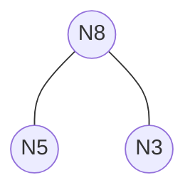
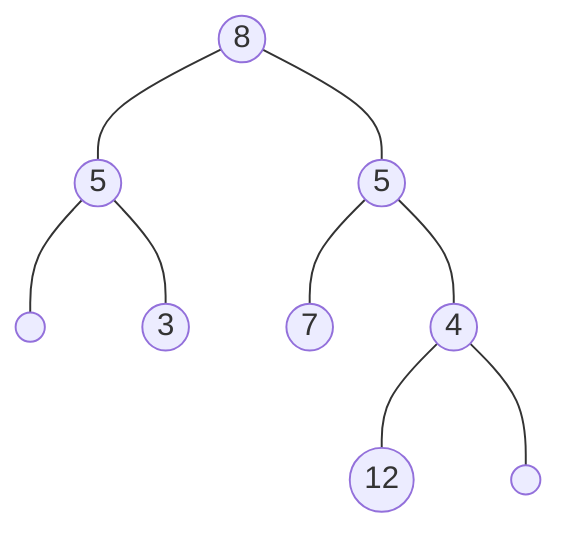
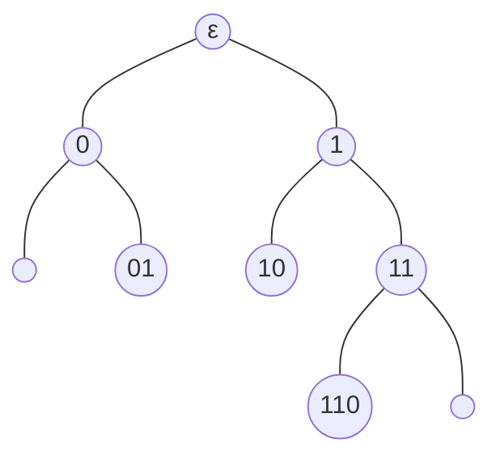
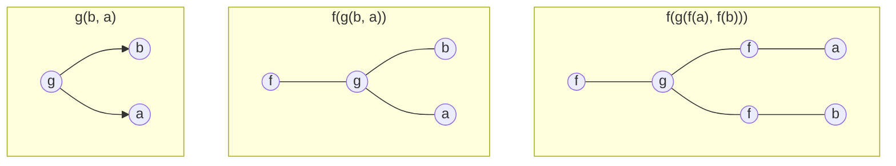

# Alberi etichettati

Gli alberi etichettati binari ($BT_A$) su un insieme di etichette $A$ sono definiti induttivamente come segue:

1. $\lambda \in BT_A$ (albero vuoto).
2. Se $t_1, t_2 \in BT_A$, allora $N(t_1, a, t_2) \in BT_A$ per ogni $a \in A$.

Rappresentabile anche come:  

$$N(N(\lambda, 5, \lambda), 8, N(\lambda, 3, \lambda))$$  

# Operazioni su alberi etichettati

### Presenza di un elemento `belBT`
La funzione $belBT : BT_A \times A \to \text{Bool}$ verifica se un elemento $b \in A$ e' presente all'interno dell'albero:  

$$
\begin{aligned}
1. \quad & belBT(\lambda, b) = \text{false} \\
2. \quad & belBT(N(t_1, a, t_2), b) = \text{true}, \quad \text{per ogni } a, b \in A \text{ tale che } a = b \\
3. \quad & belBT(N(t_1, a, t_2), b) = belBT(t_1, b) \lor belBT(t_2, b), \quad \text{per ogni } a, b \in A \text{ tale che } a \neq b
\end{aligned}
$$

# Visita di un albero

La *visita* di un albero e' una scansione sequenziale dei nodi secondo una determinata strategia che *raccoglie* gli elementi in una lista. La funzione di visita simmetrica (in-order da sinistra a destra):  

$$visit : BT_A \to List_A$$  

$$
\begin{aligned}
1. \quad & visit(\lambda) = [] \\
2. \quad & visit(N(t_1, a, t_2)) = app(visit(t_1), a : visit(t_2))
\end{aligned}
$$  

Esistono in totale 6 modi classici di visitare gli alberi binari, combinando la direzione (sinistra/destra) e l'ordine dell'operazione sulla radice (anticipata/pre-order, simmetrica/in-order, posticipata/post-order).

### Esempio di visita simmetrica

Considerando il seguente albero:

La visita simmetrica produce la lista di elementi:  

$$[5, 3, 8, 7, 5, 12, 4]$$  

# Trasformazione e calcolo sugli alberi

### Mappatura della lunghezza delle etichette (lengthBT)

La funzione $lengthBT$ trasforma un albero di stringhe $BT_{A^*}$ in un albero di interi $BT_{\mathbb{N}}$, sostituendo ogni etichetta con la propria lunghezza:  

$$lengthBT : BT_{A^*} \to BT_{\mathbb{N}}$$  

$$
\begin{aligned}
1. \quad & lengthBT(\lambda) = \lambda \\
2. \quad & lengthBT(N(t_1, w, t_2)) = N(lengthBT(t_1), |w|, lengthBT(t_2))
\end{aligned}
$$

### Somma dei nodi (sumBT)

La funzione $sumBT$ calcola la somma intera di tutti i valori memorizzati nei nodi dell'albero:  

$$sumBT : BT_{\mathbb{N}} \to \mathbb{N}$$  

$$
\begin{aligned}
1. \quad & sumBT(\lambda) = 0 \\
2. \quad & sumBT(N(t_1, n, t_2)) = sumBT(t_1) + sumBT(t_2) + n
\end{aligned}
$$

# Principio di induzione su alberi etichettati

Sia $P$ una proprieta' definita sugli alberi binari etichettati, $P : BT_A \to \text{Bool}$. Per dimostrare che $P(t)$ e' vera per ogni $t \in BT_A$:

- **Caso Base (CB):** Si dimostra che $P(\lambda)$ e' vera.
- **Passo Induttivo (PI):** Assumendo che $P(t_1)$ e $P(t_2)$ siano vere (ipotesi induttiva), si dimostra che $P(N(t_1, a, t_2))$ e' vera per qualsiasi $a \in A$.

### Esempio di proprieta'  

$$belList(visit(t), b) = belBT(t, b)$$  

Vedi dispensa per la dimostrazione...

# Rappresentazione di un albero binario come grafo

E' possibile costruire induttivamente il grafo $G = (V, E)$ associato a un albero binario $T$. I nodi in $V$ sono rappresentati da sequenze binarie (stringhe) che descrivono il percorso dalla radice:
- La radice e' identificata dalla stringa vuota $\epsilon$.
- Si aggiunge $0$ quando si scende nel ramo sinistro.
- Si aggiunge $1$ quando si scende nel ramo destro.

### Diagramma delle etichette di percorso

### Definizione formale della costruzione del grafo

Sia $T$ un albero binario:

- **Caso Base:**  
  $$GRAFO(\lambda) = (\emptyset, \emptyset)$$  

- **Caso Induttivo:**

  Siano $grafo(t_1) = (V_1, E_1), \quad grafo(t_2) = (V_2, E_2)$. Il nuovo grafo $grafo(N(t_1, t_2)) = (V, E)$ e' definito come:  

  $$V = \{0w \mid w \in V_1\} \cup \{1w \mid w \in V_2\} \cup \{\epsilon\}$$  

  $$
  \begin{aligned}
  E = & \{(0u, 0v) \mid (u, v) \in E_1\} \cup \{(1u, 1v) \mid (u, v) \in E_2\} \\
      & \cup \{(\epsilon, 0) \mid \epsilon \in V_1\} \cup \{(\epsilon, 1) \mid \epsilon \in V_2\}
  \end{aligned}
  $$

In questo modo, ai nodi dei sottoalberi viene aggiunto il prefisso $0$ o $1$, e la radice del nuovo albero e' rappresentata dalla stringa vuota $\epsilon$.

## Verso il principio di induzione strutturale

L'obiettivo di questa sezione e' introdurre gli strumenti formali per generalizzare il principio di induzione a diverse strutture dati:

* Introduciamo la nozione di **segnatura** e la definizione induttiva di **termine**.
* Vediamo come recuperare strutture note (numeri naturali, liste, alberi binari) come casi particolari di termini.
* Impariamo a definire funzioni induttivamente sui termini.
* Prepariamo il terreno per il **Principio di Induzione Strutturale**, che e' parametrico rispetto alla segnatura scelta.

---

# Segnature

Una **segnatura** e' una famiglia di insiemi indicizzata dai numeri naturali $\mathbb{N}$:  

$$\mathcal{F} = \{\mathcal{F}_n\}_{n \in \mathbb{N}}$$  

* Per ogni $n \in \mathbb{N}$, $\mathcal{F}_n$ rappresenta l'insieme dei **simboli di arieta' $n$** (ovvero simboli che richiedono $n$ argomenti).
  > Ad esempio $g(x, y)$ e' un simbolo di arieta' 2, ovvero $\mathcal{F}_2$ in quanto richiede 2 argomenti $x, y$
* I simboli in $\mathcal{F}_0$ (di arieta' $0$) sono chiamati **costanti**.
  > Non dipendono da nessun fattore esterno quindi non cambiano mai, restano costanti.
* I simboli in $\mathcal{F}_1$ sono spesso detti **unari** (1 argomento), mentre quelli in $\mathcal{F}_2$ sono detti **binari** (2 argomenti).

---

## Termini per una segnatura

Data una segnatura $\mathcal{F}$, l'insieme $\mathcal{F}Term$ degli **$\mathcal{F}$-termini** e' il piu' piccolo insieme definito induttivamente dalle seguenti clausole:

* **Clausola base:** Per ogni costante $c \in \mathcal{F}_0$, si ha che $c \in \mathcal{F}Term$.
* **Clausola induttiva:** Per ogni $n \ge 1$ e per ogni simbolo $f \in \mathcal{F}_n$, se $t_1, t_2, \dots, t_n \in \mathcal{F}Term$, allora $f(t_1, t_2, \dots, t_n) \in \mathcal{F}Term$.

Al variare della segnatura $\mathcal{F}$, i termini permettono di rappresentare diverse strutture dati definite induttivamente.

### Esempio pratico

Consideriamo la segnatura $\mathcal{F}$ definita come:
* $\mathcal{F}_0 = \{a, b\}$ (costanti)
* $\mathcal{F}_1 = \{f\}$ (simbolo unario)
* $\mathcal{F}_2 = \{g\}$ (simbolo binario)
* $\mathcal{F}_n = \emptyset$ per ogni $n \ge 3$

**Esempi di termini validi in $\mathcal{F}Term$:**
* $f(a)$
* $g(a, a)$
* $g(b, a)$
* $f(g(b, a))$
* $f(f(a))$
* $f(g(f(a), f(b)))$

> $a()$ e' tecnicamente corretto in quanto e' un simbolo di arieta' zero che prende zero argomenti, ma per rispettare la clausola induttiva dei termini si omettono le parentesi.

**Esempi di sequenze NON in $\mathcal{F}Term$ (non valide):**
* $g(a)$ — *errato: $g$ ha arieta' 2, ma ha un solo argomento.*
* $f(a, b)$ — *errato: $f$ ha arieta' 1, ma ha due argomenti.*
* $g(a, a, b)$ — *errato: $g$ ha arieta' 2, ma ha tre argomenti.*

---

## Rappresentazione grafica di termini

I termini possono essere visualizzati intuitivamente come **alberi ordinati etichettati**, con etichette prese dalla segnatura $\mathcal{F}$. La regola strutturale e' semplice: se un nodo ha un'etichetta appartenente a $\mathcal{F}_n$, allora avra' esattamente $n$ figli dove le foglie sono le costanti in $\mathcal{F}_0$.

Riprendendo l'esempio precedente $\mathcal{F}_0 = \{a, b\}$, $\mathcal{F}_1 = \{f\}$, $\mathcal{F}_2 = \{g\}$, ecco la rappresentazione ad albero di alcuni termini:

---

## Strutture dati note come termini

Modificando opportunamente la segnatura, possiamo ottenere le definizioni standard delle principali strutture dati.

### La segnatura BT: alberi binari come termini

Definiamo la segnatura $\mathcal{BT}$ per gli alberi binari:
* $\mathcal{BT}_0 = \{\lambda\}$ (l'albero vuoto)
* $\mathcal{BT}_1 = \emptyset$
* $\mathcal{BT}_2 = \{N\}$ (costruttore di nodo binario)
* $\mathcal{BT}_n = \emptyset$ per ogni $n \ge 3$

Applicando la definizione generale di termini a $\mathcal{F} = \mathcal{BT}$:
1. **Clausola base:** $\lambda \in \mathcal{BT}Term$.
2. **Clausola induttiva:** Se $t_1, t_2 \in \mathcal{BT}Term$, allora $N(t_1, t_2) \in \mathcal{BT}Term$.

Otteniamo esattamente l'insieme degli alberi binari: $\mathcal{BT}Term = BT$.

### La segnatura $\mathcal{L}^A$: liste come termini

Dato un alfabeto (insieme di elementi) $A$, definiamo la segnatura $\mathcal{L}^A$:
* $\mathcal{L}^A_0 = \{[]\}$ (la lista vuota)
* $\mathcal{L}^A_1 = \{a: \mid a \in A\}$ (un simbolo unario per ogni elemento $a \in A$, che rappresenta l'inserimento in testa)
* $\mathcal{L}^A_n = \emptyset$ per ogni $n \ge 2$

Applicando la definizione di termini:
1. **Clausola base:** $[] \in \mathcal{L}^A Term$.
2. **Clausola induttiva:** Per ogni $a \in A$, se $t_1 \in \mathcal{L}^A Term$, allora $a:(t_1) \in \mathcal{L}^A Term$.

Gli elementi di $\mathcal{L}^A Term$ sono in corrispondenza biunivoca con le liste su $A$ ovvero $\mathcal{L}^A Term \cong L_A$, dove la notazione funzionale $a:(lst)$ corrisponde all'usuale $a:lst$.  

> **Nota:** La differenza sintattica tra `a:(lst)` e `a:lst` e' necessria per rispettare lal definizione induttiva degli F-termini.

### La segnatura $\mathcal{N}$: i naturali come termini

Definiamo la segnatura $\mathcal{N}$ per i numeri naturali:
* $\mathcal{N}_0 = \{Z\}$ (lo zero)
* $\mathcal{N}_1 = \{S\}$ (la funzione successore)
* $\mathcal{N}_n = \emptyset$ per ogni $n \ge 2$

Dalla definizione di termini otteniamo:
1. **Clausola base:** $Z \in \mathcal{N}Term$.
2. **Clausola induttiva:** Se $t \in \mathcal{N}Term$, allora $S(t) \in \mathcal{N}Term$.

Questi termini sono in biiezione con i numeri naturali $\mathbb{N}$ (ad esempio, $Z$ corrisponde a $0$, $S(Z)$ a $1$, $S(S(Z))$ a $2$, e cosi' via).

---

## Funzioni definite induttivamente su termini

Per definire una funzione il cui dominio e' $\mathcal{F}Term$, si segue la stessa struttura della definizione induttiva dell'insieme:
* Si definisce il valore della funzione per ogni simbolo di **arieta' 0** (casi base).
* Si definisce il valore della funzione per ogni simbolo di **arieta' $n \ge 1$**, potendo utilizzare il valore della funzione gia' calcolato su ciascuno degli $n$ argomenti (casi induttivi).

### Esempio: valutazione di $\mathcal{N}$-termini

Definiamo la funzione $val: \mathcal{N}Term \to \mathbb{N}$ che converte un $\mathcal{N}$-termine nel corrispondente numero naturale:

1. $val(Z) = 0$ *(Clausola base)*
2. $val(S(x)) = val(x) + 1$ *(Clausola induttiva)*

**Esempio di calcolo per $S(S(S(Z)))$:**
$$
\begin{aligned}
val(S(S(S(Z)))) &= val(S(S(Z))) + 1 && \text{(Clausola induttiva)} \\
&= val(S(Z)) + 1 + 1 && \text{(Clausola induttiva)} \\
&= val(Z) + 1 + 1 + 1 && \text{(Clausola induttiva)} \\
&= 0 + 1 + 1 + 1 && \text{(Clausola base)} \\
&= 3
\end{aligned}
$$

### Esempio: somma di $\mathcal{N}$-termini

Definiamo la funzione $add: \mathcal{N}Term \times \mathcal{N}Term \to \mathcal{N}Term$ che esegue la somma direttamente sui termini (facendo induzione sul secondo argomento):

1. $add(x, Z) = x$ *(Clausola base)*
2. $add(x, S(y)) = S(add(x, y))$ *(Clausola induttiva)*

**Esempio di calcolo per $3 + 2$, ovvero $add(S(S(S(Z))), S(S(Z)))$:**  

$$
\begin{aligned}
add(S(S(S(Z))), S(S(Z))) &= S(add(S(S(S(Z))), S(Z))) && \text{(Clausola induttiva)} \\
&= S(S(add(S(S(S(Z))), Z))) && \text{(Clausola induttiva)} \\
&= S(S(S(S(S(Z))))) && \text{(Clausola base)}
\end{aligned}
$$