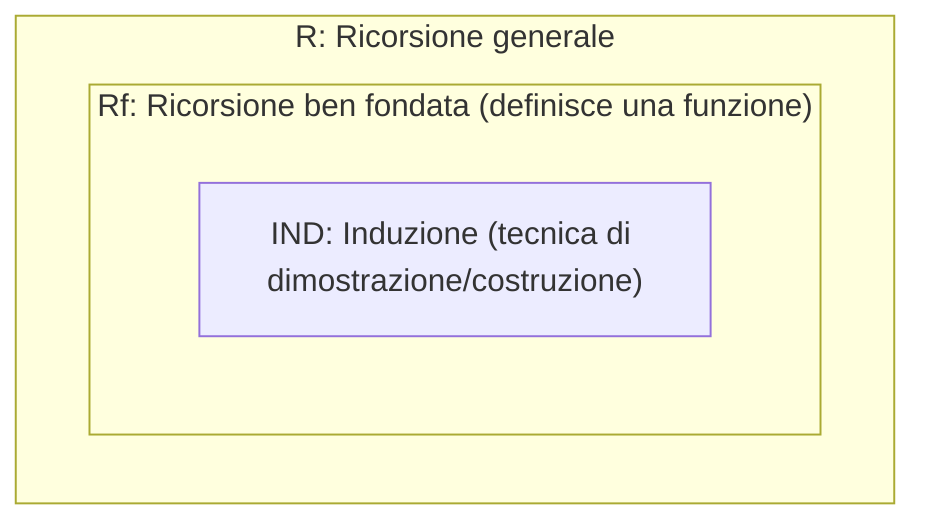

# Principio di induzione strutturale

Sia $\mathcal{F}$ una segnatura e $P$ una proprieta' definita sull'insieme dei termini $\mathcal{F}Term$, ovvero una funzione $P: \mathcal{F}Term \to \text{Bool}$.

Per dimostrare che $P(t)$ e' vera per ogni termine $t \in \mathcal{F}Term$, e' sufficiente dimostrare due condizioni:

* **Caso base**: $P(c)$ e' vera per ogni simbolo di costante $c \in \mathcal{F}_0$.
* **Passo induttivo**: per ogni arieta' $n \ge 1$, per ogni simbolo di funzione $f \in \mathcal{F}_n$ e per ogni $n$-upla di termini $t_1, \dots, t_n \in \mathcal{F}Term$, vale che se $P(t_1), \dots, P(t_n)$ sono vere (ipotesi induttiva), allora anche $P(f(t_1, \dots, t_n))$ e' vera.

In forma di regola di inferenza logica, il principio si esprime come:  

$$\frac{\forall c \in \mathcal{F}_0 . P(c) \qquad \forall n \ge 1 . \forall f \in \mathcal{F}_n . \forall t_1, \dots, t_n \in \mathcal{F}Term . (P(t_1) \land \dots \land P(t_n) \Rightarrow P(f(t_1, \dots, t_n)))}{\forall t \in \mathcal{F}Term . P(t)}$$  

## Correttezza del principio di induzione strutturale

Vogliamo dimostrare che il principio e' corretto. Assumiamo quindi che la proprieta' $P$ soddisfi entrambe le premesse (caso base e passo induttivo) e mostriamo che $P(t) = \text{true}$ per ogni $t \in \mathcal{F}Term$.

Definiamo l'insieme $A$ dei termini che soddisfano la proprieta' $P$:  

$$A = \{ t \in \mathcal{F}Term \mid P(t) = \text{true} \}$$  

Per definizione, e' evidente che $A \subseteq \mathcal{F}Term$. Per dimostrare che $P$ vale per tutti i termini, dobbiamo provare l'inclusione opposta, ovvero che $\mathcal{F}Term \subseteq A$ (cosi' da avere $A = \mathcal{F}Term$).

Poiche' $\mathcal{F}Term$ e' il piu' piccolo insieme chiuso rispetto alle clausole induttive che lo definiscono, per mostrare che $\mathcal{F}Term \subseteq A$ basta far vedere che anche $A$ soddisfa le stesse due clausole:

1. **Clausola base**: per ogni costante $c \in \mathcal{F}_0$, si ha $c \in A$ (poiche' per la prima premessa $P(c)$ e' vera).
2. **Clausola induttiva**: per ogni $n \ge 1$ e per ogni simbolo $f \in \mathcal{F}_n$, se $t_1, t_2, \dots, t_n \in A$, allora $f(t_1, t_2, \dots, t_n) \in A$ (poiche' per la seconda premessa la verita' di $P$ sui sottotermini implica la verita' di $P$ sul termine composto).

## Analogia con la correttezza del principio di induzione matematica

Il ragionamento appena visto e' la generalizzazione diretta del classico principio di induzione sui numeri naturali $\mathbb{N}$:  

$$\frac{P(0) \qquad \forall n \in \mathbb{N} . (P(n) \Rightarrow P(n + 1))}{\forall m \in \mathbb{N} . P(m)}$$  

Anche in questo caso, assumiamo che $P$ soddisfi le due premesse e definiamo l'insieme $A = \{ t \in \mathbb{N} \mid P(t) = \text{true} \}$, con $A \subseteq \mathbb{N}$. Per dimostrare che $\mathbb{N} \subseteq A$, verifichiamo che $A$ soddisfi le clausole generatrici dei numeri naturali ($0 \in \mathbb{N}$ e chiusura rispetto al successore $n \mapsto n+1$):

* $0 \in A$, poiche' vale la prima premessa $P(0)$, cioe' $P(0) = \text{true}$.
* Sia $n \in A$. Per definizione di $A$, sappiamo che $P(n)$ e' vera. Applicando il passo induttivo (la seconda premessa), deduciamo che $P(n+1)$ e' vera, e di conseguenza $n+1 \in A$.

## Esempio di dimostrazione per induzione strutturale

Consideriamo una segnatura $\mathcal{N}$ per i numeri naturali rappresentati come termini ($\mathcal{N}Term$), definita da:
* $\mathcal{N}_0 = \{ Z \}$ (costante zero)
* $\mathcal{N}_1 = \{ S \}$ (funzione successore)
* $\mathcal{N}_n = \emptyset$ per ogni $n \ge 2$

L'insieme $\mathcal{N}Term$ e' definito induttivamente dalle seguenti regole:
1. $Z \in \mathcal{N}Term$
2. Se $t \in \mathcal{N}Term$, allora $S(t) \in \mathcal{N}Term$

Definiamo inoltre la funzione di valutazione $val: \mathcal{N}Term \to \mathbb{N}$ e l'operazione di somma $add$ tramite le seguenti equazioni:

| Regole per $val$ | Regole per $add$ |
| :--- | :--- |
| **1 VAL**: $val(Z) = 0$ | **1 ADD**: $add(x, Z) = x$ |
| **2 VAL**: $val(S(x)) = val(x) + 1$ | **2 ADD**: $add(x, S(y)) = S(add(x, y))$ |

Vogliamo dimostrare per induzione strutturale su $y$ che, per ogni $x, y \in \mathcal{N}Term$, vale la proprieta' $P(y)$ definita come:  

$$P(y) \equiv \quad val(add(x, y)) = val(x) + val(y)$$  

### Caso base

Dobbiamo dimostrare $P(Z)$, ovvero che $val(add(x, Z)) = val(x) + val(Z)$. Sviluppiamo separatamente i due membri dell'uguaglianza:

* **Membro sinistro**:  
  $$val(add(x, Z)) \stackrel{\text{1 ADD}}{=} val(x)$$  

* **Membro destro**:  
  $$val(x) + val(Z) \stackrel{\text{1 VAL}}{=} val(x) + 0 \stackrel{\text{calcolo}}{=} val(x)$$  

I due membri coincidono, quindi il caso base $P(Z)$ e' dimostrato.

### Passo induttivo

Assumiamo come ipotesi induttiva che valga $P(y)$, cioe' $val(add(x, y)) = val(x) + val(y)$, e dimostriamo che vale $P(S(y))$, ovvero:  

$$val(add(x, S(y))) = val(x) + val(S(y))$$  

Procediamo tramite una catena di uguaglianze partendo dal membro sinistro:

$$
\begin{aligned}
val(add(x, S(y))) &\stackrel{\text{2 ADD}}{=} val(S(add(x, y))) \\
&\stackrel{\text{2 VAL}}{=} val(add(x, y)) + 1 \\
&\stackrel{\text{Ip. Induttiva}}{=} (val(x) + val(y)) + 1 \\
&\stackrel{\text{2 VAL contrario}}{=} val(x) + val(S(y)) \\
\end{aligned}
$$

Avendo dimostrato sia il caso base che il passo induttivo, per il principio di induzione strutturale la proprieta' $P(y)$ e' vera per ogni $y \in \mathcal{N}Term$.

# Ricorsione e induzione

La **ricorsione** consiste nel *"definire qualcosa in termini di se stesso"*. 

Alla domanda *"funziona sempre?"*, la risposta e' *"dipende"*. Per mettere ordine tra i vari concetti, possiamo visualizzare la relazione gerarchica tra ricorsione generale ($R$), ricorsione ben fondata che definisce effettivamente una funzione ($Rf$) e induzione ($IND$):

* **$R$ (Ricorsione)**: qualsiasi definizione che fa riferimento a se stessa.
* **$Rf$ (Ricorsione ben fondata)**: una definizione ricorsiva che termina sempre e definisce una vera e propria funzione.
* **$IND$ (Induzione)**: il principio strutturale o matematico legato alle definizioni ben fondate.

## Definizioni ricorsive di funzioni

In generale, una definizione per casi su un insieme di partenza $D$ ha la forma:

$$
rec(n) = \begin{cases} 
\text{espr}_1 & \text{se } n \in D_1 \\
\text{espr}_2 & \text{se } n \in D_2 \\ 
\dots & \\ 
\text{espr}_k & \text{se } n \in D_k 
\end{cases}
$$

dove $D_1, D_2, \dots, D_k \subseteq D$ sono sottoinsiemi dell'insieme di partenza.

Una definizione di questo tipo si dice **ricorsiva** se:

>in almeno un caso richiede di valutare la stessa funzione $rec$ su uno o piu' argomenti.

Ad esempio...

* **Fattoriale (e' ricorsiva)**:
  $$
  n! = \begin{cases} 
  1 & \text{se } n = 0 \\ 
  n \cdot (n-1)! & \text{altrimenti} 
  \end{cases}
  $$
  Qui il secondo caso richiama la funzione stessa su $n-1$.

* **Pari (non e' ricorsiva)**:
  $$
  \text{pari}(n) = \begin{cases} 
  \text{vero} & \text{se } n \% 2 = 0 \\ 
  \text{falso} & \text{se } n \% 2 = 1 
  \end{cases}
  $$
  E' una semplice definizione per casi, ma non richiama mai se stessa.

## Come leggere una funzione ricorsiva

Per comprendere il comportamento di una definizione ricorsiva si usa l'**interpretazione operazionale**:

> *"Dato $n \in \mathbb{N}$, $g(n)$ e' ottenuto applicando le clausole della definizione finche' non otteniamo un valore."*

### Funzioni parziali vs definizioni ben fondate

Non tutte le definizioni ricorsive producono un valore per ogni input:

1. **Funzione parziale (non termina per tutti gli input)**:
   $$
   g(n) = \begin{cases} 
   0 & \text{se } n = 0 \\ 
   g(n+1) & \text{altrimenti} 
   \end{cases}
   $$
   Per $n = 0$ restituisce $0$, ma per qualsiasi $n > 0$ entra in un ciclo infinito ($g(1) = g(2) = g(3) = \dots$). Non e' una funzione totale su $\mathbb{N}$, ma una **funzione parziale**.

2. **Definizione ricorsiva ben fondata**:
   $$
   due(n) = \begin{cases} 
   2 & \text{se } n > 100 \\ 
   due(n+1) & \text{altrimenti} 
   \end{cases}
   $$
   Nonostante l'argomento cresca ($n+1$), esiste un limite superiore ($n > 100$) che garantisce sempre la terminazione. Pertanto $due: \mathbb{N} \to \mathbb{N}$ e' una **definizione ricorsiva ben fondata**. E' importante notare che e' anche una funzione, ovvero totale e univalente.

## Congettura di Collatz

> Una **congettura** e' un'affermazione o un enunciato che si ritiene vero sulla base di intuizioni, osservazioni o prove parziali, ma per il quale non esiste ancora una dimostrazione formale. Se dimostrato formalmente allora diventa un **teorema**.

Un esempio celebre in cui la terminazione non e' ancora stata dimostrata matematicamente per tutti i numeri e' la funzione legata alla congettura di Collatz:

$$
f(n) = \begin{cases} 
1 & \text{se } n \le 1 \\ 
f(n/2) & \text{se } n > 1 \text{ ed e' pari} \\ 
f(3 \cdot n + 1) & \text{se } n > 1 \text{ ed e' dispari} 
\end{cases}
$$

Valutando operazionalmente alcuni valori:
* $f(1) = 1$
* $f(2) = f(1) = 1$
* $f(3) = f(10) = f(5) = f(16) = f(8) = f(4) = f(2) = f(1) = 1$

## Relazione associata a una definizione ricorsiva

Data una definizione ricorsiva $rec: D \to A$, possiamo associarle una relazione binaria $R_{rec} \subseteq D \times A$ definita come:

$$
R_{rec} = \{ (n, m) \mid \text{partendo da } rec(n) \text{ e applicando iterativamente e correttamente le clausole, la valutazione termina con il risultato } m \}
$$

Una definizione ricorsiva si dice **ben data** (cioe' definisce una funzione) se e solo se la corrispondente relazione $R_{rec}$ e':
* **Univalente** (a ogni input corrisponde al piu' un output).
* **Totale** (per ogni input del dominio $D$ esiste almeno un output in $A$, ovvero la valutazione termina sempre).

### Esempio di definizione non ben data

Consideriamo la seguente definizione sui naturali:

$$
h(n) = \begin{cases} 
h(n-2) & \text{se } n \ge 2 \\ 
h(n+2) & \text{se } n = 1 \\ 
0 & \text{se } n = 0 
\end{cases}
$$

Proviamo a valutarla su un numero pari e su un numero dispari:
* **Input pari**: $h(4) = h(2) = h(0) = 0$
* **Input dispari**: $h(5) = h(3) = h(1) = h(3) = h(1) = \dots$ (entra in un **loop** infinito)

La relazione associata e' quindi:

$$
R_h = \{ (n, 0) \mid n \text{ e' pari} \}
$$

Poiche' $R_h$ e' univalente ma **non e' totale** (non e' definita per i numeri dispari), la definizione di $h$ **non e' ben data**.

---

# Relazione di precedenza indotta da una definizione ricorsiva

Consideriamo una definizione ricorsiva generale $rec: D \to A$:

$$
rec(n) = \begin{cases} \text{espr}_1 & \text{se } n \in D_1 \\ \text{espr}_2 & \text{se } n \in D_2 \\ \dots & \\ \text{espr}_k & \text{se } n \in D_k \end{cases}
$$

La **relazione di precedenza indotta** da questa definizione e' una relazione binaria $<_{rec} \subseteq D \times D$ definita nel seguente modo:

$$
x <_{rec} y \iff rec(y) \text{ e' definita direttamente in termini di } rec(x)
$$

* **Significato operativo**: se $x <_{rec} y$ allora per poter calcolare $rec(y)$ e' necessario prima calcolare $rec(x)$.
* **Problema della non terminazione**: se esiste una **catena discendente infinita** di elementi nel dominio:  
  $$d_1 >_{rec} d_2 >_{rec} d_3 >_{rec} \dots$$  
  allora la valutazione di $rec(d_1)$ non terminera' mai, perche' continuera' a generare nuove chiamate ricorsive all'infinito.

## Relazioni ben fondate

Una relazione $\sqsubset \subseteq A \times A$ si dice **ben fondata** se non esiste alcuna catena infinita decrescente di elementi in $A$, ovvero non esiste alcuna sequenza infinita tale che:

$$
a_1 \sqsupset a_2 \sqsupset a_3 \sqsupset \dots
$$

### Proposizione fondamentale

Una definizione ricorsiva $rec: D \to A$ e' **ben data** (definisce cioe' una funzione totale e univalente) se la sua relazione di precedenza indotta $<_{rec} \subseteq D \times D$ e' **ben fondata** (e $\{D_1, D_2, \dots, D_k\}$ forma una partizione del dominio $D$, garantendo cosi' che le clausole siano mutuamente esclusive).

## Perche' le funzioni induttive sono ben date?

Quando definiamo un insieme di dati in modo **induttivo**, le regole stesse di costruzione generano naturalmente una relazione di precedenza (tra sotto-elementi ed elementi composti) che e' sempre **ben fondata**, poiche' ogni elemento viene costruito in un numero finito di passi a partire dai casi base.

Ecco alcuni esempi classici di insiemi induttivi e delle rispettive relazioni ben fondate indotte:

| Struttura dati | Definizione induttiva | Relazione di precedenza ben fondata |
| :--- | :--- | :--- |
| **Numeri naturali ($\mathbb{N}$)** | 1. $0 \in \mathbb{N}$ 2. Se $n \in \mathbb{N}$ allora $n+1 \in \mathbb{N}$ | $<_{\mathbb{N}} = \{ (n, n+1) \mid n \in \mathbb{N} \}$ *(relazione del successore)* |
| **Liste su $A$ ($L_A$)** | 1. $[] \in L_A$ 2. Se $a \in A$ e $lst \in L_A$ allora $a:lst \in L_A$ | $<_{L_A} = \{ (lst, a:lst) \mid lst \in L_A, a \in A \}$ *(la coda precede la lista intera)* |
| **Alberi binari ($BT$)** | 1. $\lambda \in BT$ (albero vuoto) 2. Se $t_1, t_2 \in BT$ allora $N(t_1, t_2) \in BT$ | $<_{BT} = \{ (t_1, N(t_1, t_2)), (t_2, N(t_1, t_2)) \mid t_1, t_2 \in BT \}$ *(i sottoalberi precedono il nodo padre)* |

## Ordinamento indotto dai termini su una segnatura

Generalizzando gli esempi precedenti, consideriamo l'insieme dei termini $\mathcal{F}Term$ costruiti su una segnatura $\mathcal{F}$:

* **Clausola base**: per ogni costante $c \in \mathcal{F}_0$, $c \in \mathcal{F}Term$.
* **Clausola induttiva**: per ogni $n \ge 1$ e per ogni simbolo $f \in \mathcal{F}_n$, se $t_1, t_2, \dots, t_n \in \mathcal{F}Term$, allora $f(t_1, t_2, \dots, t_n) \in \mathcal{F}Term$.

Questa costruzione induce automaticamente la relazione di sotto-termine immediato $<_{\mathcal{F}}$, che e' sempre ben fondata:

$$
\begin{aligned}
t_1 &<_{\mathcal{F}} f(t_1, \dots, t_n) \\
t_2 &<_{\mathcal{F}} f(t_1, \dots, t_n) \\
&\dots \\
t_n &<_{\mathcal{F}} f(t_1, \dots, t_n)
\end{aligned}
$$

> **Nota:** Molte funzioni definite per ricorsione su strutture induttive seguono esattamente la struttura del dato in ingresso, inducendo cosi' la **stessa relazione di precedenza ben fondata** dell'insieme di partenza. Per questo motivo sono automaticamente ben date:

1. **Fattoriale su $\mathbb{N}$**:  
   $$n! = \begin{cases} 1 & \text{se } n = 0 \\ n \cdot (n-1)! & \text{altrimenti} \end{cases}$$  
   La chiamata ricorsiva passa da $n$ a $n-1$, seguendo la relazione del successore ($n-1 <_{\mathbb{N}} n$).

2. **Concatenazione di due liste ($app: L_A \times L_A \to L_A$)**:  
   $$\begin{aligned} app([], lst_2) &= lst_2 \\ app(a:lst_1, lst_2) &= a : app(lst_1, lst_2) \end{aligned}$$  
   La ricorsione passa da $a:lst_1$ a $lst_1$, rispettando l'ordinamento delle liste ($lst_1 <_{L_A} a:lst_1$).

3. **Somma di termini naturali ($add$)**:  
   $$\begin{aligned} add(x, Z) &= x \\ add(x, S(y)) &= S(add(x, y)) \end{aligned}$$  
   La ricorsione sul secondo argomento passa da $S(y)$ a $y$, seguendo l'ordinamento dei termini ($y <_{\mathcal{N}} S(y)$).