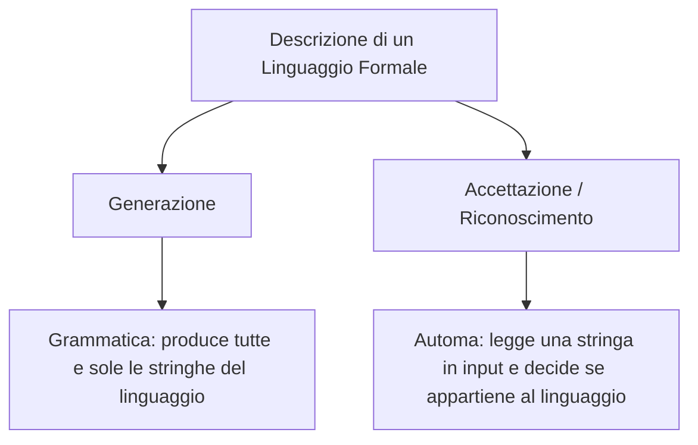

## Relazioni ben fondate e definizioni ricorsive

Alcune definizioni ricorsive ben date non inducono esattamente la stessa relazione d'ordine strutturale del dominio, ma una relazione molto simile.

### Esempio sugli alberi binari

Consideriamo la funzione `leftMost(t)` che restituisce l'etichetta del nodo piu' a sinistra di un albero binario:

$$
leftMost(t) = \begin{cases} 
0 & \text{se } t = \lambda \\
a & \text{se } t = N(\lambda, a, t_2) \\
leftMost(t_1) & \text{se } t = N(t_1, a, t_2) \text{ con } t_1 \neq \lambda
\end{cases}
$$

In questo caso, la chiamata ricorsiva avviene solo sul sottoalbero sinistro: $t_1 < N(t_1, a, t_2)$ per ogni $t_1 \in BT_A$.

### Esempio su Fibonacci

La funzione di Fibonacci e' definita come:

$$
fib(n) = \begin{cases} 
1 & \text{se } n = 1 \text{ oppure } n = 2 \\
fib(n-1) + fib(n-2) & \text{altrimenti}
\end{cases}
$$

Le chiamate ricorsive inducono una relazione di dipendenza diretta sugli argomenti:
* $n - 1 <_{fib} n$
* $n - 2 <_{fib} n$

### Fibonacci e' ben data, formalmente

Per dimostrare che definizioni come quella di Fibonacci terminano sempre, ci basiamo sulle proprieta' delle relazioni ben fondate (relazioni in cui non esistono catene discendenti infinite).

**Proposizione (proprieta' delle relazioni ben fondate):**
>1. Se $\sqsubseteq$ e' una relazione ben fondata e $\sqsubseteq_1 \subseteq \sqsubseteq$, allora anche $\sqsubseteq_1$ e' ben fondata (un sottoinsieme di una relazione ben fondata resta ben fondato).
>2. Una relazione $\sqsubseteq$ e' ben fondata se e solo se lo e' la sua chiusura transitiva $\sqsubseteq^+$.

**Applicazione a Fibonacci:**
Sappiamo che la relazione successore ($succ$, dove $n \prec n+1$) sui numeri naturali e' ben fondata. La chiusura transitiva di $succ$ e' l'usuale relazione di minore stretto ($<$). Di conseguenza, anche $<$ e' ben fondata. Poiche' $<_{fib}$ e' contenuta in $<$, qualunque funzione ricorsiva definita sui naturali usando il suo valore su argomenti strettamente minori (come `fib`) e' ben data e termina.

---

## La congettura di Collatz

Un esempio celebre in cui non e' affatto ovvio stabilire se la definizione induca una relazione ben fondata e' la funzione di Collatz:

$$
f(n) = \begin{cases} 
1 & \text{se } n \le 1 \\
f(n/2) & \text{se } n > 1 \text{ ed e' pari} \\
f(3 \cdot n + 1) & \text{se } n > 1 \text{ ed e' dispari}
\end{cases}
$$

* **Univalenza:** e' una funzione univalente; se $f(k)$ e' definito (cioe' se il calcolo termina), allora il risultato e' necessariamente $f(k) = 1$.
* **Totalita' (problema aperto):** non e' ancora stato dimostrato se $f$ sia totale (ovvero se termini per ogni $n \in \mathbb{N}$).
* **Verifica computazionale:** e' stato dimostrato al calcolatore che termina per tutti i numeri fino a $5,764 \cdot 10^{18}$.
* Resta uno dei problemi aperti piu' affascinanti della matematica proprio per l'estrema semplicita' della sua formulazione.

---

## Altre tipologie di ricorsione

Oltre alla classica **ricorsione diretta** (in cui una funzione richiama direttamente se stessa), esistono altre forme di ricorsione con caratteristiche specifiche:
* Ricorsione annidata
* Ricorsione mutua
* Ricorsione procedurale
* Ricorsione in coda (tail recursion)
* Ricorsione inefficiente

### Ricorsione annidata: la funzione 91 di McCarthy

Nella ricorsione annidata, l'argomento di una chiamata ricorsiva contiene a sua volta un'altra chiamata ricorsiva. Un esempio classico e' la funzione 91 di McCarthy:

$$
f(n) = \begin{cases} 
n - 10 & \text{se } n > 100 \\
f(f(n + 11)) & \text{se } n \le 100 
\end{cases}
$$

* E' univalente, ma non e' affatto immediato dimostrare che sia totale (poiche' l'argomento $n+11$ cresce invece di diminuire verso un caso base).
* Si puo' verificare che, per ogni intero, la funzione restituisce $f(n) = 91$ per $n \le 100$, e $f(n) = n - 10$ per $n > 100$.

### Ricorsione mutua o indiretta

Si ha ricorsione mutua quando due o piu' funzioni si richiamano a vicenda ciclicamente:

$$
ping(n) = \begin{cases} 
0 & \text{se } n = 0 \\
pong(n - 1) & \text{altrimenti} 
\end{cases}
\qquad
pong(n) = \begin{cases} 
0 & \text{se } n = 0 \\
ping(n - 1) & \text{altrimenti} 
\end{cases}
$$


* **Riducibilita':** puo' sempre essere eliminata sostituendo la chiamata alla seconda funzione con il suo corpo, ottenendo cosi' una ricorsione diretta (ad esempio, $ping(n) = ping(n-2)$ per $n \ge 2$).
* Presenta le stesse identiche problematiche della ricorsione diretta per quanto riguarda la dimostrazione della terminazione.

### Ricorsione procedurale

Finora abbiamo analizzato la ricorsione in senso strettamente matematico (funzioni come relazioni univalenti e totali che restituiscono un valore). Gli stessi identici principi si applicano pero' anche alle **procedure** nei linguaggi di programmazione imperativi, le quali non restituiscono un valore matematico ma operano tramite **effetti collaterali** (come la stampa a video o la modifica della memoria).

```c
void stampa_array(int a[], int i, int n) {
    if (i < n) { // clausola ricorsiva: c'e' ancora qualcosa da stampare
        printf("%d ", a[i]);
        stampa_array(a, i + 1, n);
    }
    // clausola base implicita: i == n; l'array a[i..n-1] e' vuoto, la procedura termina
}

void main() {
    int arr[5] = {1, 2, 3, 4, 5};
    stampa_array(arr, 0, 5);
}
```

---

# Introduzione ai linguaggi formali

Che cos'e' un linguaggio? Possiamo distinguere tra **linguaggi naturali** (come l'italiano o l'inglese, evoluti spontaneamente) e **linguaggi formali** (progettati con regole rigide, come i linguaggi di programmazione o la notazione matematica).

In ogni linguaggio si distinguono due aspetti fondamentali:
* **Sintassi:** l'insieme delle regole formali che stabiliscono quali frasi sono ben formate (ammissibili).
  * *Esempio in italiano:* la struttura `<soggetto> <verbo> <complemento-oggetto>`.
  * *"Il bambino mangia la mela"* e' sintatticamente corretta.
  * *"La mela mangia il bambino"* e' anch'essa sintatticamente corretta!
* **Semantica:** il significato associato alle frasi ammissibili (e' la semantica a dirci che la seconda frase non ha senso nel mondo reale).

> *Nota: in questa trattazione ci occuperemo esclusivamente della **sintassi**.*

### Approcci alla descrizione di un linguaggio

Formalmente, un linguaggio e' un insieme di stringhe ammissibili costruite su un certo alfabeto $A$.
* *Esempio:* nel linguaggio dell'aritmetica, la stringa `3 x 4 + 2` e' ammissibile, mentre `3 + x 5 + -` non e' ammissibile.
* Nei linguaggi di programmazione, le stringhe ammissibili sono i programmi sintatticamente validi (quelli che compilano senza errori di sintassi).

Per descrivere un linguaggio dobbiamo definire un meccanismo che isoli il sottoinsieme delle stringhe ammissibili rispetto a tutte le combinazioni possibili. Esistono due tecniche principali:



---

## Alfabeto

Un **alfabeto** $A$ e' un **insieme finito** non vuoto di elementi chiamati **simboli** (o caratteri).

* **Alfabeto latino minuscolo:** $\{a, b, c, \dots, y, z\}$
* **Cifre decimali:** $\{0, 1, 2, \dots, 9\}$
* **Cifre binarie:** $\{0, 1\}$
* **Simboli dell'aritmetica:** $\{0, 1, \dots, 9\} \cup \{+, \times, -, \div\}$
* **ASCII / UNICODE:** insiemi finiti che includono caratteri alfabetici, numerici e di punteggiatura.

---

## Stringhe (o parole) su un alfabeto

Una **stringa** (detta anche *parola* nel contesto dei linguaggi naturali) su un alfabeto $A$ e' una sequenza finita, di lunghezza arbitraria, di simboli appartenenti ad $A$. L'insieme di tutte le possibili stringhe costruibili sull'alfabeto $A$ si indica con $A^\star$ (chiusura di Kleene).

### Definizione induttiva di $A^\star$

L'insieme $A^\star$ puo' essere definito per induzione strutturale nel seguente modo:
* **Clausola base:** $\epsilon \in A^\star$ (dove $\epsilon$ indica la *stringa vuota*, di lunghezza 0).
* **Clausola induttiva:** se $w \in A^\star$ e $a \in A$, allora $aw \in A^\star$ (concatenando un simbolo a sinistra di una stringa si ottiene ancora una stringa).

### Esempi di stringhe in $A^\star$

* **Su alfabeto latino minuscolo:** `bob`, `anna`, `hrjk`, $\epsilon$, `iiiiiii`
* **Su cifre decimali:** `1981`, `27`, `10`, `500`, `0010`
* **Su cifre esadecimali:** `F2`, `23A`, `A55C`, `3A8`
* **Su simboli romani:** `I`, `IV`, `XII`, `IIII`, $\epsilon$, `XVMVX` *(nota: `IIII` e `XVMVX` sono stringhe valide su questo alfabeto, anche se non rappresentano numeri romani ben formati secondo la sintassi romana)*.

### Analogia tra stringhe su $A$ e liste su $A$

Confrontiamo la definizione induttiva di $A^\star$ con quella delle liste $L_A$ formate da elementi di un insieme $A$:

| Concetto | Stringhe ($A^\star$) | Liste ($L_A$) |
| :--- | :--- | :--- |
| **Caso base** | $\epsilon \in A^\star$ | $[] \in L_A$ |
| **Passo induttivo** | $(a \in A \land w \in A^\star) \implies aw \in A^\star$ | $(a \in A \land lst \in L_A) \implies a : lst \in L_A$ |

* **Isomorfismo:** si puo' dimostrare formalmente che $L_A \cong A^\star$, ovvero l'insieme delle liste su $A$ e l'insieme delle stringhe su $A$ sono in **biiezione** (hanno la stessa identica struttura).
* **Differenza d'uso:** nel caso delle stringhe, $A$ e' per definizione un alfabeto (un insieme finito di simboli elementari). Nel caso delle liste, invece, l'insieme $A$ puo' essere arbitrario e persino infinito (liste di numeri, tuple, altre liste, programmi, ecc.).

---

## Linguaggio su un alfabeto

Dato un alfabeto $A$, un **linguaggio** $L$ su $A$ e' un qualsiasi sottoinsieme di stringhe costruite su $A$:

$$
L \subseteq A^\star
$$

Di conseguenza, l'insieme di tutti i possibili linguaggi definibili sull'alfabeto $A$ coincide con l'insieme delle parti di $A^\star$, indicato con $\mathcal{P}(A^\star)$.

* **Il vocabolario italiano:** e' un linguaggio (finito) definito sull'alfabeto latino.
* **La lingua italiana (insieme delle frasi corrette):** e' un linguaggio (infinito) definito su un alfabeto che comprende lettere latine maiuscole e minuscole, lo spazio e i segni di punteggiatura.
* **Le espressioni aritmetiche ben formate:** sono un linguaggio definito sull'alfabeto $\{0, 1, \dots, 9, +, -, \div, \times, (, )\}$.
* **Un linguaggio di programmazione (es. C, Java, Python):** e' un linguaggio formale definito sull'alfabeto ASCII o UNICODE.

> **In parole povere:** $A^\star$ e' il dizionario completo di tutte le combinazioni di caratteri, $L$ e' un singolo linguaggio (un elenco specifico di parole valide), e $\mathcal{P}(A^\star)$ e' la libreria che contiene tutti gli elenchi possibili.

Ad esempio, sia un alfabeto...  

$A = \{a\}$

...allora la sua chiusura di Kleene e':

$A^\star = \{\epsilon, a, aa, aaa, aaaa, \dots\}$  

ovvero l'insieme infinito di tutte le sequenze che puoi formare usando solo la lettera $a$ inclusa la stringa vuota $\epsilon$. Un linguaggio $L \subseteq A^\star$ e' un sottoinsieme delle stringhe di $A^\star$, filtrato secondo una qualche regola. Esempi di linguaggi su $A$:  

$L_1 = \{a, aaa, aaaaa, \dots\}$ $\rightarrow$ Il linguaggio delle stringhe di lunghezza dispari.  
$L_2 = \{\epsilon, aa\}$ $\rightarrow$ Un linguaggio finito che accetta solo la stringa vuota e la stringa `aa`.  
$L_3 = \emptyset$ $\rightarrow$ Il linguaggio vuoto (non accetta nessuna stringa).  