# Automi a stati finiti

Gli automi sono macchine a stati fondamentali per l'informatica (come gli automi di Mealy e di Moore, o le Macchine di Turing). In particolare, gli **automi a stati finiti** (deterministici e non deterministici) servono per il **riconoscimento di linguaggi**.

L'idea di base e' semplice:
* Si legge una stringa in input partendo da uno **stato iniziale**.
* Ogni carattere letto causa una **transizione di stato**.
* La stringa e' riconosciuta (accettata) se, al termine della lettura di tutti i caratteri, ci si trova in uno **stato di accettazione** (o stato finale).

## Esempio intuitivo

Consideriamo l'alfabeto latino $A$ e il linguaggio $L$ formato dalle parole inglesi che contengono le vocali $\{a, e, i, o, u\}$ esattamente in questo ordine. Un automa che riconosce $L$ deve "ricordare" quali vocali ha gia' incontrato e avanzare di stato ogni volta che legge la vocale successiva attesa, ignorando le altre lettere.

```mermaid
stateDiagram-v2
    direction LR
    state "<span style='text-decoration: overline;'>5</span>" as 5
    0 --> 0 : A \ {a}
    0 --> 1 : a
    1 --> 1 : A \ {e}
    1 --> 2 : e
    2 --> 2 : A \ {i}
    2 --> 3 : i
    3 --> 3 : A \ {o}
    3 --> 4 : o
    4 --> 4 : A \ {u}
    4 --> 5 : u
    5 --> 5 : A
```



* La parola `facetious` appartiene a $L$ (raggiunge lo stato finale $5$).
* La parola `hello` non appartiene a $L$ (si ferma prima di raggiungere lo stato $5$).

## Definizione formale di automa

Dato un alfabeto $A$, un automa a stati finiti su $A$ e' una tripla:

$$\mathcal{A} = (S, T, F)$$

dove:
* $S$ e' un insieme finito, detto **insieme degli stati**.
* $T \subseteq (A \times S) \times S$ e' la **relazione di transizione**. Un elemento $((a, x), y) \in T$ indica che, trovandosi nello stato $x$ e leggendo il carattere $a$, l'automa puo' passare nello stato $y$.
* $F \subseteq S$ e' l'insieme degli **stati finali** (o di accettazione), spesso indicati graficamente con un doppio cerchio o con una barra sopra il nome dello stato (eg. $\overline{5}$).

Riprendendo l'esempio delle vocali in ordine:
* $S = \{0, 1, 2, 3, 4, 5\}$
* $T = \{((0, a), 1), ((1, e), 2), ((2, i), 3), ((3, o), 4), ((4, u), 5)\} \cup \{((0, x), 0) \mid x \in A \setminus \{a\}\} \cup \dots \cup \{((5, x), 5) \mid x \in A\}$
* $F = \{5\}$

> **Nota:** A seconda della definizione l'ordine nella coppia interna di $T$ puo' essere scritto equivalentemente come $(a, x)$ o $(x, a)$, l'importante e' distinguere stato di partenza, simbolo letto e stato di arrivo.

## Raggiungibilita'

Per formalizzare quali stati si raggiungono leggendo intere stringhe, definiamo prima la relazione di transizione per un singolo carattere $a \in A$:

$$T_a = \{(x, y) \mid ((a, x), y) \in T\} \in \text{Rel}(S, S)$$

> Ovvero $T_a$ contiene tutte le coppie $(x, y)$ di stati collegati da un arco etichettato con $a$.

Estendiamo poi questa definizione a una qualsiasi stringa $w \in A^*$ in modo **induttivo**:
* **Clausola base** (stringa vuota $\epsilon$): $T_\epsilon = \text{id}_S$ (senza leggere caratteri si resta nello stesso stato).
* **Clausola induttiva** (stringa $aw$): $T_{aw} = T_a ; T_w$ (dove $;$ indica la composizione di relazioni: prima si fa un passo con $a$, poi si prosegue con $w$).

Se $(x, y) \in T_w$, allora lo stato $y$ e' **raggiungibile** da $x$ leggendo la stringa $w$.

### Esempio di calcolo

Consideriamo l'alfabeto $A = \{a, b\}$ e l'automa $\mathcal{A} = (S, T, F)$ con $S = \{x, y, z\}$ e $F = \{x, z\}$:

```mermaid
stateDiagram-v2
    state "<span style='text-decoration: overline;'>x</span>" as x
    state "<span style='text-decoration: overline;'>z</span>" as z
    direction LR
    x --> y : a, b
    y --> x : a
    y --> z : b
    z --> z : a
    z --> x : b
```



Le relazioni per i singoli simboli sono:
* $T_a = \{(x, y), (y, x), (z, z)\}$
* $T_b = \{(x, y), (y, z), (z, x)\}$

Calcoliamo gli stati raggiungibili con la stringa $abb$:

$$T_{abb} = T_a ; T_{bb} = T_a ; (T_b ; T_b) = T_a ; T_b ; T_b = \{(x, x), (y, z), (z, y)\}$$

Ad esempio, partendo da $x$: con $a$ si va in $y$, con $b$ si va in $z$, con $b$ si torna in $x$; quindi $(x, x) \in T_{abb}$.

## Linguaggio accettato da uno stato

Dato un automa $\mathcal{A} = (S, T, F)$ e uno stato $x \in S$, il **linguaggio accettato da $x$** e' l'insieme di tutte le stringhe che portano da $x$ a un qualche stato finale:

$$\ll x \gg = \{w \in A^* \mid \exists y \in F . (x, y) \in T_w\}$$

Se $w \in \ll x \gg$, diciamo che $w$ e' accettata dallo stato $x$.

Dalla definizione discende una proprieta' importante: **la stringa vuota $\epsilon$ e' accettata da uno stato $x$ se e solo se $x$ e' uno stato finale** ($x \in F$), poiche' $T_\epsilon = \text{id}_S$.  

> Intuitivamente leggere 0 caratteri da una posizione $x$ ci lascia nella stessa posizione $x$ e quindi $\epsilon$ e' accettata solo se $x$ e' uno stato finale.

Verifichiamo alcune stringhe sull'automa dell'esempio precedente (dove $F = \{x, z\}$):
* $b \in \ll x \gg$? **No**, perche' con $b$ da $x$ si va solo in $y \notin F$.
* $bb \in \ll x \gg$? **Si'**, perche' da $x$ si va in $y$ e poi in $z \in F$.
* $a \in \ll z \gg$? **Si'**, perche' da $z$ con $a$ si resta in $z \in F$.
* $\epsilon \in \ll x \gg$? **Si'**, perche' $x \in F$.

## Automi deterministici e non deterministici

Un automa $\mathcal{A} = (S, T, F)$ si dice **deterministico** se e solo se la relazione di transizione $T$ e' una **funzione** (da $A \times S$ a $S$), ovvero deve essere:
1. **Totale**: per ogni stato e per ogni carattere dell'alfabeto esiste almeno una transizione uscente.
2. **Univalente**: per ogni stato e per ogni carattere esiste al massimo una transizione uscente (non ci sono scelte multiple per lo stesso simbolo).

Se manca almeno una di queste due proprieta', l'automa e' **non deterministico**. In un automa non deterministico, dato uno stato $x$ e una stringa $w$, possono esistere piu' cammini possibili: per la definizione di $\ll x \gg$, **basta che esista almeno un cammino che termina in uno stato di accettazione** perche' la stringa sia accettata.

### Esercizio: parole che cominciano con "al"

Progettare un automa sull'alfabeto latino $A$ che accetti tutte e sole le parole che iniziano con `"al"`.

**Soluzione 1 (Non deterministica):**
La relazione e' univalente ma **non totale**: se la parola non inizia con `a` o se il secondo carattere non e' `l`, l'automa si blocca senza transizioni disponibili. Il cappio su $2$ etichettato con $A$ serve a restare nello stato di accettazione mentre si consuma il resto della stringa.

```mermaid
stateDiagram-v2
    direction LR
    state "<span style='text-decoration: overline;'>2</span>" as 2
    0 --> 1 : a
    1 --> 2 : l
    2 --> 2 : A
```



**Soluzione 2 (Deterministica):**
Per rendere la relazione totale, aggiungiamo uno **stato pozzo** ($3$) in cui finiscono tutte le stringhe che non rispettano il prefisso `"al"`. Una volta entrati nello stato pozzo, non se ne puo' piu' uscire.

```mermaid
stateDiagram-v2
    direction LR
    state "<span style='text-decoration: overline;'>2</span>" as 2
    0 --> 1 : a
    0 --> 3 : A \ {a}
    1 --> 2 : l
    1 --> 3 : A \ {l}
    2 --> 2 : A
    3 --> 3 : A
```



### Esercizio: numero pari (o dispari) di "a"

Sia $A = \{a, b\}$. Progettare un automa che accetti le stringhe con un **numero pari di `a`**.

**Soluzione deterministica minima (2 stati):**
Lo stato ricorda la parita' delle `a` lette finora: lo stato $0$ rappresenta un numero pari di `a` (incluso $0$, quindi $\epsilon$ e' accettata), mentre lo stato $1$ rappresenta un numero dispari di `a`. Leggere `b` non cambia la parita'.

```mermaid
stateDiagram-v2
    direction LR
    state "<span style='text-decoration: overline;'>0</span>" as 0
    0 --> 0 : b
    0 --> 1 : a
    1 --> 1 : b
    1 --> 0 : a
```



> **Nota:** se rendessimo finale lo stato $1$ invece dello stato $0$, l'automa riconoscerebbe le stringhe con un numero **dispari** di `a`: ad esempio `a` e `babbaa` sarebbero accettate, mentre `b` e `abbab` sarebbero rifiutate.

Esistono anche automi deterministici equivalenti ma **non minimi**, quindi con piu' stati.

### Esempio di accettazione non deterministica

Consideriamo il seguente automa non deterministico su $A = \{a, b\}$ con stato iniziale $1$ e unico stato finale $2$:

```mermaid
stateDiagram-v2
    direction RL
    state "<span style='text-decoration: overline;'>2</span>" as 2
    1 --> 2 : a
    2 --> 2 : b
    2 --> 3 : b
    3 --> 1 : a
```



Ci chiediamo: $ab \in \ll 1 \gg$?
* Leggendo `a` da $1$ andiamo in $2$.
* Da $2$, leggendo `b`, abbiamo due scelte: restare in $2$ oppure andare in $3$.
* Il cammino $(1, 2), (2, 3)$ termina in $3 \notin F$, mentre il cammino $(1, 2), (2, 2)$ termina in $2 \in F$.
* Poiche' esiste almeno un cammino che porta in uno stato finale, **si', $ab \in \ll 1 \gg$**.

## Espressivita' degli automi non deterministici

Progettare un automa sull'alfabeto latino $A$ che riconosca le parole che **finiscono con `"are"`**.

**Soluzione non deterministica (molto semplice):**
L'automa resta nello stato iniziale $0$ finche' non *"vede"* che stanno per arrivare gli ultimi tre caratteri `a`, `r`, `e` (ad esempio su `"amare"`, resta in $1$ su `a`, `m`, e poi avanza su `a`, `r`, `e`).

```mermaid
stateDiagram-v2
    direction LR
    state "<span style='text-decoration: overline;'>3</span>" as 3
    0 --> 0 : A
    0 --> 1 : a
    1 --> 2 : r
    2 --> 3 : e
```



**Soluzione deterministica (piu' complessa):**
In un automa deterministico non possiamo "indovinare" quando finira' la parola: dobbiamo gestire ogni possibile prefisso parziale di `"are"` che si interrompe e ricomincia (es. se leggiamo una `a` mentre siamo negli stati $2$, $3$ o $4$, dobbiamo tornare allo stato $2$).

```mermaid
stateDiagram-v2
    direction RL
    state "<span style='text-decoration: overline;'>3</span>" as 3
    0 --> 0 : A \ {a}
    0 --> 1 : a
    1 --> 1 : a
    1 --> 2 : r
    1 --> 0 : A \ {a, r}
    2 --> 3 : e
    2 --> 1 : a
    2 --> 0 : A \ {a, e}
    3 --> 1 : a
    3 --> 0 : A \ {a}
```



### Verso la costruzione dei sottoinsiemi

I computer fisici sono macchine a stati deterministiche: un automa non deterministico non puo' essere eseguito direttamente cosi' com'e', ma e' comodissimo come **specifica** ad alto livello.

> Dato un qualsiasi automa non deterministico, e' sempre possibile costruirne uno deterministico che riconosce esattamente lo stesso linguaggio (una sorta di **implementazione** della specifica).

Questo risultato fondamentale fu dimostrato da **Michael Rabin e Dana Scott** nel 1959 (premio Turing) tramite la **costruzione dei sottoinsiemi**.

---

# Grammatiche libere da contesto

Mentre gli automi usano un approccio di **riconoscimento** (leggono una stringa e dicono si'/no), le **grammatiche libere da contesto** usano un **approccio generativo**: definiscono le regole sintattiche per *generare* tutte e sole le stringhe corrette di un linguaggio (usate ad esempio per i linguaggi di programmazione o i linguaggi logici).

## Esempio: espressioni aritmetiche

Consideriamo l'alfabeto $A = \{+, \times, -, \div\} \cup \{0, 1, 2, 3, 4, 5, 6, 7, 8, 9\}$.
Solo alcune stringhe di $A^*$ sono espressioni aritmetiche ben formate:
* $5 \times 4 + 1 \div 3$ e' corretta.
* $5 + \times \div 3$ non e' corretta.

Per generare solo quelle corrette introduciamo delle regole di riscrittura dette **produzioni**, che hanno la forma:

$$\text{Testa} \leadsto \text{Corpo}$$

dove:
* **Testa** e' un singolo simbolo non terminale.
* $\leadsto$ e' un metasimbolo che si legge *"puo' essere"*.
* **Corpo** e' una sequenza di simboli terminali e/o non terminali.

Ecco le produzioni per le espressioni aritmetiche:

$$\begin{aligned}
\langle ExA \rangle &\leadsto \langle Num \rangle \\
\langle ExA \rangle &\leadsto \langle ExA \rangle + \langle ExA \rangle \\
\langle ExA \rangle &\leadsto \langle ExA \rangle - \langle ExA \rangle \\
\langle ExA \rangle &\leadsto \langle ExA \rangle \times \langle ExA \rangle \\
\langle ExA \rangle &\leadsto \langle ExA \rangle \div \langle ExA \rangle
\end{aligned}$$

* $\langle ExA \rangle$ e $\langle Num \rangle$ sono **simboli non terminali** (o categorie sintattiche): rappresentano sotto-linguaggi da espandere.
* $+, -, \times, \div$ sono **simboli terminali** (appartengono all'alfabeto $A$ e non si espandono ulteriormente).

## Definizione formale di grammatica

Una grammatica $G$ su un alfabeto $A$ e' una coppia:

$$G = (S, P)$$

dove:
* $S$ e' l'insieme dei **simboli non terminali**, disgiunto dall'alfabeto ($S \cap A = \emptyset$).
* $P$ e' un insieme finito di **produzioni** della forma:

$$\langle X \rangle \leadsto w$$

con $\langle X \rangle \in S$ e $w \in (S \cup A)^*$ (nota: $w$ puo' anche essere la stringa vuota $\epsilon$).

### Notazione compatta

Quando ci sono piu' produzioni per lo stesso simbolo non terminale $\langle X \rangle$, si possono raggruppare separando i corpi con il metasimbolo $|$ (letto *"oppure"*):

$$\langle X \rangle \leadsto w_1 \mid w_2 \mid \dots \mid w_k$$

Completando la grammatica delle espressioni aritmetiche con le regole per i numeri ($\langle Num \rangle$, definiti ricorsivamente come una sequenza non vuota di cifre) e per le cifre ($\langle Cif \rangle$):

$$\begin{aligned}
\langle Cif \rangle &\leadsto 0 \mid 1 \mid 2 \mid 3 \mid 4 \mid 5 \mid 6 \mid 7 \mid 8 \mid 9 \\
\langle Num \rangle &\leadsto \langle Cif \rangle \mid \langle Num \rangle \langle Cif \rangle \\
\langle ExA \rangle &\leadsto \langle Num \rangle \mid \langle ExA \rangle + \langle ExA \rangle \mid \langle ExA \rangle - \langle ExA \rangle \mid \langle ExA \rangle \times \langle ExA \rangle \mid \langle ExA \rangle \div \langle ExA \rangle
\end{aligned}$$

## Backus-Naur Form (BNF)

In informatica, le grammatiche libere da contesto vengono spesso scritte usando la **Backus-Naur Form (BNF)**, introdotta da John Backus per descrivere la sintassi del linguaggio Algol. In questa notazione si omettono le parentesi angolari $\langle \dots \rangle$ intorno ai non terminali e si usa `::=` al posto di $\leadsto$:

```bnf
Cif ::= 0 | 1 | 2 | 3 | 4 | 5 | 6 | 7 | 8 | 9
Num ::= Cif | Num Cif
ExA ::= Num | ExA + ExA | ExA - ExA | ExA × ExA | ExA ÷ ExA
```