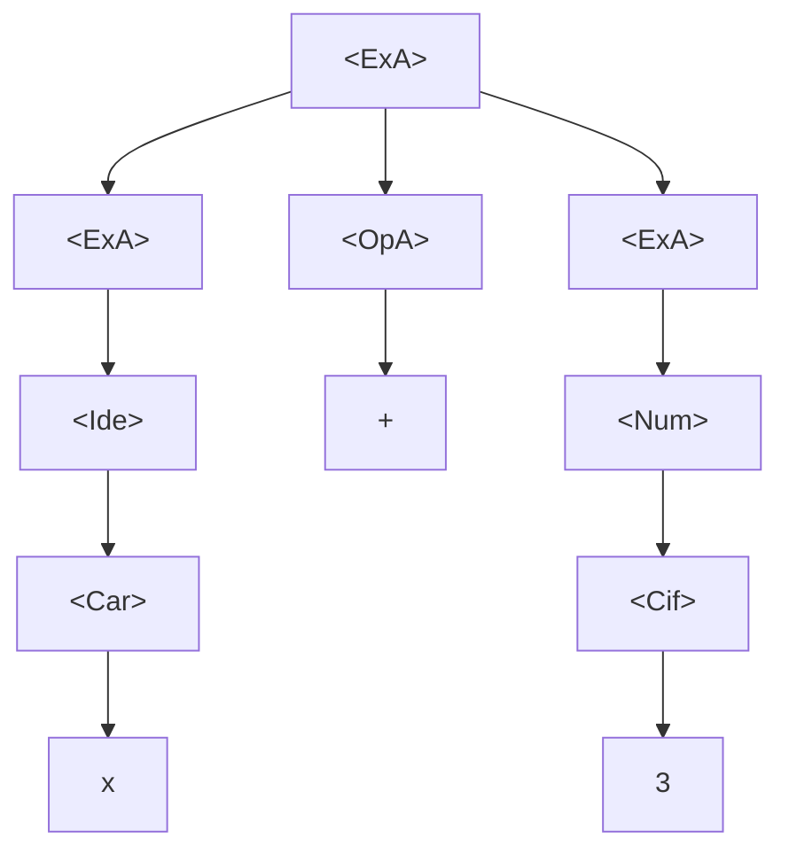
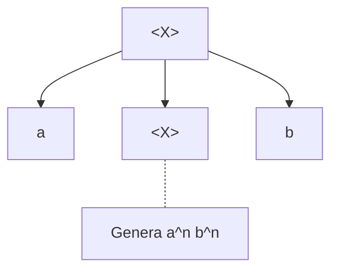
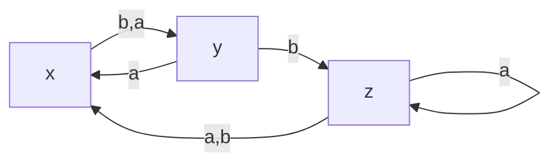
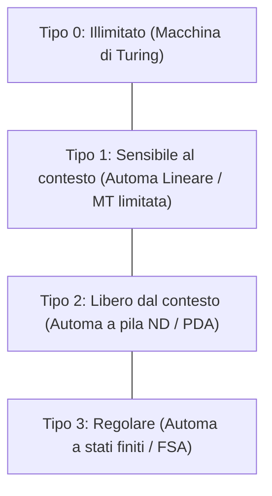

## Grammatica delle espressioni aritmetiche

Per generare espressioni aritmetiche contenenti sia numeri che variabili (come ad esempio $x + y \times 3$), e' necessario arricchire la grammatica specificando opportunamente l'alfabeto ed introducendo nuove categorie sintattiche.

### Definizione dei simboli e produzioni

* **Alfabeto**:  
  $$A = \{+, \times, -, \div\} \cup \{0, 1, 2, 3, 4, 5, 6, 7, 8, 9\} \cup \{a, b, c, \dots, z\}$$  
* **Categorie sintattiche (Non terminali)**:  
  $$S = \{\langle Cif \rangle, \langle Num \rangle, \langle ExA \rangle, \langle OpA \rangle, \langle Ide \rangle, \langle Car \rangle\}$$  

Le regole di produzione $P$ sono definite come segue:  

$$\langle Cif \rangle \leadsto 0 \mid 1 \mid 2 \mid 3 \mid 4 \mid 5 \mid 6 \mid 7 \mid 8 \mid 9$$  

$$\langle Num \rangle \leadsto \langle Cif \rangle \mid \langle Num \rangle \langle Cif \rangle$$  

$$\langle ExA \rangle \leadsto \langle Num \rangle \mid \langle ExA \rangle \langle OpA \rangle \langle ExA \rangle \mid \langle Ide \rangle$$  

$$\langle OpA \rangle \leadsto + \mid \times \mid - \mid \div$$  

$$\langle Ide \rangle \leadsto \langle Car \rangle \mid \langle Ide \rangle \langle Car \rangle$$  

$$\langle Car \rangle \leadsto a \mid b \mid c \mid \dots \mid z$$  

---

## Albero di derivazione sintattica (parse tree)

Sia $G = (S, P)$ una grammatica libera da contesto sull'alfabeto $A$. Un **albero di derivazione sintattica** (o *parse tree*) e' un albero radicato in cui:
1. Ogni nodo interno e' etichettato con un simbolo non terminale appartenente a $S$.
2. Ogni foglia e' etichettata con un simbolo terminale appartenente ad $A$, oppure con la stringa vuota $\epsilon$.
3. Se un nodo interno $x$ e' etichettato con $\langle X \rangle$, allora deve esistere una produzione $\langle X \rangle \leadsto w$ in $P$ tale che la sequenza delle etichette dei figli di $x$ (letta da sinistra a destra) sia esattamente $w$.

La stringa generata dall'albero si ottiene leggendo le etichette delle foglie da sinistra a destra (ignorando eventuali simboli $\epsilon$). Se $v \in A^*$ e' tale sequenza, l'albero prende il nome di *albero di derivazione per $v$*.

### Esempio: derivazione della stringa `"x + 3"`

Consideriamo la stringa `"x + 3"`. L'albero di derivazione partendo dal non terminale radice $\langle ExA \rangle$ e' il seguente:

Analizzando le foglie da sinistra a destra si ottiene esattamente la stringa terminale $x + 3$.

---

## Linguaggio generato da un non terminale

Sia $G = (S, P)$ una grammatica libera da contesto sull'alfabeto $A$, e sia $\langle X \rangle \in S$ un simbolo non terminale.

Il **linguaggio generato da $\langle X \rangle$**, denotato con $\ll \langle X \rangle \gg$, e' l'insieme di tutte le stringhe $w \in A^*$ per le quali esiste un albero di derivazione avente come radice il nodo etichettato con $\langle X \rangle$:  

$$\ll \langle X \rangle \gg \;=\; \{ w \in A^* \mid \exists \text{ parse tree per } w \text{ con radice } \langle X \rangle \}$$  

### Esempi di linguaggi generati

* $\ll \langle Num \rangle \gg = \{0, 1, \dots, 35, \dots\}$ (tutti i numeri naturali rappresentati come sequenze non vuote di cifre).
* $\ll \langle Ide \rangle \gg$ rappresenta l'insieme di tutte le sequenze non vuote di caratteri alfabetici (es. `x`, `temp`).
* Verifiche di appartenenza:
  * $35 \in \ll \langle Num \rangle \gg$ $\quad \checkmark$
  * $35 \in \ll \langle Ide \rangle \gg$ $\quad \times$
  * $35 \in \ll \langle ExA \rangle \gg$ $\quad \checkmark$ (poiche' un numero e' anche un'espressione aritmetica).

---

## Dimostrazione di correttezza per la grammatica di un linguaggio

Consideriamo il linguaggio delle stringhe formate da un numero uguale di $a$ seguite da un numero uguale di $b$:  

$$L = \{ a^n b^n \mid n \in \mathbb{N} \} = \{ \epsilon, ab, aabb, aaabbb, \dots \}$$  

> **Nota:** $a^0b^0 = \epsilon\epsilon = \epsilon$ mentre $a^1b^1 = ab$ e cosi' via...

Proponiamo la seguente grammatica con non terminale radice $\langle X \rangle$:  

$$\langle X \rangle \leadsto \epsilon \mid a \langle X \rangle b$$  

Vogliamo dimostrare formalmente che $\ll \langle X \rangle \gg = L$. La dimostrazione si articola in due parti (doppia inclusione).

### Inclusione 1: $L \subseteq \ll \langle X \rangle \gg$

Dimostriamo per induzione su $n \in \mathbb{N}$ la proprieta' $P(n) \equiv a^n b^n \in \ll \langle X \rangle \gg$.

* **Caso Base ($n = 0$)**: Per $n = 0$, $a^0 b^0 = \epsilon$. Esiste l'albero di derivazione banale con radice $\langle X \rangle$ e figlio unico $\epsilon$. Quindi $\epsilon \in \ll \langle X \rangle \gg$.
* **Passo Induttivo**: Assumiamo che $a^n b^n \in \ll \langle X \rangle \gg$ (ipotesi induttiva). Dobbiamo mostrare che $a^{n+1} b^{n+1} \in \ll \langle X \rangle \gg$.
  Usando la produzione $\langle X \rangle \leadsto a \langle X \rangle b$, possiamo costruire un nuovo albero di derivazione inserendo come radice $\langle X \rangle$ con tre figli: il terminale $a$, il sottoalbero con radice $\langle X \rangle$ che genera $a^n b^n$ per ipotesi induttiva, e il terminale $b$. La stringa risultante e' $a(a^n b^n)b = a^{n+1} b^{n+1}$.
  Pertanto, $a^{n+1} b^{n+1} \in \ll \langle X \rangle \gg$.

### Inclusione 2: $\ll \langle X \rangle \gg \subseteq L$

Dimostriamo per induzione sulla struttura dell'albero di derivazione che ogni stringa generata da $\langle X \rangle$ appartiene a $L$.

* Se l'albero e' applicazione della regola $\langle X \rangle \leadsto \epsilon$, la stringa e' $\epsilon = a^0 b^0 \in L$.
* Se l'albero e' applicazione della regola $\langle X \rangle \leadsto a \langle X \rangle b$, la stringa generata sara' $a w b$ dove $w$ e' la stringa generata dal sottoalbero con radice $\langle X \rangle$. Per ipotesi induttiva $w = a^n b^n \in L$, quindi $a w b = a a^n b^n b = a^{n+1} b^{n+1} \in L$.

Concludiamo dunque che $\ll \langle X \rangle \gg = L$.

---

## Esempi di grammatiche per linguaggi specifici

* Linguaggio $L = \{ a^{2n} b^n \mid n \in \mathbb{N} \}$:  
  $$\langle X \rangle \leadsto \epsilon \mid aa \langle X \rangle b$$  

* Linguaggio $L = \{ a^n b^m \mid n \le m \}$:  
  $$\langle X \rangle \leadsto \epsilon \mid a \langle X \rangle b \mid \langle X \rangle b$$  

---

## Grammatica per F-termini e alberi binari

Sia $\mathcal{F} = \{\mathcal{F}_n\}_{n \in \mathbb{N}}$ una segnatura dove ogni $\mathcal{F}_n$ rappresenta l'insieme dei simboli di funzione con arita' $n$. Gli $\mathcal{F}$-termini sono definiti induttivamente:
* **Clausola base**: Per ogni costante $c \in \mathcal{F}_0$, $c \in \mathcal{F}Term$.
* **Clausola induttiva**: Per ogni $n \ge 1$ e $f \in \mathcal{F}_n$, se $t_1, \dots, t_n \in \mathcal{F}Term$, allora $f(t_1, \dots, t_n) \in \mathcal{F}Term$.

Per costruire una grammatica libera da contesto che generi gli $\mathcal{F}$-termini:
1. Introduciamo una categoria sintattica $\langle FIde_n \rangle$ per ogni $n \in \mathbb{N}$, aggiungendo produzioni $\langle FIde_n \rangle \leadsto f$ per ogni $f \in \mathcal{F}_n$.
2. Definiamo le produzioni per $\langle Term \rangle$:
   $$\langle Term \rangle \leadsto \langle FIde_0 \rangle \mid \langle FIde_n \rangle ( \langle Term \rangle, \dots, \langle Term \rangle ) \quad (n \ge 1)$$

### Applicazione agli alberi binari

Per la segnatura degli alberi binari $\mathcal{BT}$:
* $\mathcal{BT}_0 = \{\lambda\}$ (albero vuoto)
* $\mathcal{BT}_1 = \emptyset$
* $\mathcal{BT}_2 = \{N\}$ (nodo binario)
* $\mathcal{BT}_n = \emptyset$ per ogni $n \ge 3$

Le regole della grammatica risultano:  

$$\langle \mathcal{BT}Ide_0 \rangle \leadsto \lambda$$  
$$\langle \mathcal{BT}Ide_2 \rangle \leadsto N$$  
$$\langle Term \rangle \leadsto \langle \mathcal{BT}Ide_0 \rangle \mid \langle \mathcal{BT}Ide_2 \rangle ( \langle Term \rangle, \langle Term \rangle )$$  

---

## Ambiguita' nelle grammatiche

Una grammatica libera da contesto $G = (S, P)$ si dice **ambigua** se esiste almeno una stringa $w \in A^*$ che ammette due o piu' alberi di derivazione distinti aventi la stessa etichetta nella radice.

### Esempio di ambiguita': l'espressione $y \times 5 + x$

Nella grammatica per le espressioni aritmetiche precedentemente vista, la stringa $y \times 5 + x$ puo' generare due distinti alberi di derivazione:

1. **Albero 1**: Interpreta l'espressione come $(y \times 5) + x$.
2. **Albero 2**: Interpreta l'espressione come $y \times (5 + x)$.

Se valutiamo l'espressione con i valori $x = 3$ e $y = 2$:
* $(2 \times 5) + 3 \implies 13$
* $2 \times (5 + 3) \implies 16$

L'ambiguita meccanica della grammatica causa indeterminatezza nel significato (semantica) delle espressioni.

### Soluzioni all'ambiguita'

Per risolvere l'ambiguita nelle grammatiche delle espressioni aritmetiche:
1. Si stabilisce una **precedenza degli operatori** (es. la moltiplicazione $\times$ ha precedenza sull'addizione $+$).
2. Si estende l'alfabeto con le parentesi `(`, `)` e si aggiunge la regola di produzione:  
   $$\langle ExA \rangle \leadsto (\langle ExA \rangle)$$  

### Note sull'ambiguita' nei linguaggi naturali

L'ambiguita e' una caratteristica intrinseca anche del linguaggio naturale. Consideriamo la frase:
> *"Gianna vede il vecchio col binocolo"*

Puo' essere interpretata sintatticamente in due modi:
* `Gianna vede (il vecchio col binocolo)` $\rightarrow$ Il vecchio possiede il binocolo.
* `(Gianna vede il vecchio) col binocolo` $\rightarrow$ Gianna usa il binocolo per vedere il vecchio.

---

## Grammatica per un semplice linguaggio di programmazione

Possiamo combinare tutte le definizioni viste per definire un grammaticamente un piccolo linguaggio di programmazione imperativo.  

* **Alfabeto**:
  $$A = \{+, -, \times, \div\} \cup \{0, \dots, 9\} \cup \{a, \dots, z\} \cup \{(, )\} \cup \{\land, \lor, !\} \cup \{>, \ge, =, <, \le, !=\} \cup \{;, :, \{, \}\}$$  

### Categorie sintattiche e produzioni

* **Espressioni booleane ($\langle ExB \rangle$)**:  
  $$\langle ExB \rangle \leadsto (\langle ExB \rangle) \mid \langle CoB \rangle \mid \langle ExB \rangle \langle OpB \rangle \langle ExB \rangle \mid \,!\langle ExB \rangle \mid \langle ExA \rangle \langle OpC \rangle \langle ExA \rangle$$  

* **Costanti e Operatori Booleani/Confronto**:  
  $$\langle CoB \rangle \leadsto \text{true} \mid \text{false}$$  
  $$\langle OpB \rangle \leadsto \land \mid \lor$$  
  $$\langle OpC \rangle \leadsto > \mid \ge \mid < \mid \le \mid = \mid !=$$  

* **Comandi ($\langle Com \rangle$)**:  
  $$\langle Com \rangle \leadsto \text{skip} \quad \text{(Comando vuoto)}$$  
  $$\quad \mid \langle Ide \rangle := \langle ExA \rangle \quad \text{(Assegnamento)}$$  
  $$\quad \mid \langle Com \rangle ; \langle Com \rangle \quad \text{(Composizione sequenziale)}$$  
  $$\quad \mid \text{if } (\langle ExB \rangle) \text{ then } \{\langle Com \rangle\} \text{ else } \{\langle Com \rangle\} \quad \text{(Branching condizionale)}$$  
  $$\quad \mid \text{while } (\langle ExB \rangle) \text{ do } \{\langle Com \rangle\} \quad \text{(Iterazione)}$$  

---

## Confronto tra automi e grammatiche

Mettiamo a confronto il potere espressivo degli automi a stati finiti e delle grammatiche libere da contesto.

* Un automa $\mathcal{A}$ su $A$ riconosce/accetta un linguaggio $\ll x \gg$ per ogni suo stato $x \in S$. Definiamo $L_A$ come la classe dei linguaggi accettati da automi a stati finiti.
* Una grammatica $G$ su $A$ genera un linguaggio $\ll \langle X \rangle \gg$ per ogni suo non terminale $\langle X \rangle \in S$. Definiamo $L_G$ come la classe dei linguaggi generati da grammatiche libere da contesto.

Ci chiediamo se i due formalismi sono equivalenti ($L_G = L_A$):
1. **$L_A \subseteq L_G$?** Si', per ogni automa a stati finiti e' possibile costruire una grammatica libera da contesto equivalente.
2. **$L_G \subseteq L_A$?** No! Esistono linguaggi generabili da grammatiche libere da contesto che non possono essere riconosciuti da alcun automa a stati finiti.

Di conseguenza, $L_A \subset L_G$: le grammatiche libere da contesto sono **strettamente piu' espressive** degli automi a stati finiti.

---

## Estrazione di una grammatica da un automa a stati finiti

Sia $\mathcal{A} = (S, T, F)$ un automa a stati finiti sull'alfabeto $A$, dove $S$ e' l'insieme degli stati, $T \subseteq (A \times S) \times S$ e' la relazione di transizione, e $F \subseteq S$ e' l'insieme degli stati finali.

Possiamo definire una grammatica libera da contesto equivalente $\mathcal{G}_{\mathcal{A}} = (S_{\mathcal{A}}, P_{\mathcal{A}})$ come segue:
* **Simboli non terminali**: $S_{\mathcal{A}} = \{ \langle x \rangle \mid x \in S \}$
* **Regole di produzione**:
  $$P_{\mathcal{A}} = \{ \langle x \rangle \leadsto \epsilon \mid x \in F \} \cup \{ \langle x \rangle \leadsto a \langle y \rangle \mid ((a, x), y) \in T \}$$

### Teorema
Dato un automa $\mathcal{A} = (S, T, F)$ e uno stato $x \in S$:
$$\forall w \in A^*, \quad w \in \ll x \gg \; \iff \; w \in \ll \langle x \rangle \gg$$

### Esempio di conversione

Consideriamo un automa con stati $S = \{x, y, z\}$ dove $x, z$ sono stati finali e le transizioni sono:
* da $x$: con $b \to y$, con $a \to y$
* da $y$: con $b \to z$, con $a \to x$
* da $z$: con $a \to z$, con $a \to x$, con $b \to x$

La grammatica equivalente $\mathcal{G}_{\mathcal{A}}$ avra' i non terminali $\{\langle x \rangle, \langle y \rangle, \langle z \rangle\}$ e le produzioni:

$$\langle x \rangle \leadsto \epsilon \mid a \langle y \rangle \mid b \langle y \rangle$$
$$\langle y \rangle \leadsto b \langle z \rangle \mid a \langle x \rangle$$
$$\langle z \rangle \leadsto \epsilon \mid a \langle z \rangle \mid a \langle x \rangle \mid b \langle x \rangle$$

---

## Limiti degli automi a stati finiti: il linguaggio $a^n b^n$

Dimostriamo formalmente che gli automi a stati finiti non sono in grado di riconoscere tutti i linguaggi generabili da una grammatica.

### Teorema
Nessun automa a stati finiti puo' riconoscere il linguaggio $L = \{ a^n b^n \mid n \in \mathbb{N} \}$ sull'alfabeto $A = \{a, b\}$.

### Dimostrazione (per assurdo)

Supponiamo per assurdo che esista un automa a stati finiti $\mathcal{A} = (S, T, F)$ ed uno stato $x \in S$ tale che $\ll x \gg = L$.

1. Sia $m = |S|$ il numero finito di stati dell'automa $\mathcal{A}$.
2. Consideriamo la stringa $a^m b^m$. Poiche' $m \in \mathbb{N}$, certamente $a^m b^m \in L$, e quindi $a^m b^m \in \ll x \gg$.
3. Poiche' l'automa accetta $a^m b^m$, deve esistere un cammino (*walk*) nell'automa che parte da $x$, legge i primi $m$ simboli '$a$' e arriva ad uno stato $y \in S$:
   $$x = x_0 \xrightarrow{a} x_1 \xrightarrow{a} x_2 \xrightarrow{a} \dots \xrightarrow{a} x_m = y$$
4. Questo cammino incontra una sequenza di $m + 1$ stati: $(x_0, x_1, \dots, x_m)$.
5. Consideriamo la funzione $f: \{0, 1, \dots, m\} \to S$ definita da $f(i) = x_i$. 
   Il dominio contiene $m + 1$ elementi, mentre il codominio $S$ contiene solo $m$ elementi ($|S| = m$).
6. Per il **Principio delle Buche e dei Piccioni** (Pigeonhole Principle), la funzione $f$ non puo' essere iniettiva. Di conseguenza, devono esistere due indici distinti $j, k$ con $0 \le j < k \le m$ tali che:
   $$x_j = x_k$$
7. Cio' significa che nel cammino che legge la sequenza di '$a$' e' presente un ciclo (loop) tra lo stato $x_j$ e lo stato $x_k$.
8. Possiamo dunque percorrere il cammino saltando il ciclo da $x_j$ a $x_k$. Otteniamo un cammino valido da $x_0$ a $y$ che legge una sequenza di '$a$' di lunghezza $j + m - k < m$.
9. Continuando poi da $y$ a percorrere gli archi per i simboli $b^m$, l'automa accettera' anche la stringa:
   $$a^{j + m - k} b^m$$
10. Tuttavia, poiche' $j < k$, si ha $j + m - k \ne m$. Quindi la stringa $a^{j + m - k} b^m \notin L$, poiche' il numero di '$a$' e' strettamente inferiore al numero di '$b$'.
11. Abbiamo ottenuto una contraddizione con l'ipotesi che $\ll x \gg = L$. 

Pertanto, **nessun automa a stati finiti puo' riconoscere $L = \{ a^n b^n \mid n \in \mathbb{N} \}$**.

### Conseguenza pratica

Gli automi a stati finiti non hanno una memoria illimitata (come una pila) per "contare" quanti simboli sono stati letti. Per questo motivo, un automa a stati finiti **non puo' nemmeno verificare il corretto bilanciamento delle parentesi** (es. `( ( ) ) ( )`), linguaggio essenziale nella sintassi dei linguaggi di programmazione.

---

## La gerarchia di Chomsky

Il matematico Noam Chomsky ha classificato i linguaggi formali e i relativi modelli di calcolo in una gerarchia contenitiva a 4 livelli principali.

### Sintesi dei livelli della gerarchia

* **Tipo 0 (Illimitato)**: Linguaggi ricorsivamente enumerabili, riconosciuti dalle **Macchine di Turing**.
* **Tipo 1 (Sensibile al contesto / Contestuale)**: Le regole di produzione dipendono dal contesto. Riconosciuti da automi limitati linearmente.
* **Tipo 2 (Libero dal contesto / Non contestuale)**: Le produzioni hanno forma $\langle X \rangle \leadsto w$. Riconosciuti da **Automi a Pila Non Deterministici (PDA)**. Generano la sintassi di quasi tutti i linguaggi di programmazione.
* **Tipo 3 (Regolare)**: Linguaggi piu' semplici, definiti da grammatiche regolari (o destre/sinistre) ed espressioni regolari. Riconosciuti dagli **Automi a Stati Finiti (FSA)**.