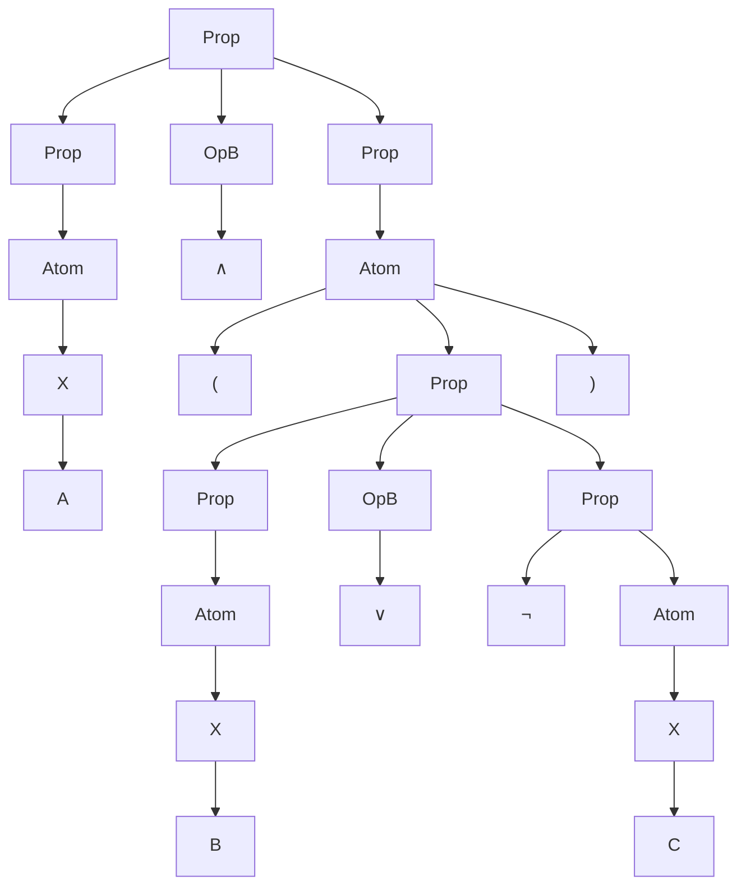
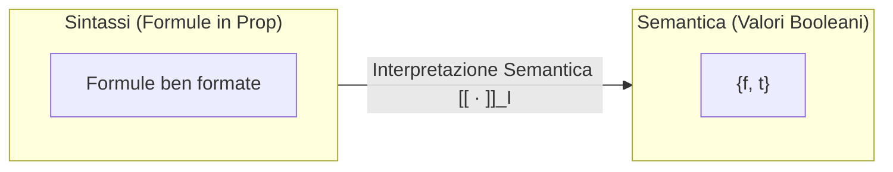

# Introduzione alla logica

La logica e' la disciplina che studia le condizioni di correttezza del ragionamento. Fin dall'antichita', lo scopo fondamentale e' stato quello di distinguere le argomentazioni valide da quelle che non lo sono.

## Il concetto di sillogismo

Il sillogismo e' una forma di ragionamento deduttivo composta da premesse e una conclusione. E' essenziale comprendere che non tutti i sillogismi sono validi dal punto di vista logico.

### Esempio di sillogismo valido
* Tutti gli uomini sono mortali.
* Socrate e' un uomo.
* **Conclusione**: Socrate e' mortale.

In questo caso, se le premesse sono vere, la conclusione e' necessariamente vera.

### Esempi di sillogismi non validi (fallaci)
1. **Fallacia di affermazione del conseguente**:
   * Tutti gli animali sono mortali.
   * Bob e' mortale.
   * **Conclusione errata**: Bob e' un animale. (Bob potrebbe essere un essere umano o un'altra entita' mortale; la struttura logica non garantisce la conclusione).
2. **Fallacia di non sequitur**:
   * Tutti gli dei sono immortali.
   * Gli uomini non sono dei.
   * **Conclusione non derivabile**: Gli uomini sono mortali. (Sebbene la conclusione sia vera nel mondo reale, non segue logicamente dalle premesse fornite).

# Dalla logica alla logica matematica

Per secoli la logica e' stata studiata prevalentemente all'interno della filosofia. A partire dalla seconda meta' del 1800, filosofi e matematici come George Boole e Augustus De Morgan hanno introdotto notazioni algebriche e matematiche per formalizzare gli operatori logici.

Questo passaggio ha permesso di applicare la logica ai fondamenti della matematica, portando a dibattiti fondazionali di enorme rilievo guidati da figure quali Bertrand Russell, Kurt Gödel e Alan Turing.

## Gli obiettivi della logica matematica
1. **Esprimere asserti in modo non ambiguo**: eliminare le sfumature e le ambiguita' del linguaggio naturale.
   * *Esempio*: l'asserto "tutti i numeri pari maggiori di due non sono primi" si formalizza rigorosamente come:  
     $$\forall n \in \mathbb{N} \ldotp (\text{pari}(n) \land n > 2 \Rightarrow \neg \text{primo}(n))$$  
2. **Chiarire e formalizzare il concetto di dimostrazione**: definire regole d'inferenza precise per verificare la correttezza di un'affermazione.

## Connessione con l'informatica

L'informatica come scienza nasce direttamente dalla logica matematica negli anni '30 grazie ai modelli computazionali teorici introdotti da Alan Turing, Alonzo Church, Stephen Kleene ed Emil Post.

La logica matematica e' parte integrante dei fondamenti dell'informatica per diverse ragioni:
* **Isomorfismo di Curry-Howard**: stabilisce un legame profondo tra dimostrazioni matematiche e programmi esecutivi (una dimostrazione corrisponde a un programma, e una formula al suo tipo).
* **Problemi aperti di grande rilevanza**: il celebre problema $P \text{ vs } NP$ e' uno dei sette problemi del millennio presieduti dal Clay Mathematics Institute.

### Usi pratici della logica in informatica
* **Formalizzazione dei requisiti**: specifica non ambigua dei software nell'ingegneria del software.
* **Dimostrazione di proprieta' di programmi**: ad esempio mediante la Logica di Hoare per garantire la correttezza del codice.
* **Programmazione dichiarativa**: linguaggi basati sulla logica come PROLOG.
* **Programmazione funzionale e teoria dei tipi**: linguaggi avanzati come Haskell o OCaml.
* **Rappresentazione della conoscenza**: in Intelligenza Artificiale per l'agente razionale.
* **Strumenti di analisi e verifica di sistemi**:
  * *Model Checking*: strumenti quali SPIN e PRISM per verificare stati e proprieta' di sistemi complessi.
  * *Proof Assistants*: sistemi interattivi come Rocq (ex Coq) e Isabelle per la verifica formale di teoremi.

# Fondamenti del calcolo proposizionale

Il calcolo proposizionale tratta proposizioni atomiche e la loro composizione mediante connettivi logici.

## Valori di verita' e proposizioni

I valori di verita' (o valori booleani) rappresentano l'insieme $\text{Bool} = \{t, f\}$, dove:
* $t$ (True / Vero / 1)
* $f$ (False / Falso / 0)

Una **proposizione** e' un'affermazione espressa in linguaggio naturale che soddisfa due principi fondamentali della logica classica:
1. **Principio del terzo escluso**: una proposizione e' o vera ($t$) o falsa ($f$), non esiste una terza possibilita'.
2. **Principio di non contraddittorieta'**: una proposizione non puo' essere contemporaneamente vera e falsa.

## Riconoscere una proposizione

Non tutte le frasi del linguaggio naturale costituiscono proposizioni logiche:

| Frase in linguaggio naturale | E' una proposizione? | Note / Motivazione |
| :--- | :---: | :--- |
| "Firenze e' la capitale d'Italia" | **Si'** | E' un'affermazione dichiarativa. Ha valore di verita' falso ($f$). |
| "Firenze e' stata la capitale d'Italia" | **Si'** | E' un'affermazione dichiarativa. Ha valore di verita' vero ($t$). |
| "E' possibile che Firenze sia la capitale d'Italia" | **No** | Esprime una modalita'/possibilita', non una certezza oggettiva. |
| "Firenze e' la capitale d'Italia?" | **No** | E' una domanda (interrogativa). |
| "Se solo Firenze fosse la capitale d'Italia!" | **No** | Esprime un desiderio (esclamativa/ottativa). |
| "Probabilmente Firenze e' la capitale d'Italia" | **No** | Valutazione probabilistica, non un valore certo $t$ o $f$. |

# Sintassi delle formule proposizionali

Sia $X = \{A, B, C, \dots\}$ un insieme infinito numerabile di **simboli proposizionali** (o variabili proposizionali).

L'insieme `Prop` delle formule proposizionali ben formate e' definito in forma Backus-Naur (BNF) dalla seguente grammatica:  

$$\langle Prop \rangle \leadsto \langle Atom \rangle \mid \neg \langle Atom \rangle \mid (\langle Prop \rangle \langle OpB \rangle \langle Prop \rangle)$$  

$$\langle Atom \rangle \leadsto T \mid F \mid \langle X \rangle \mid (\langle Prop \rangle)$$  

$$\langle OpB \rangle \leadsto \land \mid \lor \mid \Rightarrow \mid \Leftarrow \mid \Leftrightarrow$$  

$$\langle X \rangle \leadsto A \mid B \mid C \mid \dots$$  

## Connettivi logici

I connettivi logici permettono di legare ed operare sulle formule:

| Connettivo simbolico | Nome comune | Operazione logica |
| :---: | :--- | :--- |
| $\neg P$ | not, non | Negazione |
| $P \land Q$ | and, e | Congiunzione |
| $P \lor Q$ | or, o | Disgiunzione |
| $P \Rightarrow Q$ | se $P$ allora $Q$ | Implicazione |
| $P \Leftarrow Q$ | $P$ se $Q$ | Conseguenza (implicazione inversa) |
| $P \Leftrightarrow Q$ | $P$ se e solo se $Q$ | Doppia implicazione / Equivalenza |

## Esempi sintattici

### Formule ben formate in `Prop`
* $A \land (B \lor \neg C)$
* $((A \land B \lor F) \Rightarrow \neg A \lor (C \land T))$
* $(A \Rightarrow B) \land \neg(B \land \neg C) \Rightarrow (A \Rightarrow C)$

### Stringhe non valide (errori sintattici)
* $A \land \lor B$ (connettivi binari consecutivi senza argomento)
* $(A \neg C)$ (manca l'operatore binario tra $A$ e $\neg C$)
* $A \neg$ (operatore unario posizionato a destra)

## Albero sintattico di una formula

Ogni formula ben formata puo' essere rappresentata come un albero di derivazione sintattica. Di seguito e' riportata la struttura ad albero per la formula $A \land (B \lor \neg C)$:

# Formalizzazione dal linguaggio naturale

Tradurre asserti dal linguaggio naturale in formule della logica proposizionale richiede di individuare le proposizioni atomiche di base e i connettivi corrispondenti.

### Esempi di traduzione
1. **"Piove e fa molto freddo"**
   * Assegnazione: $P \equiv \text{"piove"}$, $R \equiv \text{"fa freddo"}$
   * Formula: $P \land R$

2. **"Fa freddo, ma non piove"**
   * Formula: $R \land \neg P$

3. **"Se ci sono nuvole e non c'e' vento, allora piove"**
   * Assegnazione: $N \equiv \text{"ci sono nuvole"}$, $V \equiv \text{"c'e' vento"}$, $P \equiv \text{"piove"}$
   * Formula: $(N \land \neg V) \Rightarrow P$

4. **"Nevica, ma non fa freddo se ci si copre"**
   * Assegnazione: $Ne \equiv \text{"nevica"}$, $R \equiv \text{"fa freddo"}$, $C \equiv \text{"ci si copre"}$
   * Formula: $Ne \land (\neg R \Leftarrow C)$ oppure equivalenza analoga $(C \land Ne) \Rightarrow \neg R$

5. **"Se ci si copre, allora fa freddo o nevica"**
   * Formula: $C \Rightarrow (R \lor Ne)$

6. **"Piove solo se ci sono nuvole e non c'e' vento"**
   * Formula: $P \Rightarrow (N \land \neg V)$

# Semantica del calcolo proposizionale

La semantica assegna un significato alle formule attribuendo loro un valore di verita' in $\text{Bool} = \{f, t\}$.

## Interpretazione e funzione di valutazione

Un'**interpretazione** (o assegnamento di verita') e' una funzione:  
$$\mathcal{I} : X \to \{f, t\}$$  
che ad ogni simbolo proposizionale in $X$ associa un valore di verita'.

La **semantica** e' definita induttivamente mediante la funzione di valutazione:  
$$[[ \dots ]]_{\mathcal{I}} : Prop \to \{f, t\}$$  

Le regole di definizione induttiva sono le seguenti:  

1. $[[ T ]]_{\mathcal{I}} = t \quad \text{e} \quad [[ F ]]_{\mathcal{I}} = f$  
2. $[[ A ]]_{\mathcal{I}} = \mathcal{I}(A) \quad \text{per ogni simbolo atomico } A \in X$  
3. $[[ (P) ]]_{\mathcal{I}} = ([[ P ]]_{\mathcal{I}}) \quad \text{per ogni formula } P \in Prop$  
4. $[[ \neg Q ]]_{\mathcal{I}} = \neg [[ Q ]]_{\mathcal{I}} \quad \text{per ogni formula atomica } Q$  
5. $[[ P \text{ op } Q ]]_{\mathcal{I}} = [[ P ]]_{\mathcal{I}} \text{ op } [[ Q ]]_{\mathcal{I}} \quad \text{per ogni connettivo } \text{op} \in \{\land, \lor, \Rightarrow, \Leftarrow, \Leftrightarrow\}$  

## Distinzione fondamentale tra sintassi e semantica

Un aspetto concettuale fondamentale e' la netta separazione tra il livello sintattico e il livello semantico:  

$$[[ A \land B ]]_{\mathcal{I}} = [[ A ]]_{\mathcal{I}} \land [[ B ]]_{\mathcal{I}}$$  

* Il simbolo $\land$ presente all'interno delle parentesi semantiche $[[ A \land B ]]_{\mathcal{I}}$ e' l'**AND sintattico** (un simbolo formale del linguaggio).
* Il simbolo $\land$ a destra dell'uguale e' l'**AND semantico**, ovvero la vera e propria funzione booleana:  
  $$\land : \text{Bool} \times \text{Bool} \to \text{Bool}$$  

## Tavola di verita' dei connettivi

Le funzioni booleane semantiche per ciascun connettivo sono formalizzate dalla seguente tavola di verita':

| $x$ | $y$ | $x \land y$ | $x \lor y$ | $x \Rightarrow y$ | $x \Leftarrow y$ | $x \Leftrightarrow y$ |
| :---: | :---: | :---: | :---: | :---: | :---: | :---: |
| $f$ | $f$ | $f$ | $f$ | $t$ | $t$ | $t$ |
| $f$ | $t$ | $f$ | $t$ | $t$ | $f$ | $f$ |
| $t$ | $f$ | $f$ | $t$ | $f$ | $t$ | $f$ |
| $t$ | $t$ | $t$ | $t$ | $t$ | $t$ | $t$ |

*Esempio*: $t \Rightarrow f \quad = \quad \Rightarrow(t, f) = f$  

> **Nota:** L'implicazione $\Rightarrow$ e' falsa solo quando la premessa e' vera e la conseguenza e' falsa, in tutti gli altri casi e' sempre vera!

## Esempio pratico di valutazione

Valutiamo la formula $(A \land B) \lor \neg C$ sotto l'interpretazione...  

$$\mathcal{I} = \{A \mapsto t, B \mapsto f, C \mapsto f, \dots\}$$  

* Applicando la regola 5 della semantica per la disgiunzione ($\lor$):  
   $$[[ (A \land B) \lor \neg C ]]_{\mathcal{I}} = [[ A \land B ]]_{\mathcal{I}} \lor [[ \neg C ]]_{\mathcal{I}}$$  
* Applicando le regole 3 e 4 per sotto-formule e negazione:  
   $$= ([[ A ]]_{\mathcal{I}} \land [[ B ]]_{\mathcal{I}}) \lor \neg [[ C ]]_{\mathcal{I}}$$  
* Sostituendo i valori forniti dall'interpretazione $\mathcal{I}$:  
   $$= (\mathcal{I}(A) \land \mathcal{I}(B)) \lor \neg \mathcal{I}(C)$$  
   $$= (t \land f) \lor \neg f$$  
* Risolvendo le funzioni booleane semantiche:  
   $$= f \lor t = t$$  

La formula risulta quindi **vera** ($t$) sotto l'interpretazione data.