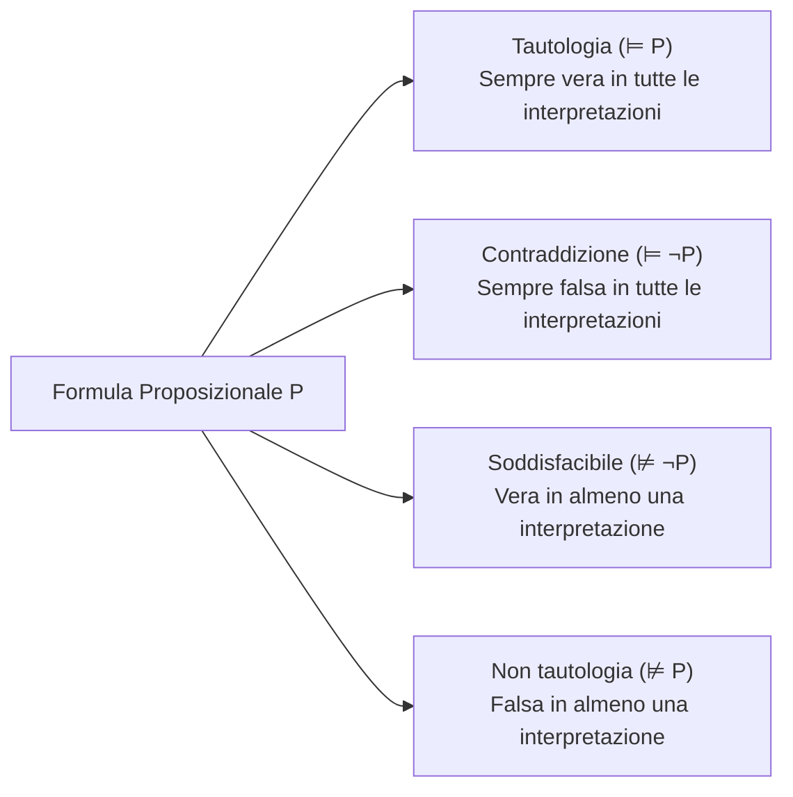

## Tavole di verita' e interpretazioni

Una **tavola di verita'** contiene tutte le possibili valutazioni di una formula per tutte le possibili interpretazioni dei suoi simboli proposizionali.

In generale, se una formula contiene $n$ simboli proposizionali distinti, il numero totale di interpretazioni possibili e' dato da:

$$|Bool|^n = 2^n$$

Ad esempio, per valutare la formula $((A \land B) \lor \neg C)$, che usa $3$ simboli ($A, B, C$), avremo $2^3 = 8$ interpretazioni possibili. Consideriamo l'interpretazione $\mathcal{I} = \{A \mapsto t, B \mapsto f, C \mapsto f\}$...

| $A$ | $B$ | $C$ | $(A \land B)$ | $\neg C$ | $((A \land B) \lor \neg C)$ |
| :---: | :---: | :---: | :---: | :---: | :---: |
| $f$ | $f$ | $f$ | $f$ | $t$ | $t$ |
| $f$ | $f$ | $t$ | $f$ | $f$ | $f$ |
| $f$ | $t$ | $f$ | $f$ | $t$ | $t$ |
| $f$ | $t$ | $t$ | $f$ | $f$ | $f$ |
| $t$ | $f$ | $f$ | $f$ | $t$ | $t$ |
| $t$ | $f$ | $t$ | $f$ | $f$ | $f$ |
| $t$ | $t$ | $f$ | $t$ | $t$ | $t$ |
| $t$ | $t$ | $t$ | $t$ | $f$ | $t$ |

---

## Modelli, equivalenza e conseguenza logica

* **Modello ($\mathcal{I} \models P$):** Un'interpretazione $\mathcal{I}$ e' un **modello** di una formula $P$ se rende vera la formula, ovvero se $[[P]]_{\mathcal{I}} = t$ (in LaTeX il simbolo $\models$ si scrive `\models`).
* **Equivalenza logica ($P \equiv Q$):** Due formule proposizionali $P$ e $Q$ sono **logicamente equivalenti** se hanno esattamente gli stessi modelli (cioe' producono gli stessi valori di verita' in ogni interpretazione).
* **Conseguenza logica ($\Gamma \models P$):** Una formula $P$ (Tesi) e' una **conseguenza logica** di un insieme di formule $\Gamma$ (Ipotesi) se ogni modello di $\Gamma$ e' anche un modello di $P$.

---

## Sintassi e gestione dell'ambiguita'

| Connettivo | Livello di precedenza |
| :---: | :---: |
| $\Leftrightarrow$ | $0$ |
| $\Rightarrow, \Leftarrow$ | $1$ |
| $\land, \lor$ | $2$ |
| $\neg$ | $3$ |

La grammatica del calcolo proposizionale puo' generare **ambiguita' sintattica**, la quale si riflette in una **ambiguita' semantica** (diversi valori di verita' per la stessa stringa). Ad esempio, la formula $A \land B \Rightarrow C$ senza parentesi ammette due diversi alberi di derivazione, che portano a risultati opposti nell'interpretazione $\{A \mapsto f, B \mapsto t, C \mapsto t\}$.  

$$(A \land B) \Rightarrow C$$  
$$A \land (B \Rightarrow C)$$  

Per risolvere l'ambiguita' si usano due accorgimenti:
1. **Livelli di precedenza dei connettivi:** Si stabilisce un ordine di priorita' (dal piu' forte al piu' debole): grazie alle precedenze, $A \land B \Rightarrow C$ si legge univocamente come $(A \land B) \Rightarrow C$.

1. **Associativita' (a parita' di precedenza):** Le precedenze da sole non bastano quando ci sono due connettivi dello stesso livello adiacenti:
   * Per operatori associativi come $\land$ e $\lor$ presi singolarmente ($A \land B \land C$ oppure $A \lor B \lor C$), l'ambiguita' e' solo sintattica (il risultato semantico non cambia).
   * Per combinazioni miste ($A \land B \lor C$) o per l'implicazione ($A \Rightarrow B \Rightarrow C$), l'ordine conta eccome! Ad esempio, con $\{A=f, C=t\}$, abbiamo $(A \land B) \lor C = t$, mentre $A \land (B \lor C) = f$. In questi casi le parentesi sono obbligatorie.

---

## Classificazione delle formule

In base al loro comportamento nelle varie interpretazioni, le formule proposizionali si classificano in quattro categorie:

* **Tautologia ($\models P$):** Formula sempre vera in ogni interpretazione ($\forall \mathcal{I} . \ [[P]]_{\mathcal{I}} = t$). Equivale a dire che ogni interpretazione e' un suo modello, oppure che e' conseguenza logica dell'insieme vuoto ($\emptyset \models P$). *Esempi:* $A \lor \neg A$, $A \lor T$.
* **Contraddizione ($\models \neg P$):** Formula sempre falsa in ogni interpretazione.
* **Soddisfacibile ($\not\models \neg P$):** Formula che non e' una contraddizione, ovvero esiste almeno un'interpretazione in cui e' vera.
* **Non tautologia ($\not\models P$):** Formula che non e' sempre vera, ovvero esiste almeno un'interpretazione in cui e' falsa.

### Come verificare la classe di una formula senza tavole di verita'

Costruire l'intera tavola di verita' richiede $2^n$ righe ed e' spesso troppo costoso. Possiamo procedere per ragionamento diretto cercando un **controesempio**:

1. **Mostrare che $(((A \Rightarrow \neg B) \land \neg A) \Rightarrow B)$ NON e' una tautologia:**
   Cerchiamo un'interpretazione che la renda **falsa**. Trattandosi di un'implicazione principale ($\dots \Rightarrow B$), l'unico modo per renderla falsa e' avere la **premessa vera** e la **conseguenza falsa**:
   * Conseguenza falsa $\implies B = f$.
   * Premessa vera $\implies (A \Rightarrow \neg B) \land \neg A = t$. Affinche' una congiunzione sia vera, entrambi i membri devono essere veri:
     * $\neg A = t \implies A = f$.
     * Verifichiamo il primo membro con $A=f, B=f$ e risulta vera in quanto le implicazioni sono sempre vere quando la premessa e' falsa.
   * Abbiamo trovato l'interpretazione $\{A \mapsto f, B \mapsto f\}$ che rende la formula falsa: quindi **non e' una tautologia** $\not\models P$.

2. **Analizzare $((A \Rightarrow \neg B) \Rightarrow (B \Rightarrow \neg A))$:**
   Provando a renderla falsa, dovremmo avere $B \Rightarrow \neg A = f$ (quindi $B = t$ e $\neg A = f \implies A = t$). Ma con $A=t, B=t$, la premessa $(A \Rightarrow \neg B)$ diventa $(t \Rightarrow f) = f$, rendendo l'intera implicazione vera! Non riusciamo a trovare un'interpretazione che la renda falsa.
   
> **Nota:** Attenzione pero', non in tutte le logiche quest'ultima e' sufficiente per dimostrare con certezza che e' una tautologia, nella *logica intuizionista* ad esempio si devono utilizzare **dimostrazioni per sostituzione** in modo esplicito.

---

## Dimostrazioni per sostituzione

Molti problemi si riducono a dimostrare che una formula e' una tautologia della forma $P \Leftrightarrow Q$. Lo si fa costruendo una catena di equivalenze giustificate passo dopo passo da leggi logiche note:

$$P = R_1 \Leftrightarrow R_2 \Leftrightarrow \dots \Leftrightarrow R_n = Q$$

### Rimpiazzamento e Principio di Sostituzione [PDS]

* **Rimpiazzamento ($P[^Q/_R]$):** Indica la formula ottenuta partendo da $P$ e sostituendo una specifica occorrenza della sottoformula $R$ con $Q$.
* **Principio di Sostituzione [PDS]:** E' la **regola di inferenza** che garantisce la validita' delle sostituzioni:

$$\frac{Q \Leftrightarrow R}{P \Leftrightarrow P[^R/_Q]} \quad \text{[PDS]}$$

Si legge: 
> *"Se $Q \Leftrightarrow R$ e' una tautologia, allora anche sostituendo $Q$ con $R$ dentro una formula piu' grande $P$ si ottiene una tautologia"*.

---

## Leggi fondamentali della logica proposizionale

Le seguenti leggi sono tutte tautologie e possono essere applicate in entrambi i versi (da sinistra a destra o viceversa). Nota che le leggi di disgiunzione, congiunzione e negazione sono analoghe a quelle degli insiemi (dove $F \leftrightarrow \emptyset$, $T \leftrightarrow \text{Universo}$, $\lor \leftrightarrow \cup$, $\land \leftrightarrow \cap$, $\neg \leftrightarrow \text{Complemento}$).

### Leggi per `and`, `or`, `not`

| Nome della legge | | |
| :--- | :--- | :--- |
| **T:F** | $\neg T \Leftrightarrow F$ | |
| **Doppia negazione** | $\neg(\neg P) \Leftrightarrow P$ | |
| **Terzo escluso** | $P \lor \neg P \Leftrightarrow T$ | |
|**Contraddizione**|$P \land \neg P \Leftrightarrow F$ ||
| **Leggi di De Morgan** | $\neg(P \lor Q) \Leftrightarrow \neg P \land \neg Q$ | $\neg(P \land Q) \Leftrightarrow \neg P \lor \neg Q$ |

| Nome della legge | | |
| :--- | :--- | :--- |
| **Unita'** | $P \lor F \Leftrightarrow P$ | $P \land T \Leftrightarrow P$ |
| **Assorbimento** | $P \lor T \Leftrightarrow T$ | $P \land F \Leftrightarrow F$ |
| **Idempotenza** | $P \lor P \Leftrightarrow P$ | $P \land P \Leftrightarrow P$ |
| **Commutativita'** | $P \lor Q \Leftrightarrow Q \lor P$ | $P \land Q \Leftrightarrow Q \land P$ |
| **Associativita'** | $P \lor (Q \lor R) \Leftrightarrow (P \lor Q) \lor R$ | $P \land (Q \land R) \Leftrightarrow (P \land Q) \land R$ |
| **Distributivita'** | $P \lor (Q \land R) \Leftrightarrow (P \lor Q) \land (P \lor R)$ | $P \land (Q \lor R) \Leftrightarrow (P \land Q) \lor (P \land R)$ |

### Leggi di altri connettivi e di eliminazione

| Nome della legge | Equivalenza logica |
| :--- | :--- |
| **Riflessivita'** | $P \Leftrightarrow P$ |
| **Simmetria** | $(P \Leftrightarrow Q) \Leftrightarrow (Q \Leftrightarrow P)$ |
| **Eliminazione dell'implicazione** | $P \Rightarrow Q \Leftrightarrow \neg P \lor Q$ |
| **Eliminazione dell'implicazione negata** | $\neg(P \Rightarrow Q) \Leftrightarrow P \land \neg Q$ |
| **Eliminazione della doppia implicazione (1)** | $(P \Leftrightarrow Q) \Leftrightarrow (P \Rightarrow Q) \land (Q \Rightarrow P)$ |
| **Eliminazione della doppia implicazione (2)** | $(P \Leftrightarrow Q) \Leftrightarrow (P \land Q) \lor (\neg P \land \neg Q)$ |

---

## Esempi di dimostrazioni per sostituzione

Vediamo come dimostrare nuove leggi importanti combinando quelle delle tabelle precedenti.

### Legge del complemento: $P \lor (\neg P \land Q) \Leftrightarrow P \lor Q$

$$\begin{aligned}
P \lor (\neg P \land Q) &\Leftrightarrow (P \lor \neg P) \land (P \lor Q) && \text{(distributivita')} \\
&\Leftrightarrow T \land (P \lor Q) && \text{(terzo escluso)} \\
&\Leftrightarrow (P \lor Q) \land T && \text{(commutativita')} \\
&\Leftrightarrow P \lor Q && \text{(unita')}
\end{aligned}$$

> In modo duale vale anche: $P \land (\neg P \lor Q) \Leftrightarrow P \land Q$

### Legge di assorbimento: $P \lor (P \land Q) \Leftrightarrow P$

$$\begin{aligned}
P \lor (P \land Q) &\Leftrightarrow (P \land T) \lor (P \land Q) && \text{(unita', al contrario)} \\
&\Leftrightarrow P \land (T \lor Q) && \text{(distributivita', al contrario)} \\
&\Leftrightarrow P \land (Q \lor T) && \text{(commutativita')} \\
&\Leftrightarrow P \land T && \text{(assorbimento)} \\
&\Leftrightarrow P && \text{(unita')}
\end{aligned}$$

> In modo duale vale anche: $P \land (P \lor Q) \Leftrightarrow P$

### Legge contronominale: $P \Rightarrow Q \Leftrightarrow \neg Q \Rightarrow \neg P$

$$\begin{aligned}
\neg Q \Rightarrow \neg P &\Leftrightarrow \neg(\neg Q) \lor \neg P && \text{(eliminazione dell'implicazione)} \\
&\Leftrightarrow Q \lor \neg P && \text{(doppia negazione)} \\
&\Leftrightarrow \neg P \lor Q && \text{(commutativita')} \\
&\Leftrightarrow P \Rightarrow Q && \text{(eliminazione dell'implicazione, al contrario)}
\end{aligned}$$

### Modus Ponens: $((P \Rightarrow Q) \land P) \Rightarrow Q \Leftrightarrow T$

$$\begin{aligned}
((P \Rightarrow Q) \land P) \Rightarrow Q &\Leftrightarrow ((\neg P \lor Q) \land P) \Rightarrow Q && \text{(eliminazione dell'implicazione)} \\
&\Leftrightarrow (P \land (\neg P \lor Q)) \Rightarrow Q && \text{(commutativita')} \\
&\Leftrightarrow (P \land Q) \Rightarrow Q && \text{(complemento)} \\
&\Leftrightarrow \neg(P \land Q) \lor Q && \text{(eliminazione dell'implicazione)} \\
&\Leftrightarrow (\neg P \lor \neg Q) \lor Q && \text{(De Morgan)} \\
&\Leftrightarrow \neg P \lor (\neg Q \lor Q) && \text{(associativita')} \\
&\Leftrightarrow \neg P \lor (Q \lor \neg Q) && \text{(commutativita')} \\
&\Leftrightarrow \neg P \lor T && \text{(terzo escluso)} \\
&\Leftrightarrow T && \text{(assorbimento)}
\end{aligned}$$

### Dimostrazioni diverse per $\neg(P \lor (\neg P \land Q)) \Leftrightarrow \neg P \land \neg Q$

Una stessa equivalenza puo' essere dimostrata seguendo percorsi piu' o meno brevi in base alle leggi che scegliamo di applicare. In questo caso possiamo usare il complemento e De Morgan per dimostrarla in modo rapido, ma utilizzando altri punti di partenza si avrebbero dimostrazioni potenzialmente molto piu' lunghe.

$$\begin{aligned}
\neg(P \lor (\neg P \land Q)) &\Leftrightarrow \neg(P \lor Q) && \text{(complemento)} \\
&\Leftrightarrow \neg P \land \neg Q && \text{(De Morgan)}
\end{aligned}$$