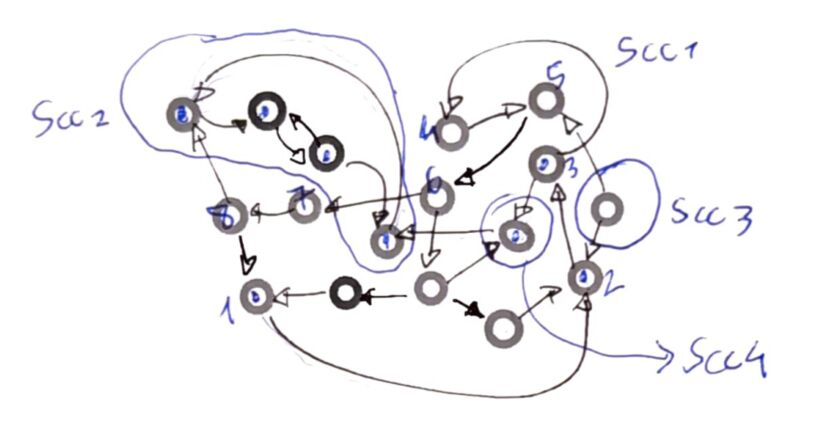

## Esercizio 1
Mostrare le componenti fortemente connesse (SCC) del seguente grafo orientato $G = (V, E)$.

  

## Esercizio 2
Sia $G = (V, E)$ un DAG, e sia $H = (V, E^{\text{op}})$ il grafo ottenuto invertendo la direzione degli archi di $G$.

Per ognuno dei seguenti enunciati dire se e' **vero** (fornendo una dimostrazione) o **falso** (fornendo un controesempio):

1. **Ogni sorgente in $G$ e' un pozzo in $H$.**
   - **Risposta**: **Vero**
   - **Dimostrazione**: Sia $x \in V$ una sorgente in $G$ si ha che $(x, y) \in E$ allora per definizione in $H$ si ha che $(y, x) \in E^{op}$. Se in $G$ il grado del nodo $d_x^- =0, \quad d_x^+=1$ in $H$ e' invece $d_x^- =1, \quad d_x^+=0$.  
2. **Ogni pozzo in $G$ e' una sorgente in $H$.**
   - **Risposta**: **Vero**
   - **Dimostrazione**: Segue dalla dimostrazione 1. Se in $G$ il grado del nodo $d_y^- =1, \quad d_y^+=0$ in $H$ e' invece $d_y^- =0, \quad d_y^+=1$.

3. **Esiste un walk da $x$ a $y$ in $G$ se e solo se esiste un walk da $x$ a $y$ in $H$.**
   - **Risposta**: **Falso**
   - **Controesempio**: Sappiamo che $x \ne y$ in quanto i DAG non hanno cappi, allora se $(x, y) \in E$ e' un walk da $x$ a $y$ in $G$, in $H$ avremo $(y, x) \in E^{op}$. Non puo' quindi esistere lo stesso walk sia in $G$ che in $H$.

4. **Esiste un walk da $x$ a $y$ in $G$ se e solo se esiste un walk da $y$ a $x$ in $H$.**
   - **Risposta**: **Vero**
   - **Dimostrazione**: Segue dalla dimostrazione 3.

5. **$H$ e' un DAG.**
   - **Risposta**: **Vero**
   - **Dimostrazione**: Segue dai punti 1 e 2. Sappiamo che $G$ e' un DAG e che invertendo la direzione degli archi ogni sorgente in $G$ e' pozzo in $H$ ed ogni pozzo in $G$ e' una sorgente in $H$, quindi $H$ e' un DAG.

---

## Esercizio 3
Per ognuno dei seguenti enunciati dire se e' vero (fornendo una dimostrazione) o falso (fornendo un controesempio).

**(a) Per tutti i DAG $G = (V, E)$, $E \in \text{Rel}(V, V)$ e' un ordinamento parziale.**
- **Risposta**: **Falso**
- **Spiegazione / Controesempio**: Per essere un ordinamento parziale, una relazione deve essere riflessiva, anti-simmetrica e transitiva. La relazione degli archi $E$ di un DAG **non e' riflessiva** in quanto i DAG non hanno cappi.

**(b) Per tutti i DAG $G = (V, E)$, $E \cup \text{Id}_V \in \text{Rel}(V, V)$ e' un ordinamento parziale.**
- **Risposta**: **Falso**
- **Spiegazione / Controesempio**: Aggiungendo l'identita' $\text{Id}_V$ si garantisce la riflessivita' e l'assenza di cicli garantisce l'antisimmetria, ma la relazione **non e' necessariamente transitiva** e.g. per il grafo $1 \to 2 \to 3$ non esiste la coppia $(1, 3) \in E$.

**(c) Per tutti i DAG $G = (V, E)$, $E^* \in \text{Rel}(V, V)$ e' un ordinamento parziale.**
- **Risposta**: **Vero**
- **Dimostrazione**:
  - $E^*$ e' la **chiusura riflessiva e transitiva** di $E$, quindi per definizione soddisfa la proprieta; **riflessiva** e la proprieta' **transitiva**.
  - **Antisimmetria**: Se $(x, y) \in E^*$ e $(y, x) \in E^*$ significa che posso andare da $x$ a $y$ e da $y$ a $x$ in $G$, ma se $x \neq y$ allora avremmo un ciclo e $G$ non sarebbe un DAG (assurdo). Allora deve valere $x = y$ soddisfacendo l'antisimmetria.
