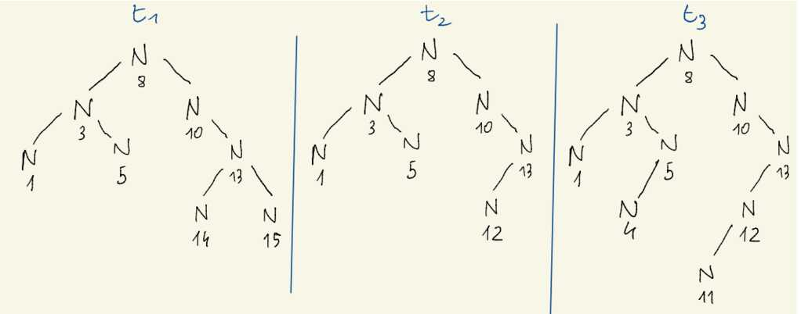

## Esercizio 1

Sia $A$ un insieme e $L_A$ l'insieme delle liste di elementi di $A$, e siano $app$, $len$ e $rev$ le funzioni su liste definite sulla dispensa. Dimostrare per induzione strutturale le seguenti uguaglianze:

1. Per ogni $lst_1, lst_2 \in L_A$, $len(app(lst_1, lst_2)) = len(lst_1) + len(lst_2)$.  

### Svolgimento 1

#### Caso Base: $lst_1 = \lbrack\ \rbrack$  
Dobbiamo dimostrare che $len(app(\lbrack\ \rbrack, lst_2)) = len(\lbrack\ \rbrack) + len(lst_2)$.

* **Primo membro:**  
  $$len(app(\lbrack\ \rbrack, lst_2)) = len(lst_2) \quad \{def.\ app\}$$  
* **Secondo membro:**  
  $$len(\lbrack\ \rbrack) + len(lst_2) = 0 + len(lst_2) = len(lst_2) \quad \{def.\ len\}$$    

I due membri coincidono, quindi il caso base e' verificato.

#### Passo Induttivo: $lst_1 = a:lst$
* **Ipotesi induttiva:** Se l'uguaglianza vale per la $lst \in L_A$, ovvero:  

  $$len(app(lst, lst_2)) = len(lst) + len(lst_2)$$  

* Dobbiamo dimostrare che vale anche per $a:lst$ (con $a \in A$):  
  $$len(app(a:lst, lst_2)) = len(a:lst) + len(lst_2)$$  

**Svolgimento passo induttivo**  

$$
\begin{aligned}
len(app(a:lst, lst_2)) &= len(a:app(lst, lst_2)) && \{def.\ app \}\\
&= 1 + len(app(lst, lst_2)) && \{def.\ len \}\\
&= 1 + len(lst) + len(lst_2) && \{ipotesi \ induttiva\}\\
&= len(a:lst) + len(lst_2) && \{def.\ len\}\\
\end{aligned}
$$

Per il principio di induzione strutturale sulle liste la proprieta' vale per ogni $lst_1, lst_2 \in L_A$.  

## Esercizio 2

Sia $\mathbb{N} \cup \{\infty\}$ l'insieme dei numeri naturali $\mathbb{N}$ esteso con un elemento $\infty$ che, intuitivamente,
rappresenta un’entità piu' grande di tutti i numeri. Si consideri l'usuale relazione di ordinamento
≤ su N estesa a $\mathbb{N} \cup \{\infty\}$ nel modo ovvio: per tutti i numeri naturali $n \in \mathbb{N}, n \le \infty$. Si consideri
l'insieme BTN degli alberi binari etichettati con elementi di N.
1. Definire per induzione su BTN la funzione $maxBT: BTN \to \mathbb{N} \cup \{\infty\}$ che restituisce l'etichetta
di valore massimo tra tutte quelle che appaiono in un albero. (Suggerimento: $maxBT(\lambda) = 0$,
dove $\lambda$ come al solito e' l'albero vuoto.)
2. Definire per induzione su BTN la funzione $min: BTN \to \mathbb{N} \cup \{\infty\}$ che restituisce l'etichetta di
valore minimo tra tutte quelle che appaiono in un albero. (Suggerimento: $min(\lambda) = \infty$, dove
$\lambda$ e' l'albero vuoto.)
Ad esempio sia `t1` l'albero in Figura 1.1: `minBT(t1) = 1`, `maxBT(t1) = 15`.

  

> Figura 1.1: Tre alberi in BTN

### Svolgimento 1

Ho utilizzato di proposito i nomi `minBT/maxBT` per poterli differenziare dalle funzioni matematiche `min/max`

**Clausola base:** $maxBT(\lambda) = 0$  

**Clausola induttiva:** $maxBT(N(t_1, n, t_2)) = max(n, max(maxBT(t_1), maxBT(t_2)))$  

### Svolgimento 2

**Clausola base:** $minBT(\lambda) = \infty$  

**Clausola induttiva:** $minBT(N(t_1, n, t_2)) = min(n, min(minBT(t_1), minBT(t_2)))$  
