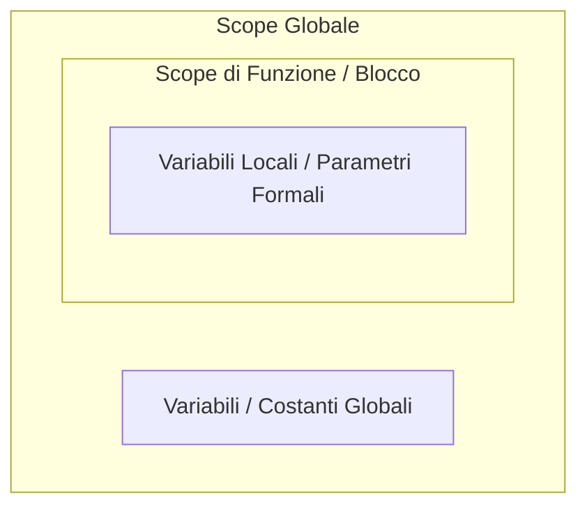

# Funzioni

Come in matematica, i punti del dominio saranno i parametri della funzione:

$$f(x) = x^2 \quad \implies \quad x \text{ si dice \textbf{parametro formale}}$$
$$f(3) = 9 \quad \implies \quad 3 \text{ si dice \textbf{parametro attuale}}$$

### Sintassi di una Funzione

```typescript
function <IDENTIFICATORE>(<PARAMETRO>: <TIPO>, ...): <TIPO DI RITORNO> {
    <COMMAND>
    return <EXPRESSION>
}
```

* Si usa il tipo `void` per funzioni che non ritornano valori. In questi casi si puo' omettere il `return` oppure usare semplicemente `return;`.

> **NOTA:** `return` esce dal corpo della funzione restituendo il controllo al chiamante.


```typescript
function saluta(tizio: string): void {
    console.log(`ciao ${tizio}`);
}
```


### Sintassi per la chiamata di funzione

```typescript
<Nome Funzione>(<PARAMETRO1>, <PARAMETRO2>, ...)
```

Il corpo della funzione viene valutato in un ambiente nel quale i nomi dei parametri formali sono legati ai valori dei parametri attuali.

> **IMPORTANTE:** L'ordine dei parametri attuali deve coincidere con l'ordine dei parametri formali.

### Valori di default

```typescript
function saluta(tizio: string, saluto: string = "Ciao"): void {
    console.log(saluto + " " + tizio);
}
```

> **Buona Pratica:** Mettere per ultimi i parametri con valori di default!

---

# Scope

Gli ambienti di visibilita' (scope) si dividono principalmente in:

* **Scope Globale:** Dichiarazioni fuori da ogni blocco/funzione, visibile da ogni parte del codice.
* **Scope di Funzione:** Visibile solo all'interno della funzione (parametri formali e variabili create all'interno).
* **Scope di Blocco:** `{ ... }` Se dichiarate dentro al blocco, le variabili sono visibili solo dentro al blocco stesso.



> *"Da dentro si vede fuori, ma da fuori non si vede dentro!"*

## Hoisting
A differenza delle variabili, le funzioni possono essere chiamate prima della loro dichiarazione (**Hoisting**).

```typescript
// Chiamata della funzione PRIMA della sua definizione
saluta(); // Output: Ciao!

function saluta() {
  console.log("Ciao!");
}
```

## Annidamento e Shadowing
Se all'interno di un blocco dichiaro una variabile con il nome di una variable esistente nello scope globale (**Shadowing**), viene creata una nuova versione della variabile visibile solo all'interno del blocco.

```typescript
let colore = "rosso"; // Variabile esterna

{
  let colore = "blu"; // Shadowing: nuova variabile con lo stesso nome nel blocco
  console.log(colore); // Stampa: "blu" (prevale quella interna al blocco)
}

console.log(colore); // Stampa: "rosso" (fuori dal blocco la variabile esterna non e' cambiata)
```

---

## Passaggio per riferimento degli array

> **ATTENZIONE:** Si ricorda che per gli array lo scope "non vale" nel senso comune, in quanto stiamo passando il **riferimento** alla funzione e **non la copia** dell'array stesso! Le modifiche fatte all'array dentro una funzione si rifletteranno anche all'esterno.


## Costanti

Si usa `const` per definire costanti che non possono essere cambiate a runtime!

```typescript
const PI_GRECO = 3.14; 
```