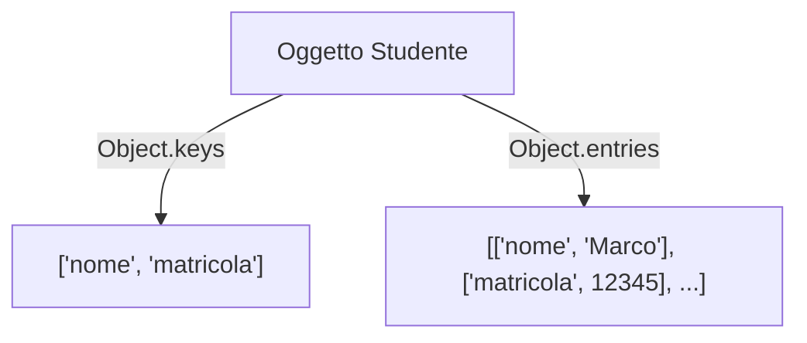

# Object

I tipi di dato non primitivi in TypeScript ricadono sotto la categoria `object`. Un **oggetto** e' una mappa da chiavi a valori dove ogni chiave compare una volta sola.

Dal punto di vista matematico:  

$\text{Dominio} = \{ \text{Insieme di tutte le chiavi} \}$  
$\text{Codominio} = \{ \text{Insieme di tutti i valori} \}$

Per denotare il tipo di un oggetto si utilizza la sintassi dell'oggetto con i tipi:

```typescript
let studente: { nome: string } = {
  nome: "Giulia"
};
```

---

## Oggetti omogenei

L'oggetto omogeneo e' generalmente utile quando le chiavi non sono note a priori. Il tipo delle proprieta' sara' pero' necessariamente omogeneo.

```typescript
// Tutte le chiavi sono arbitrarie ma tutte di tipo stringa
type something = { [chiave: string]: boolean };
```

Si possono aggiungere vincoli per chiavi gia' conosciute ed esplicite:

```typescript
type somethingConstrained = { 
  [chiave: string]: boolean, 
  d: boolean 
};
```

> **Nota**: Esiste anche il tipo generico `object`, ma **non** e' considerata una tipizzazione corretta e inoltre non permette l'uso della *"dot notation"* per l'accesso alle proprieta'.

---

## Accesso ad un membro

Possiamo accedere o cambiare le proprieta' di un oggetto tramite **Dot Notation** o **Bracket Notation**:

```typescript
// Lettura
studente.nome        // -> "Giulia"
studente["nome"]     // -> "Giulia"

// Modifica
studente.nome = "Marco";
```

---

## Accesso a Cchiavi e valori su oggetti generici

### Controllo esistenza chiave
Verificare se una chiave esiste all'interno di un oggetto:

```typescript
"nome" in studente // -> true
```

### Iterazione sulle chiavi
Si puo' iterare sulle chiavi usando il ciclo `for...in`:

```typescript
for (let k in studente) {
  console.log(k); // stampa la chiave k
}
```

> **Attenzione**: Gli oggetti **non sono ordinati**, per cui le chiavi potrebbero non essere estratte nell'ordine di inizializzazione!

### Estrazione chiavi e key-value pairs array 

```typescript
Object.keys(studente) // ["nome", ...]
Object.entries(studente) // [["nome", "Marco"], ['matricola', 12345], ...]
```



---

## Accesso dinamico su oggetti omogenei

Sugli oggetti omogenei in particolare, dentro al ciclo `for...in` e' possibile accedere direttamente al valore associato alla chiave:

```typescript
for (let k in studente) {
    console.log(studente[k]);
}
```

> **Nota**: Per gli oggetti non omogenei questo **non e' permesso** in TypeScript. In un oggetto non omogeneo i valori hanno tipi diversi (es. stringhe e numeri), quindi TypeScript ti vieta di accedervi per evitare errori imprevedibili nel programma.

---

## Aggiunta Dinamica e Definizione di Tipi

Si possono aggiungere nuove coppie chiave/valore ad un oggetto:

```typescript
studente.matricola = 7891249;
studente["matricola"] = 7891249; // stessa cosa ma in bracket notation
```

### Definire nuovi tipi con `type`
Il comando `type` serve a definire alias di tipo per qualsiasi tipo di dato:

```typescript
type Studente = { 
  nome: string, 
  matricola: number 
};

let marco: Studente = { 
  nome: "Marco", 
  matricola: 12345 
};
```

### Definizione mediante `interface`
Mentre `type` permette di definire un qualunque tipo, `interface` si usa **solo per il tipo oggetto**:

```typescript
interface Studente {
  nome: string;
  matricola: number;
}
```
