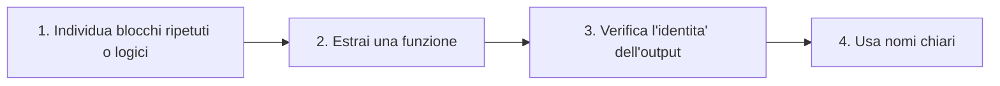
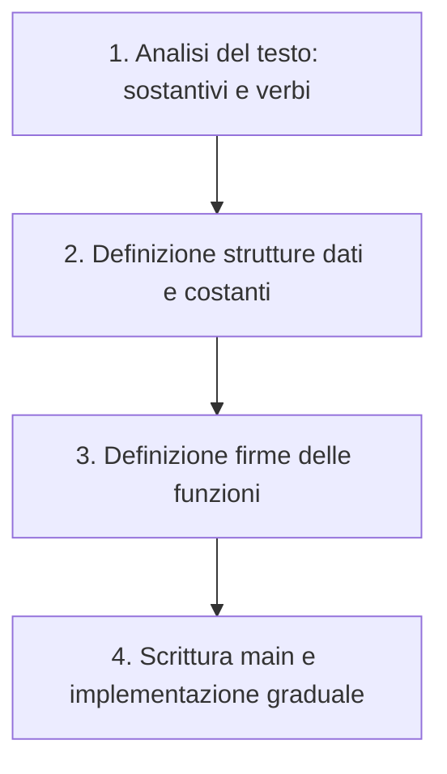

# Code refactoring e progettazione modulare

Il **code refactoring** consiste nel riscrivere il codice per migliorarne la struttura interna senza modificarne il comportamento esterno (a parita' di input, produce lo stesso output).

## Vantaggi principali

* **Leggibilita'**: usare nomi esplicativi che chiariscono subito cosa fa il codice. Funzioni troppo piccole o con nomi vaghi possono peggiorare la lettura.
* **Riuso**: il codice viene scritto una volta sola e puo' essere richiamato ovunque serva, permettendo anche una verifica diretta del suo output.
* **Modularita'**: suddividere il programma in blocchi piccoli, ciascuno responsabile di un solo compito specifico.
* **Manutenzione**: in caso di bug o modifiche, si interviene in un unico punto del codice anziche' dover aggiornare piu' parti.

> **Regola pratica**: ogni volta che ti accorgi di fare copia-incolla dello stesso blocco di codice, significa che quel blocco dovrebbe diventare una funzione da richiamare al bisogno.

---

## Procedura per rendere modulare un codice esistente

Per trasformare un programma monolitico in un codice modulare si seguono quattro passaggi:



1. **Individua** i blocchi di codice ripetuti oppure quelli che svolgono un compito ben definito (a cui e' facile dare un nome naturale).
2. **Estrai una funzione**: cio' che varia diventa un *parametro* in ingresso, mentre cio' che serve al resto del programma diventa il valore di *return*.
3. **Rilancia** il programma con gli stessi input di partenza e controlla che l'output sia identico.
4. **Utilizza nomi chiari** per funzioni e variabili.

---

## Esempio pratico: media dei voti

> Scrivere un programma che, dato un insieme di studenti con i rispettivi voti di $3$ esami, calcoli e visualizzi la media aritmetica dei voti di ciascuno. L'utente fornisce il nome di ogni studente seguito dai $3$ voti; l'acquisizione termina quando viene inserito `"stop"` come nome.

* **Esempio di input**: `Luca`, `28`, `30`, `27`, `Marta`, `30`, `29`, `30`, `Marco`, `18`, `22`, `25`, `stop`
* **Esempio di output**:
  * `Luca: 28.33`
  * `Marta: 29.67`
  * `Marco: 21.67`

### Soluzione attuale (senza funzioni)

In questa versione tutto il codice e' concentrato in un unico blocco, mescolando acquisizione dei dati, calcoli e stampa:

```typescript
type Studente = { nome: string; voti: number[] };

let studenti: Studente[] = [];
let nome: string = String(prompt("Nome (o 'stop'):"));
const N_ESAMI: number = 3;

while (nome != "stop") {
    // Blocco 1: lettura dei voti di uno studente
    let esami: number[] = [];
    for (let i = 0; i < N_ESAMI; i++) {
        let voto: number = Number(prompt(`Voto ${nome}:`));
        esami.push(voto);
    }
    studenti.push({ nome: nome, voti: esami });
    nome = String(prompt("Nome (o 'stop'):"));
}

for (let i = 0; i < studenti.length; i++) {
    // Blocco 2: calcolo della media di un array di voti
    let somma: number = 0;
    for (let j = 0; j < studenti[i].voti.length; j++) {
        somma += studenti[i].voti[j];
    }
    let media: number = somma / studenti[i].voti.length;
    console.log(studenti[i].nome + ": " + media);
}
```

### Soluzione dopo refactoring (modulare con funzioni)

Isolando i due blocchi logici in funzioni dedicate (`leggiStudente` e `media`), il flusso principale diventa piu' leggibile e lineare:

```typescript
type Studente = { nome: string; voti: number[] };
const N_ESAMI: number = 3;

function leggiStudente(nome: string): Studente {
    let esami: number[] = [];
    for (let i = 0; i < N_ESAMI; i++) {
        esami.push(Number(prompt(`Voto ${nome}:`)));
    }
    return { nome: nome, voti: esami };
}

function media(voti: number[]): number {
    let somma: number = 0;
    for (let v of voti) {
        somma += v;
    }
    return somma / voti.length;
}

// Programma principale
let studenti: Studente[] = [];

while (true) {
    let nome: string = String(prompt("Nome (o 'stop'):"));
    if (nome==="stop") {
        break;
    }
    studenti.push(leggiStudente(nome));
}

for (let s of studenti) {
    console.log(s.nome + ": " + media(s.voti));
}
```

### Considerazioni sulla modularizzazione

* **Minore sforzo di lettura**: si capisce a colpo d'occhio *cosa* fa il programma leggendo i nomi delle funzioni (es. `leggiStudente(nome)`, `media(voti)`), scendendo nei dettagli implementativi solo quando necessario.
* **Punto unico di modifica**: se il calcolo della media e' ripetuto in tre punti diversi e contiene un errore, va corretto tre volte; con la funzione `media()` basta intervenire una volta sola.
* **Test isolati**: e' possibile verificare i singoli componenti separatamente (ad esempio chiamando `media([28, 30, 27])` per controllare che restituisca `28.33`), separando la logica di calcolo dall'input/output.
* **Minore carico cognitivo**: lavorando dentro `media()`, ci si concentra solo su `voti` e `somma`, ignorando il resto del programma. Le variabili locali restano confinate, riducendo il rischio di errori o conflitti di nomi.
* **Nessuna penalita' sulle prestazioni**: il costo computazionale della chiamata a funzione e' trascurabile e gli interpreti moderni (inclusi i motori JavaScript) ottimizzano automaticamente questi passaggi.

---

## Progettazione modulare: dalla traccia al codice

Quando si parte da zero, si puo' progettare il programma in modo modulare seguendo questi passaggi:



1. **Analizza la traccia**: sottolinea i *sostantivi* (che rappresentano i dati) e i *verbi* (che rappresentano le azioni).
2. **Rappresenta i dati**: crea un tipo (`type`) per ogni entita' della traccia, un array per gli insiemi e una costante (`const`) per i valori fissi.
3. **Dividi in funzioni**: assegna una funzione a ogni azione (un solo compito per funzione) definendo inizialmente solo la **firma** (parametri in ingresso e tipo di ritorno).
4. **Costruisci il programma**: scrivi il flusso principale come sequenza di chiamate alle funzioni, poi implementa e testa una funzione alla volta.

### Dallo scheletro al programma

Applicando questo metodo alla traccia precedente si ottiene la seguente mappatura:

| Elemento nella traccia | Traduzione nel codice |
| :--- | :--- |
| Uno studente (nome + $3$ voti) | `type Studente = { nome: string, voti: number[] }` |
| Un insieme di studenti | `Studente[]` |
| "$3$ esami" | `const N_ESAMI: number = 3` |
| Acquisire nome / uno studente | `leggiNome(): string`, `leggiStudente(nome: string): Studente` |
| Media aritmetica | `media(voti: number[]): number` |
| Visualizzare | Ciclo `for..of` + `console.log` |
| "Finche' stop" | Ciclo `while` nel programma principale |

**E se i requisiti cambiano?** Ad esempio, se la traccia richiede di trovare anche lo studente con la media piu' alta, grazie alla struttura modulare basta aggiungere una nuova funzione dedicata senza dover riscrivere il codice esistente.