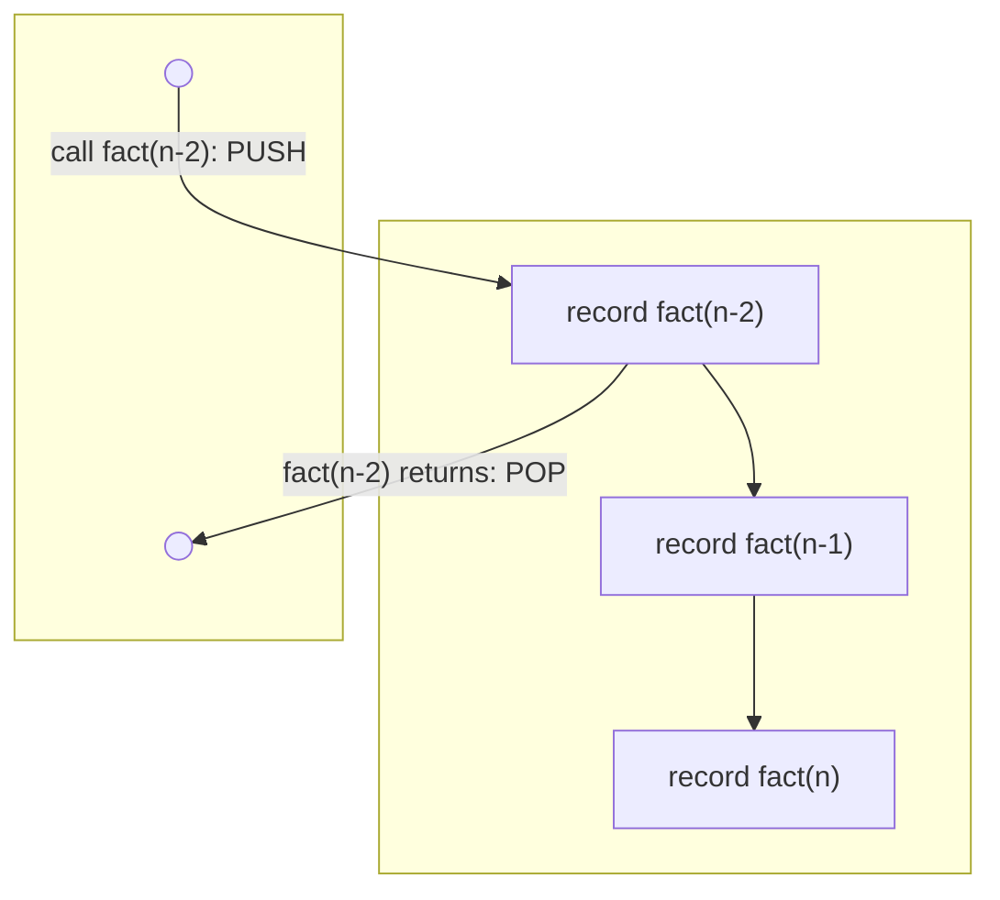
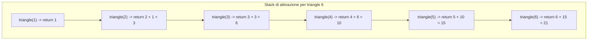

# Ricorsione

La [ricorsione](./2026-11-18_ricorsione.md) e' una tecnica di programmazione in cui una funzione invoca se stessa per risolvere un problema dividendolo in sotto-problemi piu' piccoli dello stesso tipo.

## Funzioni ricorsive

Una funzione e' definita ricorsiva quando contiene al suo interno almeno una chiamata a se stessa. Per funzionare correttamente e terminare, ogni funzione ricorsiva deve possedere due elementi fondamentali:

- **Almeno una chiamata ricorsiva**: la funzione richiama se stessa passando dei parametri ridotti o semplificati rispetto a quelli ricevuti.
- **Almeno un caso base**: una condizione di arresto in cui il risultato viene calcolato direttamente senza effettuare ulteriori chiamate ricorsive. Senza caso base, la ricorsione proseguirebbe all'infinito causando un errore di *stack overflow*.

## Stack di record di attivazione

Durante l'esecuzione di un programma, le chiamate a funzione vengono gestite tramite una pila di memoria chiamata **stack di record di attivazione**, o spesso solo **stack**.

Ogni volta che una funzione viene invocata:
- Viene creata ed inserita in cima alla pila una nuova area di memoria (**PUSH**).
- Il record di attivazione contiene:
  - I parametri passati alla funzione.
  - Le variabili locali allocate.
  - L'indirizzo di ritorno (il punto del codice a cui tornare una volta terminata l'esecuzione).

Quando la funzione termina ed esegue un `return`:
- Il corrispondente record di attivazione viene rimosso dalla cima della pila (**POP**).
- Il controllo dell'esecuzione e l'eventuale valore restituito tornano al chiamante.

### Rappresentazione dello stack



> **Nota:** Lo stack viene processato seguendo il metodo **LIFO** (last in first out).

## Esempio pratico: i numeri triangolari

Un numero triangolare rappresenta il numero di punti disposti a forma di triangolo equilatero. Per un intero positivo $n > 0$, l'-esimo numero triangolare $T_n$ e' la somma di tutti gli interi da $1$ a $n$:

$$T_n = \sum_{i=1}^{n} i = 1 + 2 + 3 + \dots + n$$

In forma ricorsiva, la successione e' definita come:

$$T_n = \begin{cases} 
1 & \text{se } n = 1 \quad \text{(caso base)} \\ 
n + T_{n-1} & \text{se } n > 1 \quad \text{(passo ricorsivo)} 
\end{cases}$$

I primi numeri triangolari sono: $T_1 = 1$, $T_2 = 3$, $T_3 = 6$, $T_4 = 10$, $T_5 = 15$, $T_6 = 21$.

### Implementazione

```typescript
function triangle(n: number): number {
    if (n === 1) {
        return 1;
    } else {
        return n + triangle(n - 1);
    }
}
```

### Traccia di esecuzione dello stack per `triangle(6)`

Quando si invoca `triangle(6)`, lo stack si riempie verso l'alto fino al raggiungimento del caso base, per poi svuotarsi restituendo i valori parziali.



## Definizioni induttive

La ricorsione riflette direttamente la struttura delle **definizioni induttive** in matematica (utilizzate per insiemi, sequenze o funzioni). Una definizione induttiva si articola in:

- **Clausola base**: fornisce una regola diretta per gli elementi piu' semplici.
- **Clausola induttiva**: fornisce una regola per costruire elementi piu' complessi a partire da quelli gia' definiti.

### Ricorsione su strutture dati

La ricorsione si adatta in modo naturale a strutture dati che rappresentano collezioni di oggetti (come liste o alberi). 

Ad esempio, una lista di lunghezza $len$ puo' essere definita induttivamente come:
- **Clausola base**: una lista vuota ha lunghezza $0$.
- **Clausola induttiva**: una lista di lunghezza $len$ e' composta da un elemento iniziale (*testa*) seguito da una lista di lunghezza $len - 1$ (*coda*).

## Ricorsione in coda (tail recursion)

Una funzione si dice **ricorsiva in coda** (*tail recursive*) quando la chiamata ricorsiva e' l'ultima operazione effettuata nel corpo della funzione prima del `return`. Non rimangono quindi operazioni sospese da completare al rientro.

### Vantaggi e Tail-Call Optimization (TCO)

Con la ricorsione in coda e' possibile applicare l'ottimizzazione della chiamata in coda (*Tail-Call Optimization*):
- Il chiamante non deve eseguire ulteriori calcoli dopo la chiamata ricorsiva.
- Lo stack frame del chiamante puo' essere immediatamente deallocato o riutilizzato per la nuova chiamata.

> **Nota**: la Tail-Call Optimization non e' garantita o supportata in tutti gli ambienti di esecuzione di JavaScript / TypeScript.

### Confronto tra ricorsione classica e in coda

Nella versione classica di `triangle`, dopo il ritorno della chiamata `triangle(n-1)` occorre ancora eseguire l'operazione di addizione `n + ...`:

```typescript
// Ricorsione non in coda (operazione pendente: somma)
function triangle(n: number): number {
    if (n === 1) return 1;
    return n + triangle(n - 1); 
}
```

Per rendere la funzione ricorsiva in coda, si utilizza un parametro accumulatore `s`:

```typescript
// Ricorsione in coda (nessuna operazione dopo la chiamata ricorsiva)
function triangleCoda(n: number, s: number = 0): number {
    if (n < 1) return s;
    return triangleCoda(n - 1, s + n);
}
```

## Come progettare una funzione ricorsiva

Per scrivere correttamente una funzione ricorsiva e' utile seguire tre passi metodologici:

1. **Scomposizione del problema**: individuare come ridurre il problema originale a una o piu' sotto-istanze piu' piccole, accertandosi che i parametri della chiamata ricorsiva convergano verso il caso base.
2. **Identificazione del caso base**: definire la condizione d'arresto per gli input piu' semplici ed assicurarsi che copra tutti i casi limite di terminazione.
3. **Combinazione dei risultati**: assumere che la funzione ricorsiva funzioni gia' correttamente per le istanze piu' piccole (ipotesi induttiva) e combinare i risultati per risolvere l'istanza di partenza.

## Esercizi ed esempi notevoli

### Successione di Fibonacci

La successione di Fibonacci $F_0, F_1, F_2, \dots$ e' una sequenza infinita di numeri naturali definita ricorsivamente come:

$$F_0 = 0$$
$$F_1 = 1$$
$$F_n = F_{n-1} + F_{n-2} \quad \text{per } n > 1$$

I primi elementi della sequenza sono: $0, 1, 1, 2, 3, 5, 8, 13, 21, \dots$


```typescript
function fibonacciNsimo(n: number): number {
    // Casi base
    if (n === 0) {
        return 0;
    }
    if (n === 1) {
        return 1;
    }
    // Passo ricorsivo
    return fibonacciNsimo(n - 1) + fibonacciNsimo(n - 2);
}
```

### Operazioni aritmetiche ricorsive

Dati due numeri naturali $a$ e $b$, e' possibile implementare le operazioni aritmetiche fondamentali mediante la ricorsione:

- **Somma**: calcolata utilizzando esclusivamente le operazioni primitive di incremento ($+1$) e decremento ($-1$).
  $$a + b = \begin{cases} a & \text{se } b = 0 \\ (a + 1) + (b - 1) & \text{se } b > 0 \end{cases}$$
- **Prodotto**: espresso come somme successive.
  $$a \cdot b = \begin{cases} 0 & \text{se } b = 0 \\ a + (a \cdot (b - 1)) & \text{se } b > 0 \end{cases}$$
- **Esponentiazione**: espressa come prodotti successivi (con la convenzione $0^0 = 1$).
  $$a^b = \begin{cases} 1 & \text{se } b = 0 \\ a \cdot a^{b-1} & \text{se } b > 0 \end{cases}$$

Va da se che ogni implementazione segue dalle definizioni induttive, ad esempio:  

```typescript
function somma(a: number, b: number): number {
    if (b == 0) {
        return a
    }
    return somma(a+1, b-1)
}
```

## Iterazione vs ricorsione

Ricorsione e iterazione hanno la medesima capacita' espressiva: qualsiasi algoritmo iterativo puo' essere convertito in forma ricorsiva e viceversa.

| Caratteristica | Iterazione | Ricorsione |
| :--- | :--- | :--- |
| **Struttura naturale** | Ripetizione di operazioni su sequenze o cicli semplici. | Problemi definiti induttivamente o strutture dati ricorsive (liste, alberi, grafi). |
| **Uso della memoria** | In genere ridotto spazio aggiuntivo. | Maggiore a causa dei record di attivazione nella pila (salvo Tail-Call Optimization). |
| **Leggibilita' del codice** | Puo' richiedere la gestione esplicita degli indici di ciclo. | Produce spesso codice piu' lineare, pulito ed elegante per strutture complesse. |

La scelta tra l'approccio iterativo e quello ricorsivo dipende dallo specifico problema da risolvere e dal bilanciamento desiderato tra efficienza in memoria e semplicita' di scrittura.