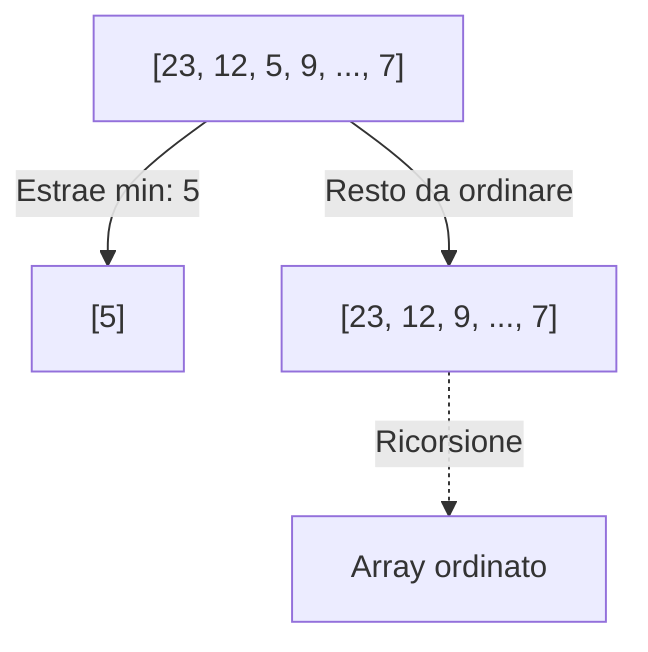
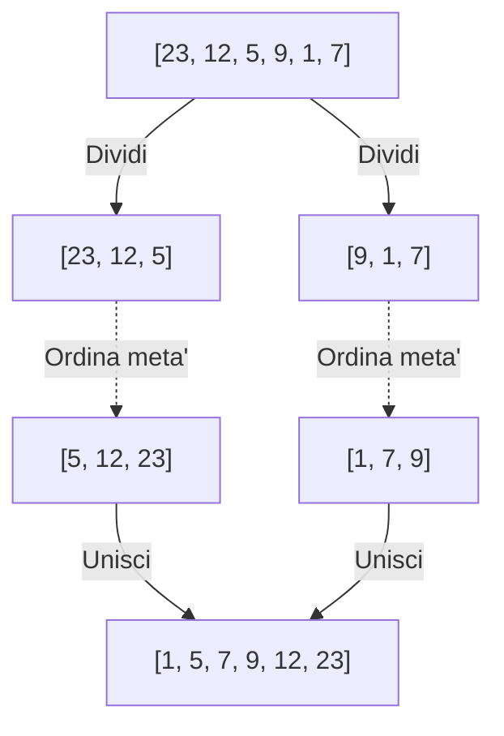
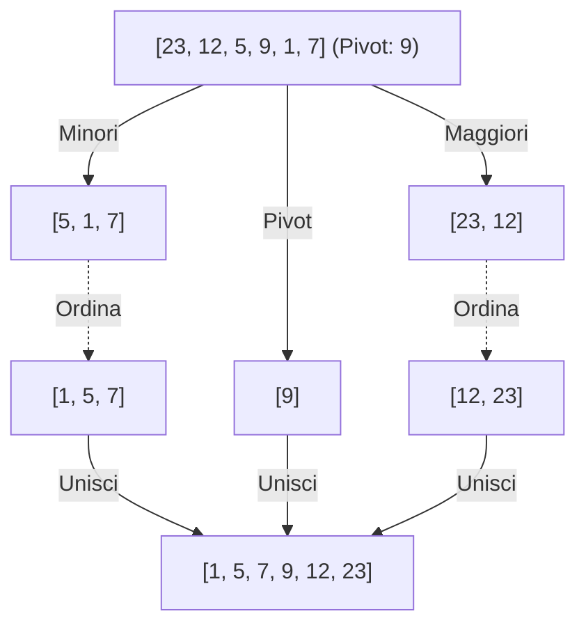

## La funzione `Array.sort()`

Il metodo `sort()` ordina gli elementi di un array sul posto (*in place*), modificando l'array originale e restituendone il riferimento. 

* **Comportamento predefinito**: ordina in modo crescente convertendo gli elementi in stringhe e confrontandone i valori delle unita' di codice UTF-16. Questo causa risultati inaspettati con i numeri (es. `10` viene prima di `4`).
* **Complessita'**: tempo e spazio non sono garantiti, poiche' dipendono dall'implementazione del motore JavaScript.
* **Alternativa immutabile**: per ordinare senza modificare l'array originale si usa il metodo `toSorted()`.

```typescript
let a: number[] = [1, 3, 0, 4, 6];
a.sort();
console.log(a); // [0, 1, 3, 4, 6]

let v: number[] = [4, 7, -1, 10, 8, 22];
v.sort();
console.log(v); // [-1, 10, 22, 4, 7, 8] -> Ordine alfabetico!
```

## Ordinamento personalizzato mediante funzione di confronto

Per definire un criterio di ordinamento specifico, si passa a `sort(compareFn)` o `toSorted(compareFn)` una funzione di comparazione che prende due elementi $a$ e $b$ e restituisce un numero:

| Caso | Valore restituito | Effetto sull'ordine |
| :--- | :--- | :--- |
| $a < b$ | Negativo (es. $-1$) | $a$ viene prima di $b$ |
| $a = b$ | $0$ (o `NaN`) | $a$ e $b$ restano invariati |
| $a > b$ | Positivo (es. $+1$) | $a$ viene dopo $b$ |

### Esempio con stringhe (ordinamento per lunghezza crescente)

```typescript
function comparaLen(a: string, b: string): number {
    return a.length - b.length;
}

let arr: string[] = ['abc', 'abba', 'z'];
arr.sort(comparaLen); // ['z', 'abc', 'abba']
```

### Esempio con interi (crescente e decrescente)

```typescript
function compare(a: number, b: number): number {
    return a - b;
}

function compareRev(a: number, b: number): number {
    return b - a;
}

let v: number[] = [4, 7, -1, 10, 8, 22];

console.log(v.toSorted(compareRev)); // [22, 10, 8, 7, 4, -1]
console.log(v);                      // [4, 7, -1, 10, 8, 22] (originale intatto)

v.sort(compare);
console.log(v);                      // [-1, 4, 7, 8, 10, 22] (modificato sul posto)
```

# Algoritmi di ordinamento

## Selection sort

Approccio ricorsivo basato sulla ricerca del minimo:
1. **Caso base**: se l'array ha lunghezza $\le 1$, e' gia' ordinato.
2. **Passo ricorsivo**: trova il valore minimo e mettilo in prima posizione, poi ordina ricorsivamente il resto dell'array.



```typescript
function selectionSort(array: number[]): number[] {
    // caso base
    if (array.length <= 1) {
        return array;
    }

    /* passo ricorsivo: minimo in testa e ordina il resto */

    // trova minimo
    let minIndex: number = 0;
    for (let index: number = 0; index < array.length; index++) {
        if (array[index] < array[minIndex]) {
            minIndex = index;
        }
    }

    // minimo in testa
    [array[0], array[minIndex]] = [array[minIndex], array[0]];

    return [array[0], ...selectionSort(array.slice(1))]
}
```

## Merge sort

Approccio *divide et impera*:
1. **Caso base**: se l'array ha lunghezza $\le 1$, e' gia' ordinato.
2. **Passo ricorsivo**: dividi l'array a meta', ordina ricorsivamente le due meta' e infine uniscile (*merge*) preservando l'ordine.



```typescript
function merge(array1: number[], array2: number[]): number[] {
    // caso base: ho esaurito uno degli array
    if (array1.length == 0) {
        return array2;
    }
    if (array2.length == 0) {
        return array1;
    }

    // passo ricorsivo:
    if (array1[0] <= array2[0]) {
        return [array1[0], ...merge(array1.slice(1), array2)];
    } else {
        return [array2[0], ...merge(array1, array2.slice(1))];
    }
}

function mergeSort(array: number[]): number[] {
    // caso base
    if (array.length <= 1) {
        return array;
    }

    // passo ricorsivo: divide et impera
    let middle: number = Math.floor(array.length / 2);
    let leftArray: number[] = mergeSort(array.slice(0, middle));
    let rightArray: number[] = mergeSort(array.slice(middle));
    return merge(leftArray, rightArray);
}
```

## Quick sort

Approccio *divide et impera* basato su un elemento perno (*pivot*):
1. **Caso base**: se l'array ha lunghezza $\le 1$, e' gia' ordinato.
2. **Passo ricorsivo**:
   * Scegli un elemento **pivot** (es. `9`).
   * Raggruppa gli elementi piu' piccoli e quelli piu' grandi del pivot in due sotto-array.
   * Ordina ricorsivamente i due gruppi.
   * Unisci il gruppo dei minori ordinato, il pivot e il gruppo dei maggiori ordinato.



```typescript
function quickSort(array: number[]): number[] {
    // caso base
    if (array.length <= 1) {
        return array;
    }

    // passo ricorsivo: divide et impera
    let pivot: number = array[array.length-1]; // <- potrei sceglere anche un qualsiasi altro elemento come pivot

    let smallerArray: number[] = [];
    let greaterArray: number[] = [];
    for (let value of array.slice(0, -1)) { // questo deve essere l'array con il pivot rimosso
        if (value < pivot) {
            smallerArray.push(value);
        } else {
            greaterArray.push(value);
        }
    }

    return [...quickSort(smallerArray), pivot, ...quickSort(greaterArray)];
}
```

## Radix sort

Algoritmo non comparativo per **numeri interi non negativi** ($0, 1, 2, \dots$), ispirato alle selezionatrici di schede perforate IBM.

* Raggruppa i numeri in 10 secchi (*bucket*) numerati da `0` a `9` in base alle loro cifre.
* Procede dalla cifra meno significativa (**unita'**) verso la piu' significativa (decine, centinaia, ecc.).
* **Stabilita'**: ad ogni passo, i numeri con la stessa cifra mantengono l'ordine relativo ottenuto nel passo precedente.

### Esempio passo per passo

Prendiamo l'array **`[5, 2, 11, 26]`** e immagina di avere sul tavolo 10 scatole numerate da **0 a 9** e una scatola speciale chiamata **"Finiti"** (per i numeri che non hanno piu' cifre da controllare).

---

#### Giro 1: Controllo delle unita' (la cifra più a destra)
Prendiamo ogni numero dell'array `[5, 2, 11, 26]` e guardiamo la sua ultima cifra:

* **5** → finisce nella scatola **5**
* **2** → finisce nella scatola **2**
* **11** → finisce nella scatola **1** (perche finisce con 1)
* **26** → finisce nella scatola **6** (perche' finisce con 6)

**Svuotiamo le scatole in ordine (dalla 0 alla 9):**
Nuovo array: **`[11, 2, 5, 26]`**
*(Ora sono ordinati in base all'ultima cifra)*

---

#### Giro 2: Guardiamo le DECINE (la seconda cifra da destra)
Prendiamo il nuovo array `[11, 2, 5, 26]`:

* **11** → la cifra delle decine e' **1** → scatola **1**
* **2** → non ha decine → scatola **"Finiti"**
* **5** → non ha decine → scatola **"Finiti"**
* **26** → la cifra delle decine e' **2** → scatola **2**

**Svuotiamo le scatole (prima "Finiti", poi dalla 0 alla 9):**
* Dalla scatola "Finiti" escono: `2, 5` (restano nell'ordine in cui erano)
* Dalla scatola 1 esce: `11`
* Dalla scatola 2 esce: `26`

Nuovo array: **`[2, 5, 11, 26]`**

---

#### Giro 3: Guardiamo le CENTINAIA (la terza cifra da destra)
Prendiamo `[2, 5, 11, 26]`:

* **2** → non ha centinaia → **"Finiti"**
* **5** → non ha centinaia → **"Finiti"**
* **11** → non ha centinaia → **"Finiti"**
* **26** → non ha centinaia → **"Finiti"**

**Controllo finale:** 
Tutti e 4 i numeri sono nella scatola **"Finiti"**. L'algoritmo si ferma e restituisce il risultato finale: **`[2, 5, 11, 26]`**.

```typescript
function nthDigit(n: number, digit: number): number {
    return Math.floor(n / 10 ** digit) % 10;
}

function radixSort(array: number[], digit: number = 0): number[] {
    // dividi gli elementi per n-esima cifra
    let buckets: number[][] = [[], [], [], [], [], [], [], [], [], []]; // 0..9
    let exhausted: number[] = []; // <- per i numeri di cui ho finito le cifre

    for (let value of array) {
        if (value < 10 ** digit) {
            exhausted.push(value);
        } else {
            buckets[nthDigit(value, digit)].push(value);
        }
    }

    // caso base: ho finito le cifre di tutti i numeri
    if (exhausted.length == array.length) {
        return exhausted;
    }

    // passo ricorsivo: combina i bucket e passa alla prossima cifra
    let newArray: number[] = [...exhausted];
    for (let bucket of buckets) {
        newArray.push(...bucket);
    }

    return radixSort(newArray, digit + 1);
}
```