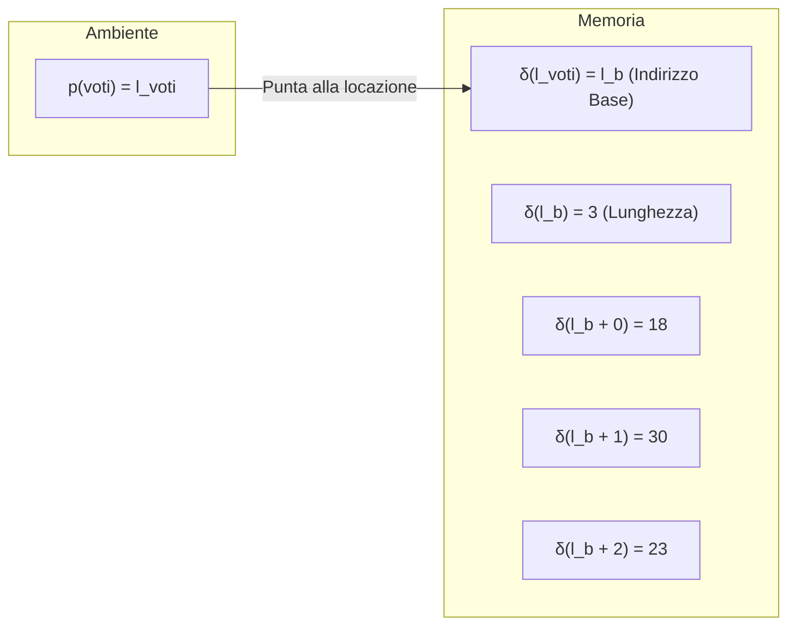

# Introduzione agli array

Gli **array** sono strutture dati fondamentali utilizzate per trattare **dati omogenei** (elementi dello stesso tipo) in modo semplice ed efficiente.

*   **Rappresentazione in memoria:** Vengono utilizzate posizioni contigue in memoria. Annotando solo la prima locazione (l'**indirizzo base**) e conoscendo la dimensione, e' possibile accedere a tutti gli altri elementi tramite indici.
*   **Vantaggio:** Invece di dichiarare molteplici variabili distinte, basta una sola variabile per gestire un'intera serie di dati.

---

## Dichiarazione e utilizzo base

Esempio di dichiarazione di un array di interi:

```java
int[] voti = [18, 30, 23];
```

*   `voti` indica una serie di interi.
*   `voti[i]` accede al valore $i$-esimo tramite un indice $i$.
*   **L'indice parte da zero!** Questo significa che per un array di lunghezza $n$, gli indici validi sono compresi nell'intervallo $[0, n-1]$.

### Regole fondamentali:
1.  **La prima locazione contiene la lunghezza:** In termini di modello di memoria, la variabile punta a un **indirizzo base** $l_b$ (invece che ad un valore), l'indirzzo base a sua volta punta alla cella contenente la lunghezza dell'array. Questo serve anche a preservare il tipo di dato, se la prima cella contenesse la lunghezza di tipo intero non ci sarebbe modo di inferire che stiamo trattando un array.
2.  **Immutabilita' di tipo e lunghezza:** Il tipo degli elementi e la lunghezza dell'array **non possono essere cambiati** dopo la dichiarazione.
3.  E' comunque possibile riassegnare la variabile a un nuovo array (es. `voti := [18, 18, 18, 18]`); si possono cambiare i valori degli elementi, ma non la struttura/dimensione originaria.

---

## Ambiente e memoria

Il legame tra l'ambiente (variabili) e la memoria RAM e' descritto dal seguente schema concettuale:



*   $l_b$: Indirizzo base (collegato all'identificatore della variabile).
*   L'indirizzo base contiene la lunghezza dell'array.
*   Per trovare la lunghezza in codice si usa la proprieta' nativa: `voti.length`

---

## Sintassi e grammatica degli array

Estendiamo la sintassi formale per la manipolazione degli array:

### Espression

```c
E ::= tutte quelle gia' viste, piu'...
    | [V_1, V_2, ..., V_n] //una serie non vuota di valori dello stesso tipo
    | new  Tb[E] // una serie di E elementi positivi, tutti inizializzati al valore di default del tipo Tb
    | Id.length // restituisce la lunghezza dell'array
    | Id[E] // restituisce il valore in posizione E dell'array `Id`
```

### Comandi

```c
C ::= tutti quelli gia' visti, piu'...
    | Id[E_1] := E_2; // modifica il valore in posizione E_1 dell'array `Id` con il valore E_2
```

---

## Vincoli e limitazioni  

*   **Espressioni booleane negli indici/inizializzazioni:** 
    Scrivere espressioni come `bool[] b = [true, 1 < 2];` **non è ammesso** se viola i vincoli sintattici della dichiarazione statica dei letterali in questo contesto specifico.
*   **Array vuoti:** 
    Un'istruzione come `int[] voti = new int[0];` non è ammessa (l'array vuoto di dimensione zero non è consentito in questa formulazione).

---

## Allocazione Implicita vs Esplicita
Le seguenti scritture sono considerate equivalenti per definire array di default o pre-allocati:
1.  **Allocazione Implicita:** `int[] voti = new int[5];`
2.  **Allocazione Esplicita:** `int[] voti = [0, 0, 0, 0, 0];`

## Esempio: Conteggio dei numeri pari in un array
Un algoritmo di scansione iterativa per contare quanti numeri pari sono presenti all'interno di un array `a`:

```c
int even_counter = 0;
int[] a = ...; // array di interi
int i = 0;

while (i < a.length) {
    if (a[i] % 2 == 0) {
        even_counter = even_counter + 1;
    }
    i = i + 1;
}
```