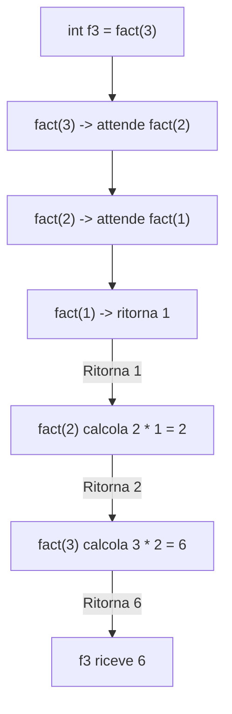

## Definizioni induttive

Una definizione induttiva e' composta da due parti fondamentali:

* **Caso Base (CB):** Definisce in modo concreto gli oggetti elementari (gli elementi di partenza).
* **Caso Induttivo (CI):** Definisce gli oggetti complessi a partire da quelli piu' semplici gia' definiti.

#### Esempio dei numeri naturali $\mathbb{N}$
* **CB:**  
  $$0 \in \mathbb{N}$$  

* **CI:**  
  $$\text{se } n \in \mathbb{N} \implies n + 1 \in \mathbb{N}$$  

---

## Funzioni ricorsive e implementazione

Le funzioni ricorsive sono particolarmente convenienti per implementare funzioni matematiche definite in modo induttivo.

### Esempio: somma induttiva

Definizione matematica induttiva:
* **CB:** $\text{Somma}(x, 0) = x$
* **CI:** $\text{Somma}(x, n + 1) = 1 + \text{Somma}(x, n)$

Esempio di esecuzione:  
$$\text{Somma}(3, 2) = 1 + \text{Somma}(3, 1) = 1 + (1 + \text{Somma}(3, 0)) = 1 + 1 + 3 = 5$$  

```c
int somma(int x, int n) {
    int s = x;
    if (n > 0) {
        s = 1 + somma(x, n - 1);
    }
    return s;
}
```

---

## Esempio: prodotto induttivo

Definizione matematica induttiva:
* **CB:** $\text{Prod}(x, 0) = 0$
* **CI:** $\text{Prod}(x, n + 1) = x + \text{Prod}(x, n)$

```c
int prod(int x, int n) {
    int p = 0;
    if (n > 0) {
        p = x + prod(x, n - 1);
    }
    return p;
}
```

---

## Fattoriale induttivo

Definizione matematica induttiva:
* **CB:** $1! = 1$
* **CI:** $n! = n \cdot (n - 1)! \qquad \forall \ n > 1$

```c
int fact(int n) {
    int f = 1;
    if (n > 1) {
        f = n * fact(n - 1);
    }
    return f;
}
```

---

## Traccia dell'esecuzione: ambiente e memoria

Analizziamo la chiamata `int f3 = fact(3);` ed il comportamento dell'ambiente (variabili e locazioni) e della memoria (valori contenuti nelle locazioni).

### Diagramma di Flusso delle Chiamate Ricorsive



### Stato dell'ambiente e della memoria

Durante l'attivazione dei vari frame della funzione ricorsiva:

| Frame / Chiamata | Ambiente (Variabile $\rightarrow$ Locazione) | Memoria (Locazione $\rightarrow$ Valore) | Note |
| :--- | :--- | :--- | :--- |
| `fact(3)` | $n \rightarrow L_1$<br>$f \rightarrow L_2$ | $L_1 \rightarrow 3$<br>$L_2 \rightarrow 1 \rightarrow 6$ | Attende `fact(2)`, poi riceve $3 \cdot 2 = 6$ |
| `fact(2)` | $n \rightarrow L_3$<br>$f \rightarrow L_4$ | $L_3 \rightarrow 2$<br>$L_4 \rightarrow 1 \rightarrow 2$ | Attende `fact(1)`, poi riceve $2 \cdot 1 = 2$ |
| `fact(1)` | $n \rightarrow L_5$<br>$f \rightarrow L_6$ | $L_5 \rightarrow 1$<br>$L_6 \rightarrow 1$ | Caso base: ritorna $1$ |
| Chiamante | $f_3 \rightarrow L_7$ | $L_7 \rightarrow 6$ | Valore finale restituito da `fact(3)` |

> **Nota:** Alla fine dell'esecuzione delle chiamate ricorsive, le locazioni temporanee dei frame di stack vengono deallocate e **solo $L_7$ resta accessibile attraverso $f_3$**

---

## Array e ricorsione

### Somma degli elementi di un array
Calcola la somma degli elementi compresi tra gli indici `from` e `to`. Ad esempio per l'array `[3, 5, 7]`.

```c
int sommaArr(int[] a, int from, int to) {
    int sum = 0;
    if (from <= to) {
        sum = a[from] + sommaArr(a, from + 1, to);
    }
    return sum;
}
```

---

## Ricerca di un carattere in una stringa

Verifica se il carattere `c` e' presente nella stringa `s` a partire dall'indice `from`.

```c
bool elem(char[] s, char c, int from) {
    bool trovato = false;
    if (from < s.length) {
        if (s[from] == c) {
            trovato = true;
        } else {
            trovato = elem(s, c, from + 1);
        }
    }
    return trovato;
}
```

### Uso di una funzione wrapper
Per incapsulare l'implementazione e consentire all'utente di chiamare la funzione senza specificare l'indice iniziale `0`:

```c
bool appartiene(char[] s, char c) {
    return elem(s, c, 0);
}
```

---

## Calcolo delle occorrenze di un carattere

Conta quante volte il carattere `c` appare nella stringa `s` a partire dall'indice `from`.

```c
int conta(char[] s, char c, int from) {
    int occ = 0;
    if (from < s.length) {
        if (s[from] == c) {
            occ = 1 + conta(s, c, from + 1);
        } else {
            occ = conta(s, c, from + 1);
        }
    }
    return occ;
}
```

---

## Calcolo dell'altezza di una scala
> Il primo gradino e' alto 1cm, il secondo 2cm, il terzo 1cm, il quatro 2cm e cosi' via...

Funzione ricorsiva che calcola l'altezza di una scala generica di `n` gradini:

```c
int altezza(int n) {
    int a = 0;
    if (n > 0) {
        if (n % 2 == 0) {
            a = 2 + altezza(n - 1);
        } else {
            a = 1 + altezza(n - 1);
        }
    }
    return a;
}
```