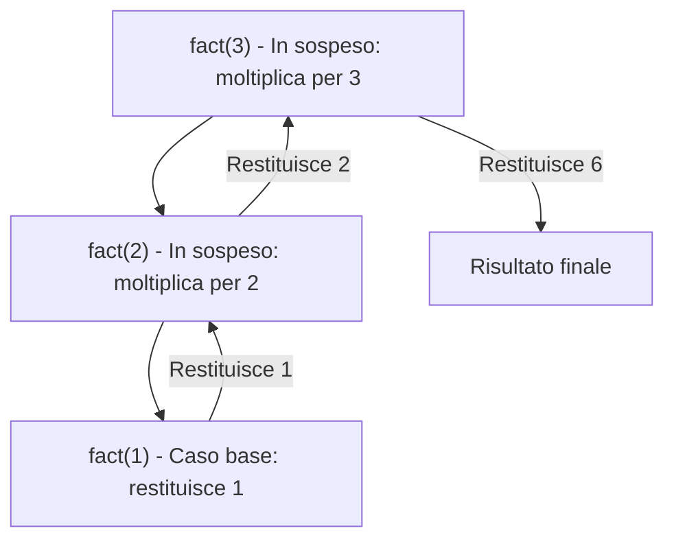

## Come costruire una funzione ricorsiva?

Per progettare correttamente un algoritmo ricorsivo e' necessario identificare quattro elementi fondamentali:

* **Caso base:** Quando posso rispondere senza altre chiamate ricorsive? Rappresenta la condizione di arresto in cui la soluzione e' immediata.
* **Riduzione:** Come trasformo il problema in un sotto-problema piu' semplice/piccolo da passare alla chiamata ricorsiva?
* **Combinazione:** Come uso il risultato ottenuto dalla chiamata ricorsiva per costruire la soluzione finale?
* **Terminazione:** Perche' ho la certezza di raggiungere prima o poi un caso base? (Garantisce che l'algoritmo non vada in loop infinito).

### Gestione delle chiamate ricorsive

Una chiamata ricorsiva lascia un lavoro in sospeso. 

Ad esempio, per calcolare $fact(3)$:
1. $fact(3)$ deve attendere il risultato di $fact(2)$, per poi moltiplicarlo per $3$.
2. $fact(2)$ deve attendere $fact(1)$, e cosi' via.



Quando il caso base restituisce il risultato, il controllo torna alla chiamata iniziale che usa il risultato per completare il suo calcolo.

---

## Che cosa diminuisce?

Nelle funzioni ricorsive e' fondamentale capire quale parametro viene ridotto a ogni passo:

|funzione|chiamata ricorsiva|cosa diminuisce|
|-|-|-|
|fattoriale|$fact(n-1)$|Diminuisce il numero di fattori da considerare|
|somma di un array|$sommaArray(arr, from+1)$|Diminuisce il numero di elementi rimasti da sommare|


---

## Esempi di funzioni ed esercizi

### Funzione `esatte`

Verifica se un determinato carattere `c` compare esattamente `n` volte all'interno della stringa `s` a partire dall'indice `from`.

```c
bool esatte(char[] s, int n, char c, int from) {
    bool ok = (n == 0);
    if (from < s.length && n >= 0) {
        if (s[from] == c) {
            ok = esatte(s, n - 1, c, from + 1);
        } else {
            ok = esatte(s, n, c, from + 1);
        }
    }
    return ok;
}
```

### MCD di Euclide con modulo

Calcolo del Massimo Comune Divisore ($MCD$) tra due numeri interi $a$ e $b$ usando l'operatore modulo `%`.

```cpp
int MCD(int a, int b) {
    if (b > 0) {
        a = MCD(b, a % b);
    }
    return a;
}
```

### Inversione di un array

Funzione ricorsiva per invertire gli elementi di un array tra gli indici `from` e `to`.

```cpp
bool inv(int[] a, int from, int to) {
    if (from < to) {
        int temp = a[from];
        a[from] = a[to];
        a[to] = temp;
        bool b = inv(a, from + 1, to - 1);
    }
    return true;
}
```
