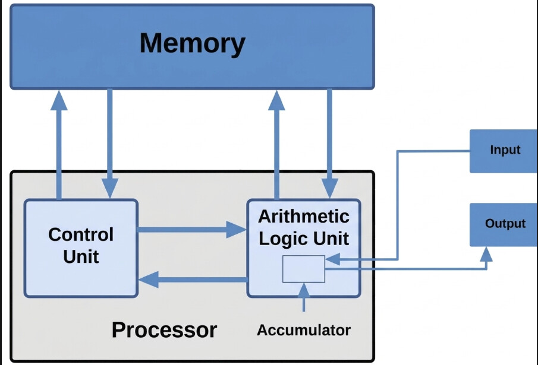
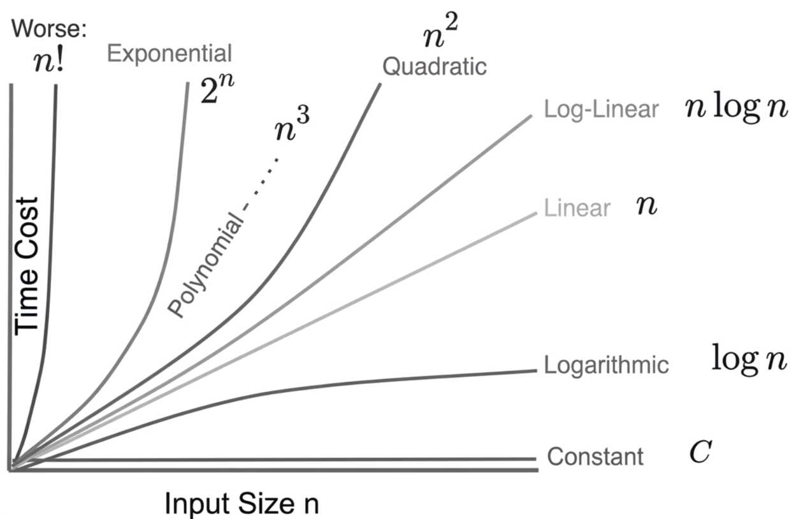

## Complessita' computazionale di un algoritmo in tempo e spazio

Un algoritmo richiede risorse hardware per essere eseguito. L'obiettivo principale dell'analisi e' minimizzare:
- **Tempo di esecuzione:** Risorsa irreversibile (il tempo trascorso non si puo' recuperare).
- **Spazio di memoria:** Risorsa reversibile (la memoria puo' essere liberata e riutilizzata).

### Costo in tempo di un algoritmo
Rappresenta il numero di passi (operazioni elementari) eseguiti dall'algoritmo durante la sua esecuzione.

### Costo in spazio di un algoritmo
Rappresenta il numero di celle di memoria utilizzate durante l'esecuzione (escluso lo spazio occupato dall'input stesso, considerando solo lo spazio ausiliario per il calcolo).

Entrambi i costi si esprimono in funzione della **dimensione dei dati in ingresso** (ovvero la dimensione dell'istanza di input), definita formalmente come il **numero di bit necessari per rappresentare i dati di input**. Non e' necessariamente un valore preciso, e' sufficiente una misura approssimata.

### Esempi di dimensione dell'input

| Input | Dimensione dell'input | Note |
| :--- | :--- | :--- |
| AND di 2 variabili booleane $a, b$ | Costante ($2 \text{ bit}$) | Dimensione fissa. |
| Somma di due interi $A, B$ | Numero di bit di $A$ e $B$ pari al logaritmo del loro valore | Dimensione proporzionale a $\log(A) + \log(B)$. |
| Array `a` | `a.length` | Ricerca del minimo o analisi su array. |
| Stringa di caratteri | Numero di caratteri nella stringa o nel testo | Operazioni su testo. |

---

## Modello di calcolo RAM (Random Access Machine)

La Random Access Machine (Macchina ad Accesso Diretto) e' un modello teorico di calcolo basato su una struttura CPU/Memoria standard.

  

---

## Operazioni elementari

Si definiscono operazioni elementari le istruzioni base eseguibili direttamente dal processore in tempo costante:
- **Op. aritmetiche:** $+$, $-$, $*$, $/$
- **Op. logiche:** $\text{AND}$, $\text{OR}$, $\text{NOT}$, $\dots$
- **Op. di confronto:** $<$, $==$, $>$, $\dots$
- **Op. di trasferimento:** Lettura/scrittura da memoria ad accumulatore e viceversa.
- **Op. di controllo:** Chiamate di funzione, passaggio del controllo da un'istruzione a un'altra ($\text{jump}$, $\text{return}$).

### Ipotesi di costo uniforme

Se assumiamo che ogni operazione elementare richiede **tempo costante** di esecuzione, allora il numero di operazioni elementari fornisce una stima accurata del costo in tempo dell'algoritmo (a meno di una costante).

L'algoritmo piu' efficiente e' quello il cui costo in tempo cresce piu' lentamente al crescere della dimensione dei dati di input $n$.

  


*(Graficamente, funzioni come $\log n$ e $n \log n$ crescono piu' lentamente rispetto a $n^2$ per grandi valori di $n$).*

---

## Bit model vs Word model

- **Bit model:** Si utilizza quando i numeri da elaborare crescono indefinitamente e non possono essere contenuti in una singola cella di memoria fissa.
- **Word model:** Si applica quando i dati da elaborare sono abbastanza piccoli in valore da poter essere contenuti in una singola cella di memoria o in un piccolo e costante numero di celle (es. parola di memoria da 32 o 64 bit).

---

## Analisi al caso ottimo, medio, pessimo

Sia $\Pi$ un problema computazionale, $A$ un algoritmo che risolve $\Pi$, e $I$ un'istanza di input con dimensione $|I| = n = \text{dim}(I)$.

### Caso ottimo
Costo minimo dell'algoritmo su tutte le istanze di dimensione $n$:  

$$T_{\text{ottimo}}(n) = \min_{I: |I| = n} T(I)$$  

### Caso pessimo
Costo massimo su tutte le istanze di dimensione $n$. Ci fornisce il **limite superiore** (upper bound) garantito: l'algoritmo non impieghera' mai piu' di questo tempo.  

$$T_{\text{pessimo}}(n) = \max_{I: |I| = n} T(I)$$  

### Caso medio
Media del costo su tutte le istanze di dimensione $n$, pesata sulla probabilita' con cui si presentano le varie istanze:  

$$T_{\text{medio}}(n) = \sum_{I: |I|=n} \text{Prob}(I) \cdot T(I)$$  

---

## Esempio 1: ricerca dell'elemento massimo in un array non ordinato

Dato un array $V$ di $n$ interi:

```c
// Pseudo codice per brevita'

m = V[0];
n = V.length;
for (int i = 1; i < n; i++) {
    if (m < V[i]) {
        m = V[i];
    }
}
return m;
```

- Inizializzazione: $2$ operazioni elementari.
- Il ciclo `for` si ripete per $n-1$ volte.
- Il corpo del ciclo ha costo costante per ogni iterazione.
- Ritorno del valore: tempo costante.

La parte piu' interessante dell'algoritmo e' il corpo del ciclo `for`. Ignorando le operazioni di inizializzazione/ritono e -1 in quanto sono trasculabili, possiamo affermare che:

> $T(n)$ cresce come $n$, a meno di costanti.

### Conteggio dei confronti
L'operazione principale e' il **confronto** `m < V[i]`. Il costo in tempo e' proporzionale al numero di confronti:
- **Tempo:** $C(n) = n - 1$
- **Spazio:** $S(n) = \text{costante}$

Sono sufficienti **e necessari** $n-1$ confronti, quindi e' un **algoritmo ottimale** (non si puo' fare di meglio per questo problema).

---

## Esempio 2: ricerca sequenziale in array non ordinato

### Specifiche
- **Input:** Array `a` di interi non ordinato, valore chiave `v`.
- **Output:** Posizione di `v` in `a` se presente, `-1` se non e' presente.

```c
int ricercaS(int[] a, int v) {
    int pos = -1;
    int i = 0;
    while (pos == -1 && i < a.length) {
        if (a[i] == v) {
            pos = i;
        }
        i = i + 1;
    }
    return pos;
}
```

Sia $I = (a, v)$ l'istanza con dimensione $|I| = n = \text{a.length}$.

### Studio del numero di confronti
- **Caso ottimo:** $C(n) = 1$ (quando $v$ si trova in prima posizione, ovvero indice $0$).
- **Caso pessimo:** $C(n) = n$ (ricerca senza successo oppure $v$ presente in ultima posizione `a[n-1]`).

### Caso medio
Consideriamo le posizioni possibili di $v$:

| Casi possibili | # Confronti |
| :--- | :--- |
| $v$ presente in pos $0$ | $1$ |
| $v$ presente in pos $1$ | $2$ |
| $\dots$ | $\dots$ |
| $v$ presente in pos $n-1$ | $n$ |
| $v$ non presente | $n$ |

In totale vi sono **$n+1$ casi possibili**.

**Ipotesi di equiprobabilita':** Tutti i casi si verificano con la stessa probabilita' pari a $\frac{1}{n+1}$.  

$$C_{\text{medio}}(n) = \sum_{I: |I|=n} \text{Prob}(I) \cdot C(I) = \frac{1}{n+1} \sum C(I)$$  

$$C_{\text{medio}}(n) = \frac{1}{n+1} \left( 1 + 2 + 3 + \dots + n + \underbrace{n}_{\text{caso senza successo}} \right)$$  

Sapendo che $1 + 2 + 3 + \dots + n = \sum_{i=1}^{n} i = \frac{n(n+1)}{2}$:  

$$C_{\text{medio}}(n) = \frac{1}{n+1} \left( \frac{n(n+1)}{2} + n \right) = \frac{1}{\cancel{n+1}} \cdot \frac{n(\cancel{n+1})}{2} + \frac{1}{n+1} \cdot n $$  

$$C_{\text{medio}}(n) = \frac{n}{2} + \frac{n}{n+1} \approx \frac{n}{2}$$  

Per grandi valori di $n$ si ha che $\frac{n}{n+1} \to 0$ percio' scriviamo $\approx \frac{n}{2}$.  

Il numero di confronti nel caso medio cresce linearmente con $n$, comportandosi asintoticamente come nel caso pessimo.
