# Selection sort

Il **Selection Sort** (ordinamento per selezione) e' un algoritmo di ordinamento basato su un approccio **incrementale per passi**.

A ogni passo $j$ (con $0 \le j \le n-2$), l'algoritmo individua l'elemento minimo all'interno del segmento non ancora ordinato $a[j \dots n-1]$ e lo scambia con l'elemento presente in posizione $j$.

### Esempio di esecuzione

Consideriamo l'array iniziale $a = [7, 2, 4, 5, 3, 1]$ di dimensione $n = 6$:

```mermaid
graph LR
    subgraph Passo_0["Passo 0"]
        A0["[ 7 | 2 | 4 | 5 | 3 | 1 ]"] -->|"Minimo e' 1: scambia a[0] e a[5]"| A1["[ 1 | 2 | 4 | 5 | 3 | 7 ]"]
    end
    subgraph Passo_1["Passo 1"]
        A1 -->|"Minimo e' 2: gia' in posizione a[1]"| A2["[ 1 | 2 | 4 | 5 | 3 | 7 ]"]
    end
    subgraph Passo_2["Passo 2"]
        A2 -->|"Minimo e' 3: scambia a[2] e a[4]"| A3["[ 1 | 2 | 3 | 5 | 4 | 7 ]"]
    end
    subgraph Passo_3["Passo 3"]
        A3 -->|"Minimo e' 4: scambia a[3] e a[4]"| A4["[ 1 | 2 | 3 | 4 | 5 | 7 ]"]
    end
    subgraph Passo_4["Passo 4"]
        A4 -->|"Minimo e' 5: gia' in posizione a[4]"| A5["[ 1 | 2 | 3 | 4 | 5 | 7 ]"]
    end
```



```c
void selectionSort(int[] a) {
    int n = a.length;               // tempo costante, 0 confronti
    int i, j, temp;
    int min;
    
    for (j = 0; j < n - 1; j++) {    // eseguito n - 1 volte
        // Ricerca del minimo nel sotto-array a[j ... n-1]
        min = j;                    // tempo costante
        
        for (i = j + 1; i < n; i++) { // eseguito (n - 1) - (j + 1) + 1 = n - j - 1 volte
            if (a[i] < a[min]) {     // 1 confronto ad ogni iterazione del ciclo interno
                min = i;
            }
        }
        
        // a[min] e' il minimo di a[j ... n-1], lo scambiamo con a[j]
        temp = a[min];
        a[min] = a[j];
        a[j] = temp;                // tempo costante, 0 confronti
    }
}
```

## Dimostrazione di correttezza

La correttezza del Selection Sort si dimostra tramite l'**invariante di ciclo** per il ciclo `for` esterno.

* **Invariante:** All'inizio della $j$-esima iterazione del ciclo `for` esterno, la porzione $a[0 \dots j-1]$ e' ordinata e contiene i $j$ elementi piu' piccoli dell'array $a$.

* **Inizializzazione ($j = 0$):**
  Prima della prima iterazione, il sotto-array $a[0 \dots -1]$ e' vuoto. Un sotto-array vuoto e' banalmente ordinato e contiene 0 elementi. L'invariante e' verificata.

* **Conservazione:**
  Durante la $j$-esima iterazione, l'algoritmo cerca l'elemento minimo nella porzione non ordinata $a[j \dots n-1]$ e lo scambia con $a[j]$. Di conseguenza, $a[j]$ diventa maggiore o uguale a tutti gli elementi in $a[0 \dots j-1]$ e minore o uguale a tutti gli elementi rimanenti in $a[j+1 \dots n-1]$. Pertanto, dopo l'esecuzione della $j$-esima iterazione, il sotto-array $a[0 \dots j]$ e' ordinato e contiene i $j+1$ elementi piu' piccoli di $a$. L'invariante e' conservata per l'iterazione successiva.

* **Conclusione (all'uscita con $j = n - 1$):**
  Il ciclo termina quando $j = n - 1$. Per l'invariante, il sotto-array $a[0 \dots n-2]$ e' ordinato e contiene i $n-1$ elementi piu' piccoli di $a$. Di conseguenza, l'ultimo elemento rimasto in $a[n-1]$ e' necessariamente il massimo dell'intero array. L'intero array $a[0 \dots n-1]$ e' quindi ordinato.

## Analisi della complessita'

### Calcolo esatto del numero di confronti $C(n)$

Il costo computazionale dell'algoritmo e' dominato dai confronti effettuati nella riga `if (a[i] < a[min])`.  

$$C(n) = \sum_{j=0}^{n-2} \left( \sum_{i=j+1}^{n-1} 1 \right)$$  

Semplificando la sommatoria interna:  

$$\sum_{i=j+1}^{n-1} 1 = (n - 1) - (j + 1) + 1 = n - 1 - j$$  

> **Nota:** Quando devi sommare il numero $1$ da un indice di partenza $A$ fino a un indice di arrivo $B$ (estremi inclusi), la quantita' di volte che sommi $1$ (cioe' il numero di termini della sommatoria) e' data dalla formula: $\text{Numero di termini} = (B - A) + 1$

Sostituendo nella sommatoria esterna:  

$$C(n) = \sum_{j=0}^{n-2} (n - 1 - j)$$  

Espandendo la somma per i vari valori di $j$:

$$C(n) = \underbrace{(n-1)}_{j=0} + \underbrace{(n-2)}_{j=1} + \underbrace{(n-3)}_{j=2} + \dots + \underbrace{2}_{j=n-3} + \underbrace{1}_{j=n-2}$$  

Invertendo l'ordine dei termini otteniamo la somma dei primi $n-1$ numeri interi:  

$$C(n) = \sum_{j=1}^{n-1} j = \frac{n(n-1)}{2} = \binom{n}{2}$$  

Il numero di confronti $C(n) = \binom{n}{2}$ cresce quadraticamente come $n^2$. Poiche' il tempo totale di esecuzione $T(n)$ e' proporzionale a $C(n)$ in tutti i casi, si ha $T(n) \sim n^2$.

> **Nota:** Quando $n$ diventa grande il termine con $n^2$ cresce molto piu' velocemente rispetto a $n$ e la costante moltiplicativa $\frac{1}{2}$ viene ignorata dalla notazione asintotica:   
> $$\frac{n(n-1)}{2} = \frac{n^2 - n}{2} = \frac{1}{2}n^2 - \frac{1}{2}n \simeq n^2$$  

## Confronto tra algoritmi di ordinamento

| Parametro | Insertion Sort (Caso ottimo) | Insertion Sort (Caso medio) | Insertion Sort (Caso pessimo) | Selection Sort (Tutti i casi) |
| :--- | :--- | :--- | :--- | :--- |
| **Numero di confronti** | $n - 1$ | $\frac{1}{2} \binom{n}{2}$ | $\binom{n}{2}$ | $\binom{n}{2}$ |
| **Tasso di crescita tempo $T(n)$** | $n$ | $n^2$ | $n^2$ | $n^2$ |
| **Costo in spazio** | $O(1)$ (In loco) | $O(1)$ (In loco) | $O(1)$ (In loco) | $O(1)$ (In loco) |

> entrambi gli algoritmi sono **in loco** (in-place), ovvero utilizzano una quantita' di memoria ausiliaria costante $O(1)$. Tuttavia, Selection Sort esegue sempre lo stesso numero di confronti a prescindere dall'ordinamento iniziale dell'input, mentre Insertion Sort e' piu efficiente su input gia' parzialmente ordinati.

---

# Notazione asintotica

La notazione asintotica (introdotta formalmente in informatica da Donald Knuth nel 1970) descrive il comportamento limite di una funzione $f(n)$ quando la dimensione dell'input $n$ tende all'infinito ($n \to \infty$).

### Notazione O-grande

La notazione $O$ specifica un **limite superiore asintotico** per il tasso di crescita di una funzione.  

$$O(g(n)) = \{ f(n) : \exists \, c > 0, n_0 > 0 \text{ t.c. } \forall n \ge n_0, \, 0 \le f(n) \le c \cdot g(n) \}$$  

Se $f(n) \in O(g(n))$, diciamo che $f(n)$ cresce al piu' come $g(n)$, a meno di un fattore costante.

#### Esempi di O-grande
* Per $f(n) = 7n^3 + 100n^2 - 20n + 6$:
  * $f(n) \in O(n^3)$ (il termine di grado massimo domina).
  * $f(n) \in O(n^4)$ (limite valido ma non stretto).
  * $f(n) \notin O(n^2)$ (una funzione cubica cresce piu' velocemente di una quadratica).
* Funzioni appartenenti a $O(n^2)$: $1$, $100$, $n$, $100n$, $n \log n$, $\binom{n}{2} = \frac{n^2 - n}{2}$.

---

### Notazione omega-grande

La notazione $\Omega$ specifica un **limite inferiore asintotico** per il tasso di crescita di una funzione.  

$$\Omega(g(n)) = \{ f(n) : \exists \, c > 0, n_0 > 0 \text{ t.c. } \forall n \ge n_0, \, 0 \le c \cdot g(n) \le f(n) \}$$  

Se $f(n) \in \Omega(g(n))$, diciamo che $f(n)$ cresce almeno come $g(n)$, a meno di un fattore costante. Viene utilizzata spesso per esprimere i limiti inferiori dei problemi computazionali.

#### Esempi di omega-grande
* Per $f(n) = 7n^3 + 100n^2 - 20n + 6$:
  * $f(n) \in \Omega(n^3)$
  * $f(n) \in \Omega(n^2)$
  * $f(n) \in \Omega(n \log n)$
  * $f(n) \in \Omega(n)$
  * $f(n) \notin \Omega(n^3 \log n)$

---

### Notazione theta

La notazione $\Theta$ definisce un **limite asintotico stretto** (sia superiore che inferiore).  

$$\Theta(g(n)) = \{ f(n) : \exists \, c_1 > 0, c_2 > 0, n_0 > 0 \text{ t.c. } \forall n \ge n_0, \, 0 \le c_1 \cdot g(n) \le f(n) \le c_2 \cdot g(n) \}$$  

#### Teorema fondamentale di caratterizzazione  

$$f(n) \in \Theta(g(n)) \iff f(n) \in O(g(n)) \land f(n) \in \Omega(g(n))$$  

#### Esempio di applicazione agli algoritmi di ordinamento
* **Selection Sort:** $T(n) = \Theta(n^2)$ in tutti i casi (ottimo, medio, pessimo).
* **Insertion Sort:**
  * $T_{\text{ottimo}}(n) = \Theta(n)$
  * $T_{\text{pessimo}}(n) = \Theta(n^2)$
  * In generale per Insertion Sort si scrive $T(n) = O(n^2)$ e $T(n) = \Omega(n)$, ma **non** $T(n) = \Theta(n^2)$ per tutti i casi generici.

---

### Notazioni o-piccolo e omega-piccolo

Le notazioni $o$ (o-piccolo) e $\omega$ (omega-piccolo) indicano relazioni di crescita stretta (analoghe a $<$ e $>$ nei numeri reali).

#### Notazione o-piccolo ($o$)  

$$f(n) \in o(g(n)) \iff \lim_{n \to +\infty} \frac{f(n)}{g(n)} = 0$$  

$f(n)$ cresce **strettamente piu' lentamente** di $g(n)$.

#### Notazione omega-piccolo ($\omega$)  

$$f(n) \in \omega(g(n)) \iff \lim_{n \to +\infty} \frac{f(n)}{g(n)} = +\infty$$  

$f(n)$ cresce **strettamente piu' velocemente** di $g(n)$.

#### Esempi pratici con $f(n) = n^3$
* $n^3 \in O(n^3 \log n)$
* $n^3 \in o(n^4)$
* $n^3 \in \omega(n)$
* $n^3 \in \omega(n^2)$
* $n^3 \in o(n^3 \log n)$

---

## Proprieta' delle notazioni asintotiche

* **Transitivita':**
  * $f(n) \in \Theta(g(n)) \land g(n) \in \Theta(h(n)) \implies f(n) \in \Theta(h(n))$
  *(La proprieta' e' valida anche per $O, \Omega, o, \omega$)*

* **Riflessivita':**
  * $f(n) \in O(f(n))$
  * $f(n) \in \Omega(f(n))$
  * $f(n) \in \Theta(f(n))$

* **Simmetria:**
  * $f(n) \in \Theta(g(n)) \iff g(n) \in \Theta(f(n))$

* **Simmetria trasposta:**
  * $f(n) \in O(g(n)) \iff g(n) \in \Omega(f(n))$
  * $f(n) \in o(g(n)) \iff g(n) \in \omega(f(n))$

---

## Classi di complessita' e costanti

### Notazione per il tempo costante
Una funzione ha costo temporale costante se la sua esecuzione e' limitata superiormente da una costante indipendentemente dall'input:  

$$T(n) = O(1) \iff O(1) = \{ f(n) : \exists \, c > 0, n_0 > 0 \text{ t.c. } \forall n \ge n_0, \, 0 \le f(n) \le c \}$$  

### Gerarchia dei tassi di crescita
Dalla funzione a crescita piu' lenta a quella piu me rapida:  

$$O(1) \prec O(\log n) \prec O(n) \prec O(n \log n) \prec O(n^2) \prec O(n^3) \prec O(2^n) \prec O(n!)$$  

* $O(1)$: Costante (Constant)
* $O(\log n)$: Logaritmico (Logarithmic)
* $O(n)$: Lineare (Linear)
* $O(n \log n)$: Linearitmico / Log-lineare (Log-Linear)
* $O(n^2)$: Quadratico (Quadratic)
* $O(n^3)$: Polinomiale (Polynomial)
* $O(2^n)$: Esponenziale (Exponential)
* $O(n!)$: Fattoriale (Factorial / Worse)

### Regole di calcolo pratiche
* **Regola della somma:** Se $f_1(n) = O(g_1(n))$ e $f_2(n) = O(g_2(n))$, allora:  

  $$f_1(n) + f_2(n) = O(g_1(n) + g_2(n)) = O(\max(g_1(n), g_2(n)))$$  

* **Polinomi:** Se $f(n)$ e' un polinomio di grado $d$ in $n$, allora $f(n) = O(n^d)$.

---

## Esercizi

### Esercizio 1: Valutazione di appartenenza
Dato $f(n) = 3n^2$, stabilire la validita' delle seguenti affermazioni:

* $3n^2 \in O(n^2)$ $\Rightarrow$ **Vero**
* $3n^2 \in O(n^4)$ $\Rightarrow$ **Vero**
* $3n^2 \in O(n \log n)$ $\Rightarrow$ **Falso**
* $3n^2 \in O(n^2 \log n)$ $\Rightarrow$ **Vero**
* $3n^2 \in \Omega(n^2 \log n)$ $\Rightarrow$ **Falso**
* $3n^2 \in \Omega(n^2)$ $\Rightarrow$ **Vero**
* $3n^2 \in \Theta(n^2)$ $\Rightarrow$ **Vero**

### Esercizio 2: Ordinamento di funzioni per tasso di crescita
Ordinare le seguenti funzioni in ordine di tasso di crescita **crescente**:  

$$n \log n, \quad n, \quad \log^2 n, \quad n \log^2 n, \quad 2^n, \quad 3^n, \quad 2, \quad \log \log n, \quad \log n, \quad \sqrt{n}, \quad n^2$$  

#### Soluzione ordinata:  

$$2 \;\prec\; \log \log n \;\prec\; \log n \;\prec\; \log^2 n \;\prec\; \sqrt{n} \;\prec\; n \;\prec\; n \log n \;\prec\; n \log^2 n \;\prec\; n^2 \;\prec\; 2^n \;\prec\; 3^n$$  