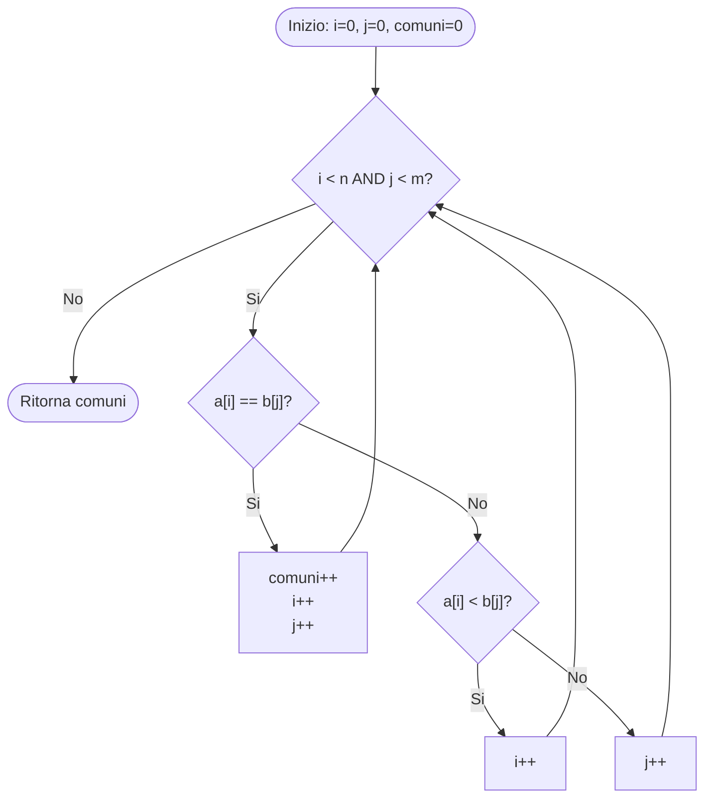

# Algoritmi di ricerca

## Ricerca del massimo in un array

L'algoritmo trova il valore massimo contenuto all'interno di un array di interi non ordinato $v$ di lunghezza $n$.

```c
int max(int[] v) {
    int m = v[0];           // O(1)
    int n = v.length;       // O(1)
    
    for (int i = 1; i < n; i++) { // Si ripete n - 1 volte: Theta(n)
        if (m < v[i]) {
            m = v[i];       // O(1)
        }
    }
    
    return m;               // O(1)
}
```

### Analisi della complessita'

* **Inizializzazione e return:** $O(1)$.
* **Ciclo `for`:** Viene eseguito $n - 1$ volte. Ogni iterazione compie un confronto a costo costante $O(1)$.
* **Complessita' totale:**  

$$T(n) = O(1) + \Theta(n) + O(1) = \Theta(n)$$  

## Ricerca sequenziale (lineare) di un elemento in un array

La ricerca sequenziale permette di determinare l'indice di un valore $v$ all'interno di un array $a$ di dimensione $n$. Non e' richiesta alcuna precondizione sull'ordinamento dell'array.

```c
int ricercaS(int[] a, int v) {
    int pos = -1;           // O(1)
    int i = 0;              // O(1)
    int n = a.length;       // O(1)
    
    while (pos == -1 && i < n) { // Si ripete al piu' n volte: O(n)
        if (a[i] == v) {
            pos = i;
        }
        i = i + 1;
    }
    
    return pos;             // O(1)
}
```

### Analisi della complessita'

* **Caso ottimo:** L'elemento si trova in prima posizione ($a[0] == v$), tempo $O(1)$.
* **Caso pessimo:** L'elemento si trova in ultima posizione oppure non e' presente nell'array. Il ciclo viene eseguito $n$ volte.
* **Complessita' totale nel caso peggiore:**  

$$T(n) = O(1) + O(n) + O(1) = O(n)$$  

## Ricerca binaria

La ricerca binaria richiede come **precondizione fondamentale** che l'array $a$ sia **ordinato** in modo crescente. Ad ogni passo dimezza lo spazio di ricerca confrontando l'elemento cercato $v$ con l'elemento centrale $a[cx]$.

### Versione iterativa

```c
int ricercaB(int[] a, int v) {
    int sx = 0;
    int dx = a.length - 1;
    int pos = -1;
    int cx;
    
    while (sx <= dx && pos == -1) { // Si ripete al piu' log2(n) volte
        cx = (sx + dx) / 2;
        if (a[cx] == v) {
            pos = cx;
        } else if (a[cx] < v) {
            sx = cx + 1;    // Cerca nella meta' destra
        } else {
            dx = cx - 1;    // Cerca nella meta' sinistra
        }
    }
    
    return pos;
}
```

### Analisi della complessita'

Poiche' lo spazio di ricerca dimezza a ogni iterazione del ciclo `while`, il numero massimo di confronti e' proporzionale a $\log_2 n$.  

$$T(n) = O(1) + O(\log n) + O(1) = O(\log n)$$  

### Versione ricorsiva

L'algoritmo ricorsivo riceve anche gli indici estremi del sotto-array da analizzare ($sx$ e $dx$).

```c
int ricercaB(int[] a, int sx, int dx, int v) {
    if (sx > dx) {
        return -1; // Regione vuota, elemento non presente
    }
    
    int cx = (sx + dx) / 2;
    
    if (a[cx] == v) {
        return cx;
    } else if (a[cx] < v) {
        return ricercaB(a, cx + 1, dx, v); // Ricerca nel sotto-array destro
    } else {
        return ricercaB(a, sx, cx - 1, v); // Ricerca nel sotto-array sinistro
    }
}
```

**Prima chiamata sull'intero array:**

```c
int pos = ricercaB(a, 0, a.length - 1, v);
```

### Equazione di ricorrenza  

$$T(n) \le \begin{cases} O(1) & \text{se } n = 0 \text{ (caso base)} \\ T\left(\frac{n}{2}\right) + O(1) & \text{se } n > 0 \end{cases}$$  

La risoluzione dell'equazione di ricorrenza per sostituzione o tramite albero di ricorsione fornisce:  

$$T(n) = O(\log n)$$  

# Algoritmi di ordinamento

## Insertion sort

L'algoritmo **Insertion Sort** costruisce l'array ordinato un elemento alla volta, inserendo l'elemento corrente `key` nella corretta posizione all'interno della porzione di array gia' ordinata a sinistra.

```c
void insertionSort(int[] a) {
    int n = a.length;
    int i, j, key;
    
    for (j = 1; j < n; j++) {
        key = a[j]; // 2
        i = j - 1;
        
        // Sposta gli elementi di a[0...j-1] maggiori di key avanti di una posizione
        while (i >= 0 && key < a[i]) {
            a[i + 1] = a[i];
            i--;
        }
        a[i + 1] = key;
    }
}
```

### Analisi della complessita'

* Il ciclo esterno `for` scorre le posizioni $j$ da $1$ a $n - 1$.
* Il ciclo interno `while` esegue al piu' $j$ iterazioni (spostamenti).
* Usando la somma della serie aritmetica:  

$$T(n) = \cancel{O(1)} + \sum_{j=1}^{n-1} O(j) = O\left(\sum_{j=1}^{n-1} j \right) = O\left( \frac{n(n-1)}{2} \right) = O(n^2)$$  

### Proprieta' delle somme nella notazione O-grande

Durante l'analisi della complessita' di cicli annidati si applica la seguente regola per la sommatoria:  

$$\sum_{k \in S} O(f(k)) = O\left( \sum_{k \in S} f(k) \right)$$  

*(valida purche' entrambe le somme convergano)*

## Selection sort

L'algoritmo **Selection Sort** seleziona ripetutamente l'elemento minimo dalla porzione non ordinata dell'array e lo scambia con l'elemento all'inizio della porzione non ordinata.

```c
void selectionSort(int[] a) {
    int n = a.length;
    int i, j, temp, min;
    
    for (j = 0; j < n - 1; j++) {
        min = j; // Indice del minimo nel sotto-array a[j...n-1]
        
        for (i = j + 1; i < n; i++) {
            if (a[i] < a[min]) {
                min = i;
            }
        }
        
        // Scambio dell'elemento minimo trovato con a[j]
        temp = a[min];
        a[min] = a[j];
        a[j] = temp;
    }
}
```

### Analisi della complessita'

* Il ciclo interno viene eseguito $n - j - 1$ volte ad ogni passo del ciclo esterno, ovvero $\Theta(n - j)$ iterazioni.
* Sommando su tutte le iterazioni del ciclo esterno $j$ da $0$ a $n - 2$:  

$$T(n) = O(1) + \sum_{j=0}^{n-2} \Theta(n - j) = \Theta\left( \sum_{j=0}^{n-2} (n - j) \right) = \Theta\left( \sum_{k=2}^{n} k \right) = \Theta(n^2)$$  

# Esercizi di verifica e ottimizzazione

## Conteggio di 0 e 1 in array ordinato


Progettare un algoritmo efficiente per determinare se un array ordinato di $n$ interi, contenente **solo 0 e 1**, contiene piu' 0 che 1. Analizzare la complessita'.

### Intuizione e soluzione

Poiche' l'array e' gia' ordinato e contiene solo valori 0 e 1, tutti gli 0 si trovano nella prima parte dell'array e tutti gli 1 nella seconda.

Per verificare se il numero di 0 e' strettamente maggiore del numero di 1:

* Se l'elemento situato esattamente a meta' dell'array e' 0, poiche' l'array e' ordinato, tutti gli elementi precedenti sono anch'essi 0. Di conseguenza, gli 0 costituiscono la maggioranza.
* L'accesso alla posizione centrale dell'array si effettua in tempo costante.

### Struttura dell'array

```
Se n e' pari (es. n=6):
Indici:  0    1    2    3    4    5
Array:  [0  | 0  | 0  | 1  | 1  | 1]
                 ^ meta' (n/2 - 1 oppure n/2)

Se n e' dispari (es. n=5):
Indici:  0    1    2    3    4
Array:  [0  | 0  | 0  | 1  | 1]
                 ^ meta' ((n-1)/2)
```

```c
boolean piuZeroCheUno(int[] a) {
    int n = a.length;
    // Se l'elemento alla meta' inferiore dell'array e' 0, gli 0 sono la maggioranza
    return a[(n - 1) / 2] == 0;
}
```

### Complessita'

L'algoritmo effettua un unico controllo in posizione fissa:  

$$T(n) = O(1)$$  

## Trova # di elementi comuni tra due array


Dati due array $a$ e $b$ di dimensione $n$ e $m$ di interi distinti, determinare il numero di elementi comuni.

### Caso 1: Entrambi gli array NON ordinati

#### Soluzione

Per ogni elemento di $a$, si effettua una ricerca sequenziale all'interno dell'array $b$.

```c
int comuni(int[] a, int[] b) {
    int n = a.length;
    int m = b.length;
    int comuni = 0;
    
    for (int i = 0; i < n; i++) {
        // Cerco a[i] in b con ricerca sequenziale: O(m)
        if (ricercaS(b, a[i]) != -1) {
            comuni++;
        }
    }
    
    return comuni;
}
```

#### Complessita'

Il ciclo esterno si ripete $n$ volte. Ogni ricerca sequenziale in $b$ costa $O(m)$.  

$$T(n, m) = \Theta(n \cdot m)$$  

### Caso 2: Array $a$ NON ordinato, array $b$ ORDINATO

#### Soluzione

Poiche' l'array $b$ e' ordinato, per ogni elemento di $a$ possiamo applicare la ricerca binaria `ricercaB` su $b$.

```c
int comuni(int[] a, int[] b) { // b e' ordinato
    int n = a.length;
    int m = b.length;
    int comuni = 0;
    
    for (int i = 0; i < n; i++) {
        // Cerco a[i] in b tramite ricerca binaria: O(log m)
        if (ricercaB(b, a[i]) != -1) {
            comuni++;
        }
    }
    
    return comuni;
}
```

#### Complessita'

Il ciclo si ripete $n$ volte e ogni ricerca binaria su $b$ ha costo $O(\log m)$.  

$$T(n, m) = O(n \log m)$$  

## Trova # di elementi comuni tra due array ordinati


Dati due array ordinati $a$ e $b$ di dimensione $n$ e $m$ contenenti interi distinti, determinare il numero di elementi comuni in modo ottimale.

### Soluzione (Tecnica dei due puntatori)

Sfruttando l'ordinamento di entrambi gli array, e' possibile scandire $a$ e $b$ in un'unica passata sequenziale mantenendo due indici $i$ e $j$.

### Diagramma della logica dei due puntatori



```c
int comuni(int[] a, int[] b) { // a e b entrambi ordinati
    int n = a.length;
    int m = b.length;
    int i = 0;
    int j = 0;
    int comuni = 0;
    
    while (i < n && j < m) {
        if (a[i] == b[j]) {
            comuni++;
            i++;
            j++;
        } else if (a[i] < b[j]) {
            i++;
        } else { // a[i] > b[j]
            j++;
        }
    }
    
    return comuni;
}
```

### Analisi della complessita'

* Ad ogni iterazione del ciclo `while` viene incrementato almeno uno dei due indici ($i$ o $j$).
* Il ciclo termina quando uno dei due array e' stato interamente esaminato.
* Il ciclo si ripete al piu' $n + m$ volte.  

$$T(n, m) = O(n + m)$$  

* **Caso migliore:** $O(\min(n, m))$ (quando tutti gli elementi di un array sono minori del primo elemento dell'altro).
* **Caso peggiore:** $O(n + m)$.

## Ricerca di una coppia con somma pari a $k$


Dato un array ordinato $a$ di $n$ interi positivi, verificare se esistono nell'array due elementi in posizioni distinte $a[i]$ e $a[j]$ ($i \neq j$) tali che:  

$$a[i] + a[j] = k$$  

### Soluzione

Per ogni elemento $a[i]$ dell'array (con $0 \le i \le n - 2$), cerchiamo l'elemento complementare $k - a[i]$ nella restante porzione di array $a[i+1 \dots n-1]$ sfruttando la ricerca binaria.

```c
boolean sommaK(int[] a, int k) {
    int n = a.length;
    
    for (int i = 0; i < n - 1; i++) {
        // Cerco il valore (k - a[i]) nel sotto-array a[i+1 ... n-1]
        if (ricercaB(a, i + 1, n - 1, k - a[i]) != -1) {
            return true; // Coppia trovata
        }
    }
    
    return false; // Nessuna coppia trovata
}
```

### Analisi della complessita'

* Il ciclo esterno viene eseguito al piu' $n - 1$ volte ($O(n)$).
* Ad ogni passo, la ricerca binaria su un sotto-array di dimensione $\le n$ richiede tempo $O(\log n)$.
* Complessita' temporale complessiva:  

$$T(n) = O(n \log n)$$  
