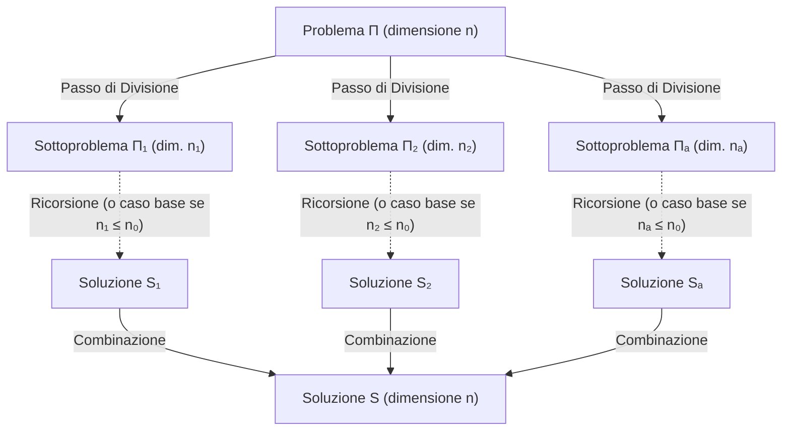
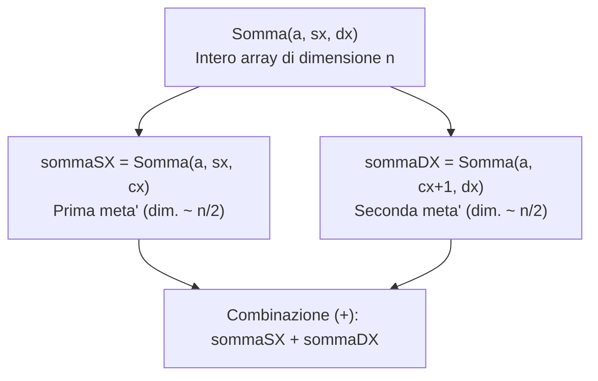

# Esempi di valutazione della complessita'

## Ricerca di una coppia con somma k

Dato un array $a$ di $n$ interi ($n = a.\text{length}$) e un intero $k$, il problema consiste nel trovare due indici $i, j$ tali che:  

$$0 \le i < j < n \quad \text{e} \quad a[i] + a[j] = k$$  

Se la coppia non esiste, l'algoritmo deve restituire `<-1, -1>`.

### Caso 1: array non ordinato

Se l'array non ha alcun ordinamento garantito, l'unica strategia sicura e' confrontare tutte le possibili coppie di elementi distinti tramite due cicli annidati.

```c
// Pseudo-codice

// Restituisce una coppia di interi <i, j> oppure <-1, -1>
CercaCoppia(int[] a, int k) {
    int n = a.length;
    for (int i = 0; i < n - 1; i++) {
        for (int j = i + 1; j < n; j++) {
            if (a[i] + a[j] == k) {
                return <i, j>; // Interrompe la scansione appena trova la coppia
            }
        }
    }
    return <-1, -1>; // Coppia non trovata
}
```

* **Costo in tempo:** $T(n) = O(n^2)$ nel caso pessimo (quando la coppia non esiste o si trova all'ultima iterazione, costringendo a esplorare tutte le $\frac{n(n-1)}{2}$ coppie).

### Caso 2: array ordinato (tecnica dei due puntatori)

Se l'array $a$ e' ordinato (implicitamente *debolmente crescente* oppure *non decrescente*), possiamo sfruttare l'ordinamento per ridurre drasticamente il numero di confronti usando due indici (puntatori) che partono dagli estremi opposti dell'array: `i = 0` (inizio) e `j = a.length - 1` (fine).

```c
// Prerequisito: l'array 'a' e' ordinato
CercaCoppiaOrdinato(int[] a, int k) {
    int i = 0;
    int j = a.length - 1;
    int somma;
    
    while (i < j) {
        somma = a[i] + a[j];
        if (somma == k) {
            return <i, j>;
        } else if (somma < k) {
            i++; // Serve una somma piu' grande, avanzo a sinistra
        } else {
            j--; // Serve una somma piu' piccola, arretro a destra
        }
    }
    return <-1, -1>;
}
```

#### Analisi e invariante di ciclo

* **Complessita' temporale:** $T(n) = O(n)$. A ogni iterazione del `while` la distanza tra $i$ e $j$ diminuisce di $1$, quindi si eseguono al piu' $n - 1$ iterazioni, ciascuna di costo $O(1)$.
* **Invariante di ciclo:** All'inizio di ogni iterazione del ciclo `while (i < j)`, non esiste alcuna coppia valida che coinvolga gli elementi gia' scartati alle estremita'. Formalmente:  

  $$\forall i_0 : 0 \le i_0 < i \quad \text{e} \quad \forall j_0 : j < j_0 < n$$  
  $$\quad a[i_0] + a[j_0] \neq k$$  

>**Nota:** La dimostrazione non e' banale e non verra' affrontata.

---

## Altri esempi di valutazione della complessita'

Analizziamo alcuni esercizi sulla determinazione del costo al **caso pessimo** e al **caso ottimo** al crescere di $n$.

### Esercizio: Algoritmo 1

```c
Algoritmo1(int[] a) {
    int n = a.length;           // O(1)
    if (n >= 1) {
        if (a[0] % 2 == 0) {
            InsertionSort(a);   // Caso ottimo: O(n), Caso pessimo: O(n^2)
        } else {
            int u = RicercaBinaria(a, 0, n - 1, 3); // O(log n)
        }
    }
}
```

* **Costo al caso pessimo:** $T(n) = O(n^2)$
  * *Quando si verifica:* quando $n \ge 1$, il primo elemento `a[0]` e' pari (quindi entra nel ramo `if` ed esegue `InsertionSort`) e l'array `a` e' ordinato in senso inverso (decrescente), costringendo l'Insertion Sort al suo caso peggiore.
* **Costo al caso ottimo:** $T(n) = O(1)$
  * *Quando si verifica:* quando l'array e' vuoto ($n = 0$, l'if esterno e' falso e termina subito), oppure quando `a[0]` e' dispari e l'elemento `3` si trova esattamente al centro dell'array (la ricerca binaria lo trova al primo confronto in tempo $O(1)$).

### Esercizio: Algoritmo 2

```c
Algoritmo2(int[] a) {
    int n = a.length;               // O(1)
    if (n >= 3) {
        if (a[n - 1] % 3 == 1) {
            return RicercaBinaria(a, 0, n - 1, 2); // O(log n)
        } else {
            return a[2];            // O(1)
        }
    }
    return 0;                       // O(1)
}
```

* **Costo al caso pessimo:** $T(n) = O(\log n)$
  * *Quando si verifica:* quando $n \ge 3$, l'ultimo elemento soddisfa `a[n - 1] % 3 == 1` e il valore `2` non e' presente nell'array `a` (ricerca senza successo, che richiede di dimezzare l'array fino in fondo).
* **Costo al caso ottimo:** $T(n) = O(1)$
  * *Quando si verifica:* quando $n < 3$, oppure quando $n \ge 3$ e `a[n - 1] % 3 != 1` (esegue il ramo `else` accedendo direttamente a `a[2]` in tempo costante).

### Esercizio A: Algoritmi iterativi (`ALGO1`)

```c
int ALGO1(int[] A) {
    int n = A.length;                       // 1: O(1)
    bool flag = true;                       // 2: O(1)
    int i, j, h, val;                       // 3: O(1)
    i := 0;                                 // 4: O(1)
    while (flag && (i < n - 1)) {           // 5: fino a n-1 iterazioni
        if (A[i] > A[i + 1]) { flag = false; } // 6
        else { i++; }                       // 7
    }                                       // 8
    if (flag) { h := RicercaBinaria(A, 0, n - 1, 3); } // 9: O(log n)
    else { SelectionSort(A); }              // 10: Theta(n^2)
    val := A[0];                            // 11: O(1)
    for (j := 1; j < n; j++) {              // 12: Theta(n)
        if (A[j] < val) { val := A[j]; }    // 13
    }                                       // 14
    return val;                             // 15: O(1)
}
```

#### Soluzioni ai quesiti

* **A. Significato di `flag` e `val`:**
  * Dopo il `while`, il booleano `flag` vale `true` **se e solo se** l'array `A` e' gia' ordinato in ordine non decrescente (infatti diventa `false` non appena trova una coppia adiacente fuori ordine $A[i] > A[i+1]$).
  * Dopo il ciclo `for` finale, `val` corrisponde al **valore minimo** contenuto nell'array `A`, poiche' viene inizializzato a `A[0]` e aggiornato ogni volta che si incontra un elemento strettamente minore.
* **B. Complessita' al caso ottimo:** $\Theta(n)$ (lineare)
  * *Condizioni:* si verifica quando l'array `A` in input e' **gia' ordinato**. In questo caso il `while` iniziale scorre tutto l'array in $\Theta(n)$, `flag` resta `true`, viene eseguita la `RicercaBinaria` in $O(\log n)$ e infine il `for` impiega $\Theta(n)$. Il termine dominante e' lineare: $\Theta(n) + O(\log n) + \Theta(n) = \Theta(n)$.
* **C. Complessita' al caso pessimo:** $\Theta(n^2)$ (quadratica)
  * *Condizioni:* si verifica quando l'array `A` in input **non e' ordinato** (ad esempio con la prima inversione subito all'inizio, $A[0] > A[1]$). Il `while` si arresta subito in $\Theta(1)$, `flag` diventa `false` ed entra nel ramo `else` eseguendo `SelectionSort(A)`, che ha costo $\Theta(n^2)$ in ogni caso.
* **D. Ottimizzazione delle righe 11-15:**
  1. Il frammento dalle righe 11 a 15 ha complessita' $\Theta(n)$ perche' il ciclo `for` esegue sempre $n - 1$ confronti indipendentemente dai dati.
  2. Poiche' alla riga 11 l'array `A` e' **sicuramente ordinato** in senso non decrescente (o lo era gia' in partenza se `flag == true`, oppure e' appena stato ordinato da `SelectionSort` se `flag == false`), il minimo si trova certamente in prima posizione. Possiamo quindi sostituire le righe 11-15 con l'unica istruzione `return A[0];`, riducendo la complessita' di quel blocco da $\Theta(n)$ a $\Theta(1)$.

---

# Metodo Divide et Impera

Il **Divide et Impera** (dividi e conquista) e' una tecnica di progettazione algoritmica ricorsiva. Dato un problema $\Pi$ su un'istanza di dimensione $n$, l'approccio si articola in tre fasi fondamentali:

1. **Divisione (Divide):** si suddivide l'istanza del problema $\Pi$ di dimensione $n$ in $a$ sottoproblemi $\Pi_1, \Pi_2, \dots, \Pi_a$ dello stesso tipo, ma su istanze di dimensione strettamente minore ($n_i < n$ per ogni $1 \le i \le a$).
2. **Ricorsione (Impera):** si risolvono i sottoproblemi ricorsivamente con la stessa tecnica. Se la dimensione di un sottoproblema e' sufficientemente piccola ($n_i \le n_0$, dove $n_0$ e' una costante), lo si risolve direttamente tramite il **caso base** senza ulteriori chiamate ricorsive.
3. **Combinazione (Combina):** si combinano le soluzioni parziali $S_1, S_2, \dots, S_a$ dei sottoproblemi per costruire la soluzione $S$ del problema originale $\Pi$.



### Equazione di ricorrenza generale

Il tempo di esecuzione $T(n)$ di un algoritmo Divide et Impera si esprime tramite un'equazione di ricorrenza:  

$$T(n) = \begin{cases} O(1) & \text{se } n \le n_0 \\ D(n) + T(n_1) + T(n_2) + \dots + T(n_a) + C(n) & \text{se } n > n_0 \end{cases}$$  

Dove:
* $O(1)$ e' il costo costante richiesto dalla soluzione diretta del sottoproblema elementare (caso base).
* $D(n)$ e' il costo della fase di divisione di $\Pi$ in sottoproblemi.
* $T(n_1) + \dots + T(n_a)$ e' il costo totale delle chiamate ricorsive.
* $C(n)$ e' il costo della fase di combinazione delle soluzioni.

### Caso particolare: sottoproblemi di uguale dimensione

Molto spesso il problema $\Pi$ viene diviso in $a$ sottoproblemi tutti della **stessa dimensione** $\frac{n}{b}$. In questo caso l'equazione di ricorrenza diventa:  

$$T(n) = \begin{cases} O(1) & \text{se } n \le n_0 \\ a T\left(\frac{n}{b}\right) + f(n) & \text{se } n > n_0 \end{cases}$$  

* **Condizione fondamentale:** affinche' la ricorsione termini riducendo la dimensione del problema, deve valere $\frac{n}{b} < n$, il che implica **$b > 1$**.
* $a T\left(\frac{n}{b}\right)$ rappresenta il lavoro svolto nelle chiamate ricorsive.
* $f(n) = D(n) + C(n)$ raggruppa il costo di tutte le operazioni svolte **al di fuori della ricorsione** (divisione + combinazione).

---

## Esempi di algoritmi Divide et Impera

### Ricerca binaria ricorsiva

Dato un array ordinato $a$, cerchiamo l'indice del valore $v$ nella porzione delimitata da `sx` e `dx`.

```c
// Chiamata iniziale sull'intero array: RicercaBinRic(a, v, 0, a.length - 1)
int RicercaBinRic(int[] a, int v, int sx, int dx) {
    if (sx > dx) {
        return -1; // Caso base: porzione vuota, elemento non trovato
    }
    
    // DIVISIONE: calcolo l'indice centrale in O(1)
    int cx = (sx + dx) / 2;
    
    // RICORSIONE: eseguo UNA sola chiamata ricorsiva grazie all'if-else
    if (a[cx] == v) {
        return cx;
    } else if (a[cx] < v) {
        return RicercaBinRic(a, v, cx + 1, dx);
    } else { // v < a[cx]
        return RicercaBinRic(a, v, sx, cx - 1);
    }
    // COMBINAZIONE: vuota in questo caso, C(n) = O(1)
}
```

#### Analisi della ricorrenza

* **Divisione:** $D(n) = O(1)$ (calcolo di `cx` e confronto).
* **Numero di sottoproblemi:** $a = 1$ (nonostante l'array sia diviso in due meta', l'`if` sceglie solo una delle due meta' da esplorare).
* **Fattore di riduzione:** $b = 2$ (la dimensione si dimezza a ogni chiamata).
* **Combinazione:** $C(n) = O(1)$ (nessun lavoro da fare al ritorno della ricorsione, il risultato viene semplicemente restituito).

L'equazione di ricorrenza e' quindi:  

$$T(n) = \begin{cases} O(1) & \text{se } n = 0 \\ T\left(\frac{n}{2}\right) + O(1) & \text{se } n > 0 \end{cases}$$  

> **Nota:** La soluzione di questa ricorrenza porta a $T(n) = O(\log n)$.

### Esercizio 1: somma di n interi in un array

Progettare un algoritmo Divide et Impera per calcolare la somma degli $n$ elementi di un array $a$ nell'intervallo `[sx, dx]`, dove $n = dx - sx + 1$.

```c
// Chiamata iniziale: Somma(a, 0, a.length - 1)
int Somma(int[] a, int sx, int dx) {
    // CASO BASE
    if (sx > dx) {
        return 0;       // Array vuoto (n = 0)
    }
    if (sx == dx) {
        return a[sx];   // Un solo elemento (n = 1)
    }
    
    // Se ci sono almeno 2 elementi (n > 1):
    // 1. DIVISIONE: O(1)
    int cx = (sx + dx) / 2;
    
    // 2. RICORSIONE: due chiamate su meta' array
    int sommaSX = Somma(a, sx, cx);       // Costo T(n/2)
    int sommaDX = Somma(a, cx + 1, dx);   // Costo T(n/2)
    
    // 3. COMBINAZIONE: somma dei due risultati parziali, O(1)
    return sommaSX + sommaDX;
}
```

#### Visualizzazione della suddivisione



#### Analisi della ricorrenza

* **Caso base ($n \le 1$):** restituisce `0` o `a[sx]` in tempo costante $O(1)$.
* **Divisione:** $D(n) = O(1)$ (calcolo dell'indice medio `cx`).
* **Ricorsione:** si generano $a = 2$ sottoproblemi, ciascuno di dimensione $n/2$ ($b = 2$), per un costo di $2T\left(\frac{n}{2}\right)$.
* **Combinazione:** $C(n) = O(1)$ (una singola addizione `sommaSX + sommaDX`).

L'equazione di ricorrenza che descrive l'algoritmo e':  

$$T(n) = \begin{cases} O(1) & \text{se } n \le 1 \\ 2T\left(\frac{n}{2}\right) + O(1) & \text{se } n > 1 \end{cases}$$  