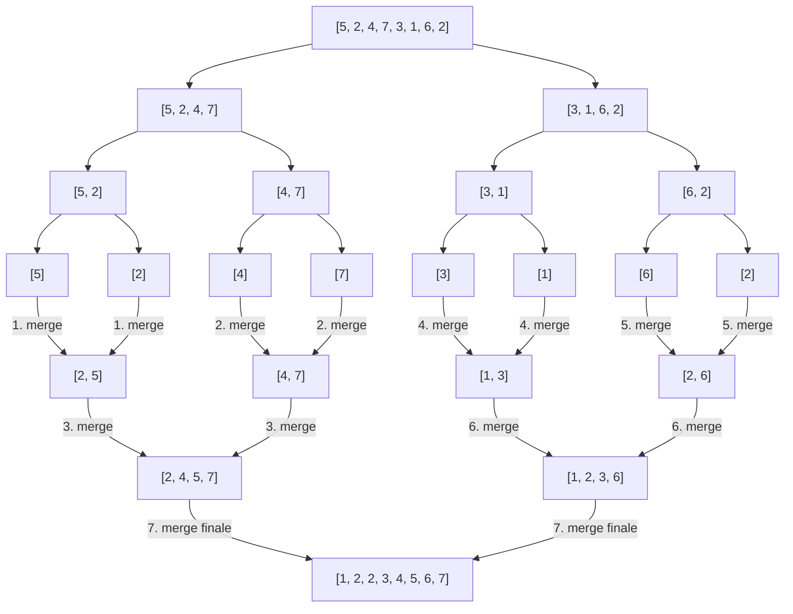

# Algoritmi di ordinamento per confronti

Gli algoritmi di ordinamento per confronti ordinano gli elementi di input usando **solo confronti** tra di essi, senza operazioni aritmetiche, logiche o altro.

* **Operazione dominante:** il confronto tra due elementi.
* **Costo in tempo:** proporzionale al numero di confronti effettuati ($C(n)$).

## Riepilogo complessita' algoritmi elementari

### Insertion sort
* **Caso ottimo:** $C(n) = n - 1 \in \Theta(n)$ (array gia' ordinato)
* **Caso medio:** $C(n) \simeq \frac{1}{2}\binom{n}{2} \in \Theta(n^2)$
* **Caso pessimo:** $C(n) = \frac{n(n-1)}{2} = \binom{n}{2} \in \Theta(n^2)$
* **Costo in spazio:** $S(n) = O(1)$ (ordina *in loco*)
  
In generale $T(n) = O(n^2)$

### Selection sort
* **Caso ottimo, medio e pessimo:** $C(n) = \frac{n(n-1)}{2} = \binom{n}{2} \in \Theta(n^2)$
* **Costo in spazio:** $S(n) = O(1)$ (ordina *in loco*)

In generale $T(n) = \Theta(n^2)$ (fa sempre tutti i confronti possibili).

# Merge sort

Algoritmi avanzati come **Merge Sort** richiedono $O(n \log n)$ confronti: questo e' il meglio che si possa sperare di ottenere in un modello basato su confronti. La differenza di crescita al variare della dimensione dell'input $n$ e' enorme:

| Dimensione $n$ | $10$ | $100$ | $1000$ | $10^6$ | $10^9$ |
| :--- | :--- | :--- | :--- | :--- | :--- |
| **$n \log n$** | $\sim 33$ | $665$ | $10^4$ | $\sim 2 \cdot 10^7$ | $\sim 10^{10}$ |
| **$n^2$** | $100$ | $10^4$ | $10^6$ | $10^{12}$ | $10^{18}$ |

Ideato da Von Neumann (1945), si basa sul paradigma **Divide et Impera** per ordinare un array $A$ di $n$ elementi:

1. **Caso base:** se $n < 2$, l'array e' gia' ordinato.
2. **Divisione:** si divide a meta' la sequenza da ordinare (due sottosequenze di dimensione $n/2$).
3. **Ricorsione:** si ordinano ricorsivamente le due sottosequenze.
4. **Combinazione (Merge):** si fondono le due sottosequenze ordinate in un'unica sequenza ordinata.

## Esempio visivo di esecuzione



### Implementazione in TypeScript

Per ordinare l'intero array $A$, si invoca `mergeSort(A, 0, A.length - 1)`.

```typescript
function mergeSort(A: number[], p: number, r: number): void {
    // Caso base: se p >= r la sottosequenza ha <= 1 elementi
    if (p < r) {
        // Divisione: q e' la posizione centrale del segmento A[p...r]
        const q = Math.floor((p + r) / 2);
        
        // Ricorsione
        mergeSort(A, p, q);
        mergeSort(A, q + 1, r);
        
        // Combinazione
        merge(A, p, q, r);
    }
}
```

## La procedura merge

La funzione `merge(A, p, q, r)` fonde due sottoarray adiacenti e gia' ordinati: $A[p \dots q]$ e $A[q+1 \dots r]$, per un totale di $n = r - p + 1$ elementi.

* Utilizza due array di appoggio $L$ (di dimensione $n_L = q - p + 1$) e $R$ (di dimensione $n_R = r - q$), dove $n = n_L + n_R$.
* Scorre $L$ e $R$ copiando ogni volta l'elemento minore in $A$.
* Quando uno dei due array di appoggio termina, copia i restanti elementi dell'altro array in coda ad $A[p \dots r]$.

```typescript
function merge(A: number[], p: number, q: number, r: number): void {
    const nL = q - p + 1; // Dimensione di A[p...q]
    const nR = r - q;     // Dimensione di A[q+1...r]

    // Due array di appoggio: L e R -> Tempo O(1)
    const L: number[] = new Array(nL);
    const R: number[] = new Array(nR);

    // Copia A[p...q] in L -> Tempo Theta(nL)
    for (let i = 0; i < nL; i++) {
        L[i] = A[p + i];
    }
    // Copia A[q+1...r] in R -> Tempo Theta(nR)
    for (let j = 0; j < nR; j++) {
        R[j] = A[q + 1 + j];
    }

    let i = 0; // Indice che scorre L
    let j = 0; // Indice che scorre R
    let k = p; // Indice che scorre A[p...r]

    // Finche' ci sono elementi da prendere in entrambi L e R
    while (i < nL && j < nR) {
        if (L[i] <= R[j]) {
            A[k] = L[i];
            i++;
        } else {
            A[k] = R[j];
            j++;
        }
        k++;
    }

    // Copia eventuali elementi rimasti in L o in R alla fine di A[p...r]
    while (i < nL) {
        A[k] = L[i];
        i++;
        k++;
    }
    while (j < nR) {
        A[k] = R[j];
        j++;
        k++;
    }
}
```

### Analisi di complessita' di merge

* **Tempo:** ogni iterazione dei cicli `while` copia esattamente un elemento in $A$, per un totale di $n_L + n_R = n$ elementi copiati.  
$$T(n) = O(1) + \Theta(n_L) + \Theta(n_R) + \Theta(n_L + n_R) = \Theta(n) \text{ (lineare)}$$  
* **Spazio:** usa gli array di appoggio $L$ e $R$, quindi $S(n) = \Theta(n)$ (non ordina *in loco*).

# Correttezza di `mergeSort`

Per dimostrare la correttezza di `mergeSort` dobbiamo dimostrare anche la correttezza di `merge`...   

## Correttezza di `mergeSort` (induzione generalizzata)
Si dimostra per induzione sulla dimensione $n$ dell'array $A$:

1. **Caso base ($n = 0$ o $n = 1$):** $A$ e' gia' ordinato, `mergeSort` non fa nulla ed e' corretto.
2. **Ipotesi induttiva:** `mergeSort` e' corretto su ogni array di $k < n$ elementi.
3. **Passo induttivo:** per ipotesi induttiva, dopo le due chiamate ricorsive i sottoarray $A[p \dots q]$ e $A[q+1 \dots r]$ sono ordinati (poiche' hanno dimensione $\approx n/2 < n$). Per la correttezza della funzione `merge`, dopo la fusione l'intero segmento $A[p \dots r]$ risulta ordinato.

## Correttezza di `merge` (invariante di ciclo)
Si dimostra tramite il seguente **invariante di ciclo** sul primo ciclo `while`:
> *All'inizio di ogni iterazione, il sottoarray $A[p \dots k-1]$ e' ordinato e contiene i $k - p$ ($= i + j$) elementi piu' piccoli di $L$ e $R$. Inoltre, $L[i]$ e $R[j]$ sono gli elementi piu' piccoli di $L$ e $R$ non ancora copiati in $A$.*

(Per la dimostrazione formale completa si rimanda al testo *Cormen*).

# Equazioni di ricorrenza

## Ricorrenza di `mergeSort`

Analizzando i costi delle singole righe di `mergeSort`:
* Divisione (`q = ...`): $O(1)$
* Chiamate ricorsive: $T(\lceil n/2 \rceil) + T(\lfloor n/2 \rfloor)$
* Combinazione (`merge`): $\Theta(n)$  

$$T(n) = \begin{cases} O(1) & n \le 1 \\ T(\lceil n/2 \rceil) + T(\lfloor n/2 \rfloor) + \Theta(n) & n > 1 \end{cases}$$  

Trascurando i dettagli tecnici (arrotondamenti $\lceil \cdot \rceil, \lfloor \cdot \rfloor$), otteniamo la **ricorrenza semplificata**:

$$T(n) = \begin{cases} O(1) & n \le 1 \\ 2T(n/2) + \Theta(n) & n > 1 \end{cases}$$  

Prima di risolvere questa equazione di ricorrenza, vediamo alcune equazioni piu' semplici... 

## Esempio 1: ricerca binaria (metodo di sostituzione)

La ricorrenza che esprime il costo in tempo della ricerca binaria e':  

$$T(n) \le \begin{cases} c & n = 0 \\ T(n/2) + c & n > 0 \end{cases}$$  

Dove $c = O(n)$ (tempo costante). Svolgiamo per sostituzioni successive per $n \gt 0$:  

$$\begin{aligned}
T(n) &\le T\left(\frac{n}{2}\right) + c \\
&\le \bigg( T\left(\frac{n}{4}\right) + c \bigg) + c = T\left(\frac{n}{2^2}\right) + 2c \\
&\le \bigg( T\left(\frac{n}{8}\right) + c \bigg) + 2c = T\left(\frac{n}{2^3}\right) + 3c \\
&\dots \\
&\le T\left(\frac{n}{2^i}\right) + i \cdot c
\end{aligned}$$

Poiche' si usa la divisione intera, la ricorsione termina al caso base $T(0)$ quando $\frac{n}{2^i} < 1$, ovvero per $i = \log_2 n + 1$ (infatti $\frac{n}{2^{\log_2 n + 1}} = \frac{n}{2n} = 0$ in divisione intera). Sostituendo $i$:  

$$T(n) \le T(0) + (\log_2 n + 1)c = c _0+ c \log_2 n + c \implies T(n) = O(\log n)$$  

## Esempio 2: somma elementi con divide et impera

Calcoliamo la somma degli elementi di un array $A$ dividendo a meta' il problema:

```typescript
function somma(A: number[], p: number, r: number): number {
    if (p === r) return A[p];
    if (p > r) return 0;
    
    const q = Math.floor((p + r) / 2);
    return somma(A, p, q) + somma(A, q + 1, r);
}
```

La ricorrenza ha tempo costante $c$ sia nel caso base che per le operazioni di divisione e combinazione:

$$T(n) = \begin{cases} c & n \le 1 \\ 2T(n/2) + c & n > 1 \end{cases}$$  

Svolgiamo per sostituzioni successive:

$$\begin{aligned}
T(n) &= 2T\left(\frac{n}{2}\right) + c \\
&= 2\left(2T\left(\frac{n}{4}\right) + c\right) + c = 4T\left(\frac{n}{4}\right) + 3c \\
&= 4\left(2T\left(\frac{n}{8}\right) + c\right) + 3c = 8T\left(\frac{n}{8}\right) + 7c \\
&= \dots = 2^i T\left(\frac{n}{2^i}\right) + (2^i - 1) \cdot c
\end{aligned}$$

Ci fermiamo al caso base quando $\frac{n}{2^i} \le 1 \implies 2^i \ge n \implies i = \log_2 n$. Sostituendo $i = \log_2 n$ (ricordando che $2^{\log_2 n} = n$):  

$$T(n) = n \cdot T(1) + (n - 1) \cdot c = nc + (n - 1)c = O(n)$$  
